Le temps se rafraîchissant, que diriez-vous d’une bonne pizza ? Ça tombe bien, LEGO a sorti pour la ville un petit camion de restauration mobile, que je vous propose donc de voir.

Il s’agit de la boîte _60150_, nommée de façon évidente _Le camion pizza_. Sorti en 2017, ce petit modèle comporte 249 pièces et coûte 19,99 €, soit un ratio de 8 centimes par pièce.

* * *

Comme indiqué, cette boîte se rattache à la gamme CITY, donc ce logo est présent sur la face avant. L’ensemble comporte deux figurines, un chef cuisinier ici lançant une pizza, et une cliente qui déguste une part. Cette part est une pièce en quart de cercle typographiée, modèle récent me semble-t-il. Sur un scooter on aperçoit une boîte de pizza, livraison ou à emporter.

[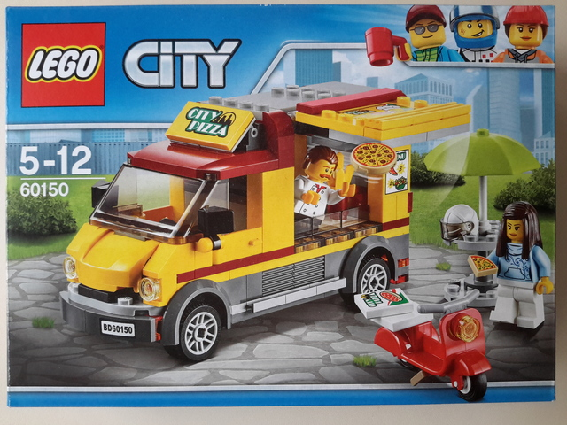](https://www.freelug.org/IMG/jpg/20180617_115313.jpg)

Au dos de la boîte, le camion est présenté côtés fermés, en mouvement. Une vignette indique que ceux-ci peuvent se lever. Sur une autre le chef sort ou met une pizza au four, tandis que les trois autres vignettes montrent l’interaction avec la cliente, qui se déplace en scooter. On aperçoit un magnifique cornet de frites.

[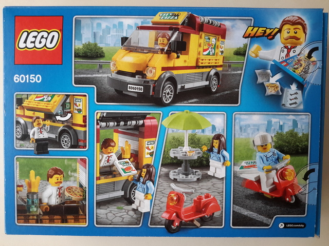](https://www.freelug.org/IMG/jpg/20180617_115330.jpg)

La tranche montre le chef en taille réelle, et un échange avec la cliente.

[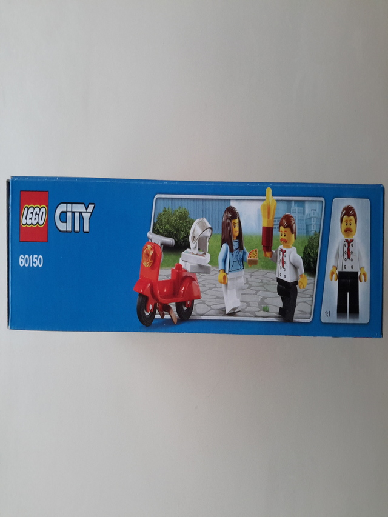](https://www.freelug.org/IMG/jpg/20180617_115400.jpg)

* * *

Dans la boîte, deux sachets, deux notices, et une plaque d’autocollants. Ceux-ci incluent les menus et décorations latérales du camion, ainsi que la bannière avant et les plaques d’immatriculation, et le dessus de la boîte à pizza.

[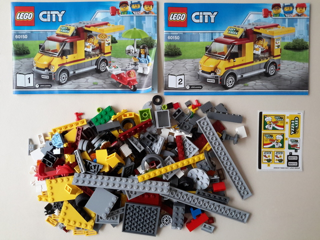](https://www.freelug.org/IMG/jpg/20180617_104221.jpg)

En plus des autocollants il y a quelques pièces sérigraphiées : une pizza entière, un quart de pizza utilisant la pièce récente « quart de cercle », un pavé numérique pour le four, et une caisse enregistreuse (non présente sur la photo). Aucune n’est exclusive à ce set, on les trouve dans des _Friends_, _City_ ou _Super Heroes_.

[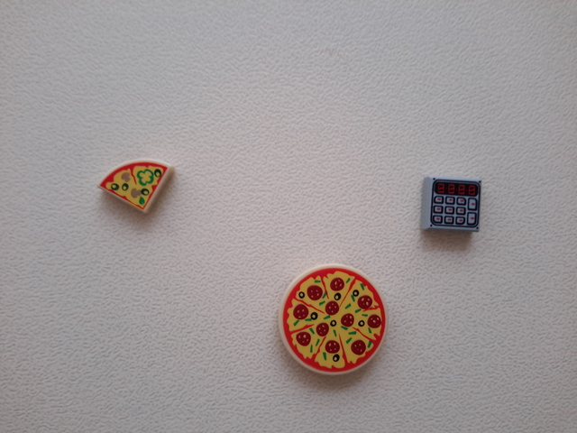](https://www.freelug.org/IMG/jpg/20180617_115010.jpg)

Voici la figurine du chef. Il a un sobre costume blanc à boutons en deux rangées, et une cravate rouge, qui rend bien une idée de chef. Il a une belle moustache et des sourcils marron, en accord avec sa chevelure. Les jambes sont noir uniforme, sans aucune décoration.

[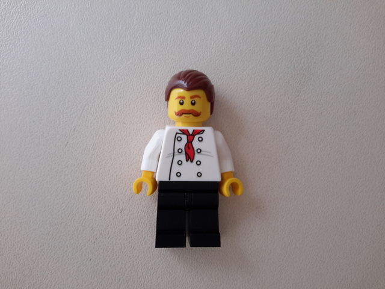](https://www.freelug.org/IMG/jpg/20180617_104519.jpg)

De dos décoration minimale, avec un pli pour la veste et la continuation de la cravate.

[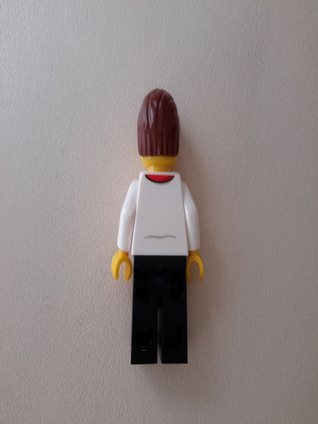](https://www.freelug.org/IMG/jpg/20180617_104530.jpg)

La cliente est une jeune femme à costume bleu pâle, une poche à mains sur le devant, et des cordons blancs autour d’un col tombant. La silhouette est suggérée, comme pour toutes les figurines féminines. La chevelure est abondante, allant sous les épaules. Elle a un petit sourire. Jambes blanches en revanche.

[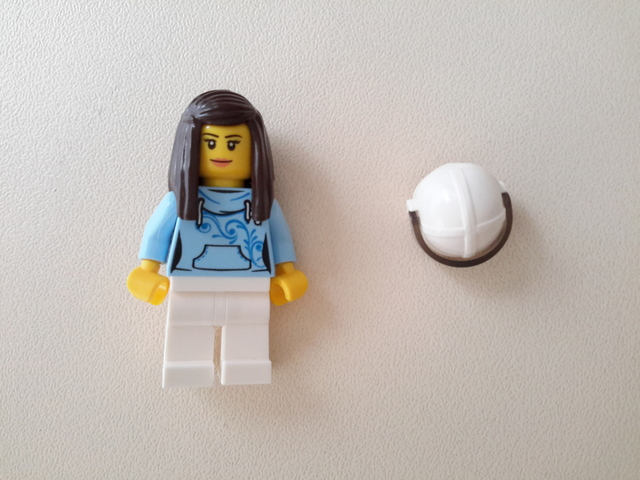](https://www.freelug.org/IMG/jpg/20180617_104543.jpg)

De dos décoration minimale également, juste une petite bande et la suite du col (ici caché par les cheveux).

[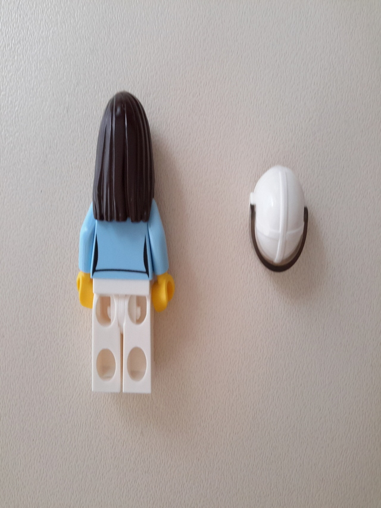](https://www.freelug.org/IMG/jpg/20180617_104552.jpg)

La voici avec son casque de moto — sécurité avant tout !

[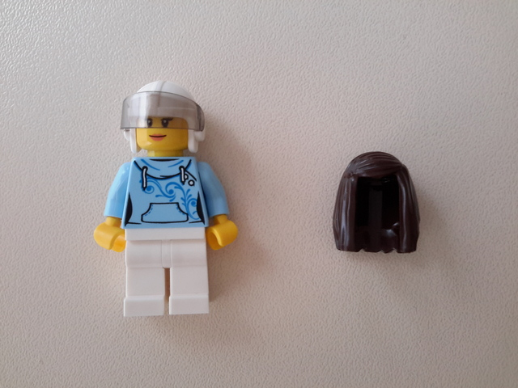](https://www.freelug.org/IMG/jpg/20180617_104623.jpg)

[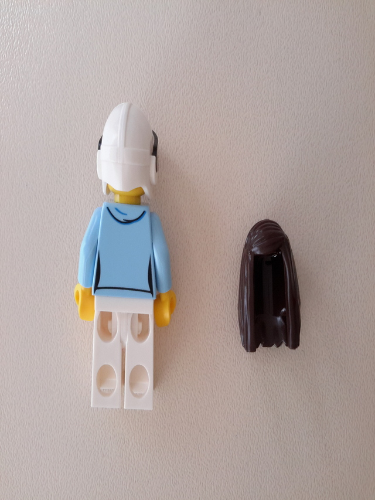](https://www.freelug.org/IMG/jpg/20180617_104645.jpg)

Aucune des figurines n’est exclusive, même si le torse féminin n’apparaît apparemment que dans une autre boîte seulement.

* * *

La construction de la boîte commence par la table à côté du camion. Rien de spécial à dire, deux plaques rondes avec un pied au milieu, et un parasol. Un quart de pizza est posé dessus.

[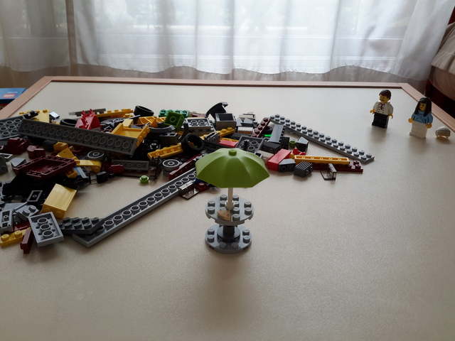](https://www.freelug.org/IMG/jpg/20180617_104918.jpg)

Ensuite on s’attaque au scooter, sur lequel deux boîtes de pizza sont posées, une seule avec un autocollant.

[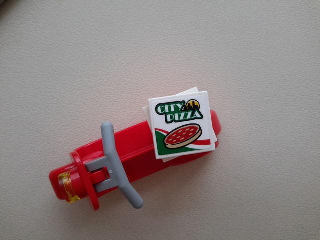](https://www.freelug.org/IMG/jpg/20180617_105607.jpg)

Le scooter est de construction classique, avec une anse de seau dessous pour servir de cale.

[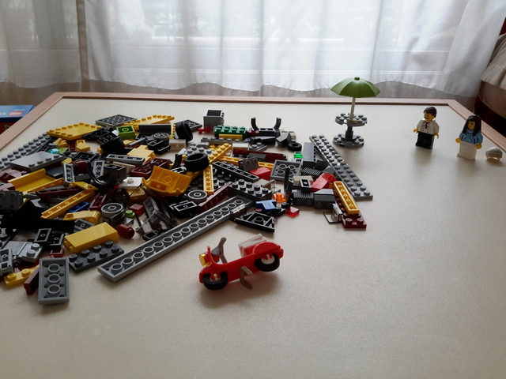](https://www.freelug.org/IMG/jpg/20180617_105702.jpg)

Le camion proprement dit commence par une barre 2x16 que l’on recouvre de plaques en orthogonal. Quelques pièces sont de couleur totalement différente pour bien ressortir durant la construction.

[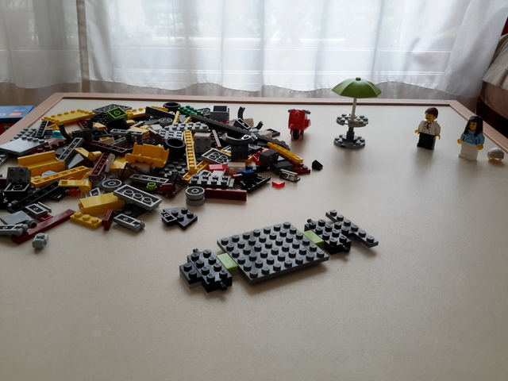](https://www.freelug.org/IMG/jpg/20180617_105905.jpg)

À l’arrière on pose une brique 2x4 gris foncé sur laquelle on met l’autocollant pour la plaque arrière — ok, j’ai raté mon coup, il est de travers...

[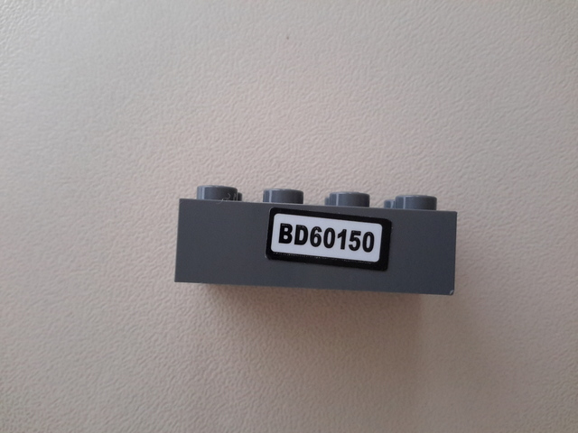](https://www.freelug.org/IMG/jpg/20180617_111746.jpg)

La construction continue en montant la partie cuisine du camion.

[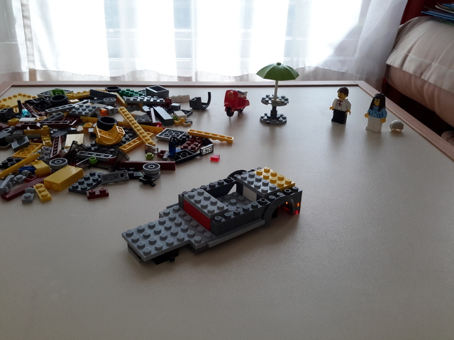](https://www.freelug.org/IMG/jpg/20180617_112008.jpg)

On assemble l’avant, qui comporte également un autocollant de plaque — ici bien droit, ouf —, et on monte l’habitacle pour conduire.

[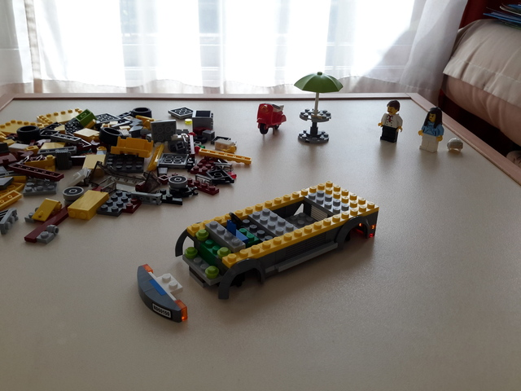](https://www.freelug.org/IMG/jpg/20180617_112353.jpg)

On pose le capot, d’un beau jaune.

[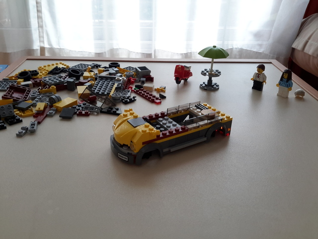](https://www.freelug.org/IMG/jpg/20180617_112812.jpg)

Après quelques autres étapes, voici le résultat. L’emplacement 2x3 qui sépare habitacle et cuisine sera rempli par un four, dont le voyant et panneau de contrôle sont déjà présents. Les angles transparent de chaque côté serviront à arrêter les panneaux latéraux pivotants.

[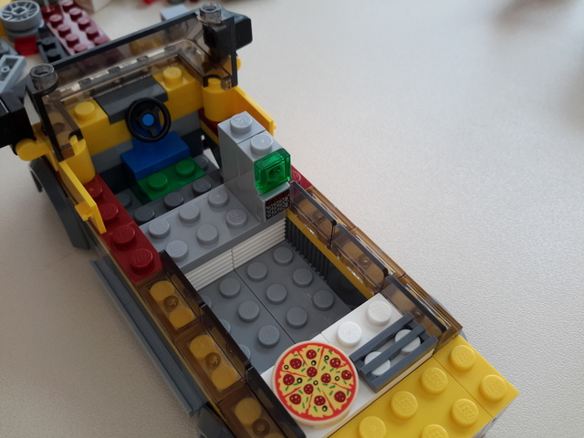](https://www.freelug.org/IMG/jpg/20180617_113053.jpg)

Voici le four, indispensable pour faire une bonne pizza. Il s’agit simplement d’un conteneur 2x3 gris, avec une porte bleu transparent. Mais je trouve son rendu amusant.

[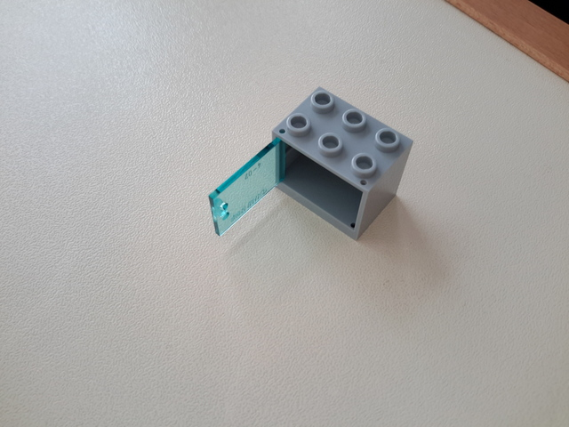](https://www.freelug.org/IMG/jpg/20180617_113131.jpg)

Complément d’une pizza, un cornet de frites (!?! personnellement, je n’aimerais pas trop combiner ces deux-là, mais chacun ses goûts !) et une bouteille de soda

[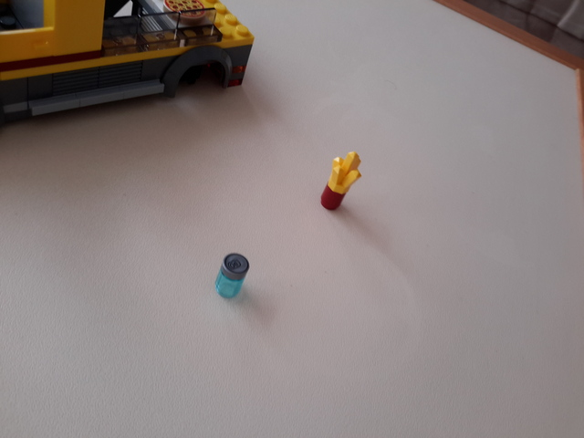](https://www.freelug.org/IMG/jpg/20180617_113318.jpg)

On continue la construction avec la partie arrière de la cuisine, qui présente une caisse enregistreuse, un pot de mayonnaise et un de ketchup. Pour les frites, j’imagine... Sur chaque côté un autocollant montrant le menu, une part de pizza ou une salade — mais rien dans les pièces pour en suggérer une.

[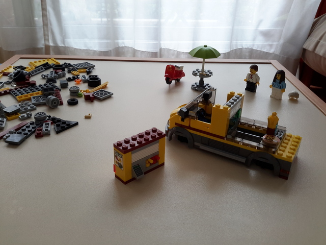](https://www.freelug.org/IMG/jpg/20180617_113754.jpg)

Voici le rendu vu du dessus.

[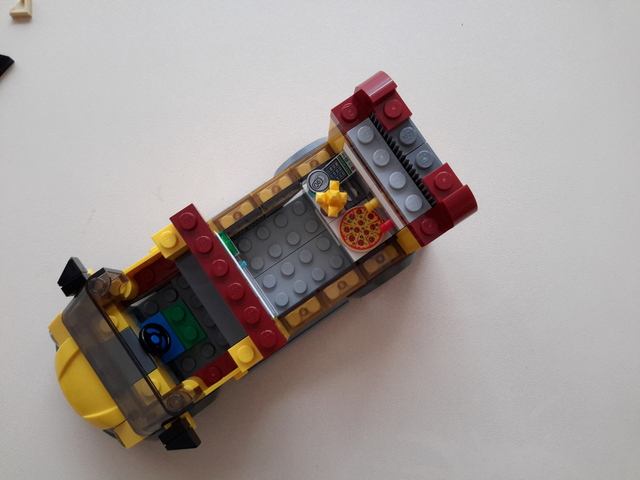](https://www.freelug.org/IMG/jpg/20180617_113913.jpg)

On monte le toit et l’enseigne à l’avant, encore un autocollant, et on s’attaque aux côtés du camion, identiques et de construction simple.

[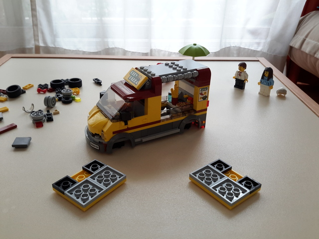](https://www.freelug.org/IMG/jpg/20180617_114438.jpg)

[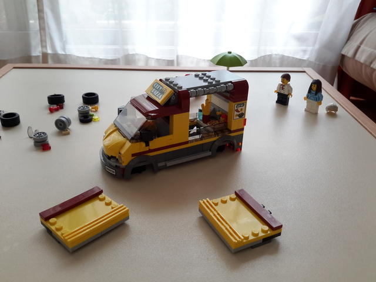](https://www.freelug.org/IMG/jpg/20180617_114601.jpg)

On place les panneaux, sur lesquels on colle encore un autocollant chacun, on met les roues, et la construction est terminée.

[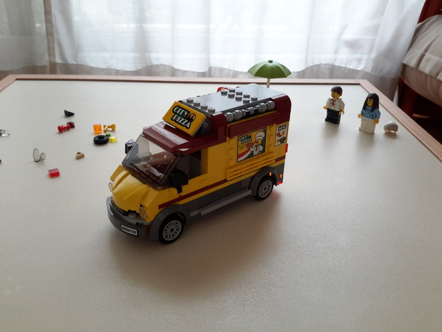](https://www.freelug.org/IMG/jpg/20180617_114815.jpg)

Petite mise en scène des éléments.

[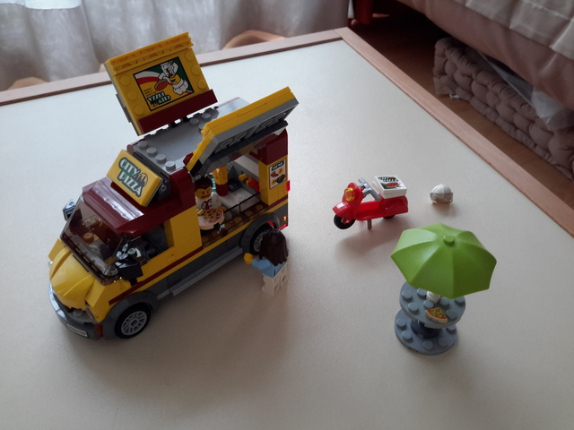](https://www.freelug.org/IMG/jpg/20180617_114954.jpg)

[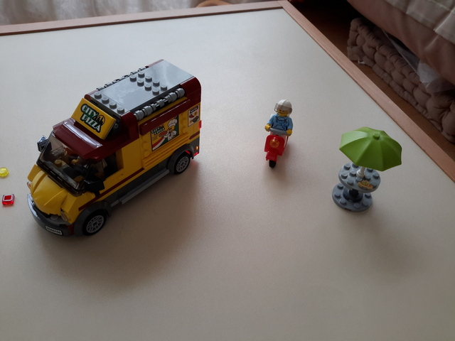](https://www.freelug.org/IMG/jpg/20180617_115144.jpg)

[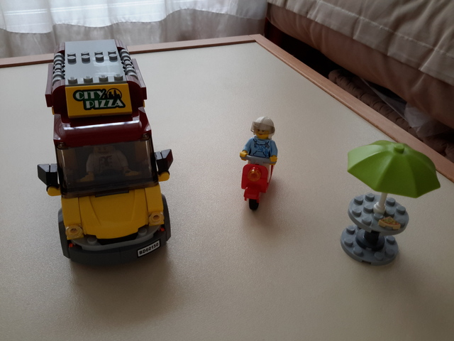](https://www.freelug.org/IMG/jpg/20180617_115154.jpg)

Et voici les pièces bonus — un tas par sachet.

[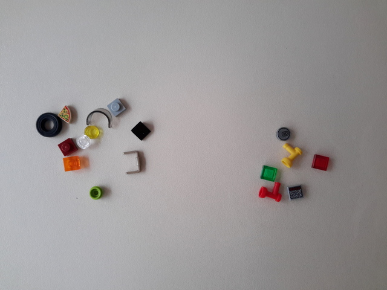](https://www.freelug.org/IMG/jpg/20180617_104122.jpg)

* * *

**Avis :** le rendu est sympathique, et le résultat est à la hauteur. En revanche la construction m’a semblé laborieuse et très très détaillée, avec un minimum de pièces par étape. Bon, c’est normal, la boîte est destinée aux 5-12 ans, donc il faut bien détailler.

Il y a quelques autocollants, mais ce n’est pas très gênant au final, même si avec de gros doigts d’adulte on a vite fait de les placer de travers !

Au final, un set sympathique qui agrémentera sans problème à peu près n’importe quelle ville.

**Bonus :** animation de la construction (cliquer pour lancer).

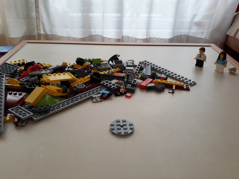
