Aujourd’hui, je vous propose de regarder, rapidement, un petit ensemble de la jungle, le set **60156**, nommé **Le buggy de la jungle**.

Sorti en 2017, il aligne fièrement 53 pièces, dont une figurine, pour 5,99 €, ce qui donne donc un poil plus que 11 centimes par pièce.

* * *

Classé dans la gamme _City_, ce petit set se rattache également à la jungle, comme l’indique me semble-t-il le personnage en haut à droite de la face avant. Celle-ci présente le contenu de la boîte, à savoir un personnage manifestement équipé pour les environnements dangereux, un petit buggy, et une statue style maya ou inca avec un magnifique diamant bleu, certainement objet de toutes les convoitises.

[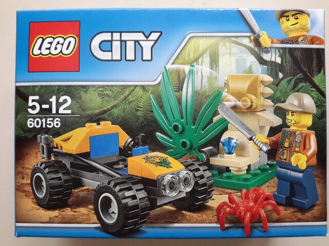](https://www.freelug.org/IMG/jpg/20180722_092631-r90.jpg)

La face arrière montre la statue dissimulée derrière un feuillage sur lequel trône une jolie araignée rouge — est-elle venimeuse ? L’histoire ne le dit pas... Une autre vignette présente le personnage au volant de son buggy, manifestement pressé d’aller quelque part.

[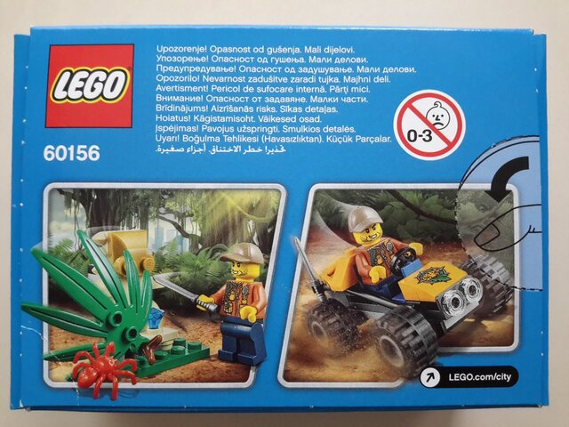](https://www.freelug.org/IMG/jpg/20180722_092649-r90.jpg)

La boîte contient une notice et un petit sachet, les pièces formant un petit tas — seulement 53 pièces, n’oublions pas.

[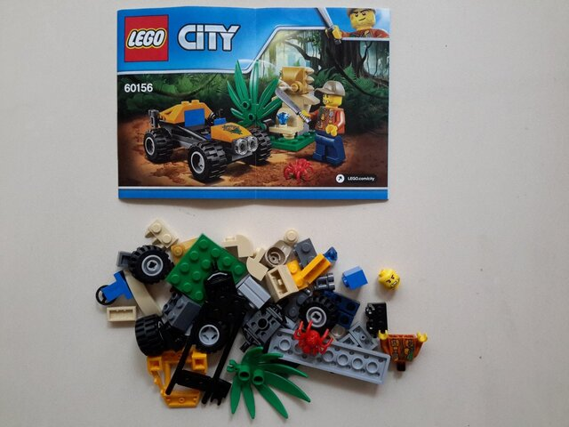](https://www.freelug.org/IMG/jpg/20180722_093008-r90.jpg)

* * *

Commençons par présenter le protagoniste principal, un explorateur manifestement. Il arbore un sourire pas très loin d’une grimace, une barbe de quelques jours, et a les sourcils froncés. Il porte une veste orange et un harnais à nombreuses poches, sur l’épaule droite une corde et un talkie-walkie sur la gauche. Les jambes en revanche ne sont pas décorées. Prévoyant, il a une paire de jumelles et une machette, pratique pour se frayer un chemin. Il s’agit, si j’en crois un site de référence, d’une figurine qui n’apparaît que dans cette boîte et un magazine polonais.

[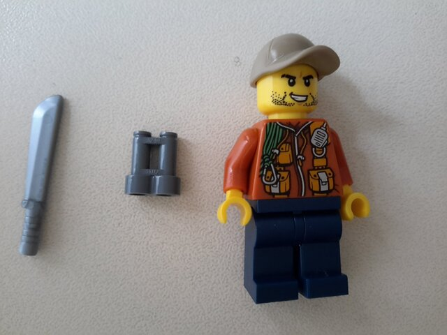](https://www.freelug.org/IMG/jpg/20180722_092528.jpg)

De dos la veste se continue, avec l’émetteur du talkie-walkie passé dans la ceinture, le harnais et la fin de la corde. Pas de visage alternatif.

[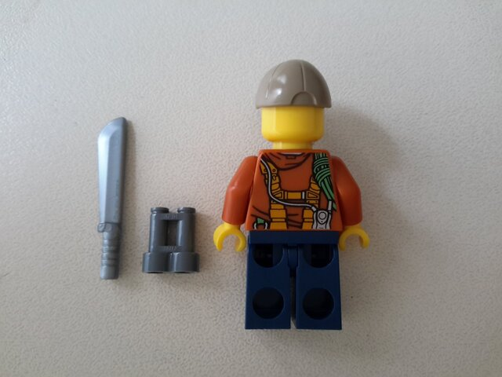](https://www.freelug.org/IMG/jpg/20180722_092549.jpg)

* * *

La construction commence par le buggy, avec un châssis très simple.

[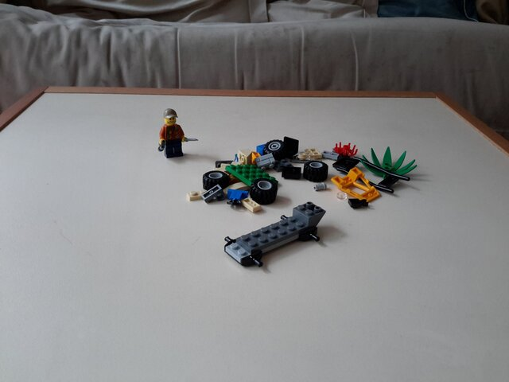](https://www.freelug.org/IMG/jpg/20180722_093142.jpg)

Une belle pièce sérigraphiée vient décorer l’avant, tandis qu’un harnais à cheval fait le cadre.

[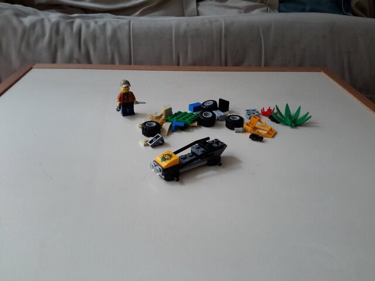](https://www.freelug.org/IMG/jpg/20180722_093252.jpg)

On rajoute le volant, l’arrière, et la construction du véhicule est déjà terminée.

[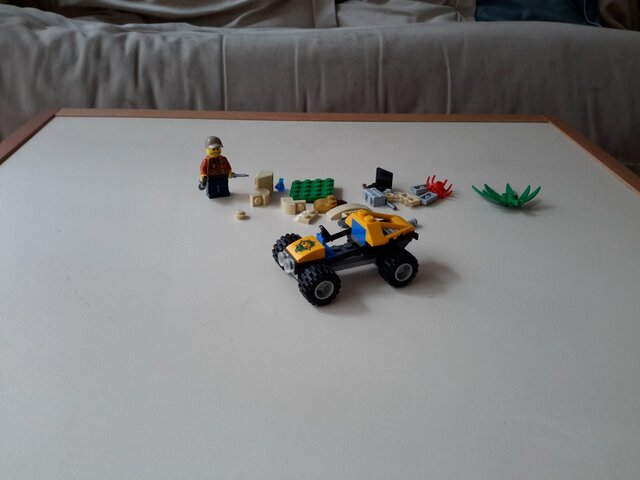](https://www.freelug.org/IMG/jpg/20180722_093358.jpg)

Le buggy en gros plan. Rien d’impressionnant, mais il fait l’affaire.

[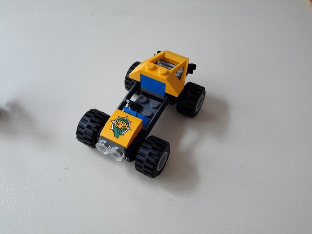](https://www.freelug.org/IMG/jpg/20180722_092438.jpg)

On peut donc s’attaquer à la statue, posée sur un socle 4x4 vert. Sur le côté gauche une charnière Technic qui permettra de faire basculer la plante, et au centre le diamant bleu, très important.

[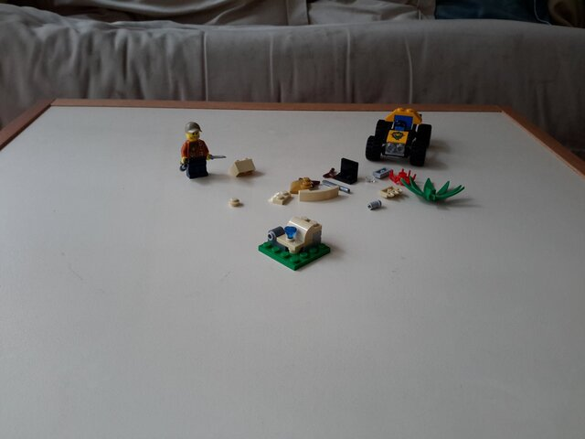](https://www.freelug.org/IMG/jpg/20180722_093525.jpg)

L’arrière est tout simple, avec une pièce inclinée pour donner un peu de relief.

[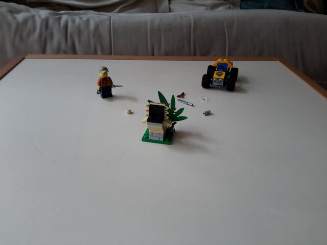](https://www.freelug.org/IMG/jpg/20180722_093659.jpg)

Et la construction de l’ensemble est terminée. Voici le tout mis en scène. La statue est dissimulée derrière une feuille sur laquelle se trouve une belle araignée rouge.

[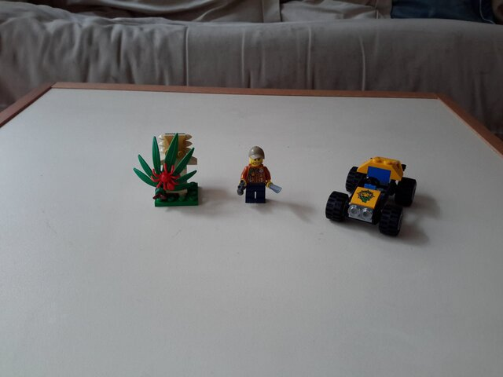](https://www.freelug.org/IMG/jpg/20180722_092413.jpg)

Heureusement l’explorateur ne semble pas dérangé par l’araignée, et trouve rapidement la statue cachée.

[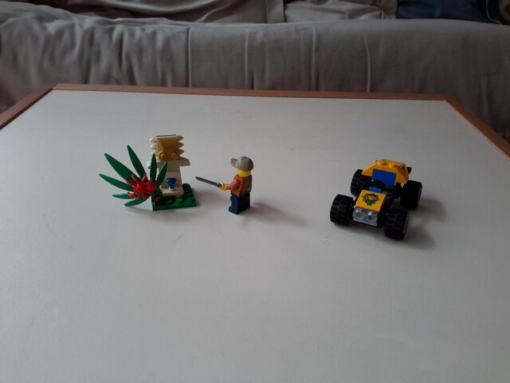](https://www.freelug.org/IMG/jpg/20180722_092425.jpg)

Voici la statue vue de près. J’aime la pièce « bec de canard » doré représentant le masque, c’est amusant. Le rendu global de la statue est efficace. À noter aussi la branche marron permettant de fixer la feuille.

[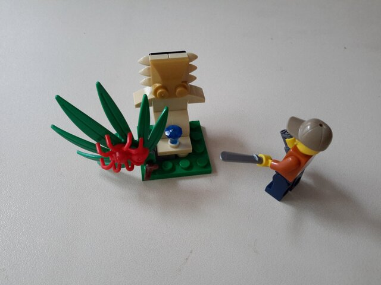](https://www.freelug.org/IMG/jpg/20180722_092444.jpg)

Pour terminer, les pièces bonus, qui font toujours plaisir.

[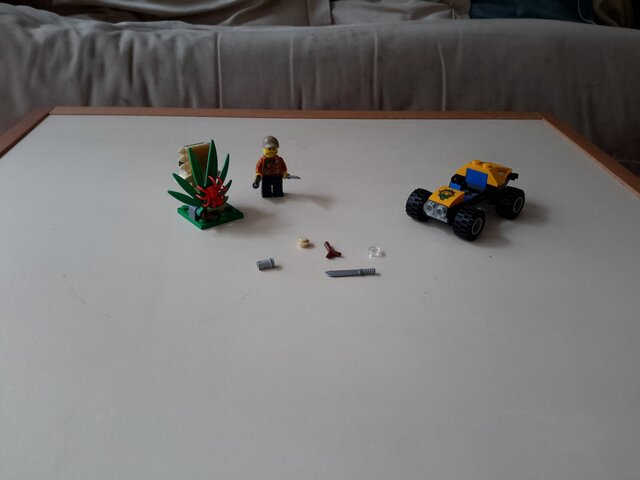](https://www.freelug.org/IMG/jpg/20180722_093717.jpg)

* * *

**Avis :** un petit ensemble rapide à construire, sans fioritures — il est indiqué pour 5-12 ans, quand même. Mais le rendu final est plus qu’acceptable, le buggy a un bon look, et la statue est bien rendue.

Je ne prétendrai pas qu’il est incontournable, mais je ne regrette pas de l’avoir acheté, je trouverai bien à le mettre en scène quelque part.
