Aujourd’hui, présentation du set 60262, de la gamme City, intitulé « L’avion de passagers ».

Sorti le premier juin 2020, ce modèle de 669 pièces, vendu 99,99 € sur la boutique officielle, permet d’assembler un avion, un mini aéroport, deux véhicules. Huit minifigurines soit fournies.

* * *

[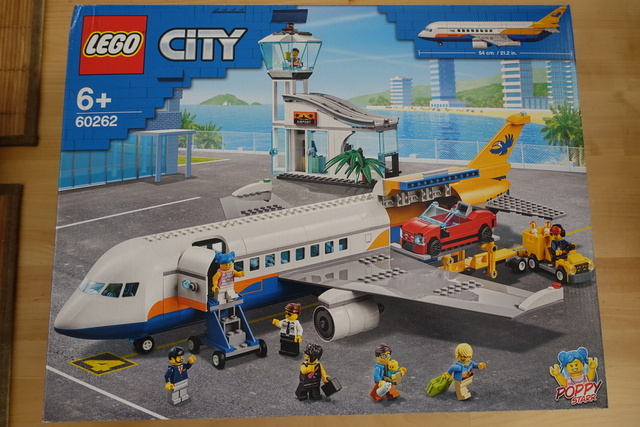](https://www.freelug.org/IMG/jpg/dsc03152.jpg)

L’avant présente l’ensemble mis en scène, avec mention proéminente de la présence de Poppy Starr dans la boîte. Personnage de la série j’imagine. La soute est ouverte pour montrer la voiture transportée (avion de luxe !), avec le monte-charge prêt à la récupérer. En arrière-plan l’aéroport est présent, mais discret, ce n’est clairement pas l’élément le plus important de la boîte.

[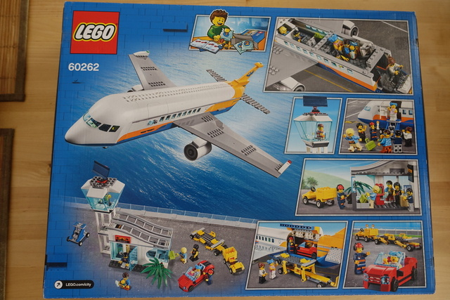](https://www.freelug.org/IMG/jpg/dsc03153.jpg)

L’arrière présente quelques détails, notamment l’intérieur de l’avion et de l’aéroport. L’avion est aménagé avec le poste de pilotage et deux compartiments, le premier avec des sièges (deux rangées), le second une zone de stockage et un chariot. Très important, des toilettes, avec l’un des personnages qui se sent mal...

[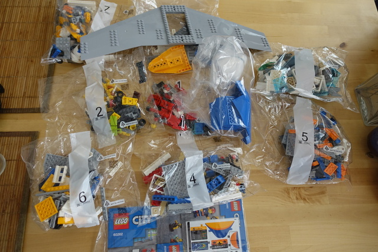](https://www.freelug.org/IMG/jpg/dsc03155.jpg)

Le contenu de la boîte est assez imposant : sept sachets numérotés, plus trois sans numéro, plus les ailes, une méga pièce bien encombrante. Quatre notices et une planche d’autocollants complètent le tout.

[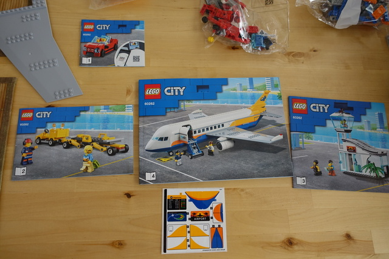](https://www.freelug.org/IMG/jpg/dsc03157.jpg)

La construction se répartit donc en : la voiture de Poppy Starr (un sachet), le monte-charge permettant de la mettre dans l’avion (un autre sachet), l’aéroport (sachet trois) et l’avion proprement dit (tous les autres sachets). Les stickers comprennent le panneau « aéroport », un écran listant les départs, la position de l’avion affichée en cabine, et des compléments de décoration pour la carlingue de l’avion.

Je ne vais pas détailler toutes les étapes de construction, visibles dans le portfolio de l’article.

* * *

[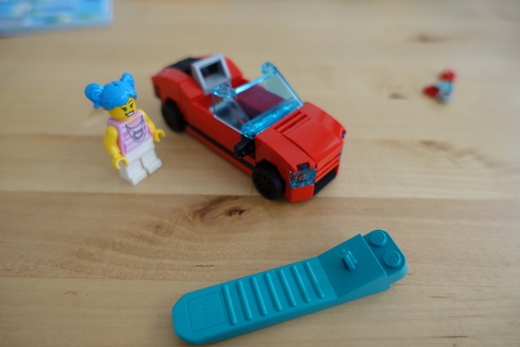](https://www.freelug.org/IMG/jpg/dsc03161.jpg)

[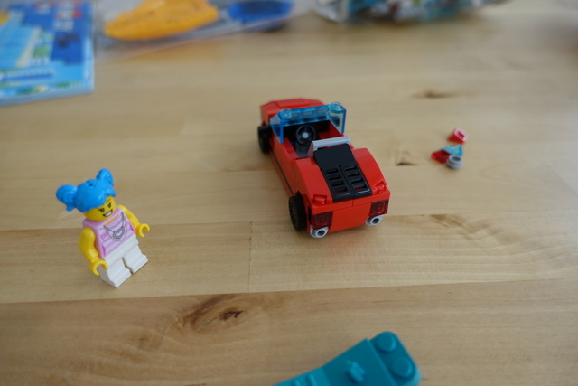](https://www.freelug.org/IMG/jpg/dsc03162.jpg)

La voiture de Poppy Starr est simple mais bien rendue, avec quelques courbes et sans toit. Pas de plaque d’immatriculation en revanche.

[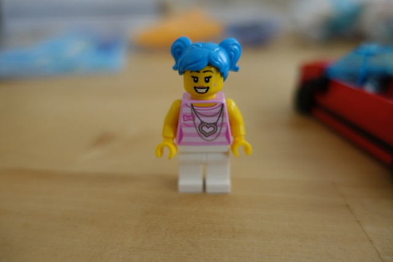](https://www.freelug.org/IMG/jpg/dsc03163.jpg)

[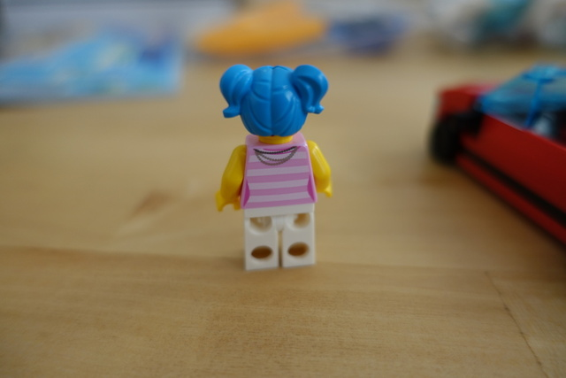](https://www.freelug.org/IMG/jpg/dsc03164.jpg)

Poppy Starr elle-même affiche un grand sourire, et a un torse joliment tampographié, avec un pendentif en cœur décalé et quelques plis, le collier, enroulé plusieurs fois, se prolongeant sur l’arrière. Bras et jambes sont unis, pas de visage alternatif.

* * *

[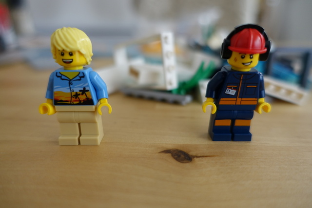](https://www.freelug.org/IMG/jpg/dsc03176.jpg)

[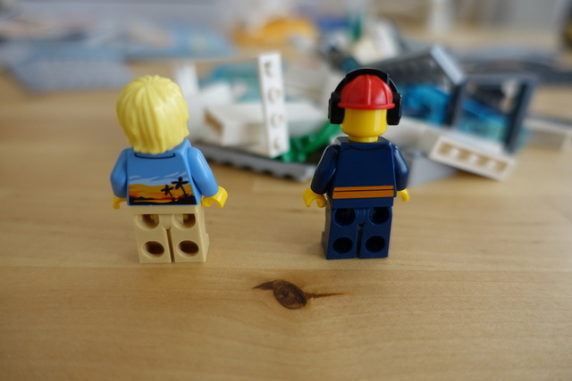](https://www.freelug.org/IMG/jpg/dsc03177.jpg)

[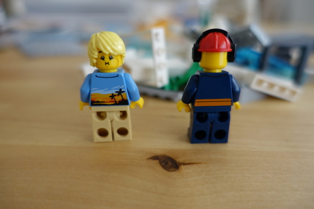](https://www.freelug.org/IMG/jpg/dsc03178.jpg)

Le deuxième sachet propose deux figurines, un passager et le conducteur du monte-charge. Le passager a une belle chemise exotique, avec un paysage tropical, il affiche un sourire ravi de circonstance. Le conducteur a un casque anti-bruit et une combinaison de travail avec badge, il a une petite cicatrice sur une joue, métier peut-être pas simple ? Les jambes sont unies. Le passager a un visage alternatif où il a mal au cœur, il est au bord de la nausée.

[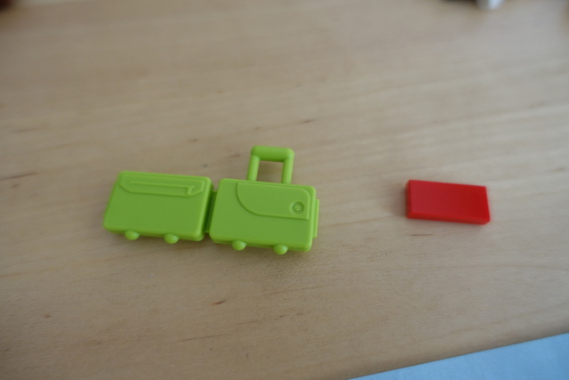](https://www.freelug.org/IMG/jpg/dsc03168.jpg)

[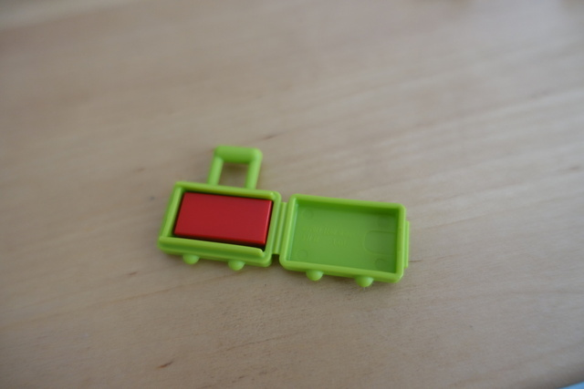](https://www.freelug.org/IMG/jpg/dsc03169.jpg)

On trouve également une valise dont je ne suis pas familier, en forme de valise à roulette qui peut contenir une pièce plate.

[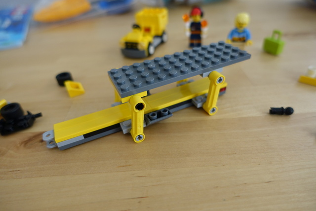](https://www.freelug.org/IMG/jpg/dsc03172.jpg)

La plateforme porte-voiture est basique, avec deux pins Technic noir permettant de donner une certaine rigidité. Aucun mécanisme, il faut monter et descendre à la main.

[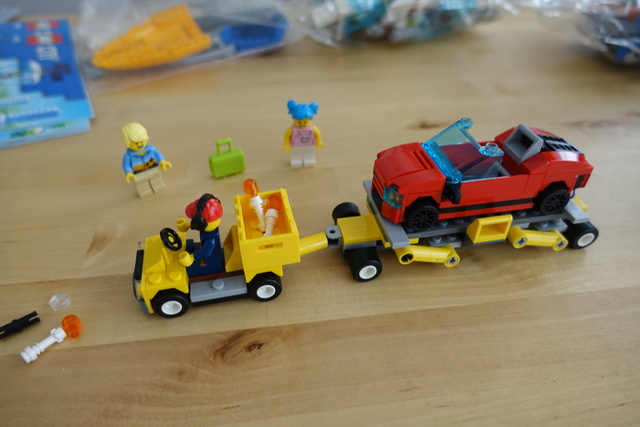](https://www.freelug.org/IMG/jpg/dsc03174.jpg)

Voici le véhicule terminé, avec la voiture chargée. Quelques signaux lumineux permettent probablement au conducteur de jouer aussi le rôle de guide pour l’avion durant les phases de roulement au sol.

* * *

L’aéroport proprement dit est représenté par un simple bâtiment avec une tour de contrôle.

[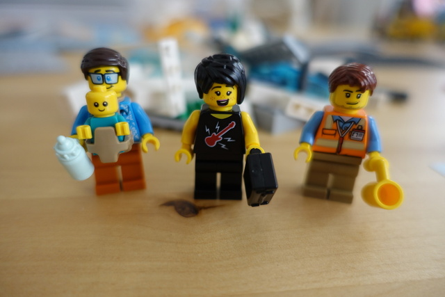](https://www.freelug.org/IMG/jpg/dsc03179.jpg)

[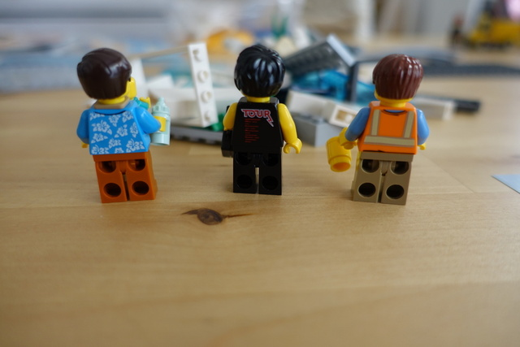](https://www.freelug.org/IMG/jpg/dsc03180.jpg)

[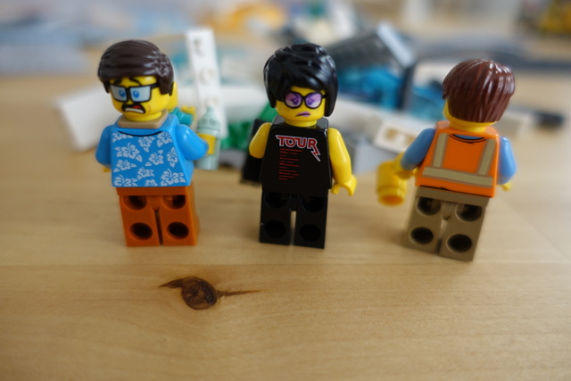](https://www.freelug.org/IMG/jpg/dsc03181.jpg)

Trois figurines sont présentes : un père avec son enfant sur le ventre, une musicienne et un employé de la tour de contrôle. Le père a un visage souriant et un biberon dans une main, il est content d’être en vacances, et a un harnais pour porter son enfant. Sa chemise est à fleurs. La musicienne a un grand sourire et porte une valise, son t-shirt a une guitare électrique sur l’avant et une liste de concerts dans le dos. L’employé lui a un vêtement de travail, avec badge et harnais, une tasse lui permet de se désaltérer. Le père a un visage alternatif effrayé raccord avec l’avant pour les lunettes, la musicienne a un visage pas content avec de belles lunettes violettes.

[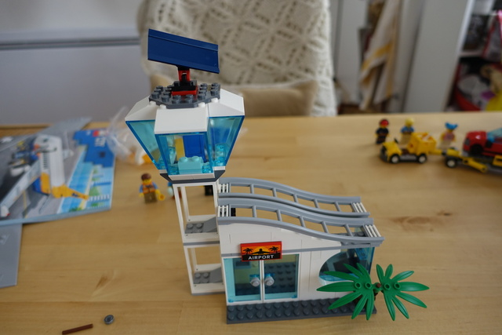](https://www.freelug.org/IMG/jpg/dsc03187.jpg)

[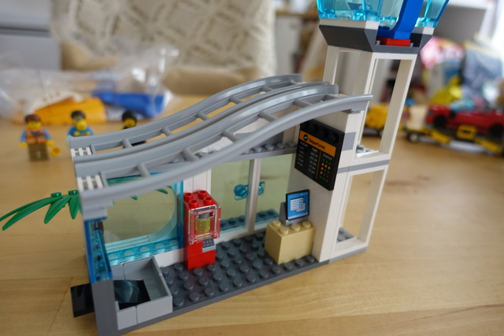](https://www.freelug.org/IMG/jpg/dsc03188.jpg)

L’aéroport lui-même est un simple bâtiment, avec deux portes transparentes et un symbolique tapis roulant pour récupérer les bagages. On y trouve également le panneau d’affichage des prochains départs, un ordinateur pour l’enregistrement (?), et une machine à boissons. Deux petites plantes tropicales donnent un air plus exotique. J’aime bien l’utilisation de deux rails de fête foraine pour le toit, cela change un peu. À noter que j’ai placé le panneau « aéroport » une brique trop bas et ainsi bloqué les portes, mea culpa.

* * *

Les quatre sachets restants permettent de monter l’avion.

[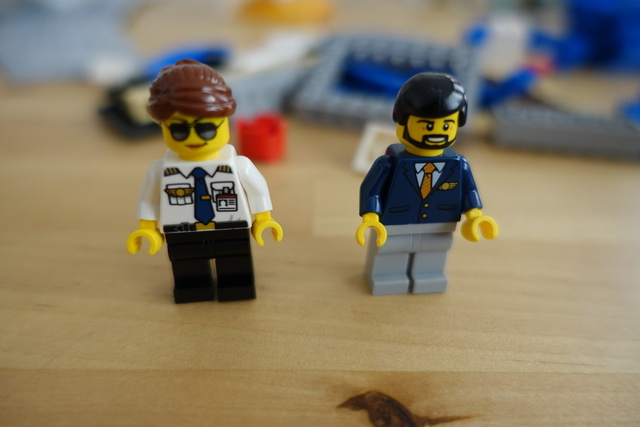](https://www.freelug.org/IMG/jpg/dsc03191.jpg)

[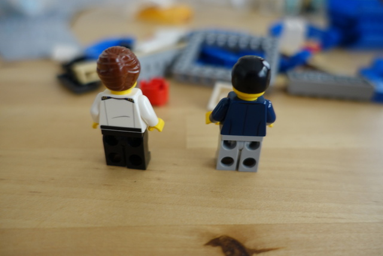](https://www.freelug.org/IMG/jpg/dsc03192.jpg)

Deux figurines sont présentes, une pilote et un steward. Ils ont tous deux une tenue classique pour leur rôle, veste cravate, visage souriant, logo avec des ailes. Pas de visage alternatif, jambes unies.

[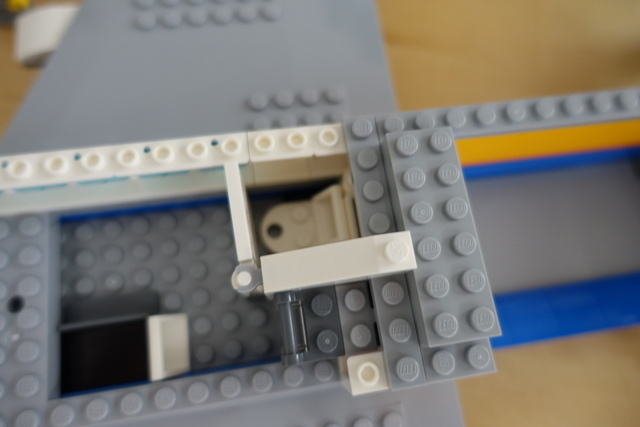](https://www.freelug.org/IMG/jpg/dsc03204.jpg)

Le compartiment arrière de l’avion inclut une zone de stockage pour un chariot et des toilettes. Il y a une petite zone avec une brique plate, peut-être pour poser des bagages ?

[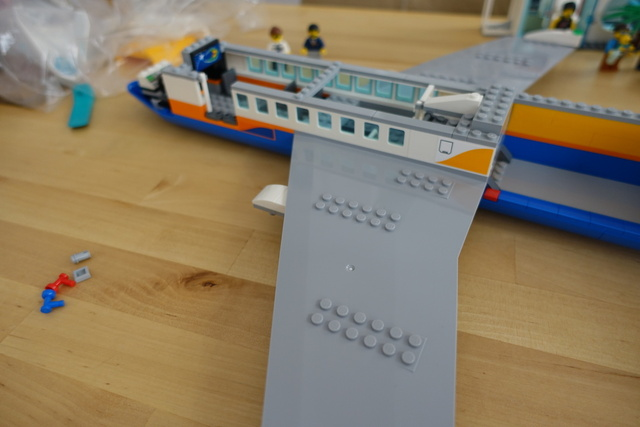](https://www.freelug.org/IMG/jpg/dsc03205.jpg)

La structure de l’avion à peu près assemblée. Sur l’avant du premier compartiment est affiché l’écran montrant la position actuelle de l’avion et la destination. L’intérieur est probablement bien lumineux, il y a beaucoup de fenêtres. Un autocollant ajoute une petite courbe vers la soute de stockage de voiture.

[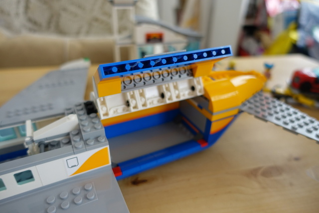](https://www.freelug.org/IMG/jpg/dsc03209.jpg)

[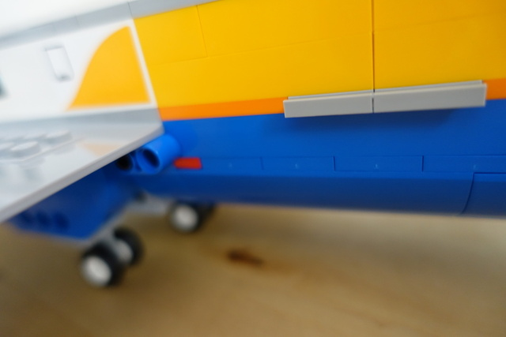](https://www.freelug.org/IMG/jpg/dsc03213.jpg)

Cette soute a un toit qui se soulève pour accéder à la voiture, et est bloqué par une petite pièce Technic accrochée à un pin noir, qui a suffisamment de frottement pour ne pas tourner spontanément — astuce pas mal. Deux plaques à encoche permettent de facilement ouvrir la soute.

[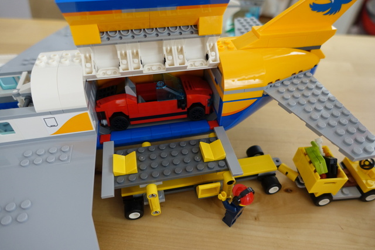](https://www.freelug.org/IMG/jpg/dsc03216.jpg)

La voiture de Poppy Starr rentre parfaitement dans la soute, et est bien stabilisée durant le vol, tandis que le monte-charge a la bonne hauteur pour la récupérer. Bon, comme il n’y a aucune pièce à mouvement latéral, la façon dont la voiture passe de la soute au monte-charge reste mystérieuse...

[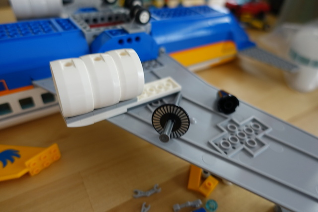](https://www.freelug.org/IMG/jpg/dsc03211.jpg)

Les réacteurs de l’avion sont constitués de trois pièces rondes, avec un axe et une pièce tampographiée pour l’hélice. Le rendu est pas mal, mais les réacteurs ne tiennent pas très bien sur l’aile, il faut faire attention en manipulant l’avion.

[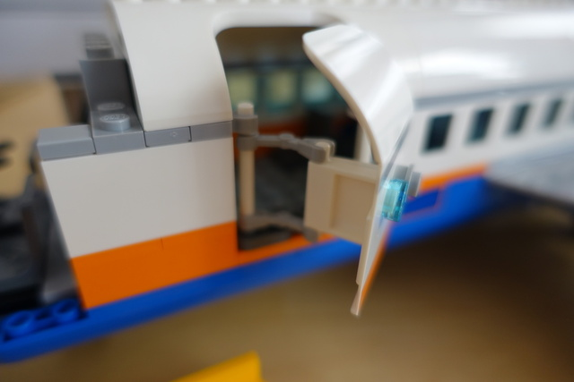](https://www.freelug.org/IMG/jpg/dsc03212.jpg)

La porte avant est montée sur des crochets accrochés à une barre verticale, ce qui lui permet de s’ouvrir vers l’extérieur, comme les vraies portes d’avion. Une fois fermée, elle est plutôt bien ajustée au toit de l’avion, même si parfois il faut un peu réajuster lors de la fermeture.

[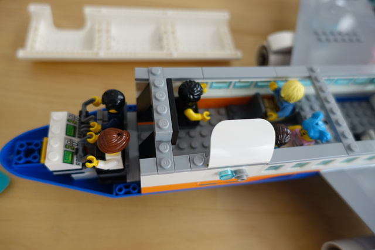](https://www.freelug.org/IMG/jpg/dsc03215.jpg)

L’avion peut facilement transporter quatre passagers (dont le père avec son enfant) et deux pilotes (le steward a été promu pour les besoins de la photo). Le cockpit avant est une seule grosse pièce avec vitre, qui peut facilement être retirée pour accéder à l’intérieur.

[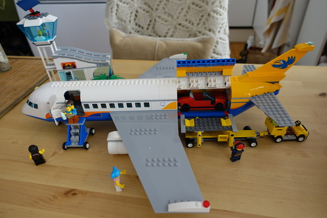](https://www.freelug.org/IMG/jpg/dsc03219.jpg)

Et voici une mise en scène complète de la boîte. La passerelle mobile est pile à la bonne hauteur par rapport à la porte, qui peut passer au-dessus grâce aux grilles plates. La queue de l’avion est tampographiée, bien joliment. Le toit de l’avion peut facilement se retirer pour permettre d’accéder à l’intérieur.

* * *

**Avis :** c’est une belle boîte, le rendu de l’avion est vraiment bon, avec quelques détails appréciables. Les figurines sont bien assorties même si elles manquent de jambes tampographiées. L’aéroport est symbolique et aurait peut-être mérité d’être un peu étoffé.

En revanche je trouve les autocollants posés sur la carlingue de l’avion décevants. Les couleurs ne sont pas du tout raccord avec celles des pièces autour, et le dessin lui-même n’est pas aligné sur les pièces, obligeant à laisser par exemple du blanc alors que la zone devrait être orange (voir la photo avec l’avion complet vu depuis sa droite, c’est assez flagrant).

Rien à redire sur les autocollants pour l’aéroport ou l’intérieur de l’avion, qui n’essayent pas de faire raccord. Je pense que ceux sur l’avion sont superflus en l’état.

Au final c’est une boîte pas mal, son montage n’est pas trop simple ni trop compliqué, pour un rendu globalement satisfaisant.
