Partons à la découverte de cette boite qui nous invite au voyage en Afrique !

[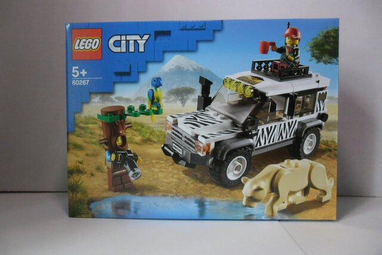](https://www.freelug.org/IMG/jpg/sam_3018.jpg)

Le set comprend 168 pièces avec deux personnages, une lionne et un perroquet. Pour un prix de 19,99€ soit un rapport prix/pièce de 0,12 Euro, c’est correct pour un set avec un véhicule et un animal.

Une petite vue arrière donne une idée de la jouabilité du set :

[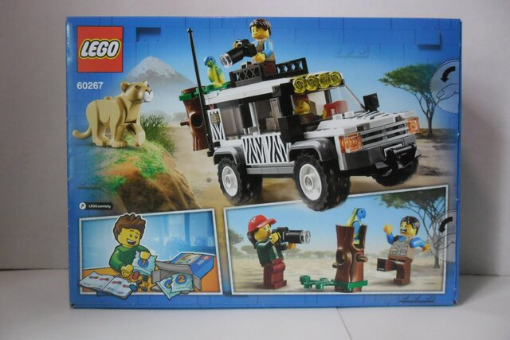](https://www.freelug.org/IMG/jpg/sam_3019.jpg)

Venons au principal : le contenu de la boite :

[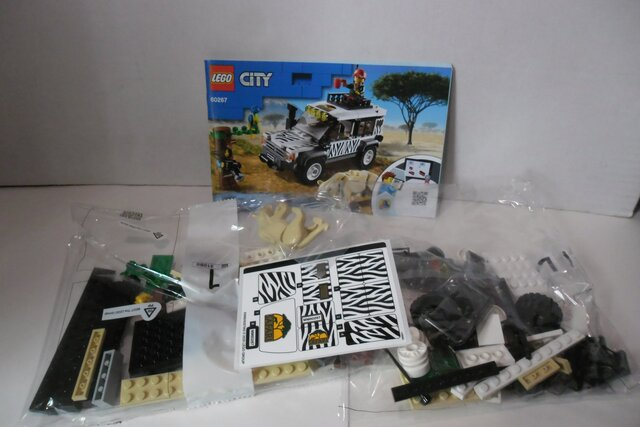](https://www.freelug.org/IMG/jpg/sam_3020.jpg)

Et voilà une immense feuille de sticker !

[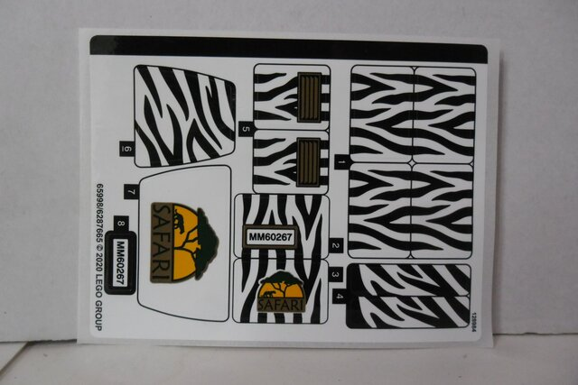](https://www.freelug.org/IMG/jpg/sam_3021.jpg)

Deux personnages, mixte

[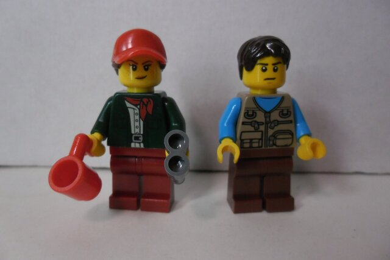](https://www.freelug.org/IMG/jpg/sam_3023.jpg)

[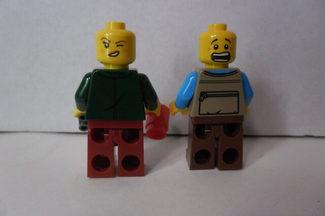](https://www.freelug.org/IMG/jpg/sam_3024.jpg)

Hop un personnage est planqué dans une souche pour observer en toute discrétion !

[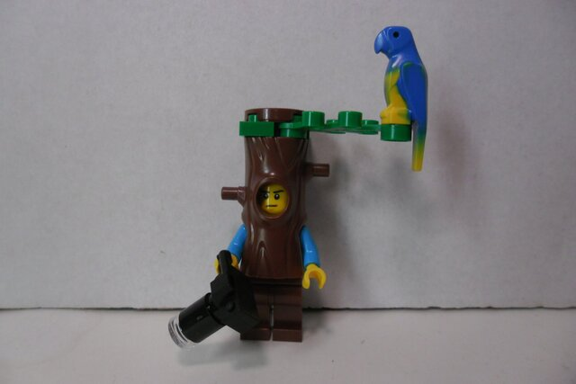](https://www.freelug.org/IMG/jpg/sam_3026.jpg)

Passons à la bête : le 4x4 !

On commence avec le châssis :

[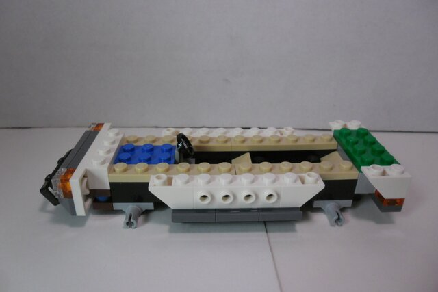](https://www.freelug.org/IMG/jpg/sam_3029.jpg)

Et voilà déjà fini :

[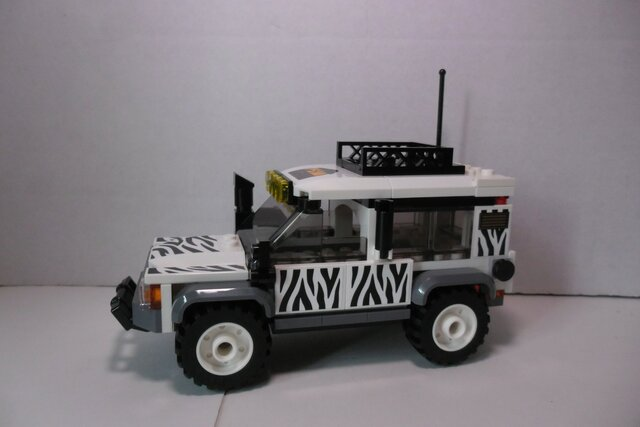](https://www.freelug.org/IMG/jpg/sam_3031.jpg)

Voilà fini, une petite photo de famille !

[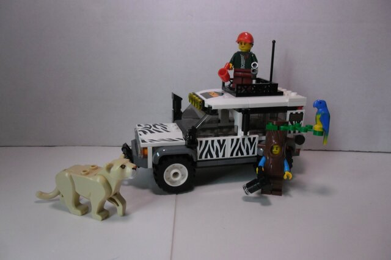](https://www.freelug.org/IMG/jpg/sam_3032.jpg)

Et pour terminer les extra parts :

[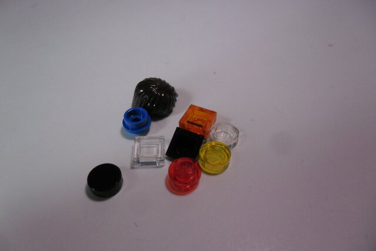](https://www.freelug.org/IMG/jpg/sam_3034.jpg)

**Conclusion**

Que dire : pas trop cher certes, mais une [réinterprétation d’un vieux set](https://brickset.com/sets/6672-1/Safari-Off-Road-Vehicle). Et que du sticker pour l’effet camouflage. Dommage...  
Donc pour moi bof, ça mérite un bout de décor en plus, et pas sûr que ça aurait coûté beaucoup plus cher.

Allez en bonus : voici une mise en valeur de l’ensemble !

[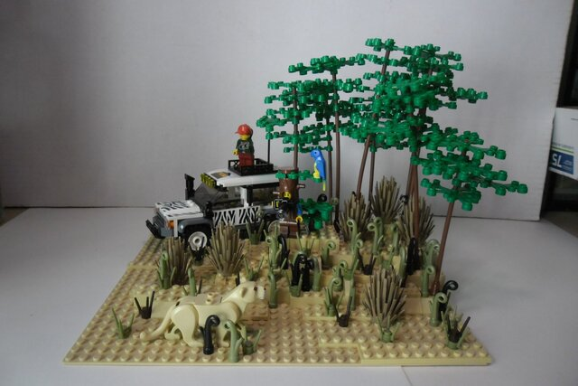](https://www.freelug.org/IMG/jpg/sam_3047.jpg)

Donc un petit set pas très cher mais mérite mieux..
