Partons au sauvetage de ces primates !

[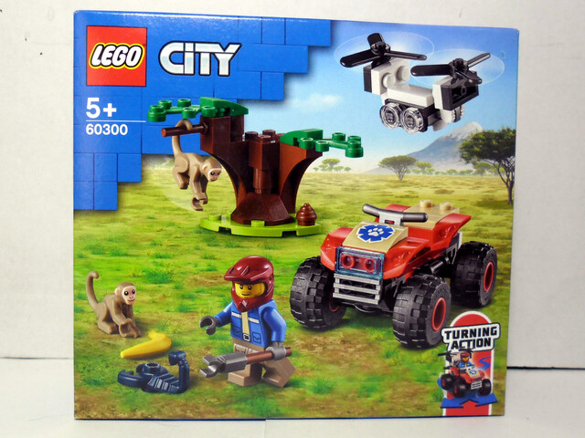](https://www.freelug.org/IMG/jpg/sam_3521.jpg)

Le set comprend 74 pièces avec un personnage, un véhicule, deux singes et un scorpion. Pour un prix de 9,99 € soit un rapport prix/pièces de 0,134 euro, c’est un peu cher pour un set de cette taille. Les singes qui sont tout nouveaux expliquent un peu.

Une petite vue arrière donne une idée de la jouabilité du set :

[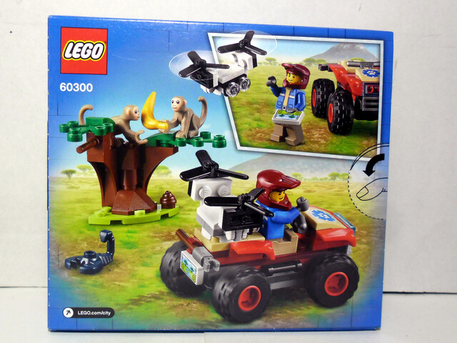](https://www.freelug.org/IMG/jpg/sam_3523.jpg)

Venons au principal : le contenu de la boite :

[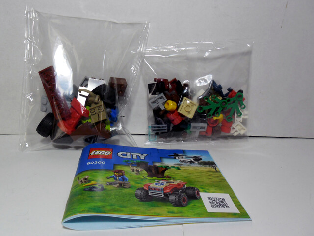](https://www.freelug.org/IMG/jpg/sam_3524.jpg)

Et voilà des belles pièces tampographiées !

[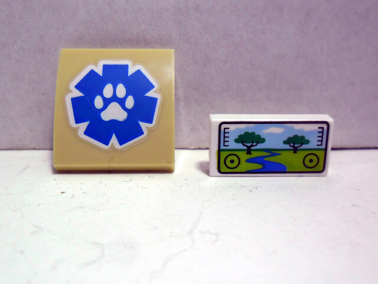](https://www.freelug.org/IMG/jpg/sam_3526.jpg)

Un personnage

[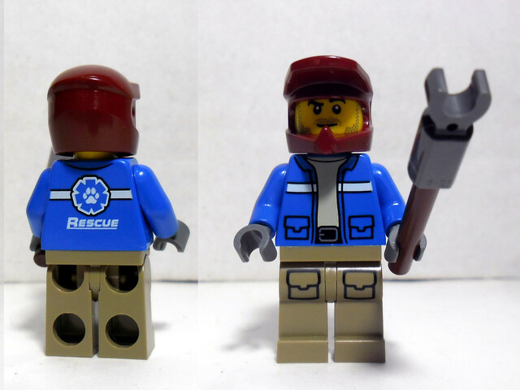](https://www.freelug.org/IMG/jpg/sam_3527.jpg)

Les singes avec une banane :

[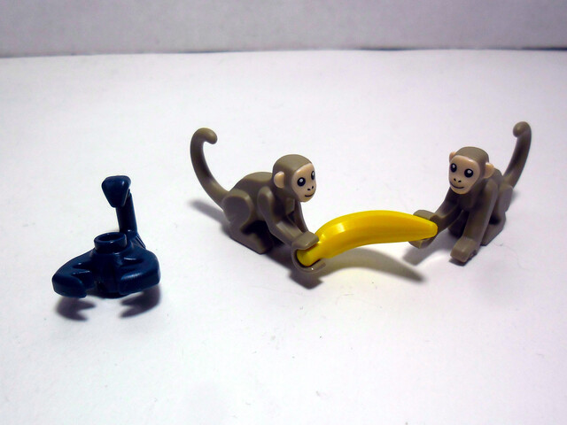](https://www.freelug.org/IMG/jpg/sam_3530.jpg)

Voilà un petit drone :

[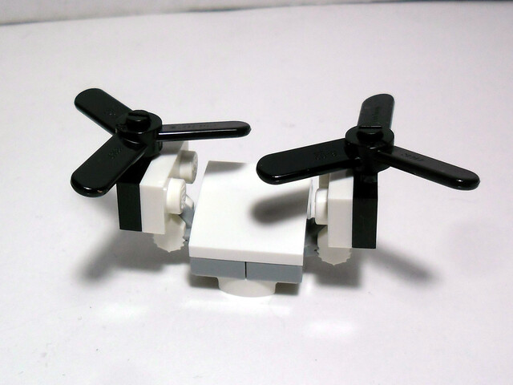](https://www.freelug.org/IMG/jpg/sam_3531.jpg)

Puis passons par le quad (avec une belle vue sur le nouveau système de suspension) :

[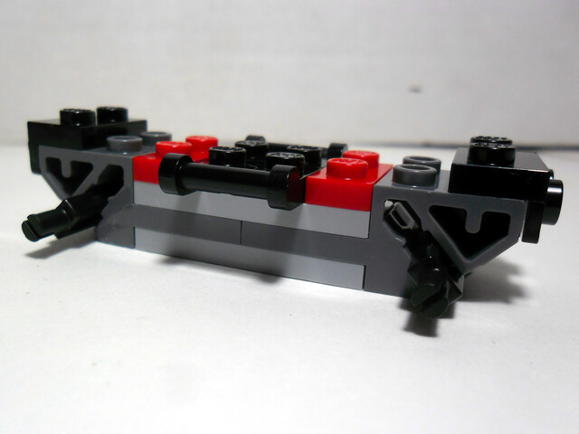](https://www.freelug.org/IMG/jpg/sam_3533.jpg)

[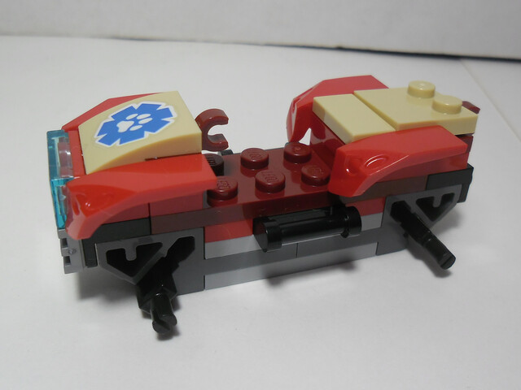](https://www.freelug.org/IMG/jpg/sam_3535.jpg)

[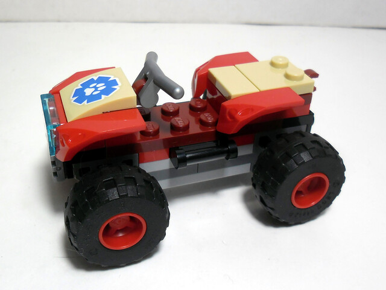](https://www.freelug.org/IMG/jpg/sam_3536.jpg)

Finissons avec un petit arbre :

[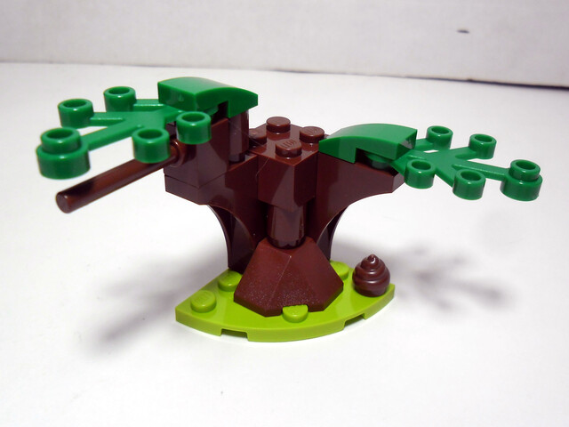](https://www.freelug.org/IMG/jpg/sam_3537.jpg)

Voilà fini, une petite photo de famille !

[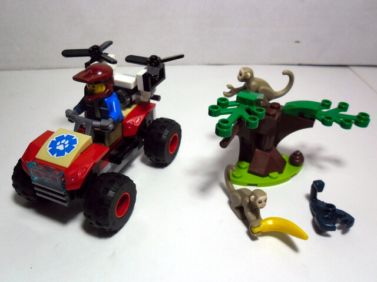](https://www.freelug.org/IMG/jpg/sam_3538.jpg)

Et pour terminer les extra parts :

[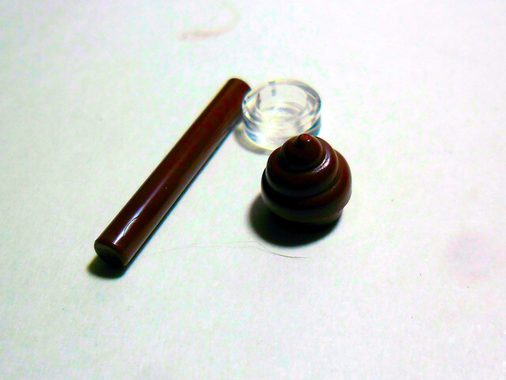](https://www.freelug.org/IMG/jpg/sam_3541.jpg)

**Conclusion**  
Verdict du set ? A part ces deux petits singes, le set est bofbof et relativement cher… En plus, les primates sont trop limités.
