Voir ma première review alors soyez indulgents ;-)

Alors je vais vous parler (et décortiquer) le set 60304 nommé Intersection à assembler !

J’étais avec mon fils de 6 ans quand j’ai vu cette boite et au premier abord je me suis dit 19 euros c’est cher pour le peu qu’il y a dedans et je ne vois pas l’interêt puisque l’on a déjà (comme beaucoup d’entre nous) des plaques de routes (60236 ou même 60237) qui elles sont vendues 10 euros les 2 plaques !  
Alors après analyse du rayon LEGO et par curiosité j’ai finalement pris la boite et me voilà vous conter mes impressions...

[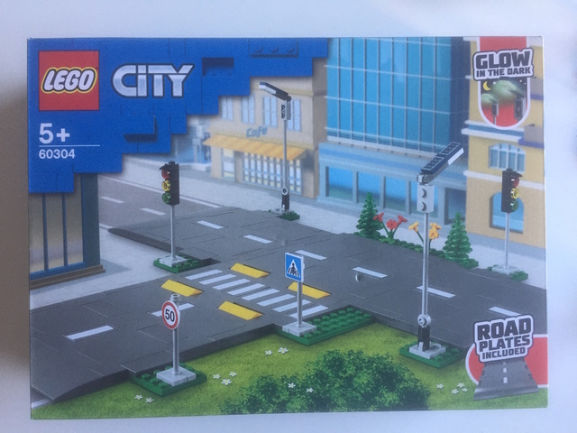](https://www.freelug.org/IMG/jpg/img_3358.jpg)

Hormis le prix, la boite donne envie de construire une ville avec les couleurs de l’emballage et surtout les différents décors : lampadaire, feu et panneau plutôt (voir trop) rares malheureusement à obtenir…

Pour le montage c’est très basique et simple : 4 grosses plaques à assembler qui me rappellent beaucoup les plaques obtenues dans les différents sets de « Disney cars » dont la référence de la pièce est 18922 mais qui est 2 fois plus petite.

[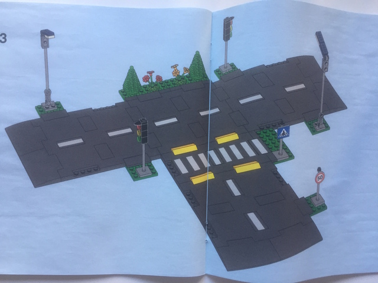](https://www.freelug.org/IMG/jpg/img_3370.jpg)

La notice nous invite à construire l’intersection (bien qu’il y ait la route droite et le « virage » à la fin donc 3 possibilités en fonction des besoins…).

[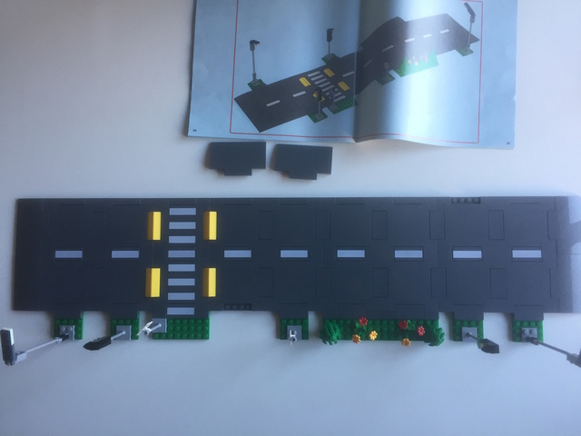](https://www.freelug.org/IMG/jpg/img_3354.jpg)

Si on décide de faire une droite avec uniquement un coté « garni » il manque quelques plaques vertes (6 en 4x4 par exemple) pour finir le bas en végétation ainsi que les tiles qui vont avec et c’est dommage !! Idem pour le haut il manque 1 tile 1x4 !

[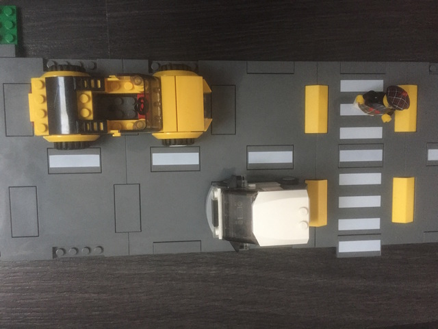](https://www.freelug.org/IMG/jpg/img_3350.jpg)

[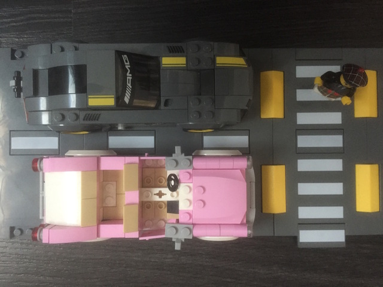](https://www.freelug.org/IMG/jpg/img_3351.jpg)

Si on tente la route, les voitures « City » passent mais pour les voitures un peu plus « poussées » comme par exemple issues du Creator diner’s club ou comme la gamme speed champion la route est vraiment étroite...

[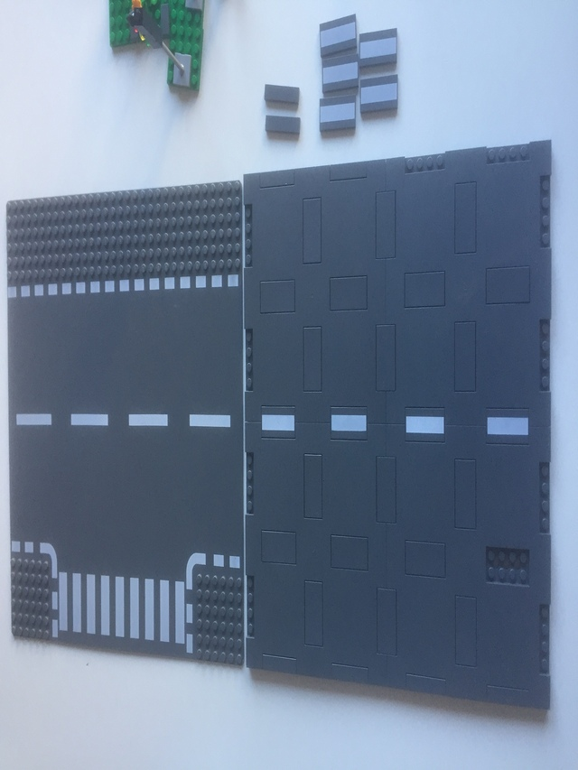](https://www.freelug.org/IMG/jpg/img_3364.jpg)

Maintenant comparons avec les plaques de base de route différentes configurations :  
Les tailles sont identiques, les lignes sont alignées mais pas de la même longueur néanmoins on perd les trottoirs dans le même espace.

[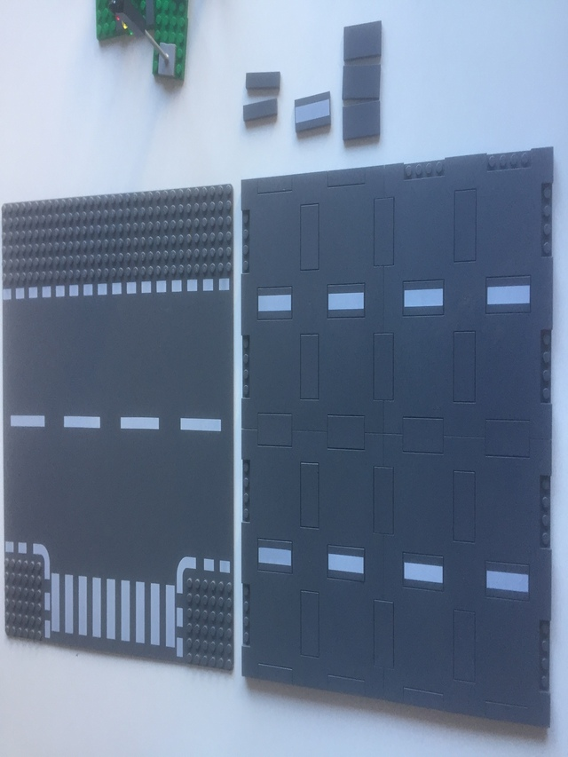](https://www.freelug.org/IMG/jpg/img_3365.jpg)

Un autre cas possible, la double voie

[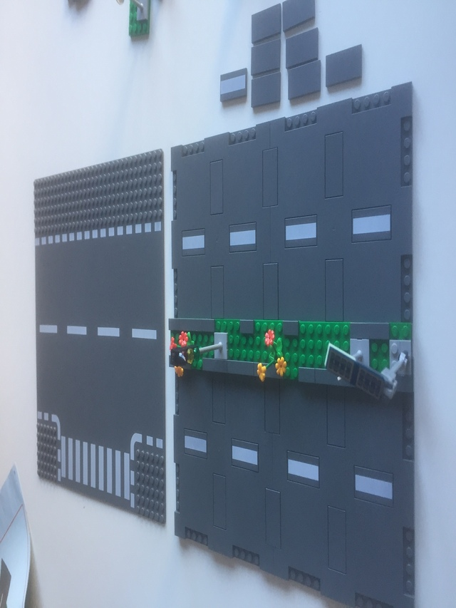](https://www.freelug.org/IMG/jpg/img_3367.jpg)

Un terre plein central peut rendre cette configuration plus sympa

[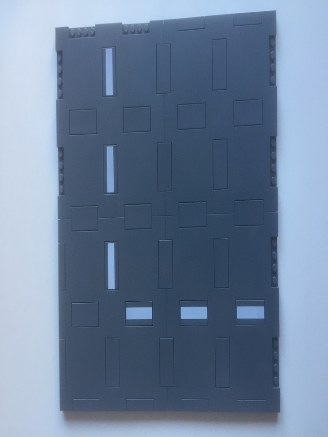](https://www.freelug.org/IMG/jpg/img_3361.jpg)

Maintenant tentons le virage

[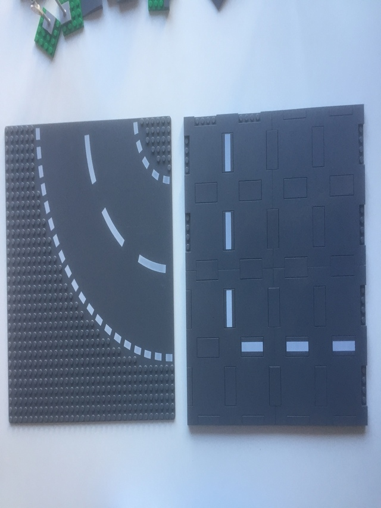](https://www.freelug.org/IMG/jpg/img_3362.jpg)

Comparons avec la plaque de base de route, on perd beaucoup d’espace de créations et la route est à angle droit au lieu d’une courbe !

[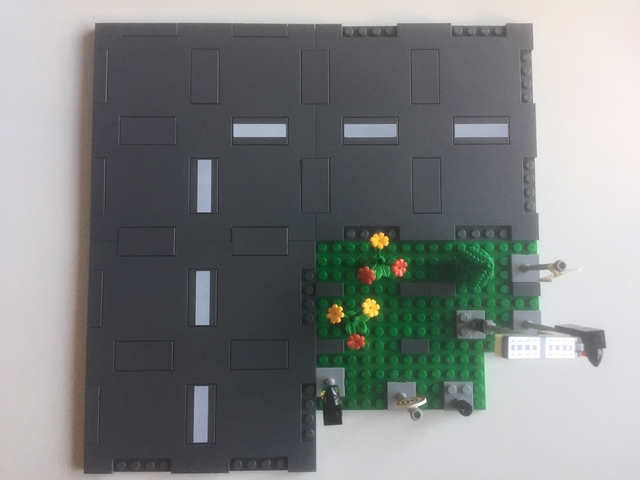](https://www.freelug.org/IMG/jpg/img_3363.jpg)

On peut tenter de garder une portion « création » mais malheureusement il manque 5 plaques vertes 4x4 pour pouvoir refermer complètement la portion végétale, c’est dommage encore mais ça reste une configuration sympa à compléter avec nos briques !

[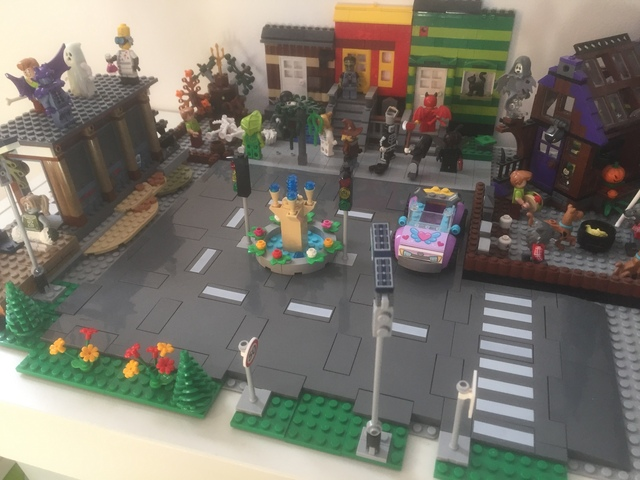](https://www.freelug.org/IMG/jpg/img_3339.jpg)

Bon j’en ai trouvé une quatrième configuration possible grâce à mon fils en faisant une petite maquette pour Halloween :-) : un rond point ou plutôt une place !

[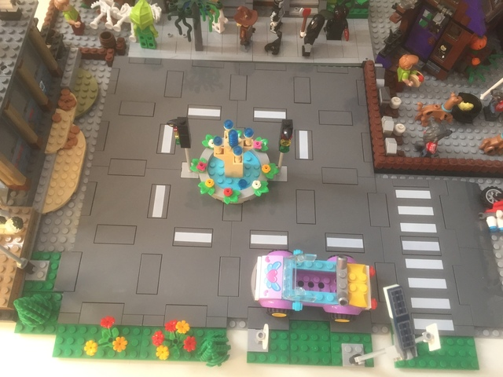](https://www.freelug.org/IMG/jpg/img_3338.jpg)

[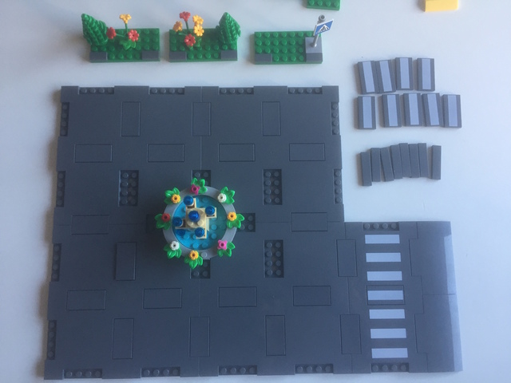](https://www.freelug.org/IMG/jpg/img_3372.jpg)

On touche aux limites du système : si on tente un rond point la voie intérieure est trop petite et les lignes ne fonctionnent pas que l’on mette ou pas la dernière tile dans les 2 cas ça fait bizarre. Mais si on décide de tout faire gris, ça passe, mais dans ce cas LEGO aurait pu rajouter 3 tiles 2x4 gris foncé en plus ! (Bien que l’on puisse quand même utiliser les 1x4)

[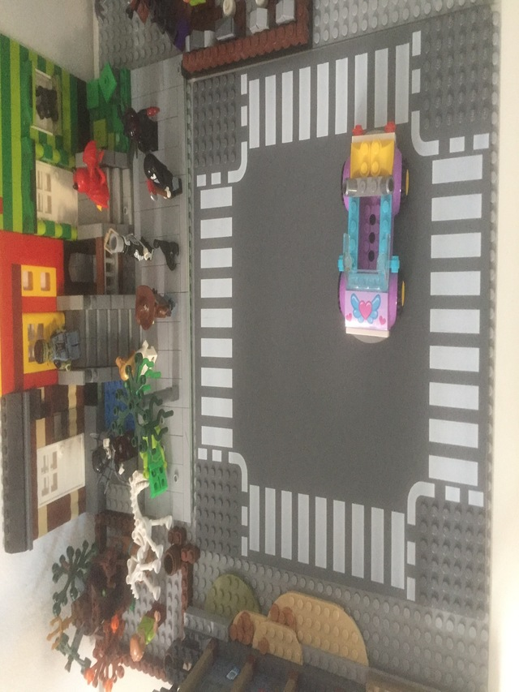](https://www.freelug.org/IMG/jpg/img_3341.jpg)

Si on compare avec une plaque de route, il faut bien reconnaitre que l’alternative était moins « fun ».

[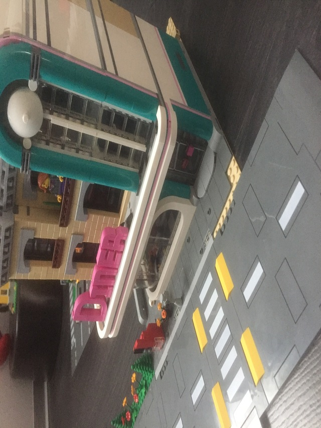](https://www.freelug.org/IMG/jpg/img_3346.jpg)

Tentons forcement une intégration avec un « modular »

[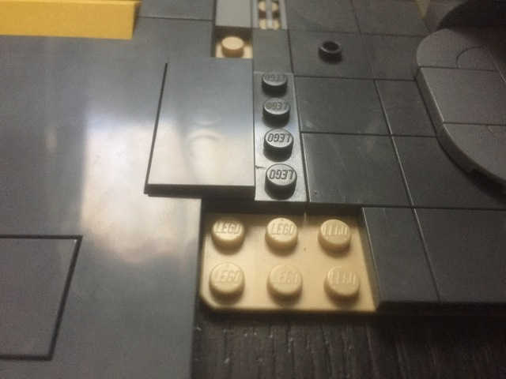](https://www.freelug.org/IMG/jpg/img_3347.jpg)

[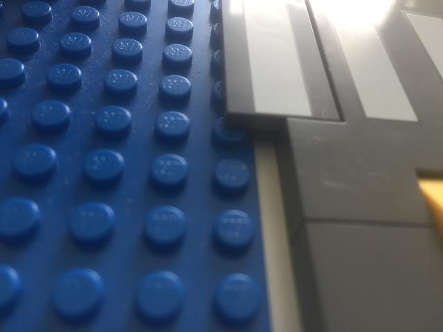](https://www.freelug.org/IMG/jpg/img_3344.jpg)

Là par contre ça pose de vrais problèmes : soit la différence de niveau est trop haute soit trop basse mais dans les 2 cas les plaques ne sont pas raccordables, juste posées côte à côte mais non solidaires.  
J’ai cru voir sur internet que certains avaient trouvé des solutions en utilisant des « curve » ou moyennant de plus grosses « bidouilles » en fixant la « nouvelle route » sur une plaque de base !

[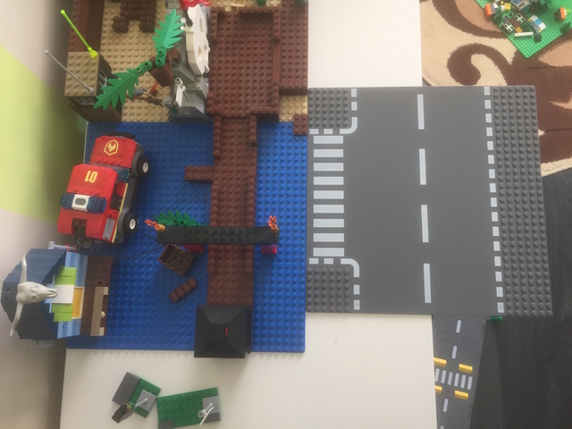](https://www.freelug.org/IMG/jpg/img_3345.jpg)

Dans notre cas où une maquette est dans une chambre en utilisant une étagère Ikea la plaque de route est impossible.

[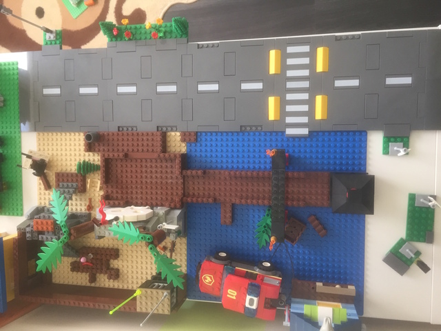](https://www.freelug.org/IMG/jpg/img_3343.jpg)

Mais avec ce système, une plaque de base plus ces nouvelles routes passent sur le meuble et c’est impeccable !

Force est de constater que cela fonctionne plutôt bien ! Néanmoins, sur les différentes configurations, je trouve que LEGO aurait pu mettre quelques tiles de plus ainsi que quelques plaques vertes afin de parer à tous les cas de figures…

Pour conclure ce système est 2 fois plus cher si on veut couvrir la même surface donc pour faire un circuit ou une boucle par terre pour un enfant avec des véhicules LEGO City (caserne, commissariat etc) mieux vaut oublier, ça coûte beaucoup trop cher et c’est pas transportable du tout (si on veut passer l’aspirateur en rangeant les plaques vite fait :-)  
Néanmoins c’est plus modulable, plus détaillé et mieux adapté pour les maquettes dans un espace limité et réduit comme des maquettes sur des meubles.  
Donc chacun verra l’utilité et cela dépendra vraiment de l’utilisation que l’on souhaite en faire...
