Aujourd’hui je vous propose la review du set 6286 dans la gamme pirate : Skull’s Eye Schooner.  
Ce set sorti en 1993 est composé de 912 pièces, dont un requin et 9 pirates.

[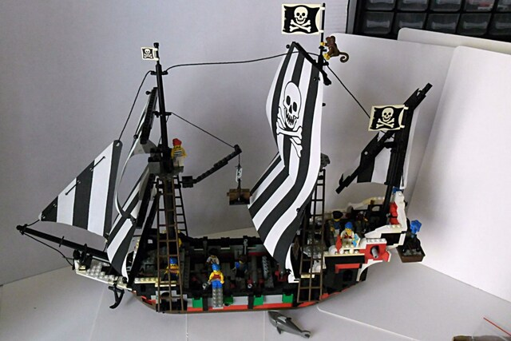](https://www.freelug.org/IMG/jpg/6286-v20.jpg)

A l’époque, les boîtes étaient énormes, avec rabats, possibilités de voir une partie du contenu, et aussi des constructions alternatives :

[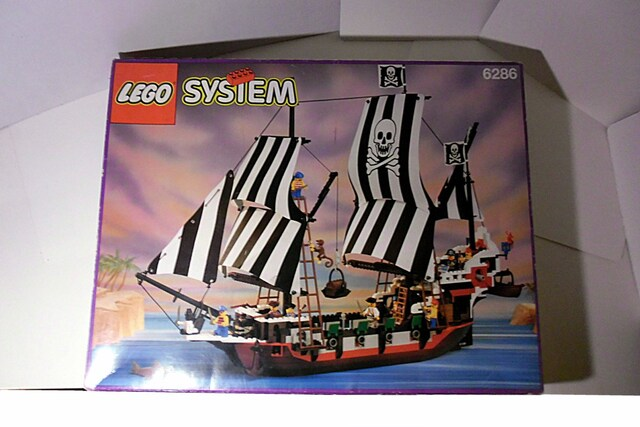](https://www.freelug.org/IMG/jpg/6286-v01.jpg)

[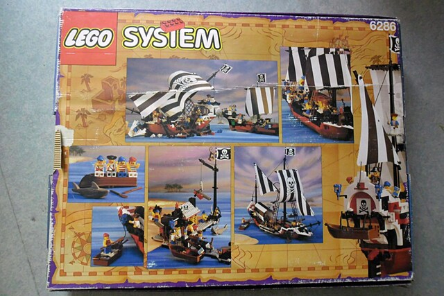](https://www.freelug.org/IMG/jpg/6286-v02.jpg)

[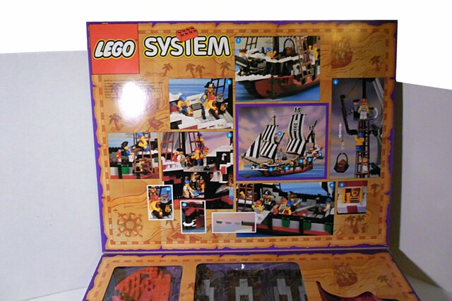](https://www.freelug.org/IMG/jpg/6286-v03.jpg)

[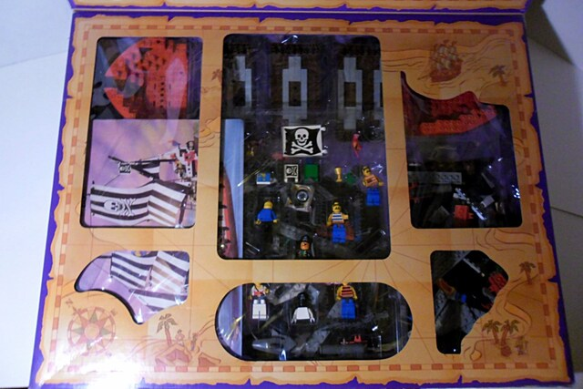](https://www.freelug.org/IMG/jpg/6286-v04.jpg)

[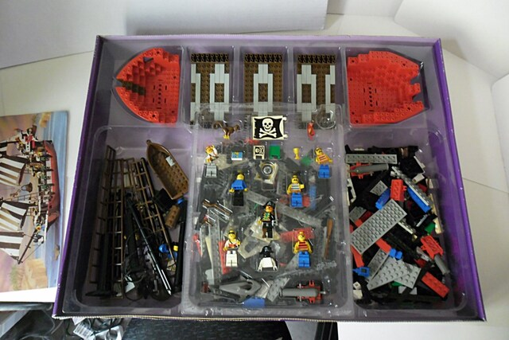](https://www.freelug.org/IMG/jpg/6286-v05.jpg)

Le livret de montage est tout petit. Hé oui, à l’époque, c’est beaucoup de pièces par étapes et surtout, ils ne disent pas toujours lesquelles... C’est ballot...

[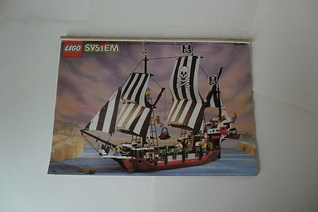](https://www.freelug.org/IMG/jpg/6286-v06.jpg)

[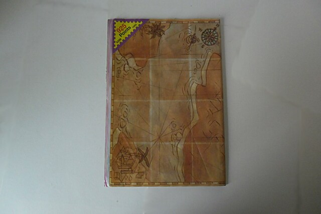](https://www.freelug.org/IMG/jpg/6286-v07.jpg)

Et voilà l’un des éléments les plus rares : les voiles.

[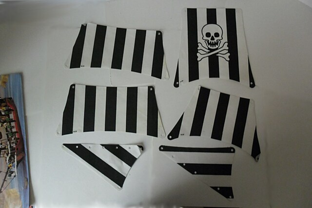](https://www.freelug.org/IMG/jpg/6286-v08.jpg)

On commence d’abord par les minifigurines et le requin :

[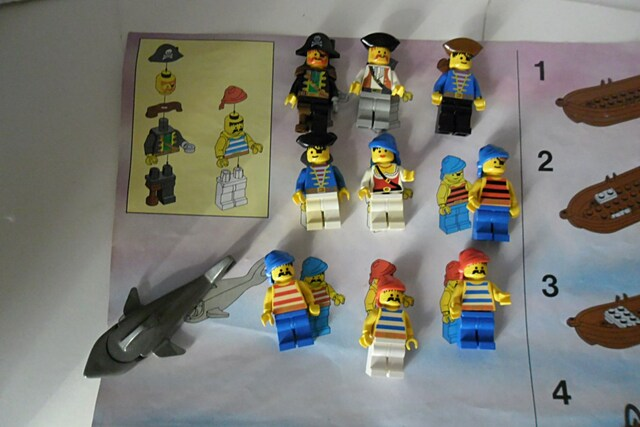](https://www.freelug.org/IMG/jpg/6286-v09.jpg)

Puis la petite barque de secours. Pour autant de personnages, si le bateau coule, il n’y aura pas beaucoup de survivants...

[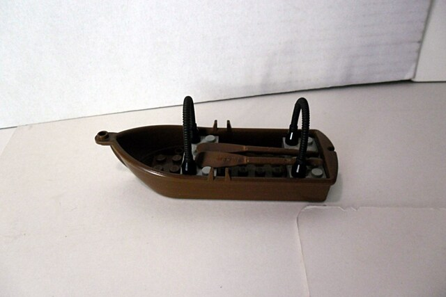](https://www.freelug.org/IMG/jpg/6286-v10.jpg)

Passons par la construction du bateau proprement dit. Avec presque autant d’étapes qu’avec la notice...

[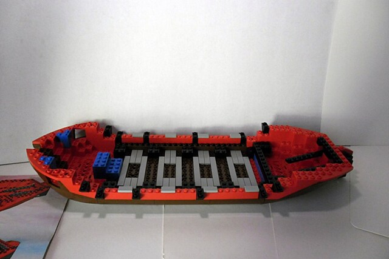](https://www.freelug.org/IMG/jpg/6286-v11.jpg)

[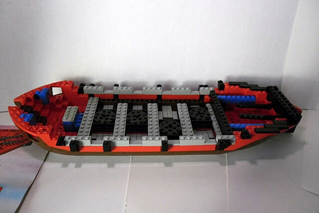](https://www.freelug.org/IMG/jpg/6286-v12.jpg)

[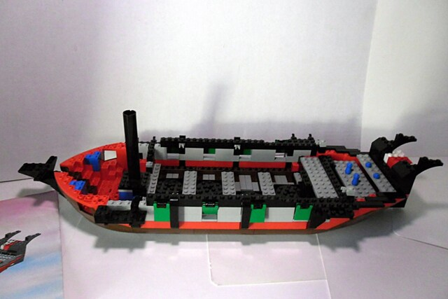](https://www.freelug.org/IMG/jpg/6286-v13.jpg)

[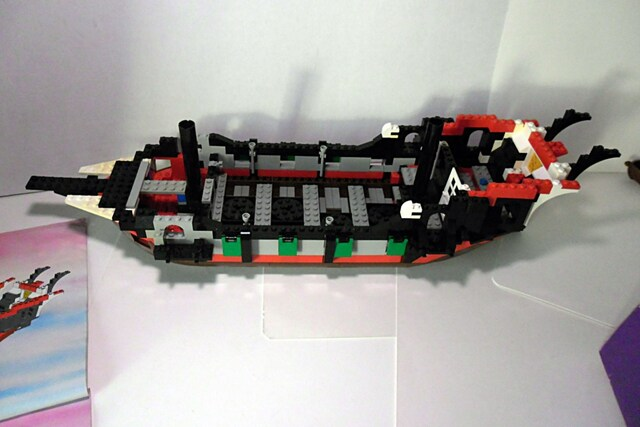](https://www.freelug.org/IMG/jpg/6286-v14.jpg)

[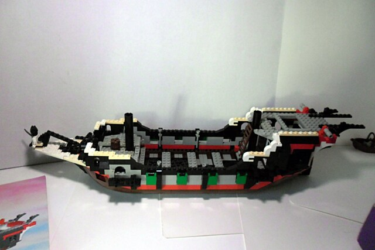](https://www.freelug.org/IMG/jpg/6286-v15.jpg)

Miracle pour l’époque : le gouvernail est fonctionnel.

[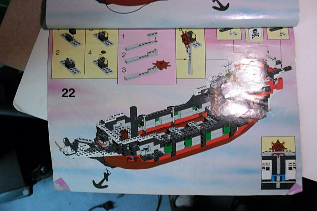](https://www.freelug.org/IMG/jpg/6286-v16.jpg)

La construction se poursuit avec les mâts et les voiles :

[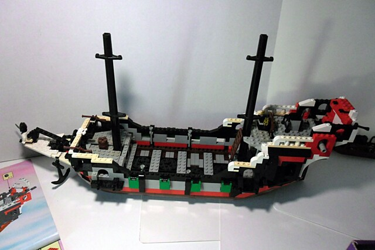](https://www.freelug.org/IMG/jpg/6286-v17.jpg)

[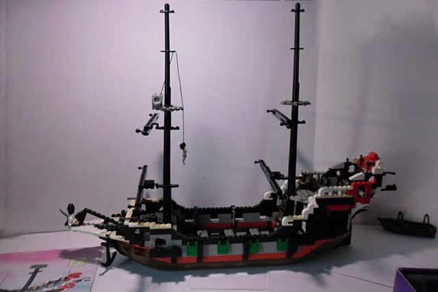](https://www.freelug.org/IMG/jpg/6286-v18.jpg)

[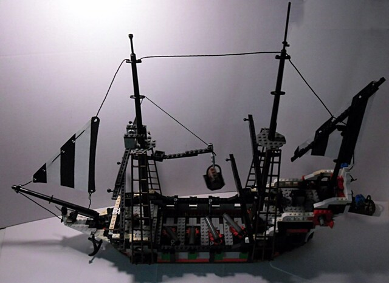](https://www.freelug.org/IMG/jpg/6286-v19.jpg)

Pour terminer, quelques vues du bateau achevé avec tous ses personnages.

[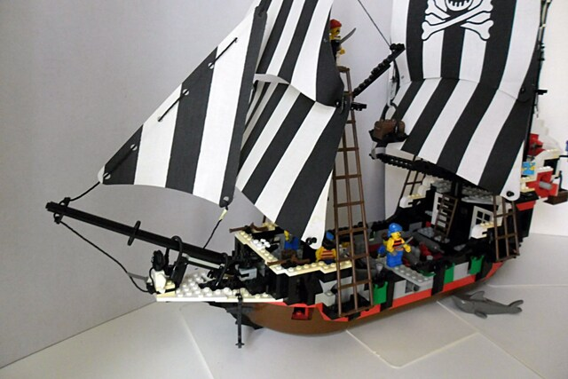](https://www.freelug.org/IMG/jpg/6286-v21.jpg)

[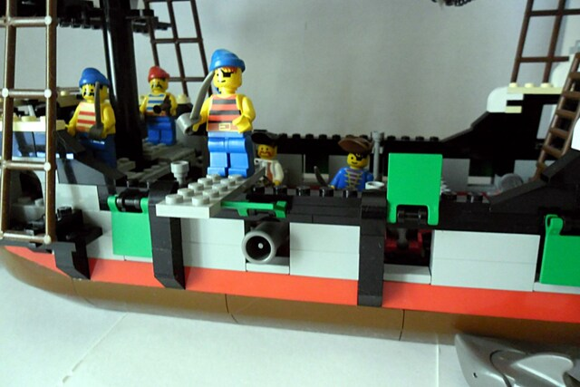](https://www.freelug.org/IMG/jpg/6286-v22.jpg)

[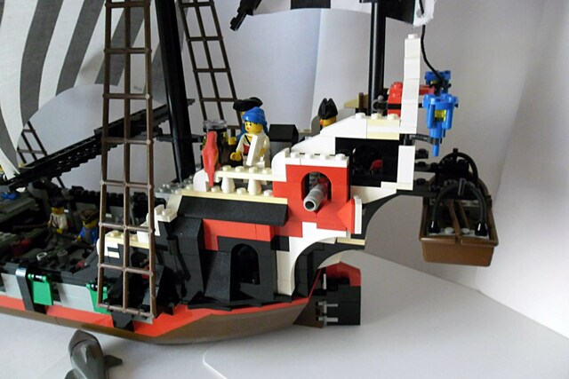](https://www.freelug.org/IMG/jpg/6286-v23.jpg)

[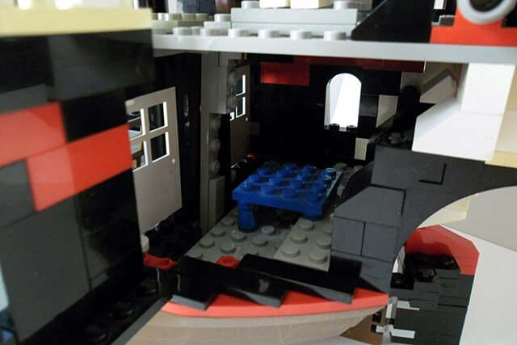](https://www.freelug.org/IMG/jpg/6286-v24.jpg)

**Conclusion :**  
Un set que je rêvais d’avoir étant jeune, et ben je ne regrette pas du tout. Il est énorme, très jouable et avec beaucoup de pirates...  
Donc à l’attaque moussaillon !!
