Partons à la découverte de ce set qui nous vient de 1997 !

[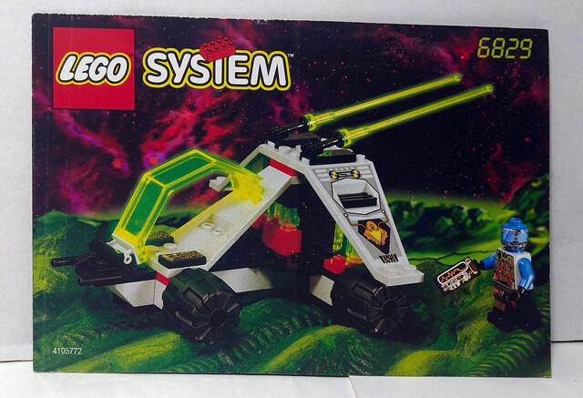](https://www.freelug.org/IMG/jpg/6829-1.jpg)

Le set comprend 52 pièces avec un personnage.

Une petite vue arrière de la notice montre les autres montages possibles :

[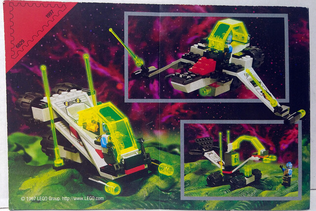](https://www.freelug.org/IMG/jpg/6829-2.jpg)

Venons au principal : le contenu de la boite :

[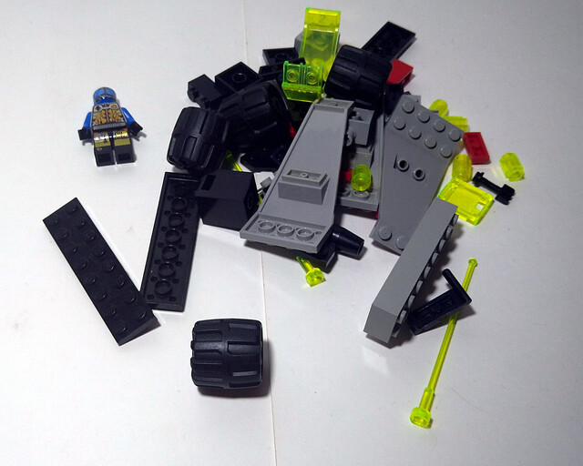](https://www.freelug.org/IMG/jpg/6829-3.jpg)

Un personnage, qui aurait pour nom : Techdroid I

[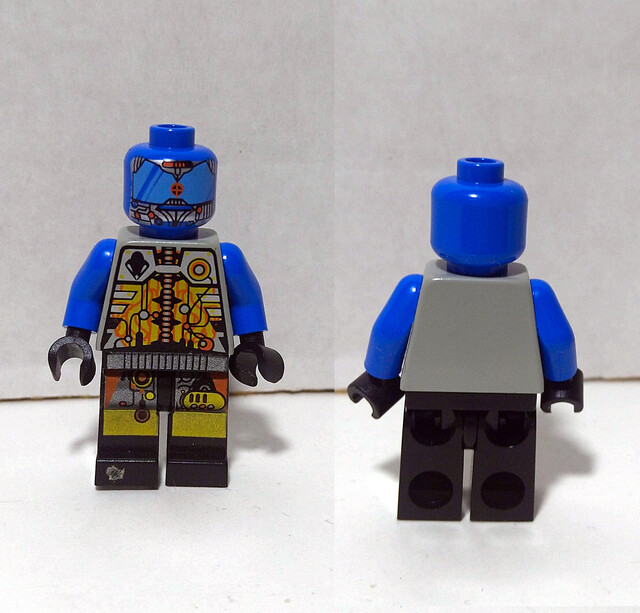](https://www.freelug.org/IMG/jpg/6829-4.jpg)

Le montage est assez rapide avec des métapièces sérigraphiées exclusives à cette gamme.

[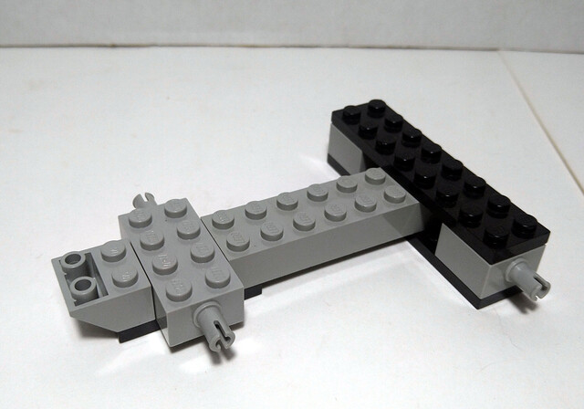](https://www.freelug.org/IMG/jpg/6829-5.jpg)

[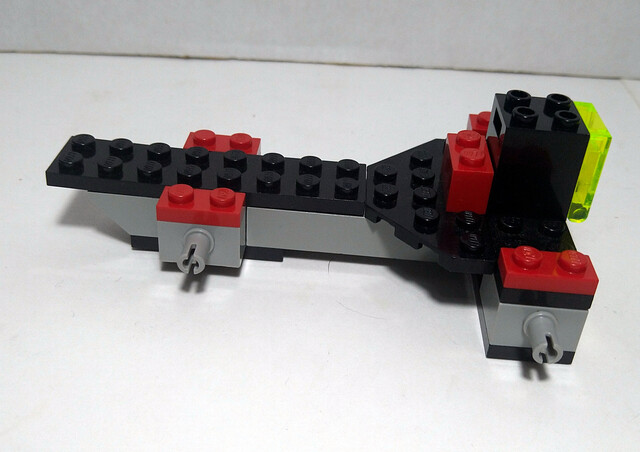](https://www.freelug.org/IMG/jpg/6829-6.jpg)

[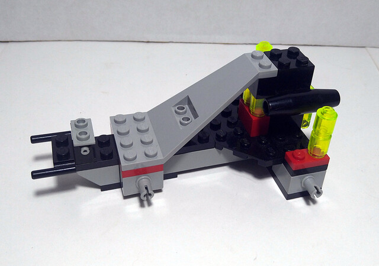](https://www.freelug.org/IMG/jpg/6829-7.jpg)

[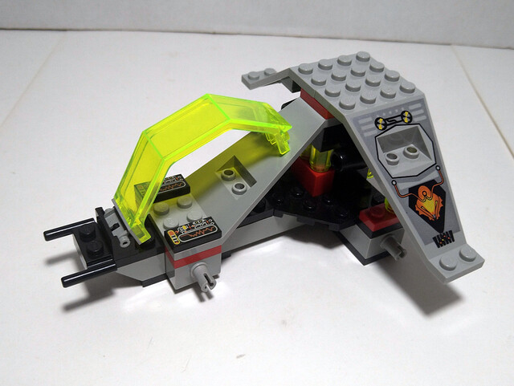](https://www.freelug.org/IMG/jpg/6829-8.jpg)

[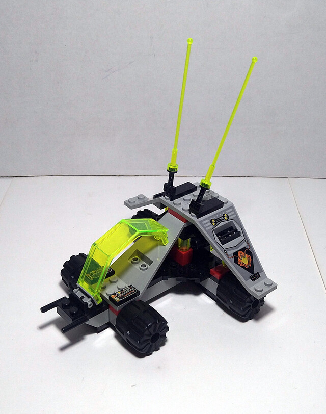](https://www.freelug.org/IMG/jpg/6829-9.jpg)

Et voilà déjà fini :

[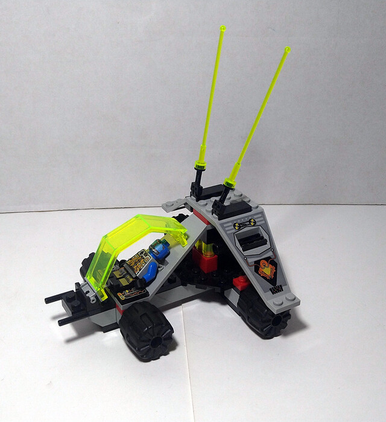](https://www.freelug.org/IMG/jpg/6829-10.jpg)

Et pour terminer les montages alternatifs :

[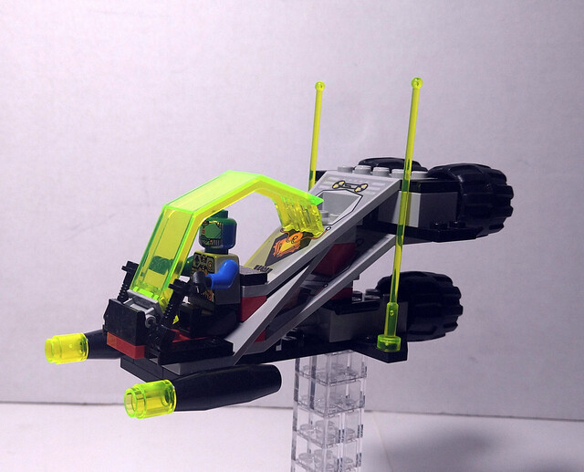](https://www.freelug.org/IMG/jpg/6829-11.jpg)

[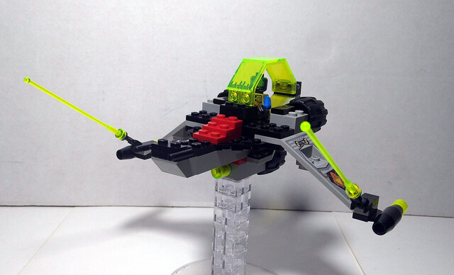](https://www.freelug.org/IMG/jpg/6829-12.jpg)

[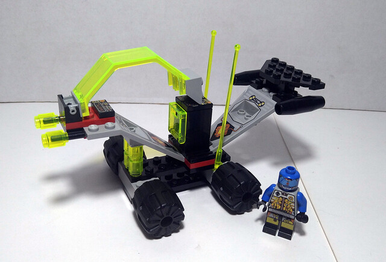](https://www.freelug.org/IMG/jpg/6829-13.jpg)

**Conclusion**  
Que dire : pour l’époque, on savait faire des trucs colorés et qui en jettent pas mal ! Un petit Rover qui permet de commencer sans trop difficulté la gamme UFO.
