Aujourd’hui je vous propose la review du set 70330 dans la gamme _Nexo Knights_ : **Ultimate Clay**.  
Ce set sorti en 2016 au prix de 9,99 € est composé de 72 pièces, soit un ratio prix/pièce de 14 centimes d’€.

[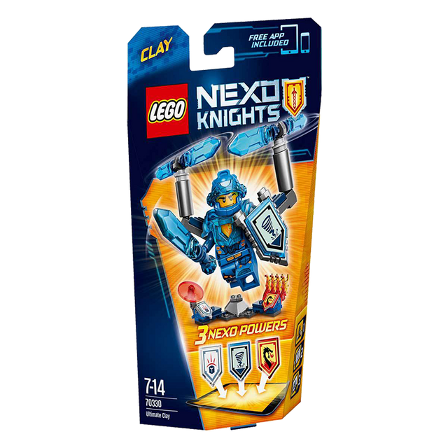](https://www.freelug.org/IMG/png/UltimateClay_box_mini.png)

Lancée début 2016, _Nexo Knights_ est une nouvelle gamme made in LEGO :

> Voyage dans un monde de chevaliers high-tech et de monstres de lave avec un magicien numérique pour une nouvelle aventure passionnante !

Les sets sont couplés à un jeu vidéo pour smartphone/tablette, les blasons contenus dans les boîtes LEGO permettent d’avoir différents pouvoirs dans le jeu.

Le visuel de la boite reprend bien le thème "chevalier high-tech" avec ses couleurs jaune et bleue.  
Sur le bas de la boîte on vois les trois Nexo Powers contenus dans le set et qui permettront de jouer dans le jeu vidéo. Le visuel est complètement dans le ton de cette nouvelle gamme, LEGO a réussi son coup de ce côté-là.

[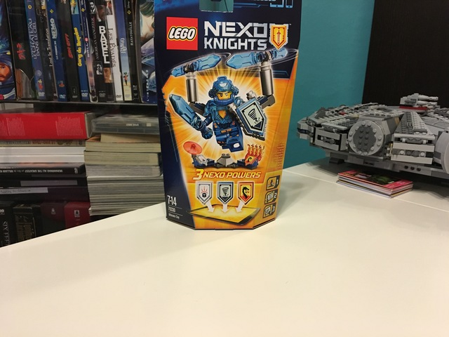](https://www.freelug.org/IMG/jpg/UltimateClay_01.jpg)

Le dos du set apporte un visuel du set monté et une grande partie est dédiée au jeu vidéo et au matériel avec lequel il est compatible. Le verso du set fait bien triste à cause de cet encart.

[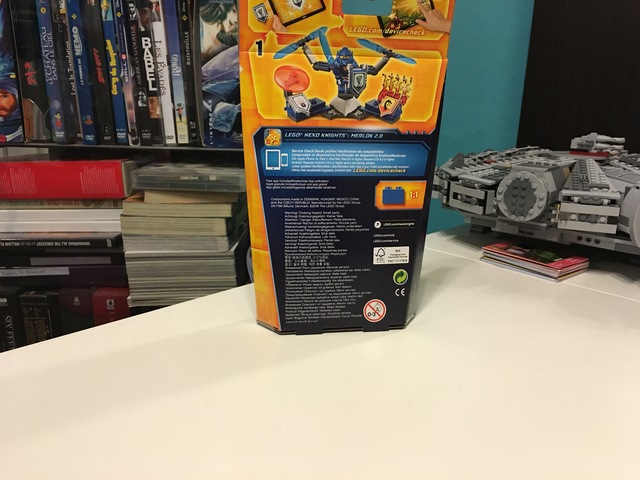](https://www.freelug.org/IMG/jpg/UltimateClay_02.jpg)

Une fois ouvert, le set contient deux sachets non numérotés et une notice de construction.

[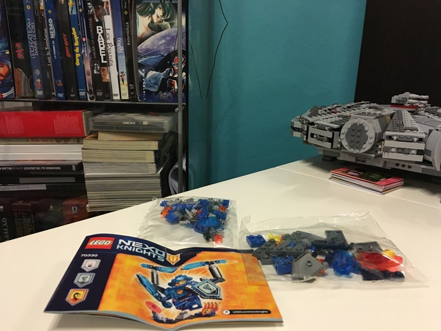](https://www.freelug.org/IMG/jpg/UltimateClay_03.jpg)

La minifig de _Clay_ est vraiment réussie. Tant au niveau du double visage qu’au niveau de la sérigraphie du torso et des jambes. Cette dernière est complètement dans le thème avec une armure qui mélange high-tech et Moyen-Age, impression renforcée avec le blason sur le torse.

[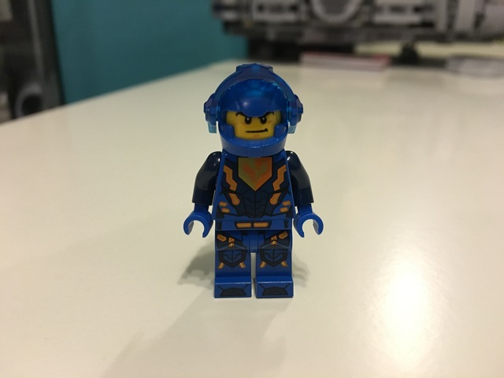](https://www.freelug.org/IMG/jpg/UltimateClay_04.jpg)

_Clay_ avec son heaume translucide abaissé.

[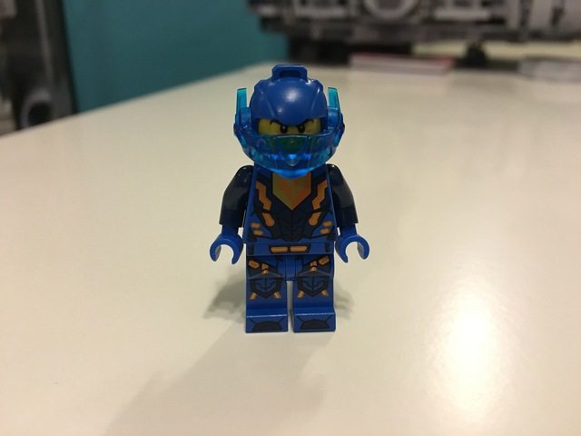](https://www.freelug.org/IMG/jpg/UltimateClay_05.jpg)

Puis avec son armure, elle aussi translucide, son épée et son bouclier contenant un des trois blasons du set (blasons sérigraphiés sur pièces translucides).  
Comme l’a très justement fait remarquer l’ami [_Gnaat_](http://reviewlego.com/) dans sa review du set _[Ultimate Aaron (70332)](http://reviewlego.com/2016/01/12/70332-lego-nexo-knights-aaron-lultime-chevalier/)_, l’armure est ajourée afin de laisser voir le blason du torse.

[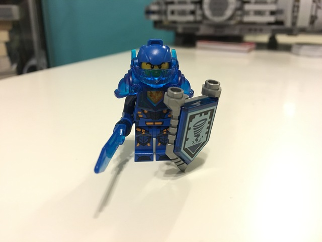](https://www.freelug.org/IMG/jpg/UltimateClay_07.jpg)

De dos on peut apprécier le visage alternatif "énervé" et ainsi que la sérigraphie toujours aussi réussie.

[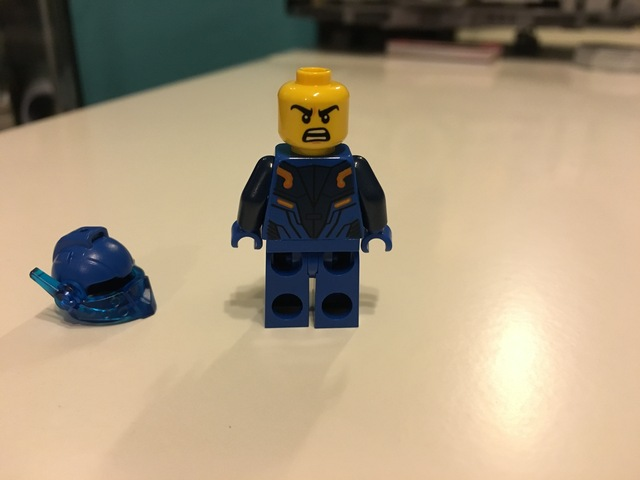](https://www.freelug.org/IMG/jpg/UltimateClay_06.jpg)

Le dos de l’armure comprend 4 tenons, nous y reviendrons plus tard.

[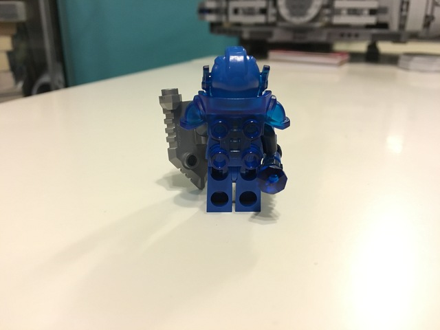](https://www.freelug.org/IMG/jpg/UltimateClay_08.jpg)

Montage des "impressionnants" bras articulés.

[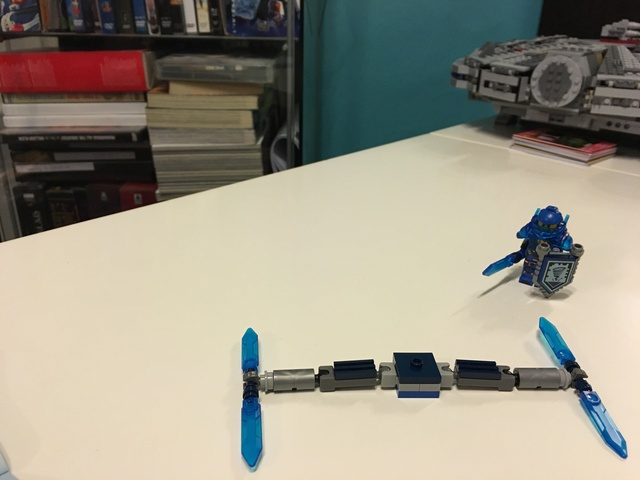](https://www.freelug.org/IMG/jpg/UltimateClay_09.jpg)

On comprend maintenant l’intérêt des 4 tenons au dos de l’armure. _Clay_ prend des airs de _Dr Octopus_ ainsi accoutré.

[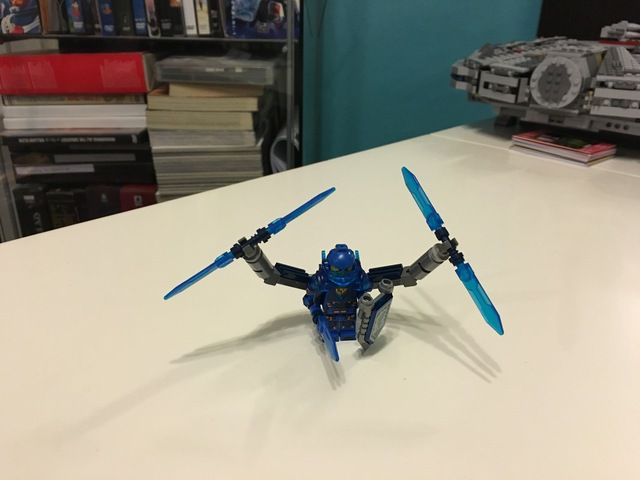](https://www.freelug.org/IMG/jpg/UltimateClay_10.jpg)

Vous comprenez maintenant le terme "impressionnants" utilisé plus haut, ces bras sont démesurés par rapport à la petite fig.

[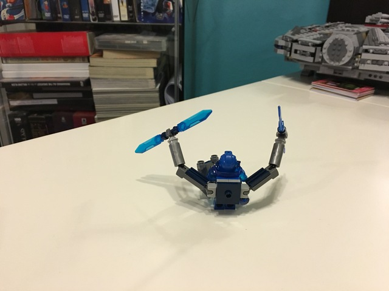](https://www.freelug.org/IMG/jpg/UltimateClay_11.jpg)

Début de construction de l’estrade qui recevra la figurine ainsi que les armes et blasons supplémentaires.

[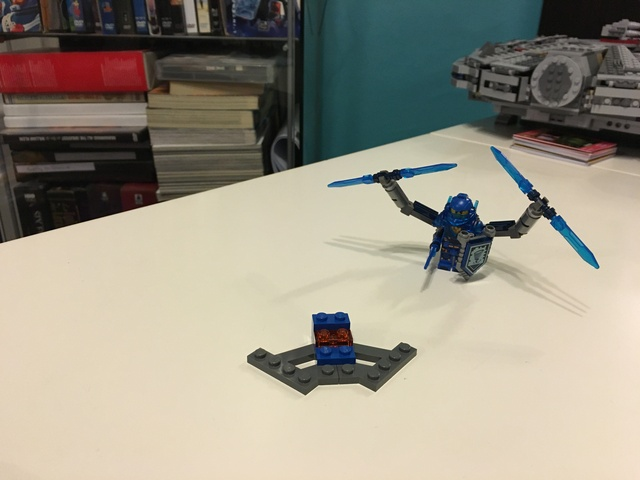](https://www.freelug.org/IMG/jpg/UltimateClay_12.jpg)

L’estrade centrale pour _Clay_ est finie.

[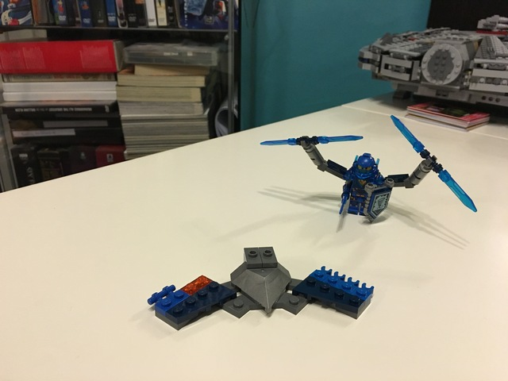](https://www.freelug.org/IMG/jpg/UltimateClay_13.jpg)

On installe les portants à blason.

[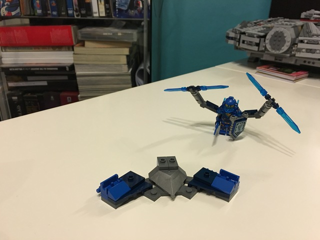](https://www.freelug.org/IMG/jpg/UltimateClay_14.jpg)

Le blason de gauche avec l’arme "Bouclier" est en place.

[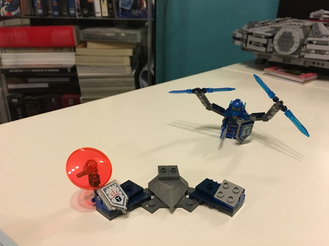](https://www.freelug.org/IMG/jpg/UltimateClay_15.jpg)

On installe maintenant le blason de droite avec l’arme "Flammes". Les flammes viennent se substituer aux épées bleues sur les bras mécaniques de _Clay_.

[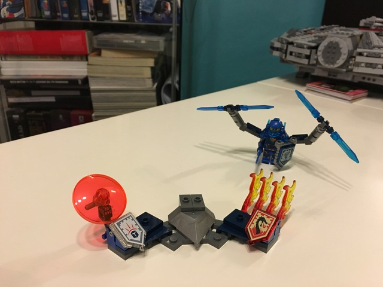](https://www.freelug.org/IMG/jpg/UltimateClay_16.jpg)

Mise en situation recto/verso du set terminé.

[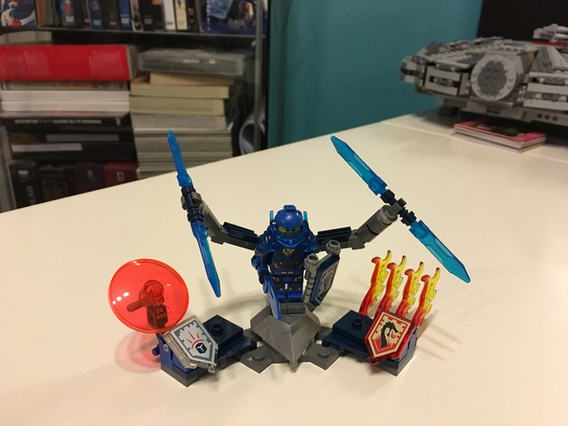](https://www.freelug.org/IMG/jpg/UltimateClay_17.jpg)

[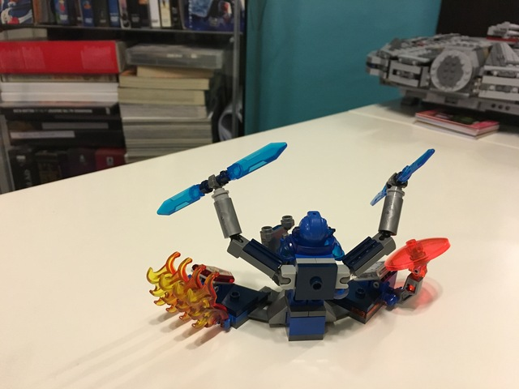](https://www.freelug.org/IMG/jpg/UltimateClay_18.jpg)

**AVIS :**

Alors que j’avais un avis négatif quand cette gamme a été annoncée par LEGO, je la trouve plutôt réussie et cohérente avec l’univers créé et voulu par l’entreprise danoise.  
Personnellement les sets ne m’intéressent pas plus que ça, par contre les Minifigures sont une vraie réussite et il n’est pas exclu que je les collectionne.

**BONUS :**

Voici un GIF animé réalisé avec la totalité des photos prises pour cette review.

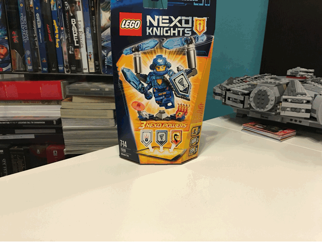
