Aujourd’hui je vous propose la review du set 70818 dans la gamme _The LEGO Movie_ : **Double-Decker Couch**.  
Ce set sorti en 2015 au prix de 16,99 euros est composé de 197 pièces, soit un ratio prix/pièce d’environ 9 centimes d’euros.

[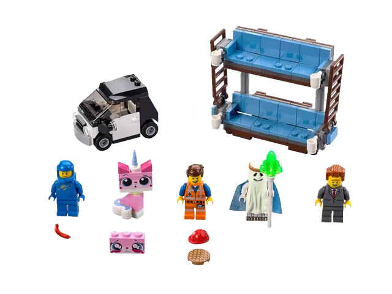](https://www.freelug.org/IMG/png/DoubleDeckerCouch.png)

* * *

Le visuel de la boite est composé en haut des logos _LEGO_ et _The LEGO Movie_.  
Le set est inséré dans le décor de la ville du film.

[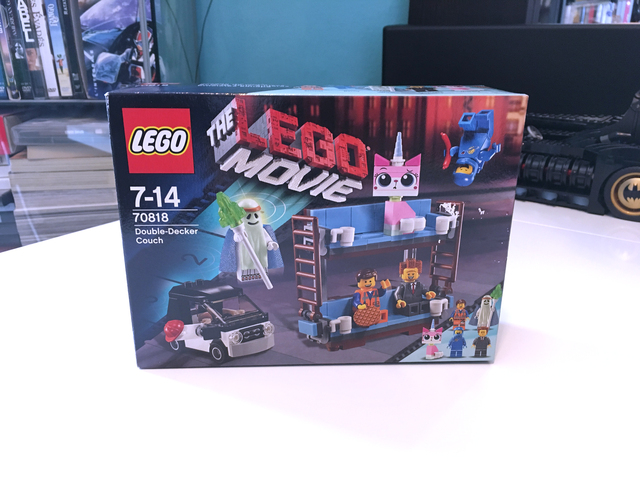](https://www.freelug.org/IMG/jpg/DoubleDeckerCouch_01.jpg)

Au verso, on retrouve plusieurs vignettes avec les éléments de jouabilités du set.

[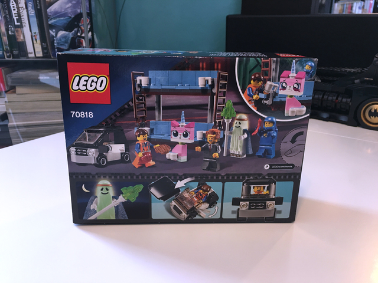](https://www.freelug.org/IMG/jpg/DoubleDeckerCouch_02.jpg)

La boite contient quatre sachets et une notice de construction.

[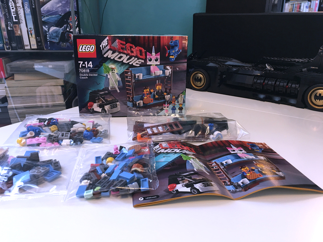](https://www.freelug.org/IMG/jpg/DoubleDeckerCouch_03.jpg)

* * *

La première minifig du set est _[Benny](http://brickset.com/minifigs/tlm094/Benny-Closed-Eyes-\(70818\))_, reproduction des _[Classic Space](http://brickset.com/minifigs/sp004/Classic-Space-Blue-with-Airtanks)_ et leurs casques qui se cassaient très facilement (ici en version moulé). _LEGO_ a même poussé le vice jusqu’à faire une sérigraphie à moitié effacée pour figurer une figurine ayant déjà bien vécue.  
La tête est une des plus sympa qui m’ait été donné de voir avec un grand sourire qui inspire tout de suite la sympathie.

[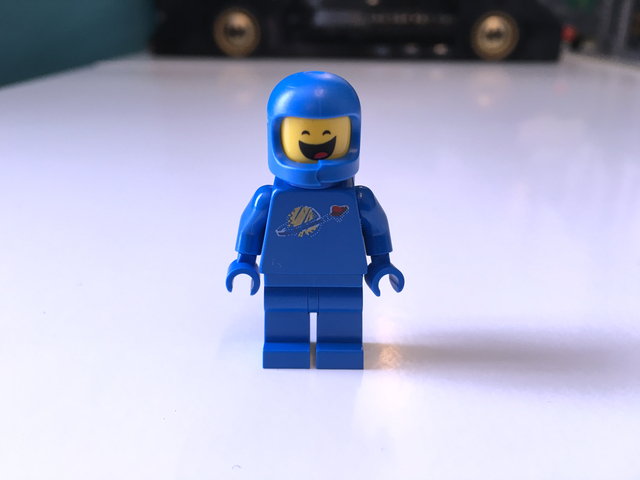](https://www.freelug.org/IMG/jpg/DoubleDeckerCouch_04.jpg)

De dos on retrouve les classiques bouteilles à oxygène, le visage alternatif figure un _Benny_ se retenant d’exploser de rire.

[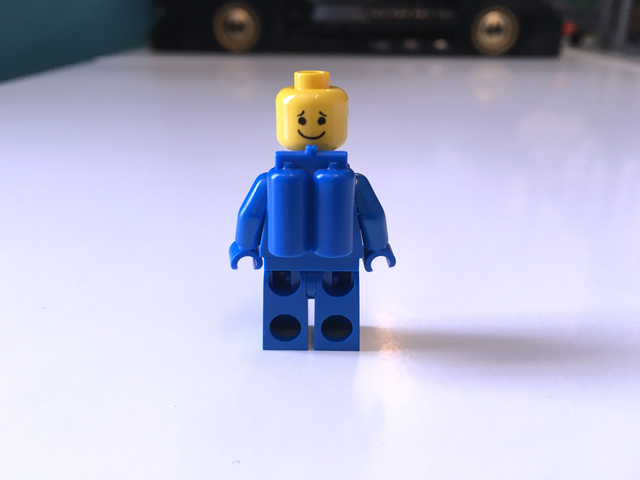](https://www.freelug.org/IMG/jpg/DoubleDeckerCouch_05.jpg)

Deuxième fig, _[Emmet](http://brickset.com/minifigs/tlm096/Emmet-Lopsided-Open-Mouth-Smile-\(70818\))_, le héros du film. Belles sérigraphies, notamment avec les bandes argentées et un visage orné d’un grand sourire.

[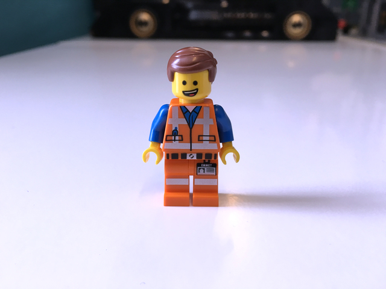](https://www.freelug.org/IMG/jpg/DoubleDeckerCouch_06.jpg)

De dos quatre bandes argentées viennent agrémenter la figurine. Le visage alternatif permet d’avoir un _Emmet_ triste.

[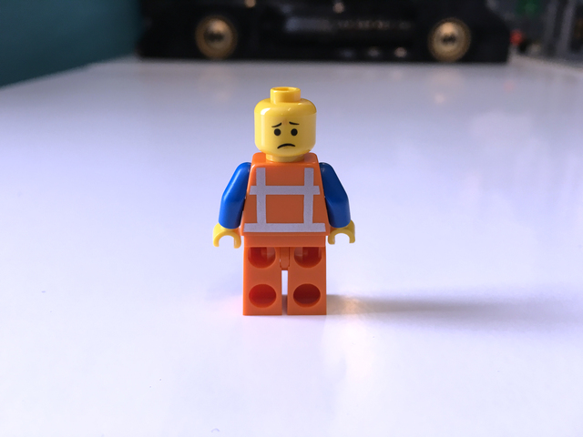](https://www.freelug.org/IMG/jpg/DoubleDeckerCouch_07.jpg)

Troisième figurine, le _[Président Business](http://brickset.com/minifigs/tlm095/President-Business-Smiling-Raised-Eyebrows)_. Sérigraphies faisant le job sans plus, ici aussi nous avons le droit à un visage joyeux.

[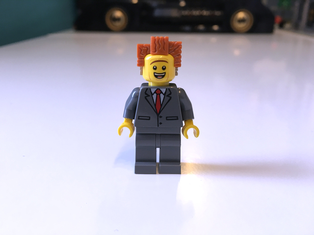](https://www.freelug.org/IMG/jpg/DoubleDeckerCouch_08.jpg)

Au dos, aucune sérigraphie et un visage faisant la moue.

[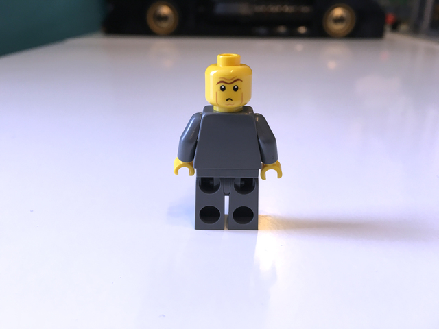](https://www.freelug.org/IMG/jpg/DoubleDeckerCouch_09.jpg)

Avant-dernière minifig, _[Vitruvius](http://brickset.com/minifigs/tlm092/Vitruvius-Ghost-Shroud-\(70818\))_ version fantôme phosphorescent.

[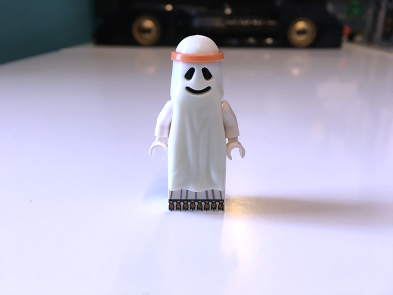](https://www.freelug.org/IMG/jpg/DoubleDeckerCouch_10.jpg)

Une fois le drap phosphorescent enlevé on découvre une tête noire dépourvue de sérigraphie. Cela permet aussi de mieux voir la brique sérigraphiée fournie à la place des jambes.

[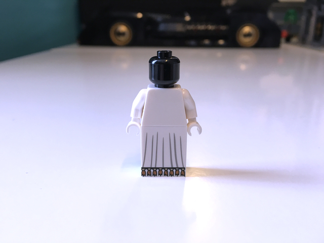](https://www.freelug.org/IMG/jpg/DoubleDeckerCouch_11.jpg)

De dos rien à signaler.

[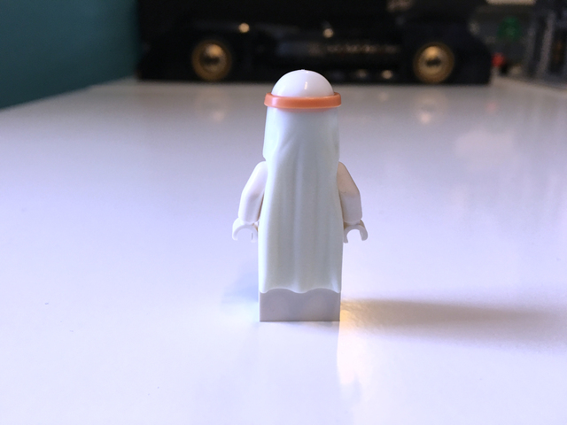](https://www.freelug.org/IMG/jpg/DoubleDeckerCouch_12.jpg)

Dernière fig, _[Unikitty](http://brickset.com/minifigs/tlm093/Unikitty-Puzzled-Sitting-\(70818\))_. Fourni avec deux visages différents, ici normal.

[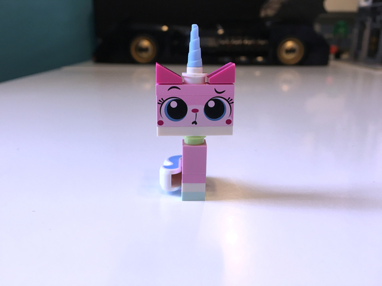](https://www.freelug.org/IMG/jpg/DoubleDeckerCouch_13.jpg)

Et version triste. Remarquez que même les sourcils sont différents.

[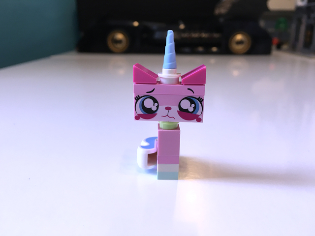](https://www.freelug.org/IMG/jpg/DoubleDeckerCouch_14.jpg)

De dos aucune sérigraphie ne vient agrémenter le personnage.

[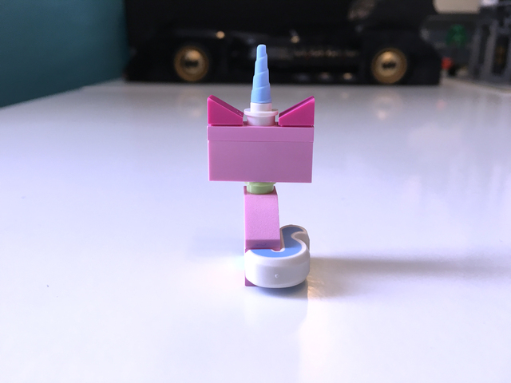](https://www.freelug.org/IMG/jpg/DoubleDeckerCouch_15.jpg)

* * *

On commence le montage par la voiture d’_Emmet_.

[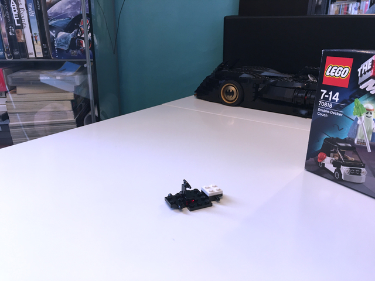](https://www.freelug.org/IMG/jpg/DoubleDeckerCouch_16.jpg)

La construction bien que rapide est plaisante pour un si petit modèle.

[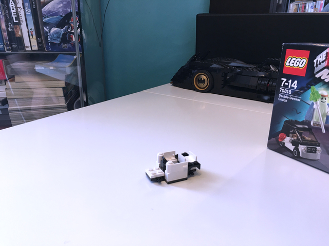](https://www.freelug.org/IMG/jpg/DoubleDeckerCouch_17.jpg)

Malgré sa petite taille, le véhicule possède même des rétroviseurs.

[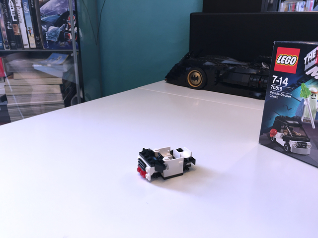](https://www.freelug.org/IMG/jpg/DoubleDeckerCouch_18.jpg)

Le pare-brise est installé.

[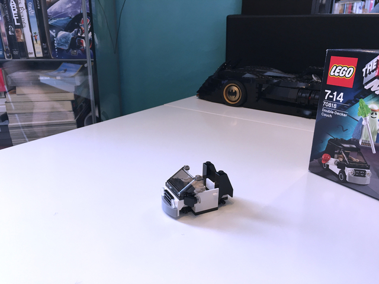](https://www.freelug.org/IMG/jpg/DoubleDeckerCouch_19.jpg)

Une fois les roues et le toit posés, la voiture est terminée. Cette dernière ressemble beaucoup à une _Smart_.

[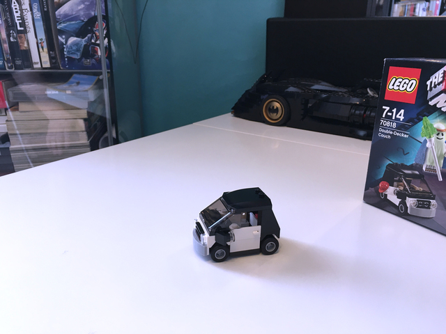](https://www.freelug.org/IMG/jpg/DoubleDeckerCouch_20.jpg)

On débute maintenant le _Canapé à l’Impérial_.

[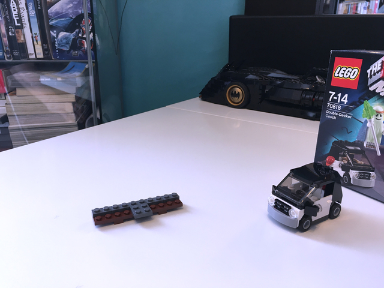](https://www.freelug.org/IMG/jpg/DoubleDeckerCouch_21.jpg)

Le dossier du canapé du haut recouvert de _tiles_ bleues.

[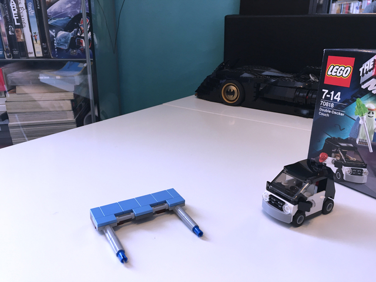](https://www.freelug.org/IMG/jpg/DoubleDeckerCouch_22.jpg)

Construction de l’assise du haut.

[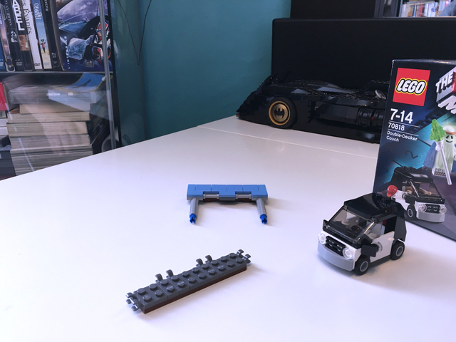](https://www.freelug.org/IMG/jpg/DoubleDeckerCouch_23.jpg)

Les briques à tenons permettront aux figurines de ne pas tomber.

[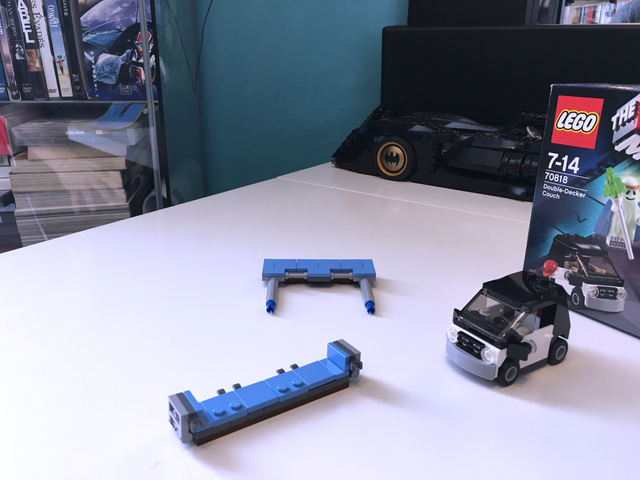](https://www.freelug.org/IMG/jpg/DoubleDeckerCouch_24.jpg)

Une fois l’assise du haut posée on recommence pour le canapé du bas.

[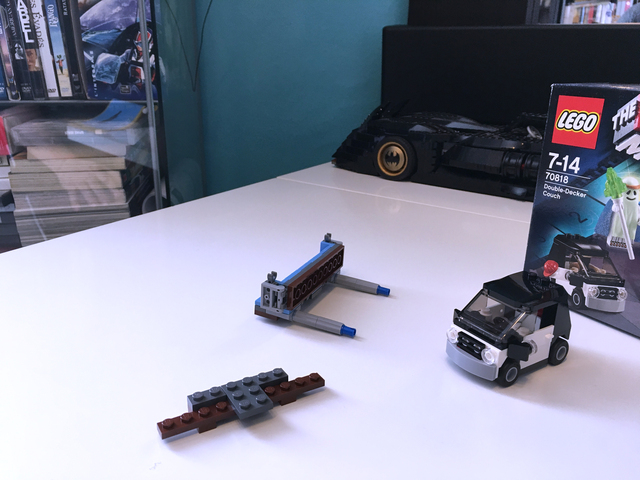](https://www.freelug.org/IMG/jpg/DoubleDeckerCouch_25.jpg)

La construction de ce canapé est donc un poil monotone, heureusement que c’est un petit set.

[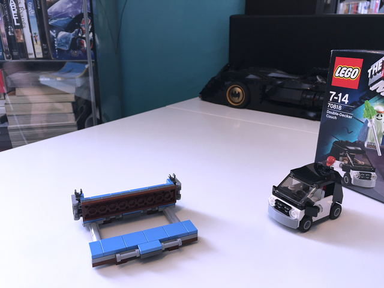](https://www.freelug.org/IMG/jpg/DoubleDeckerCouch_26.jpg)

L’assise du bas.

[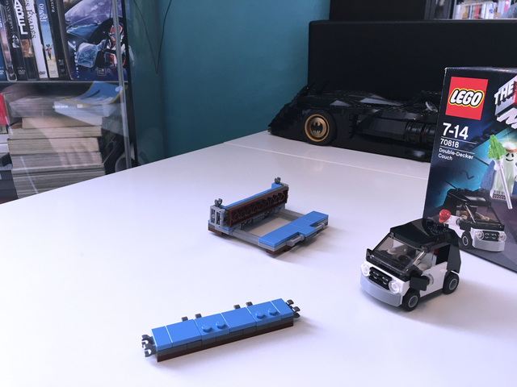](https://www.freelug.org/IMG/jpg/DoubleDeckerCouch_27.jpg)

On place les accoudoirs.

[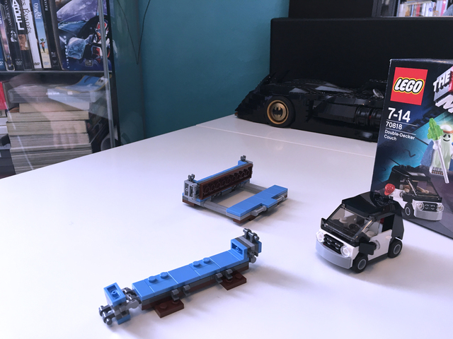](https://www.freelug.org/IMG/jpg/DoubleDeckerCouch_28.jpg)

Le canapé est quasiment fini.

[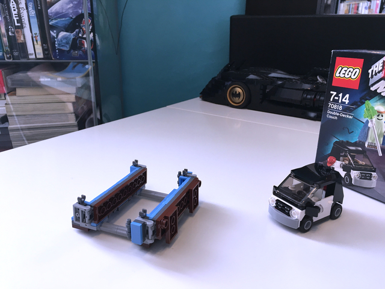](https://www.freelug.org/IMG/jpg/DoubleDeckerCouch_29.jpg)

Ajout des échelles et des tasses pour finaliser la construction.

[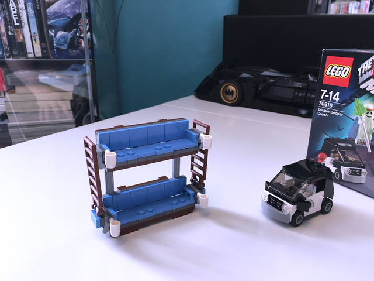](https://www.freelug.org/IMG/jpg/DoubleDeckerCouch_30.jpg)

Voici le set mis en situation avec les figurines.

[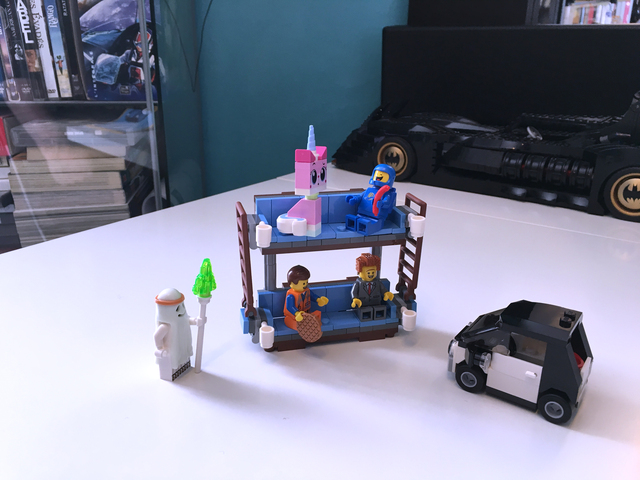](https://www.freelug.org/IMG/jpg/DoubleDeckerCouch_31.jpg)

**AVIS :**

Même si la construction est un poil répétitive, le rapport qualité/prix et la présence de cinq figurines exclusives en font un must have pour qui voudrait avoir au moins un set de la licence.

**BONUS :**

Voici un GIF animé réalisé avec la totalité des photos prises pour cette review (cliquez sur l’image pour lancer l’animation).

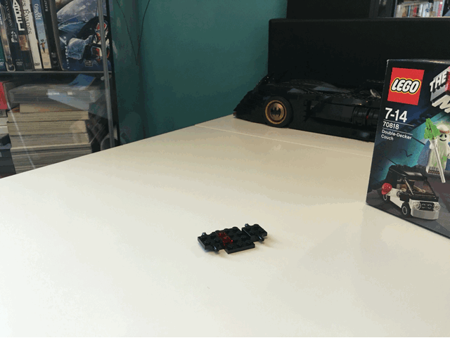
