Aujourd’hui je vous propose la review du set 7104 dans la gamme _Star Wars_ : **Desert Skiff**.  
Ce set sorti en 2000 au prix de 45 Francs (soit environ 6 Euros) est composé de 55 pièces, soit un ratio prix/pièce de 10 centimes d’euros.

[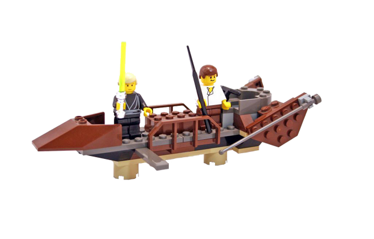](https://www.freelug.org/IMG/png/DesertSkiff7104.png)

Les sets de la Trilogie Originale traitant d’_Endor_, de _Hoth_ ou comme ici de _Tatooine_ sont plutôt prisés des collectionneurs, voyons si ce set valant 6 euros à l’époque vaut la peine d’être possédé encore aujourd’hui.

* * *

Le visuel de la boite reprend une scène du film Le retour du Jedi. Pas de bandeau comme sur les sets contemporains, juste les logos _LEGO_ et _Star Wars_ (néanmoins les personnages principaux de la Trilogie Originale sont présents au-dessus du logo).  
Le contenu du set est intégré dans un décor désertique de la planète _Tatooine_.

[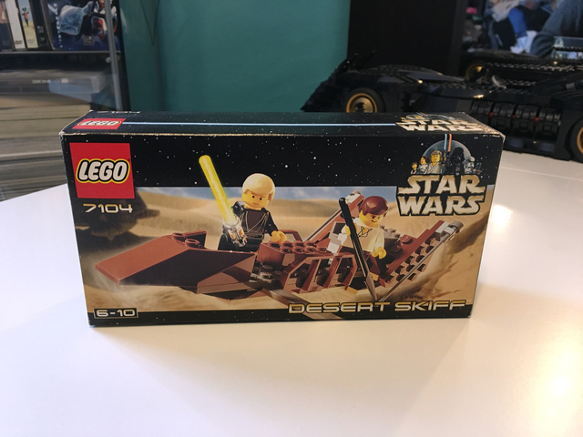](https://www.freelug.org/IMG/jpg/DesertSkiff7104_01.jpg)

Au verso plusieurs photos nous permettent de voir un modèle alternatif (non présent sur la notice).

[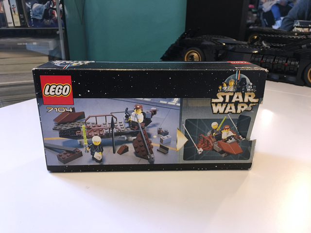](https://www.freelug.org/IMG/jpg/DesertSkiff7104_02.jpg)

J’ai acheté cette boite d’occasion, mais je pense qu’il devait y avoir deux sachets dans le set. Il contient aussi une notice et deux mini catalogues contenant les sets du moment en 2000.

[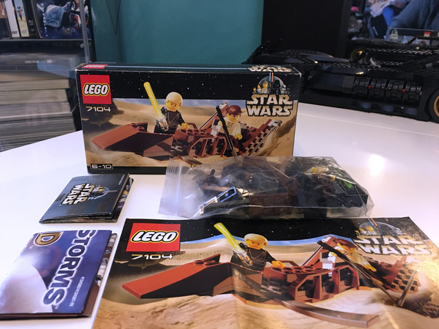](https://www.freelug.org/IMG/jpg/DesertSkiff7104_03.jpg)

Petit zoom sur la notice, on voit qu’à l’époque _LEGO_ ne donnait pas la liste des pièces pour chaque étape comme aujourd’hui.

[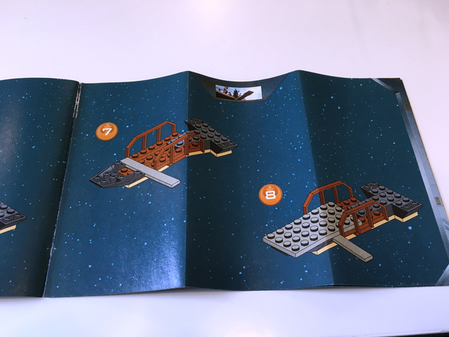](https://www.freelug.org/IMG/jpg/DesertSkiff7104_04.jpg)

* * *

La première des deux minifigs est _[Han Solo](http://brickset.com/minifigs/sw015/Han-Solo-Brown-Legs-without-Holster-Pattern-\(Skiff\))_, on peut voir ici le fossé qu’il y a entre les figs des années 2000 et celles de 2016. Ici la sérigraphie est minimaliste. De plus à cette époque les têtes sont encore jaune, mais elles ont des expressions différentes des têtes classiques.

[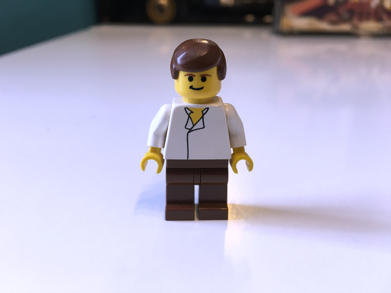](https://www.freelug.org/IMG/jpg/DesertSkiff7104_05.jpg)

De dos c’est le désert.

[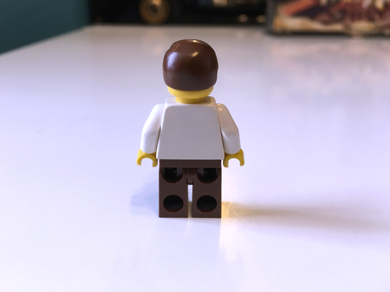](https://www.freelug.org/IMG/jpg/DesertSkiff7104_06.jpg)

_[Luke Skywalker](http://brickset.com/minifigs/sw020/Luke-Skywalker-\(Skiff\))_ dans sa tenue noire de maître Jedi. Là aussi la sérigraphie est minimaliste.

[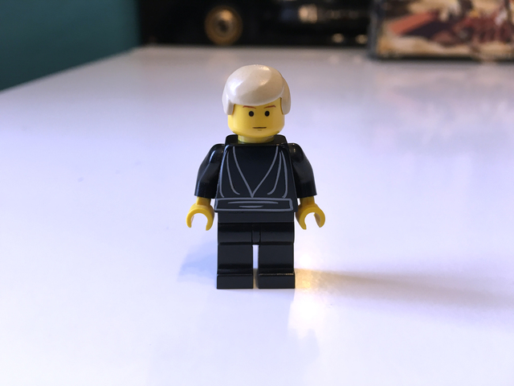](https://www.freelug.org/IMG/jpg/DesertSkiff7104_07.jpg)

Comme pour _Han Solo_, aucune sérigraphie ne vient agrémenter le dos.

[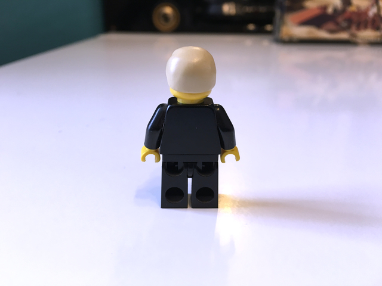](https://www.freelug.org/IMG/jpg/DesertSkiff7104_08.jpg)

* * *

On commence la construction avec des pièces simples.

[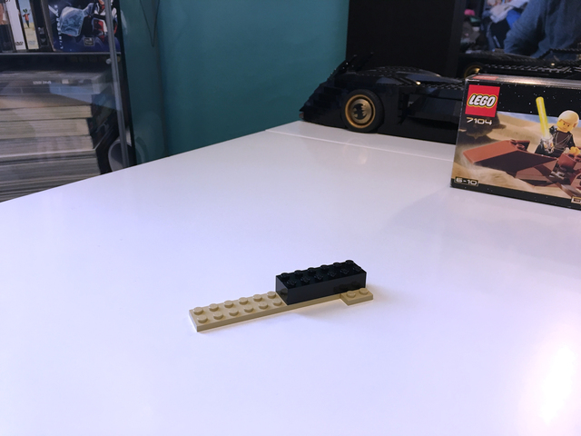](https://www.freelug.org/IMG/jpg/DesertSkiff7104_09.jpg)

L’armature prend forme.

[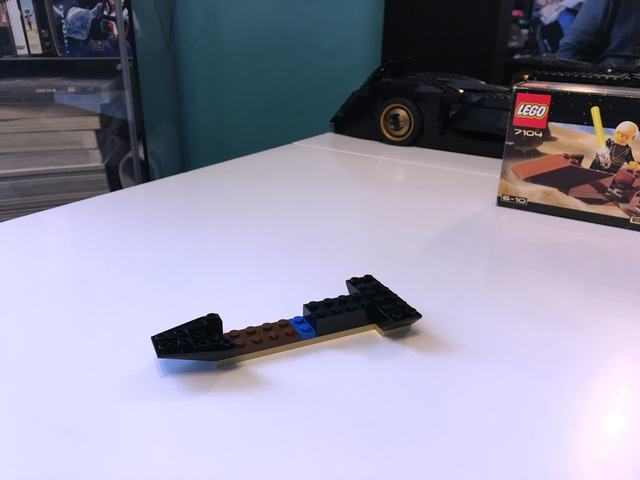](https://www.freelug.org/IMG/jpg/DesertSkiff7104_10.jpg)

On commence à s’apercevoir que les constructions de l’époque étaient beaucoup plus simples qu’aujourd’hui.

[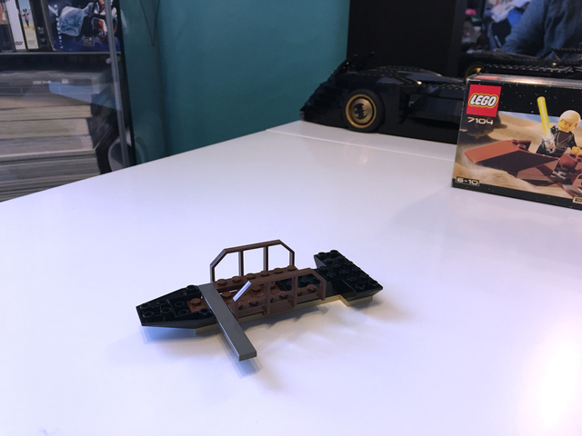](https://www.freelug.org/IMG/jpg/DesertSkiff7104_11.jpg)

Le plancher du Skiff est maintenant posé.

[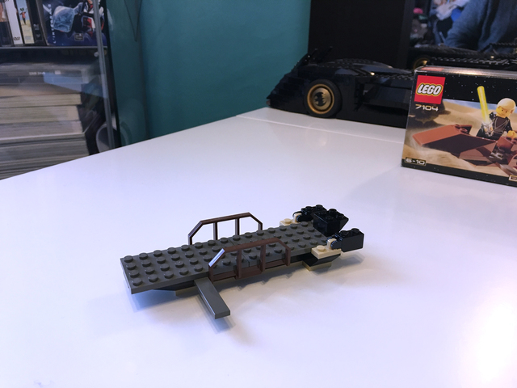](https://www.freelug.org/IMG/jpg/DesertSkiff7104_12.jpg)

Mise en place des stabilisateurs.

[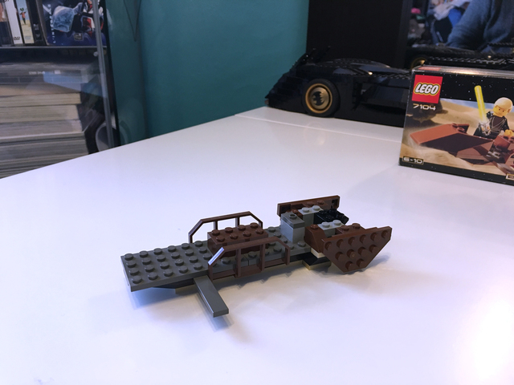](https://www.freelug.org/IMG/jpg/DesertSkiff7104_13.jpg)

Mise en place du nez de l’appareil et du poste de pilotage.

[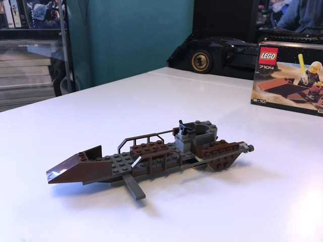](https://www.freelug.org/IMG/jpg/DesertSkiff7104_14.jpg)

Voilà le set terminé.

[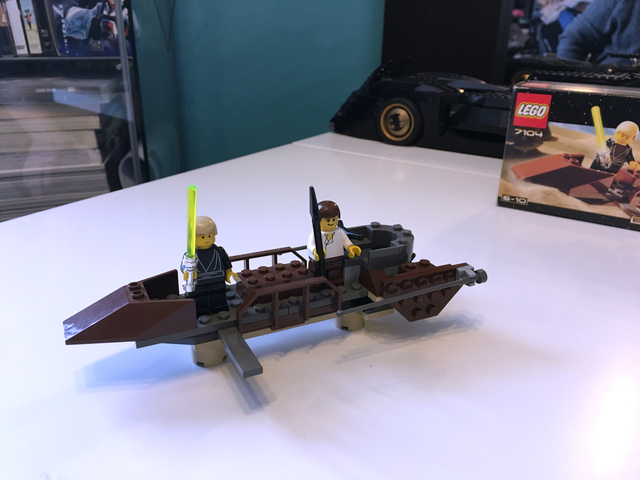](https://www.freelug.org/IMG/jpg/DesertSkiff7104_15.jpg)

Le _Skiff_ sous différents angles.

[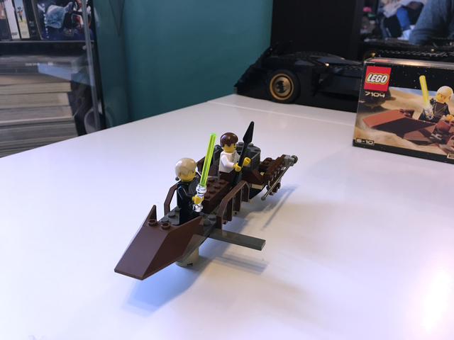](https://www.freelug.org/IMG/jpg/DesertSkiff7104_16.jpg)

[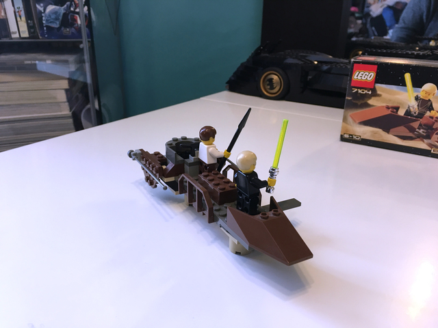](https://www.freelug.org/IMG/jpg/DesertSkiff7104_17.jpg)

[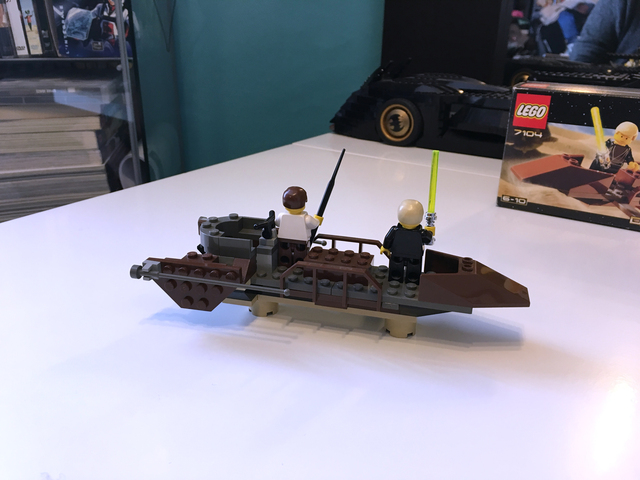](https://www.freelug.org/IMG/jpg/DesertSkiff7104_18.jpg)

[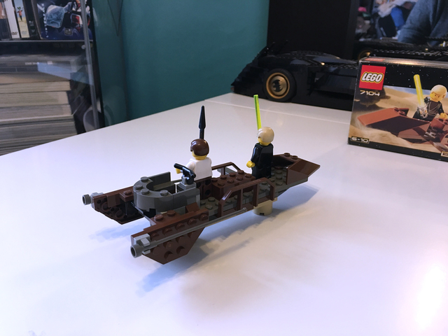](https://www.freelug.org/IMG/jpg/DesertSkiff7104_19.jpg)

[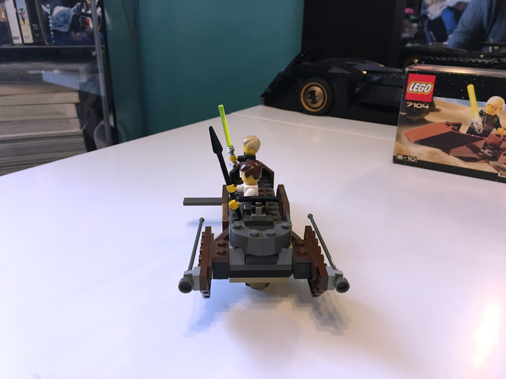](https://www.freelug.org/IMG/jpg/DesertSkiff7104_20.jpg)

[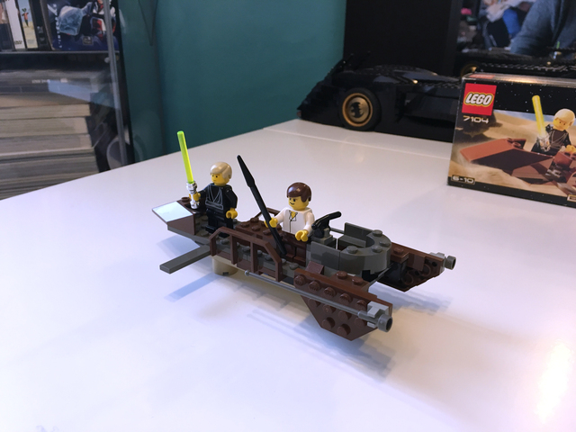](https://www.freelug.org/IMG/jpg/DesertSkiff7104_21.jpg)

[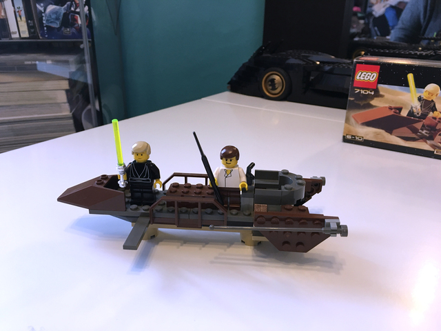](https://www.freelug.org/IMG/jpg/DesertSkiff7104_22.jpg)

**AVIS :**

Ce petit set, même s’il parait simpliste aujourd’hui, n’en reste pas moins une belle acquisition pour les fans de la Trilogie Originale. D’autant plus qu’on le trouve à des prix raisonnables et que les deux figurines sont exclusives au set.

**BONUS :**

Voici un GIF animé réalisé avec la totalité des photos prises pour cette review (cliquez sur l’image pour lancer l’animation).

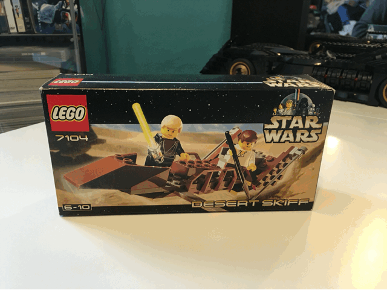
