Aujourd’hui je vous propose la review du set 71251 dans la gamme _Dimensions_ : **Fun pack : B.A. Baracus**.  
Ce set sorti en 2016 au prix de 14,99 € est composé de 73 pièces, soit un ratio prix/pièce de 21 centimes d’euro.  
Ce set est un _Fun Pack_ (ou _Level Pack_) du jeu _[LEGO Dimensions](http://www.lego.com/fr-fr/dimensions)_ sorti en 2015.

[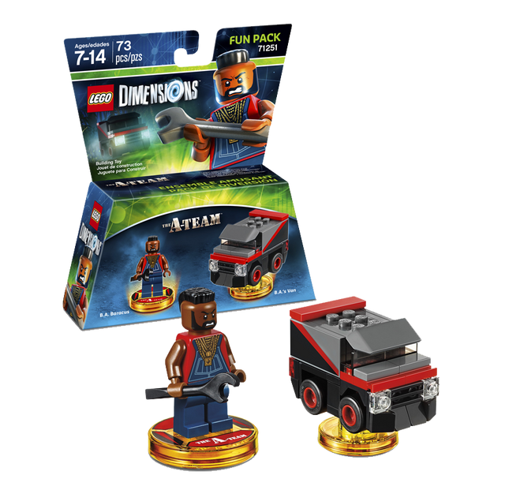](https://www.freelug.org/IMG/png/ATeam.png)

Avant de commencer, il faut savoir qu’il n’y a pas de notice de construction dans les _Level Pack_, le livret fourni sont les instructions rudimentaires du fonctionnement des socles à puce RFID. Vous pouvez vous rendre sur le site LEGO à _[cette adresse](https://wwwsecure.us.lego.com/fr-fr/service/buildinginstructions/search#?search&theme=10000-20229)_, avec le numéro du set (ici 71251) afin de récupérer les instructions de montage.  
Enfin sachez que le modèle de ce _Level Pack_ a trois versions de construction différentes.

J’ai choisi pour cette review de construire la version classique du _B.A.’s Van_ (le modèle que l’on voit sur la boite).

De plus je n’ai pas le jeu _LEGO Dimensions_, l’achat de ce pack est dû à la présence de _Barracuda_.

* * *

On retrouve le packaging des _Fun Pack_ en forme de "X". Sont représentés sur la boite, la minifig de _B.A. Baracus_ et le mini véhicule dans sa forme "classique"

[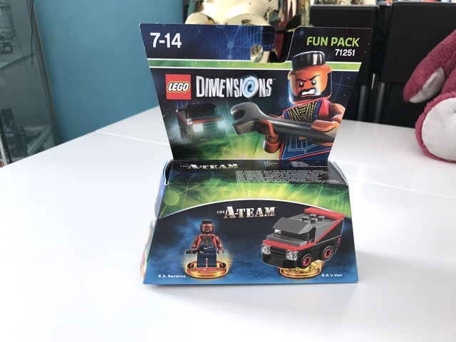](https://www.freelug.org/IMG/jpg/ATeam_01.jpg)

Au dos on peut voir les trois modèles qu’il est possible de monter.

[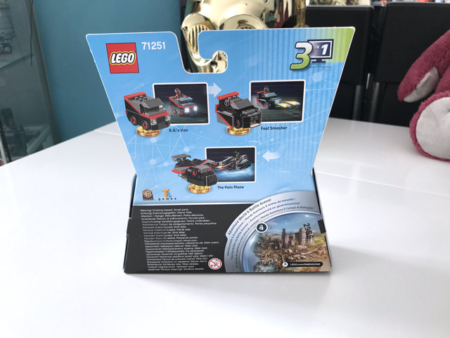](https://www.freelug.org/IMG/jpg/ATeam_02.jpg)

Ce _Level Pack_ contient deux sachets de briques et une notice de d’instruction pour le jeu _LEGO Dimensions_.

[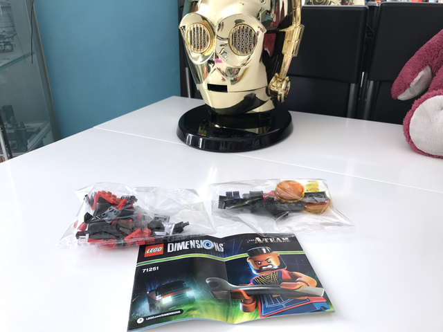](https://www.freelug.org/IMG/jpg/ATeam_03.jpg)

* * *

La sérigraphie est simple pour la salopette, par contre le travail sur les chaines et les dorures est vraiment réussi. Le visage est plutôt réussi, avec une belle expression.

[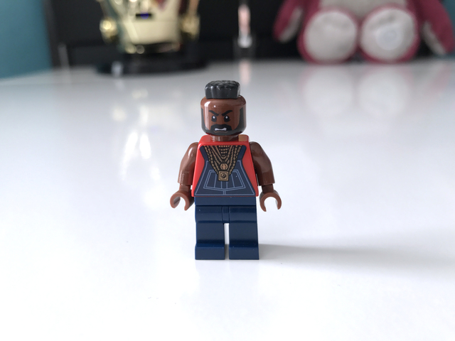](https://www.freelug.org/IMG/jpg/ATeam_05.jpg)

Le dos du torso est simple mais efficace. Vu la coupe de chevaux, pas de visage alternatif.

[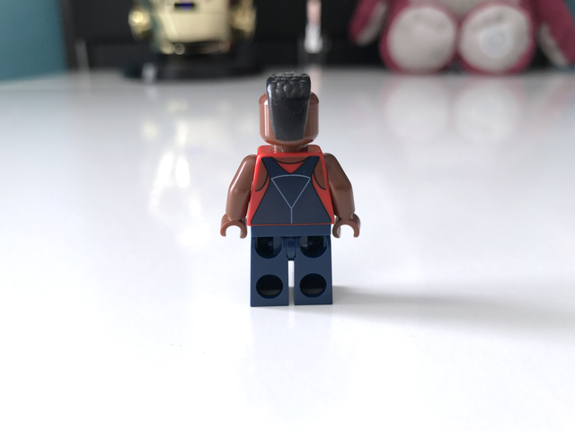](https://www.freelug.org/IMG/jpg/ATeam_06.jpg)

La minifigure de _[Barracuda](https://brickset.com/minifigs/dim024/b-a-baracus-dimensions-fun-pack)_ sur son socle RFID sérigraphié _THE A-TEAM_.

[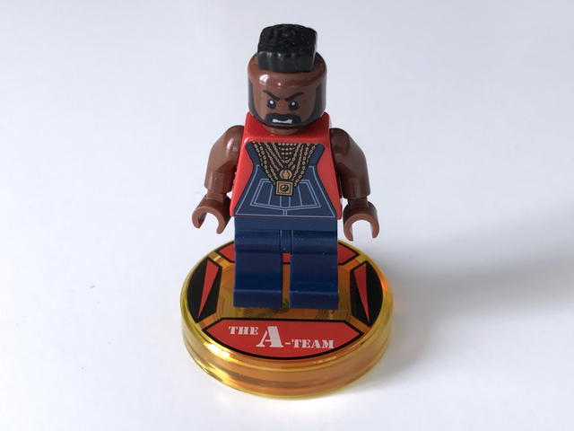](https://www.freelug.org/IMG/jpg/ATeam_04.jpg)

* * *

On commence le mini _B.A.’s Van_.

[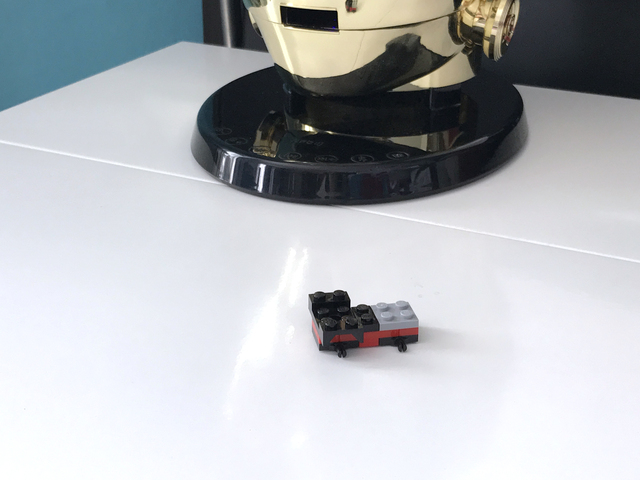](https://www.freelug.org/IMG/jpg/ATeam_07.jpg)

Les micro-véhicules _Dimensions_ sont vraiment des trésors de construction.

[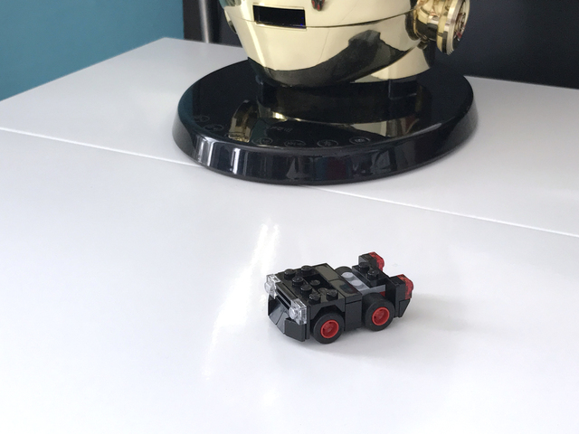](https://www.freelug.org/IMG/jpg/ATeam_08.jpg)

Utilisation ingénieuse de la pièce _Spoiler W. Shaft_.

[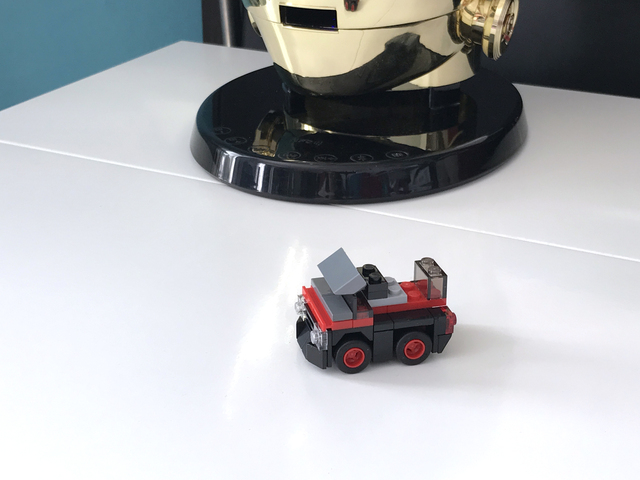](https://www.freelug.org/IMG/jpg/ATeam_09.jpg)

Mine de rien ça prend forme, tout ça avec un minimum de pièce et en peu d’étapes.

[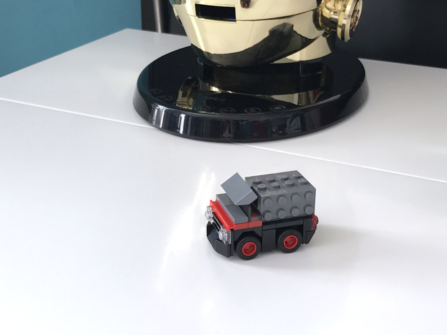](https://www.freelug.org/IMG/jpg/ATeam_10.jpg)

Voilà le van terminé avec ses pièces sérigraphiées.

[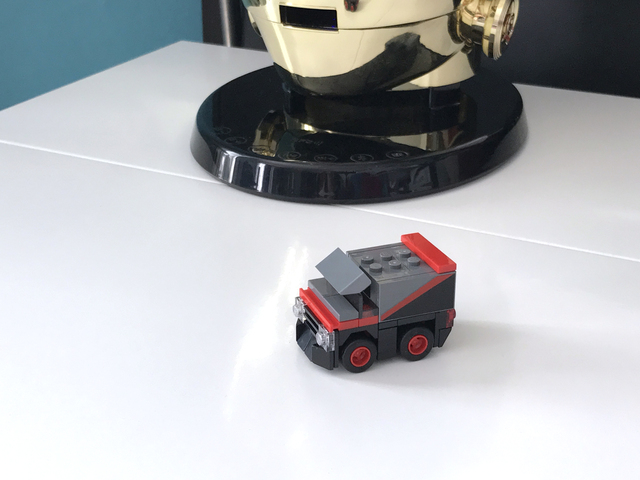](https://www.freelug.org/IMG/jpg/ATeam_11.jpg)

Photos sous plusieurs angles sur le socle RFID.

[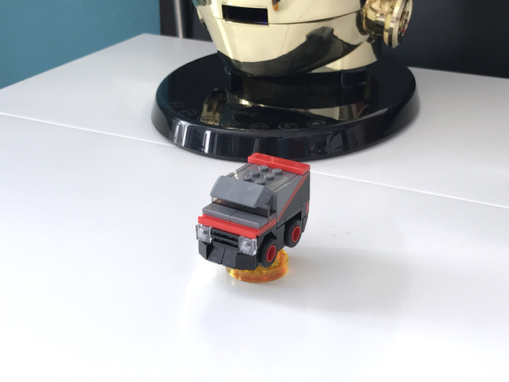](https://www.freelug.org/IMG/jpg/ATeam_12.jpg)

[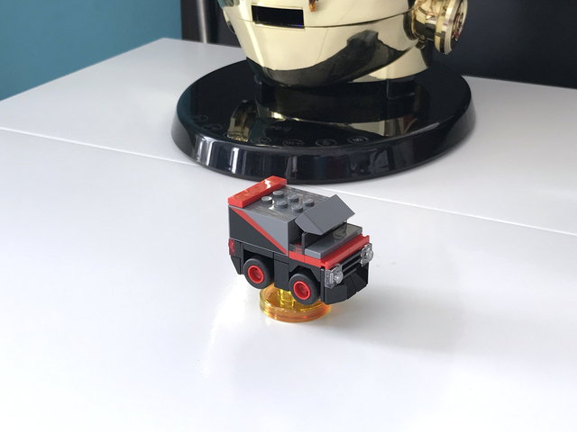](https://www.freelug.org/IMG/jpg/ATeam_13.jpg)

[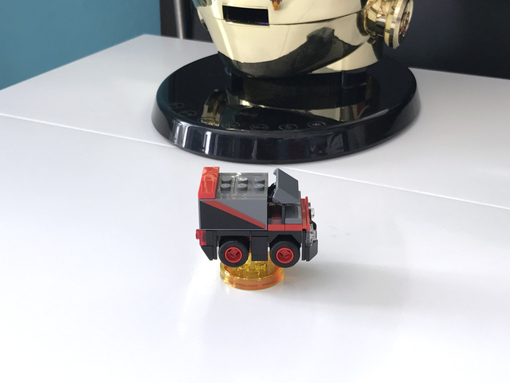](https://www.freelug.org/IMG/jpg/ATeam_14.jpg)

[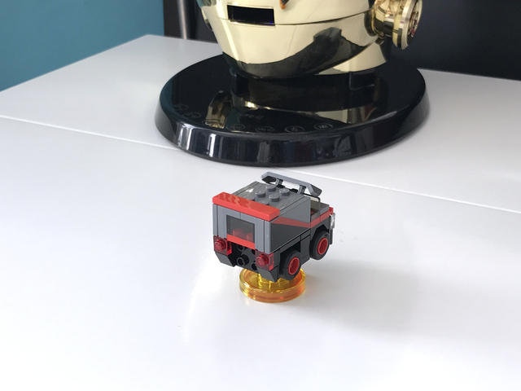](https://www.freelug.org/IMG/jpg/ATeam_15.jpg)

[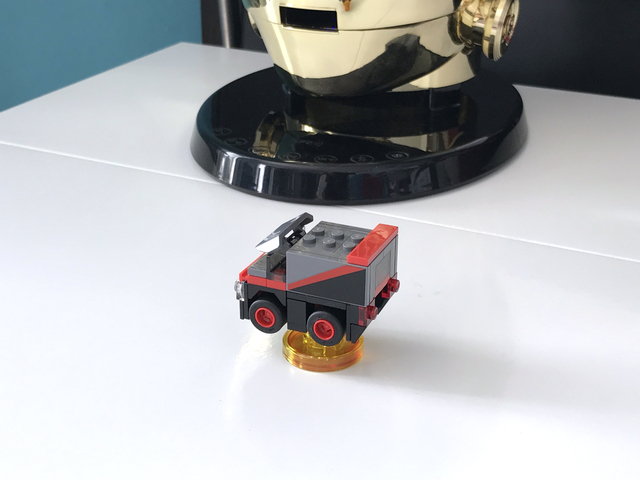](https://www.freelug.org/IMG/jpg/ATeam_16.jpg)

Photo de famille.

[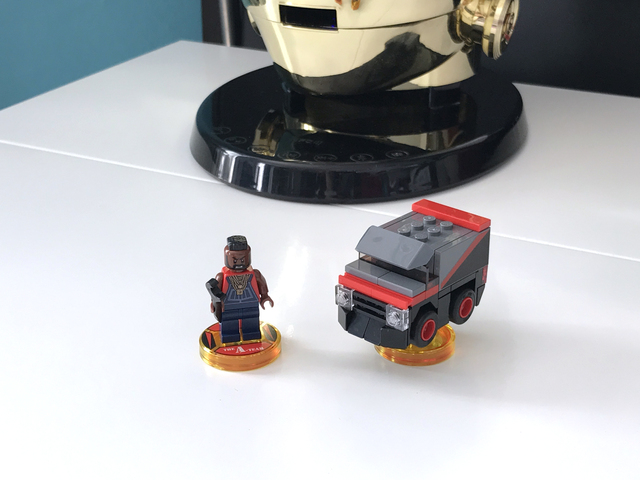](https://www.freelug.org/IMG/jpg/ATeam_17.jpg)

* * *

**AVIS :**

Encore un _Fun Pack_ acheté uniquement pour une fig. Il faut avouer que _LEGO_ réussit le pari de vendre des pack même aux gens qui ne jouent pas au jeu en incorporant pas mal de minifigs exclusives.

**BONUS :**

Voici un GIF animé réalisé avec les nombreuses photos prises pour cette review (cliquez sur l’image pour lancer l’animation).

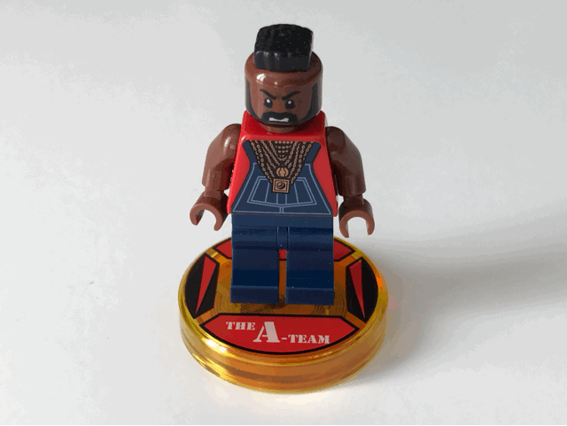
