Partons à la découverte d’un nouveau dragon Nijago !

[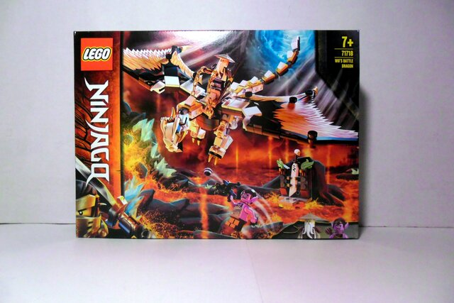](https://www.freelug.org/IMG/jpg/sam_2965.jpg)

Le set comprend 321 pièces pour un dragon, deux personnages et un petit bout de décor. Pour un prix de 20€, cela fait donc un rapport de 6,2 centimes la pièces . C’est pas trop mal.

Une vue arrière de la boite montre d’une autre manière l’ensemble du set :

[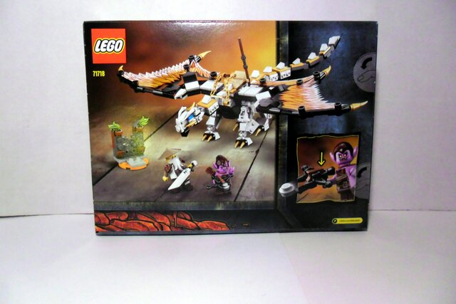](https://www.freelug.org/IMG/jpg/sam_2966.jpg)

Et voilà le contenu de la boite :

[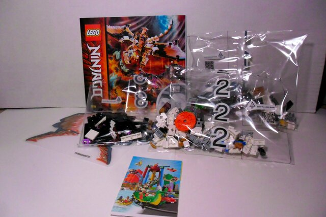](https://www.freelug.org/IMG/jpg/sam_2967.jpg)

Une notice, trois sachets , pas de sticker et les ailes en plastique souple

[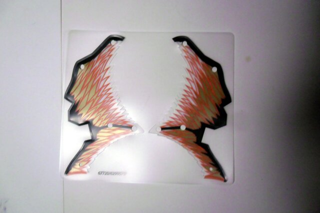](https://www.freelug.org/IMG/jpg/sam_2968.jpg)

Passons à la construction.

## Sachet n°1

Le sage Wu :

[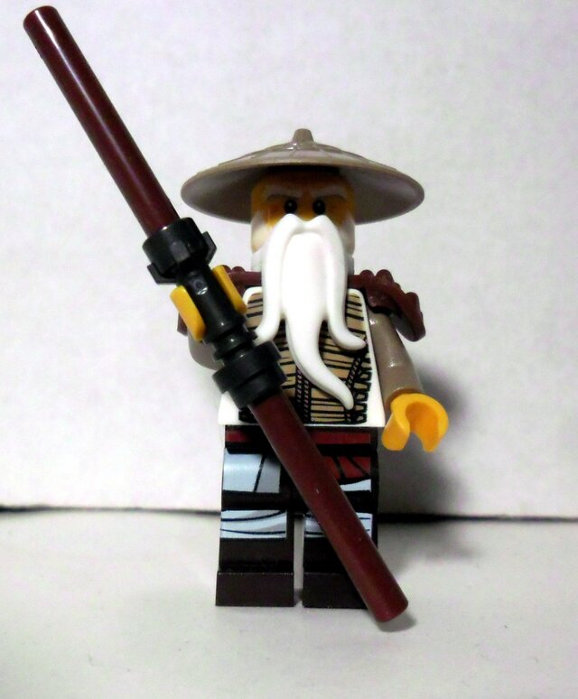](https://www.freelug.org/IMG/jpg/sam_2970-2.jpg)

[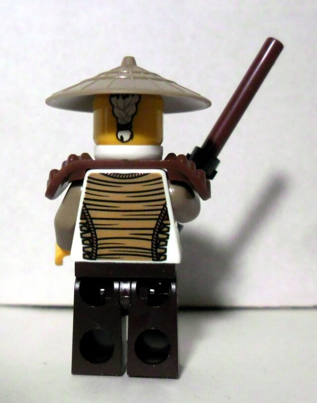](https://www.freelug.org/IMG/jpg/sam_2971-2.jpg)

[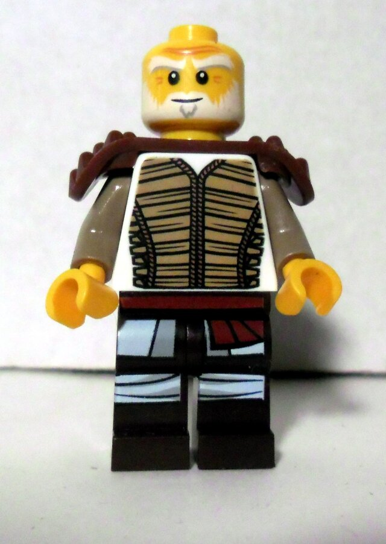](https://www.freelug.org/IMG/jpg/sam_2972-2.jpg)

et différentes étapes du dragon :

[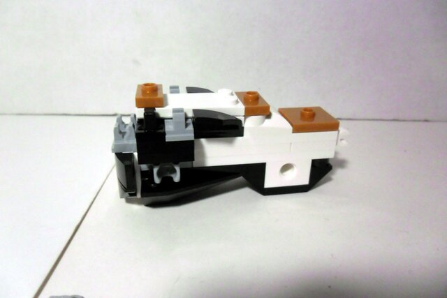](https://www.freelug.org/IMG/jpg/sam_2973.jpg)

[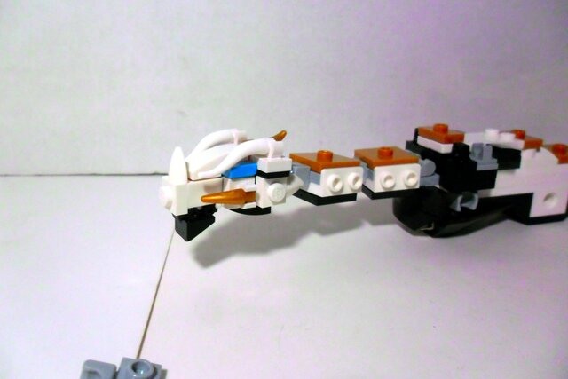](https://www.freelug.org/IMG/jpg/sam_2974.jpg)

[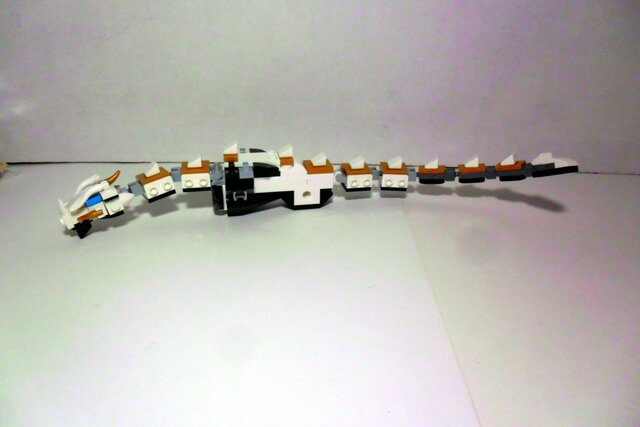](https://www.freelug.org/IMG/jpg/sam_2975.jpg)

## Sachet n°2

Un mini machin avec l’épée et on avance sur le dragon :

[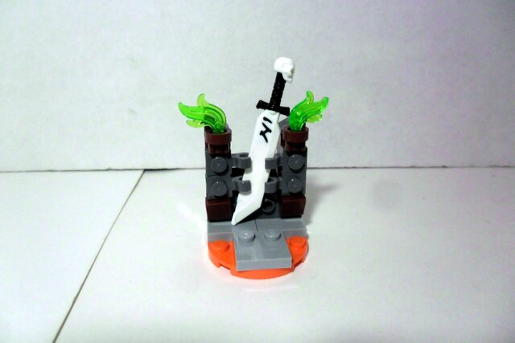](https://www.freelug.org/IMG/jpg/sam_2977.jpg)

[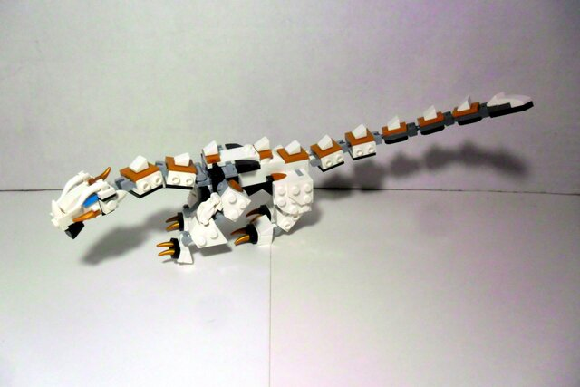](https://www.freelug.org/IMG/jpg/sam_2978.jpg)

## Sachet n°3

Un gnome :

[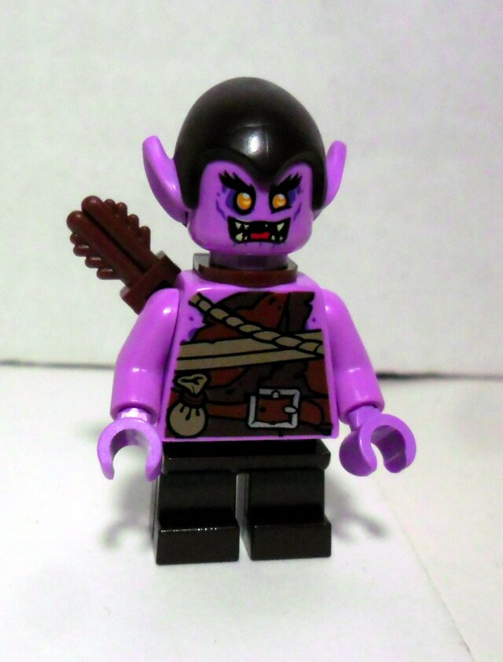](https://www.freelug.org/IMG/jpg/sam_2980-2.jpg)

[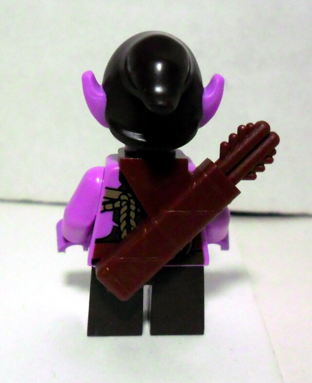](https://www.freelug.org/IMG/jpg/sam_2981-2.jpg)

[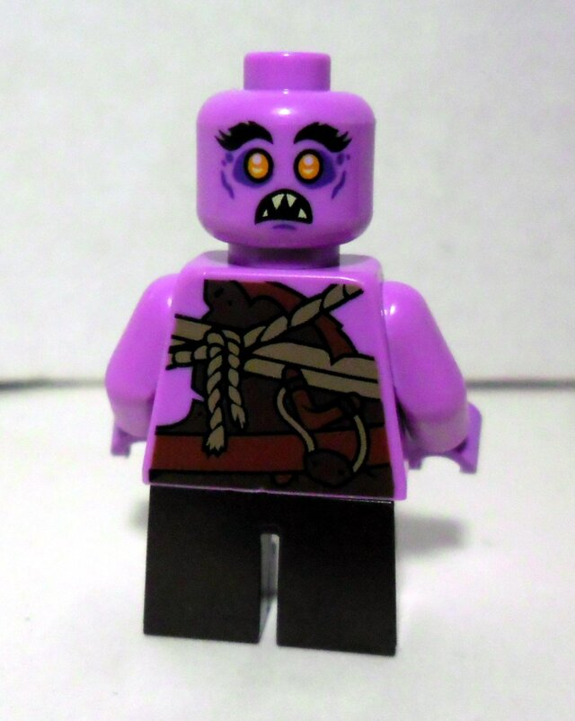](https://www.freelug.org/IMG/jpg/sam_2982-2.jpg)

Et on finit la construction du dragon :

[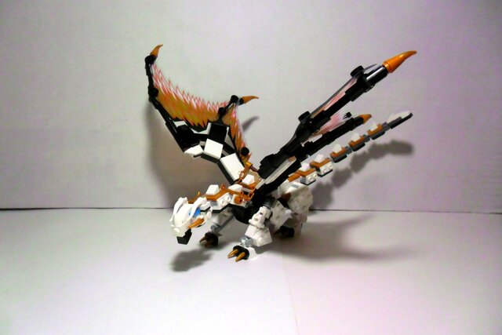](https://www.freelug.org/IMG/jpg/sam_2983.jpg)

Pour un ensemble complet :

[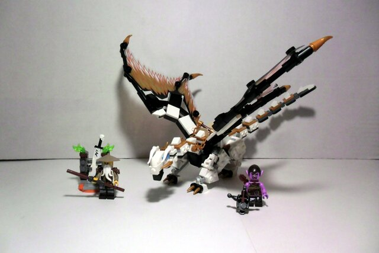](https://www.freelug.org/IMG/jpg/sam_2984.jpg)

D’autres vues du dragon (c’est surtout pour ça que je l’ai acheté...)

[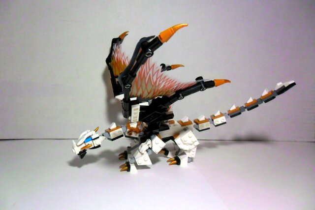](https://www.freelug.org/IMG/jpg/sam_2985.jpg)

[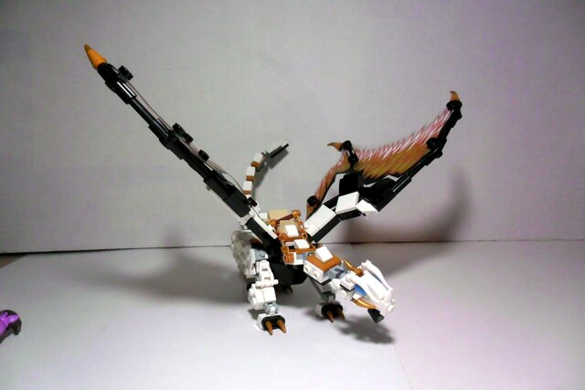](https://www.freelug.org/IMG/jpg/sam_2986.jpg)

Et les pièces en trop :

[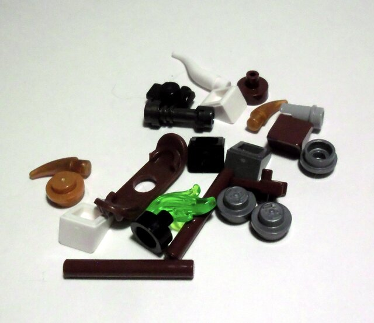](https://www.freelug.org/IMG/jpg/sam_2987.jpg)

## Conclusion

Le dragon est très réussi, et pour moi on en a pour son argent. Donc à acheter si on aime les dragons.
