Partons à la découverte de cette boite où un vilain dragon attaque notre Ninja !

[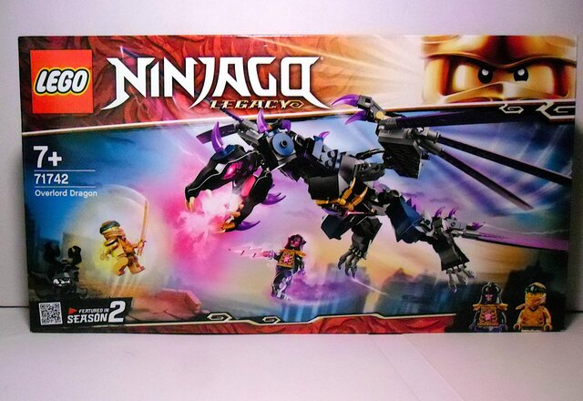](https://www.freelug.org/IMG/jpg/sam_3469.jpg)

Le set comprend 372 pièces avec deux personnages et un dragon. Pour un prix de 29,99 € soit un rapport prix/pièces de 0,08 euros, c’est très bien pour un set sous licence.  
Une petite vue arrière donne une idée de la jouabilité du set :

[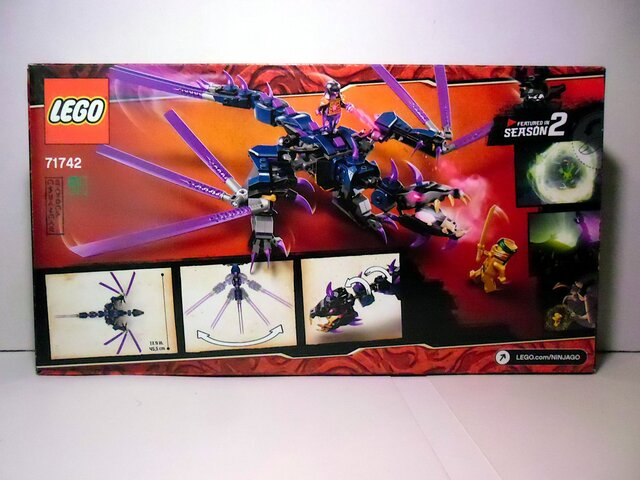](https://www.freelug.org/IMG/jpg/sam_3471.jpg)

Venons au principal : le contenu de la boite :

[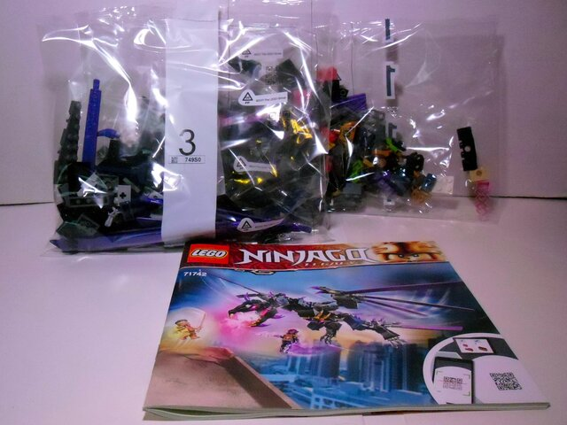](https://www.freelug.org/IMG/jpg/sam_3472.jpg)

Deux personnages, notre héros Lloyd

[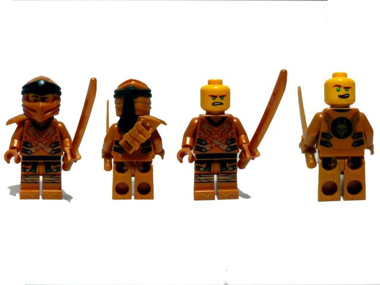](https://www.freelug.org/IMG/jpg/sam_3475.jpg)

Et le super vilain : Overlord

[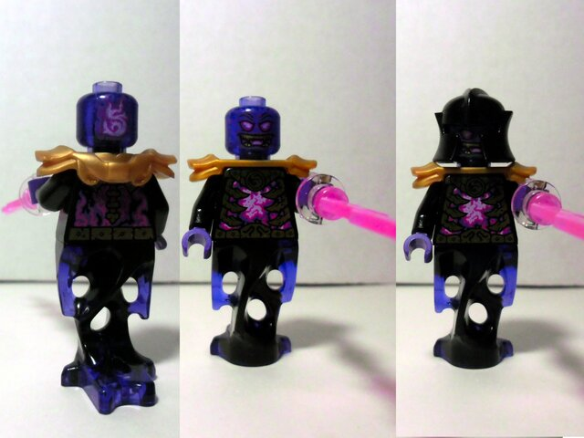](https://www.freelug.org/IMG/jpg/sam_3483.jpg)

Passons à la bête : Le dragon :  
Un gros plan sur une pièce intéressante : la tête :

[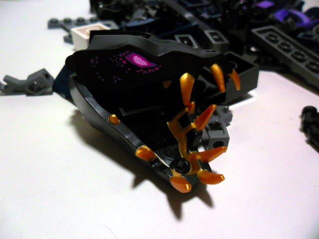](https://www.freelug.org/IMG/jpg/sam_3482.jpg)

Voilà les différentes étapes pour assembler la bête :

[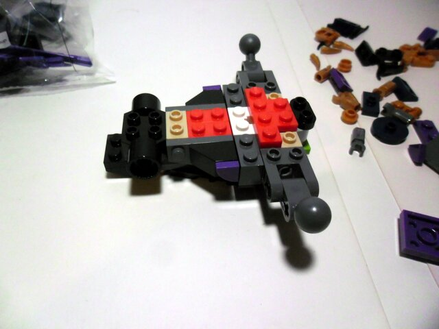](https://www.freelug.org/IMG/jpg/sam_3479.jpg)

[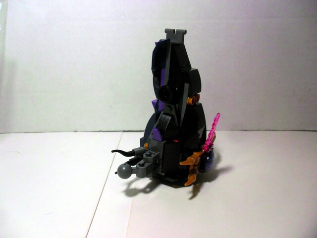](https://www.freelug.org/IMG/jpg/sam_3480.jpg)

[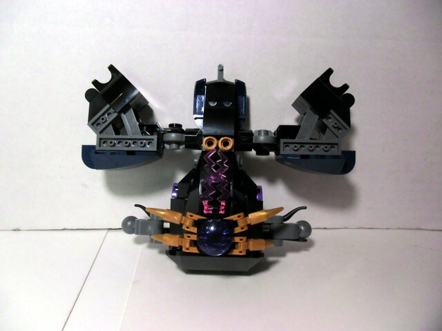](https://www.freelug.org/IMG/jpg/sam_3486.jpg)

[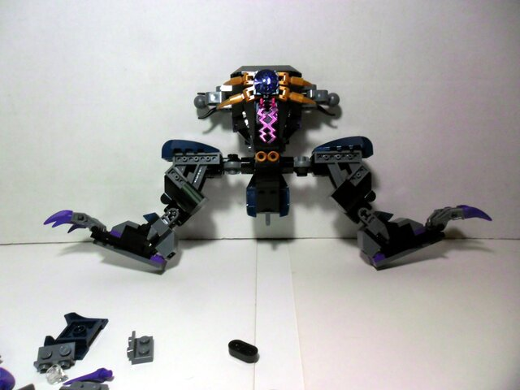](https://www.freelug.org/IMG/jpg/sam_3487.jpg)

[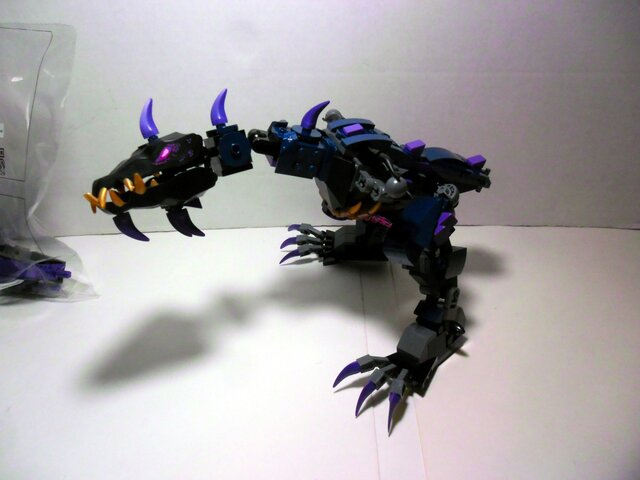](https://www.freelug.org/IMG/jpg/sam_3489.jpg)

[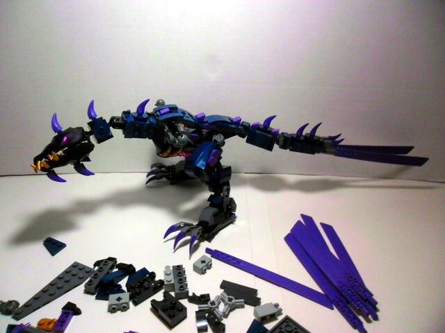](https://www.freelug.org/IMG/jpg/sam_3491.jpg)

Et voilà c’est fini :

[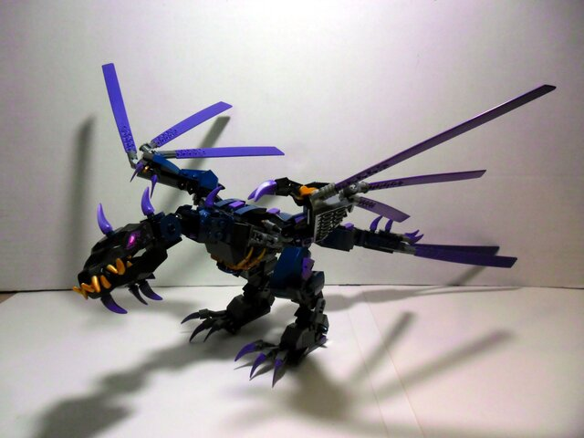](https://www.freelug.org/IMG/jpg/sam_3492.jpg)

Voilà fini, une petite photo de famille !

[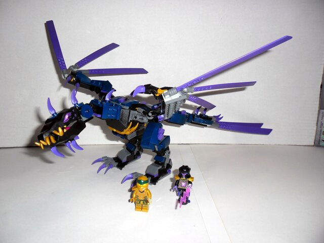](https://www.freelug.org/IMG/jpg/sam_3494.jpg)

Et pour terminer les extra parts :

[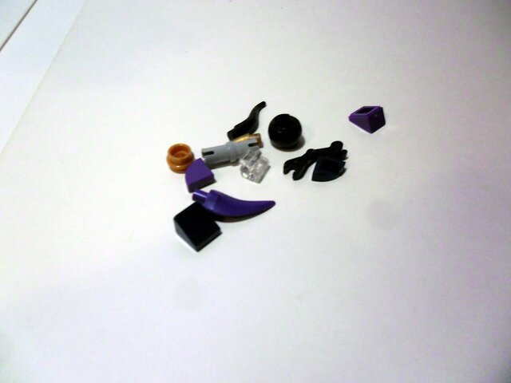](https://www.freelug.org/IMG/jpg/sam_3499.jpg)

**Conclusion**  
Que dire : pas cher pour un dragon qui en jette ! Pour moi j’adhère !

Allez en bonus : voici une mise en valeur de l’ensemble !

[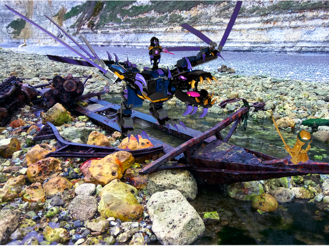](https://www.freelug.org/IMG/png/dragon.png)
