Aujourd’hui je vous propose la review du set 7181 dans la gamme _Star Wars_ : **Ultimate Collector’s Series TIE Interceptor**.  
Ce set sorti en 2000 (et oui 17 ans le pépère) au prix d’environ 125 euros dans nos contrées (100 dollars) est composé de 703 pièces, soit un ratio prix/pièce de 18 centimes d’euros.

[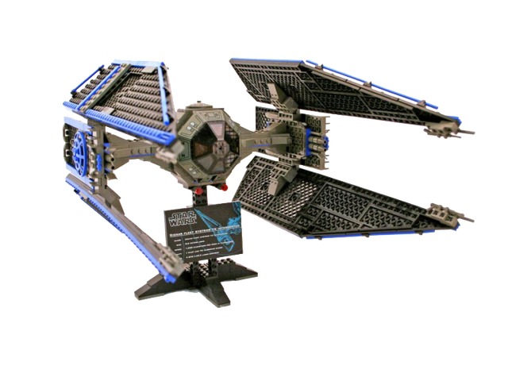](https://www.freelug.org/IMG/png/UCS_TieInterceptor_02.png)

> The Ultimate Collector’s Series, or UCS, is a subtheme of sets. UCS sets are meant to be more detailed and aimed at older builders. These sets do not generally include Minifigures, but since 2007, most have included at least one. Most are also not designed to scale with Minifigures, though there are some cases (such as 75060 Slave 1) where the set is completely to scale. Ultimate Collector’s Series sets tend to be larger, and more expensive than typical sets. Commonly, Ultimate Collector’s Series sets were given a five-digit (10xxx) product number until 2014, when they adopted the 75xxx numbering.  
> (source _[www.lego.wikia.com](http://lego.wikia.com/wiki/Ultimate_Collector's_Series)_)

* * *

**TIE Interceptor (Intercepteur TIE) :**

> Suite à l’entrée en fonction de puissants chasseurs rebelles, tels que le _X-wing_, le chasseur _TIE_ perd l’avantage en combat rapproché, en raison notamment de sa puissance de feu médiocre.
> 
> En se basant sur les travaux menés sur le _TIE Avdanced_ expérimental de _Darth Vader_, _Sienar_ développe alors un nouveau modèle de chasseur, plus rapide et plus agile, mais surtout doté d’un armement plus puissant, qui pourra assurer les missions de supériorité spatiale contre les chasseurs de l’_Alliance_.
> 
> Le résultat sera à la hauteur des espérances de l’État-major impérial : le _TIE Interceptor_ est à sa sortie le chasseur le plus maniable de la galaxie, et sa vitesse est excellente, à peine inférieure à celle du _A-wing_.
> 
> Source : _[www.starwars-holonet.com](http://www.starwars-holonet.com/encyclopedie/vaisseau-tiei.html)_

* * *

Le visuel de la boite met le set en scène dans l’espace, le numéro du set et son nom sont en gris (presque invisible). Pas de logo _UCS_ sur la boite.  
Le tout donne un aspect bien plus adulte que ce que _LEGO_ fait de nos jours avec les _Ultimate Collector’s Series_.  
Curiosité du visuel, le _TIE Interceptor_ est Photoshopé pour que les pièces bleues soient grises, le vaisseau correspond alors bien plus au design original.

[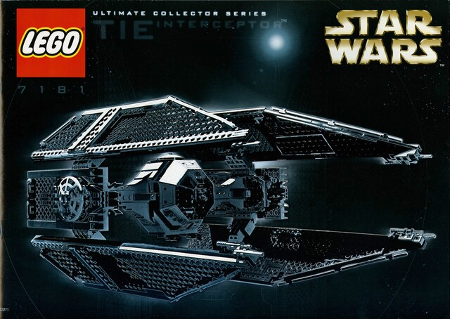](https://www.freelug.org/IMG/jpg/UCS_TieInterceptor_Box.jpg)

Ayant acheté ce set d’occasion je n’ai pas la boite, je reproduit donc ici une photo trouvé sur le net. Ce n’est pas le premier set _UCS_ que je possède, mais c’est le premier que je monte.  
Voyons voir si la gamme _Ultimate Collector’s Series_ mérite vraiment son nom.

* * *

On commence le montage par le cockpit.

[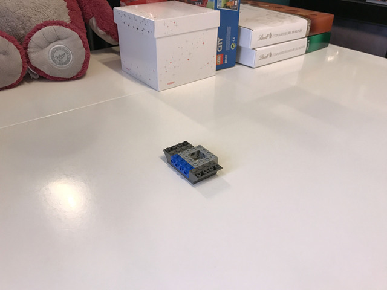](https://www.freelug.org/IMG/jpg/UCS_TieInterceptor_01.jpg)

Rapidement les commandes et les appareils de bord font leurs apparition.

[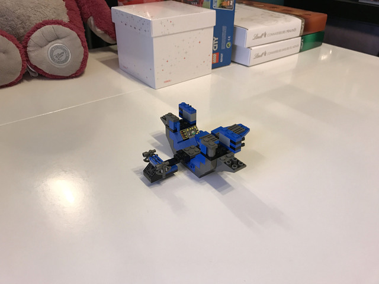](https://www.freelug.org/IMG/jpg/UCS_TieInterceptor_02.jpg)

Le cockpit continu de monter avec la construction des bras qui soutiendrons les panneaux des ailes.

[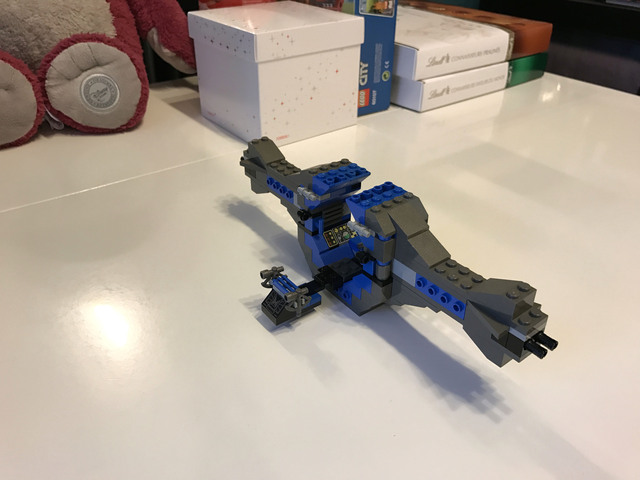](https://www.freelug.org/IMG/jpg/UCS_TieInterceptor_03.jpg)

Le cockpit terminé, avec sa grande verrière sérigraphiée.

[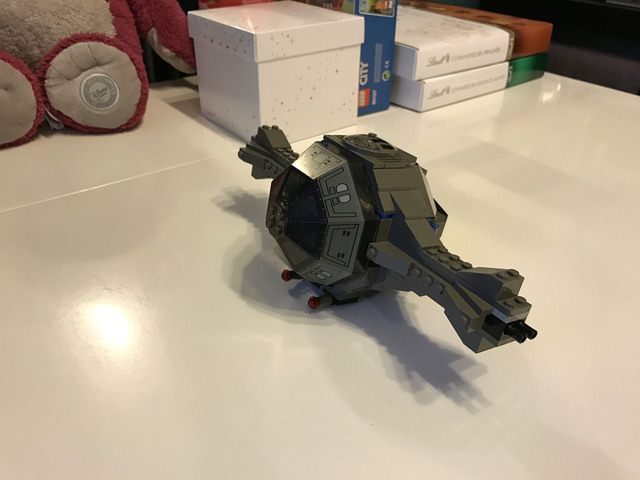](https://www.freelug.org/IMG/jpg/UCS_TieInterceptor_04.jpg)

Le cockpit de face.

[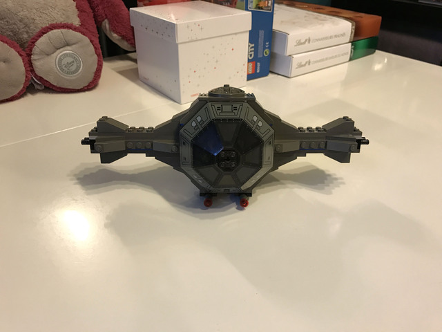](https://www.freelug.org/IMG/jpg/UCS_TieInterceptor_05.jpg)

Verrière ouverte avec les commande de bord.

[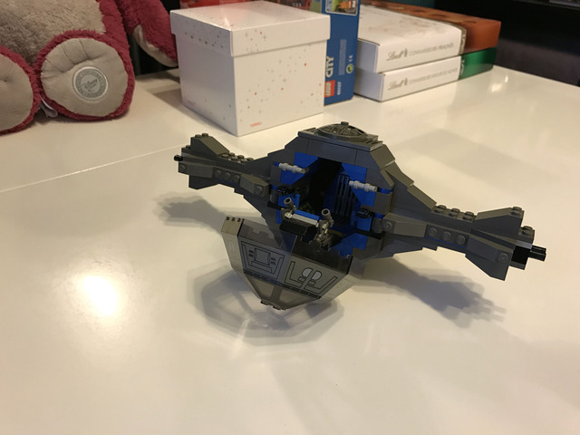](https://www.freelug.org/IMG/jpg/UCS_TieInterceptor_06.jpg)

On construit maintenant la partie qui va soutenir les trois panneaux des ailes.

[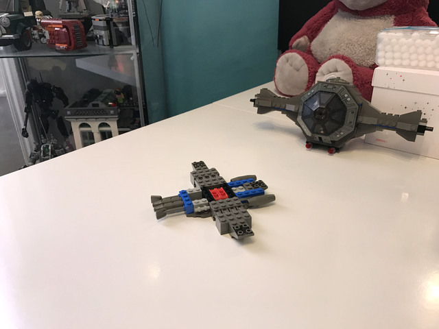](https://www.freelug.org/IMG/jpg/UCS_TieInterceptor_07.jpg)

On habille cette partie avec le panneau central.

[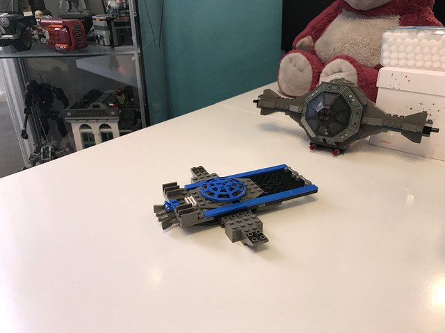](https://www.freelug.org/IMG/jpg/UCS_TieInterceptor_08.jpg)

Le panneau inférieur.

[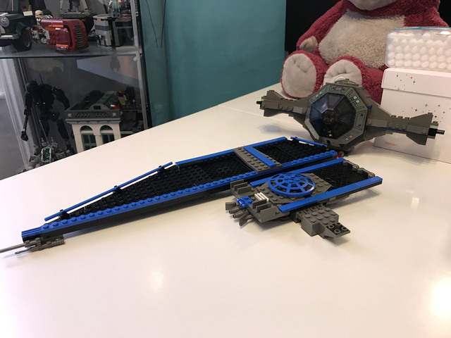](https://www.freelug.org/IMG/jpg/UCS_TieInterceptor_09.jpg)

Puis le panneau supérieur de l’aile droite. Il ne reste plus qu’à réaliser la même chose pour la deuxième aile qui est une copie de la première.

[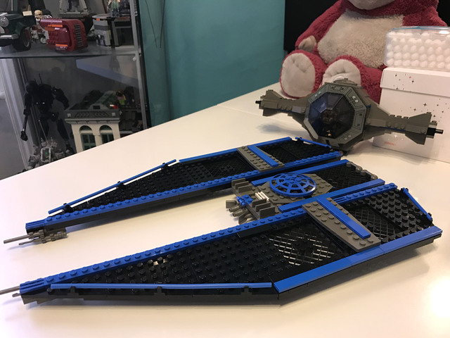](https://www.freelug.org/IMG/jpg/UCS_TieInterceptor_10.jpg)

Voici le _TIE Interceptor_ terminé, sous plusieurs angles sur son socle de présentation.

[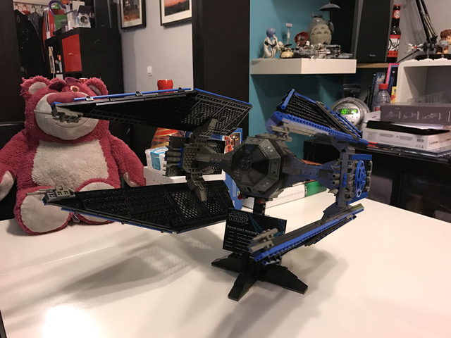](https://www.freelug.org/IMG/jpg/UCS_TieInterceptor_11.jpg)

[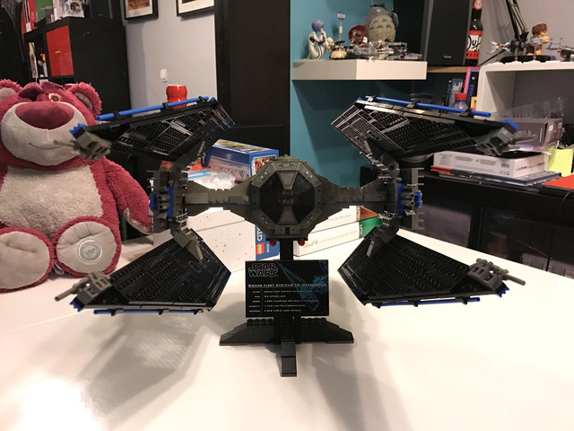](https://www.freelug.org/IMG/jpg/UCS_TieInterceptor_12.jpg)

[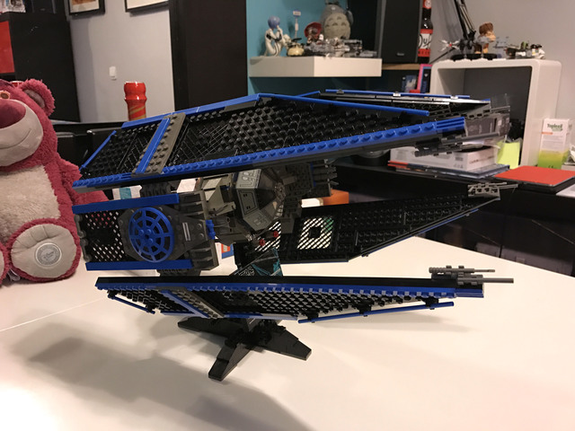](https://www.freelug.org/IMG/jpg/UCS_TieInterceptor_13.jpg)

[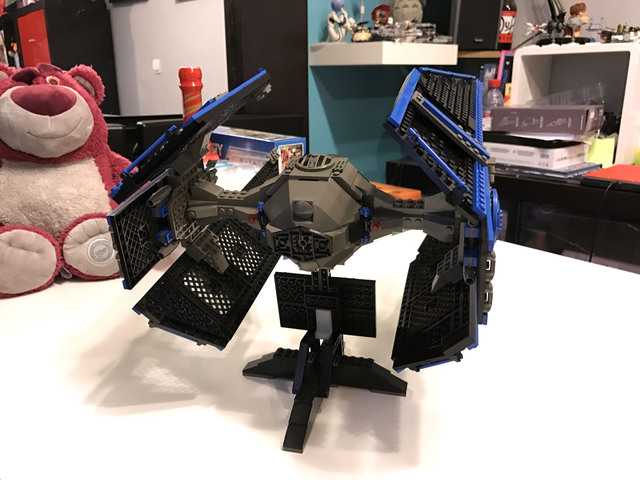](https://www.freelug.org/IMG/jpg/UCS_TieInterceptor_14.jpg)

En mode exposition sur mon étagère. Il est vraiment imposant.

[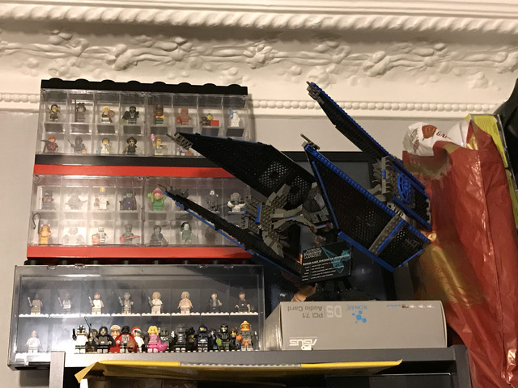](https://www.freelug.org/IMG/jpg/UCS_TieInterceptor_15.jpg)

* * *

**AVIS :**

Pour mon premier _UCS_ j’ai été servi, un vaisseau qui à de la gueule, très sympa à monter malgré ses 17 ans. Au final il en impose par sa taille et les détails qu’il contient. Bref, un vrai objet de collection à exposer.

Le seul petit regret c’est les briques bleues que _LEGO_ aurait du laisser grises pour plus de réalisme. LEGO voulait-il à l’époque, faire en sorte que les vaisseaux soient moins sombre pour plaire aux plus jeunes. Ou pour rappeler leur ancienne gamme Space. La question reste entière à ce jour.  
A part ça, si vous avez la possibilité de pouvoir acquérir ce set un jour, n’hésitez pas.

**BONUS :**

Voici un GIF animé réalisé avec la totalité des photos prises pour cette review (cliquez sur l’image pour lancer l’animation).

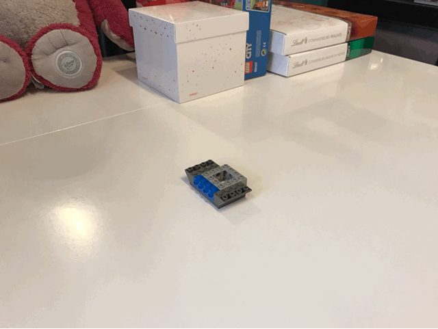
