Aujourd’hui je vous propose la review du set 75036 dans la gamme _Star Wars_ : **Utapau Troopers**.

Ce set sorti en 2014 au prix de 16,99 € est composé de 83 pièces, soit un ratio prix/pièce de 21 centimes d’euros.

[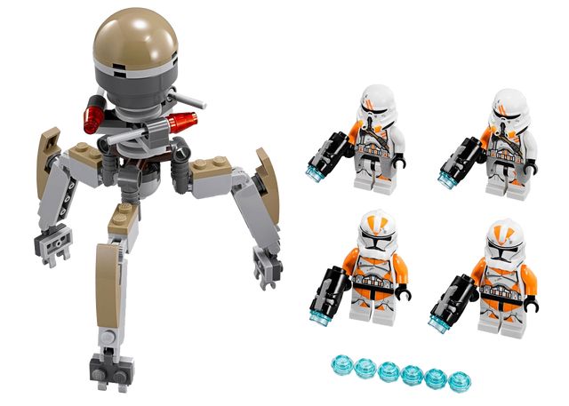](https://www.freelug.org/IMG/png/UtapauTroopers.png)

_La Guerre des Clones_ étant un sujet que beaucoup de MOCeurs aiment, voyons si ce set vaux la peine d’être possédé.

* * *

Le visuel de la boite reprend une scène du film _L’Attaque des Clones_. Le bandeau du haut est constitué des logos _LEGO_ et _Star Wars_ et de _Darth Vader_ (comme tout les sets sortis en 2014).  
Le contenu du set est intégré dans le décor de la bataille d’_Utapau_.

[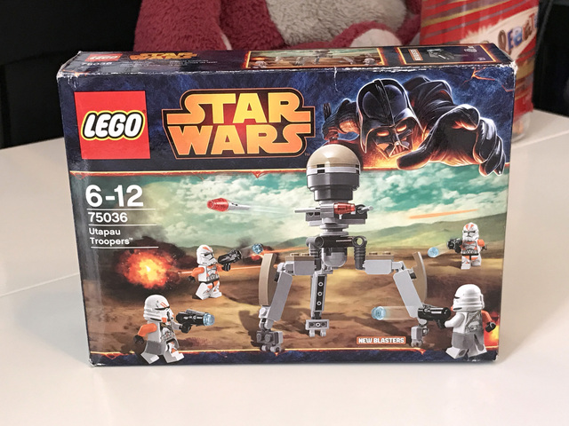](https://www.freelug.org/IMG/jpg/UtapauTroopers_01.jpg)

Au verso plusieurs vignettes avec les quelques éléments de jouabilités du set.

[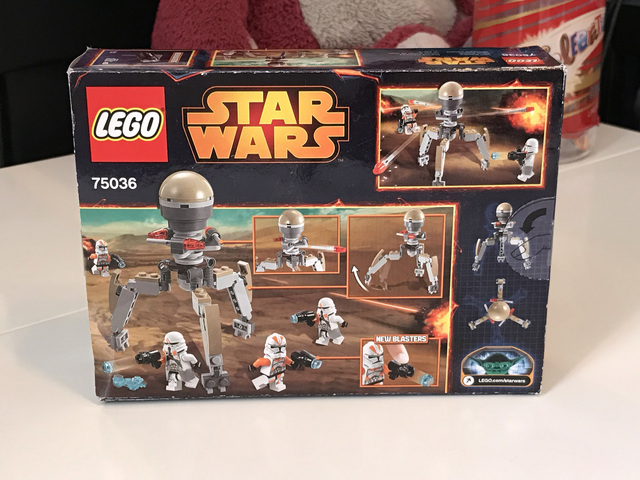](https://www.freelug.org/IMG/jpg/UtapauTroopers_02.jpg)

Une fois ouvert, le set contient deux sachets et une notice de construction.

* * *

Voici les deux minifigs _[212th Battalion Trooper](http://brickset.com/minifigs/sw522/212th-battalion-trooper)_. De couleur blanc et orange (couleurs de la _212th_) les sérigraphies sont magnifiques avec des traces de chocs sur les casques et armures, on sent que ces _Trooper_ ont vus le feu. Visage habituel, rien a dire dessus.

[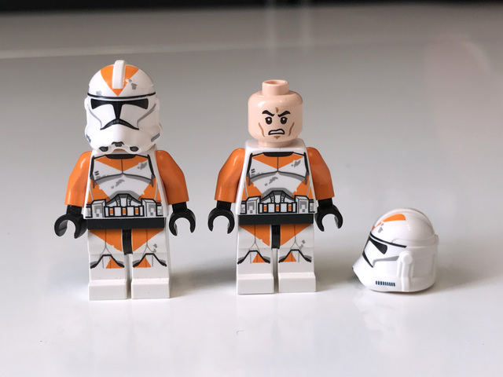](https://www.freelug.org/IMG/jpg/UtapauTroopers_03.jpg)

Le verso confirme le recto, avec une sérigraphie riche et détaillée.

[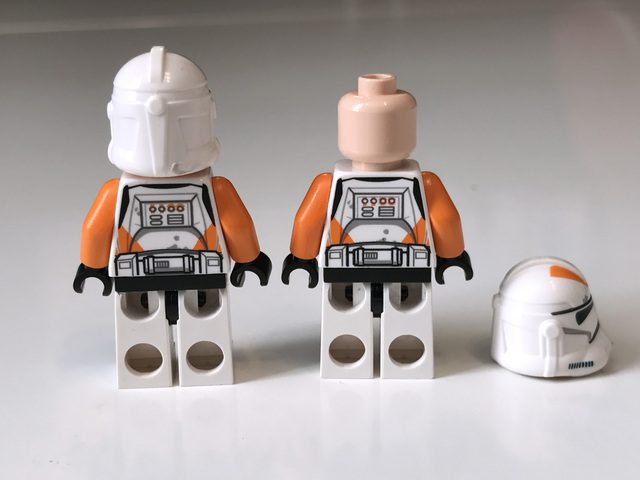](https://www.freelug.org/IMG/jpg/UtapauTroopers_04.jpg)

Très belle réalisation pour ces _[Airborne Clone Trooper](http://brickset.com/minifigs/sw523/airborne-clone-trooper)_. Encore une fois les sérigraphies sont superbement réalisées, les casques sont très originaux et tranchent avec ceux habituellement portés par les _Clone Trooper_.

[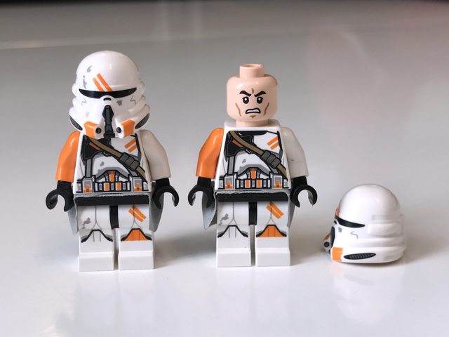](https://www.freelug.org/IMG/jpg/UtapauTroopers_05.jpg)

Comme pour le recto, le verso est très bien réalisé.

[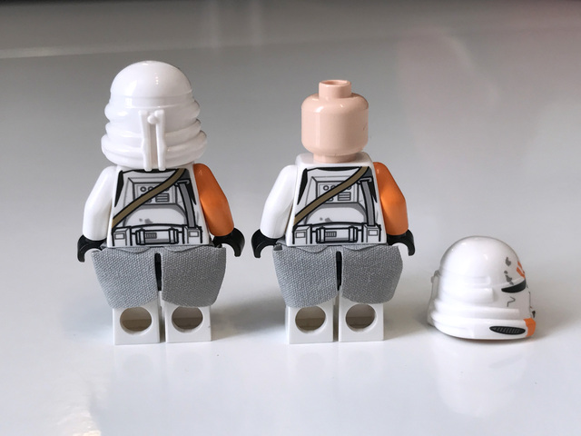](https://www.freelug.org/IMG/jpg/UtapauTroopers_06.jpg)

* * *

On commence la construction autour d’un axe _Technic_.

[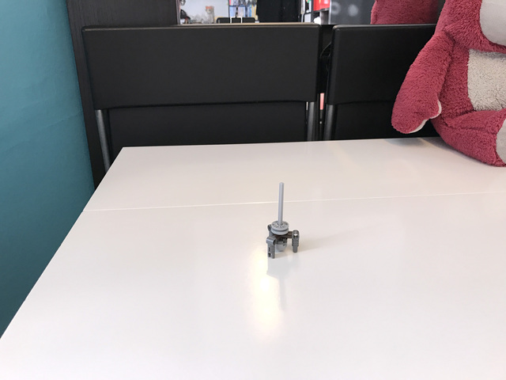](https://www.freelug.org/IMG/jpg/UtapauTroopers_07.jpg)

Montage ultra simpliste.

[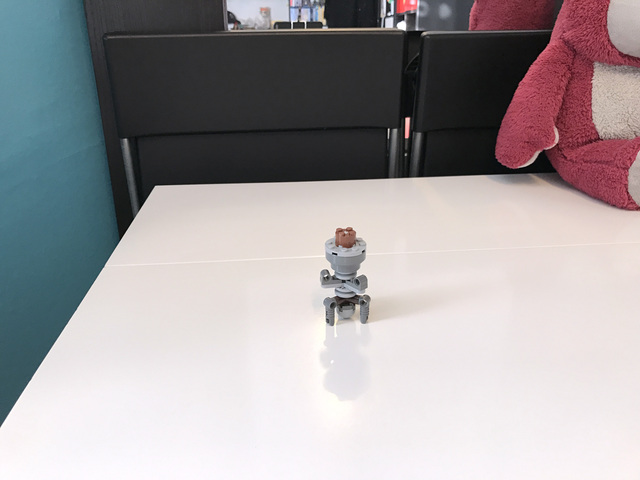](https://www.freelug.org/IMG/jpg/UtapauTroopers_08.jpg)

Un fois le corps réalisé on s’attaque au pattes.

[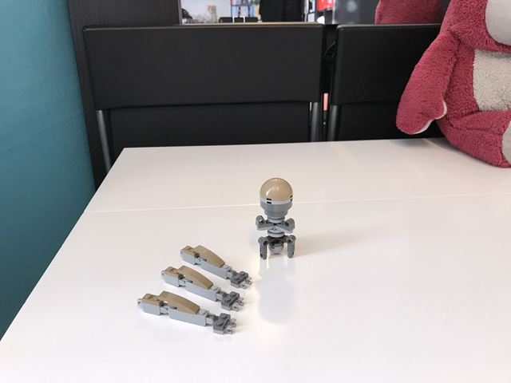](https://www.freelug.org/IMG/jpg/UtapauTroopers_09.jpg)

Voilà le set terminé, le moins que l’on puisse dire c’est que ça a été ultra rapide à monter.

[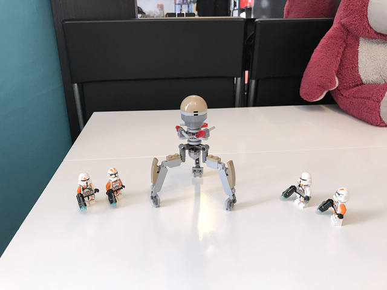](https://www.freelug.org/IMG/jpg/UtapauTroopers_10.jpg)

* * *

**AVIS :**

Franchement, je crois que j’ai trouvé le véhicule de _Battle Pack_ le plus inintéressant, le plus insipide et le plus rapide à monter jamais réalisé par _LEGO_. Heureusement que les minifigures rattrapent le coups car elles sont magnifiques.

Vous l’aurez compris, encore plus que tout les autres _Battle Pack_, l’achat n’est justifié que par les _Clone Trooper_ présents dans la boite.

**BONUS :**

Voici un GIF animé réalisé avec la totalité des photos prises pour cette review (cliquez sur l’image pour lancer l’animation).

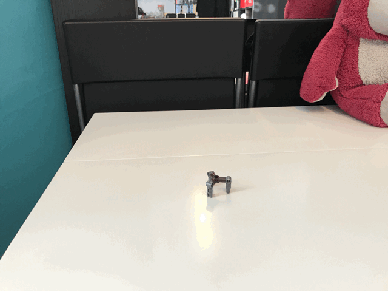
