Salut tout le monde !

Je reste dans la gamme _Star Wars_™ avec un achat récent totalement sorti de son contexte : le **Calendrier de l’Avent Star Wars™ 2015**. Ce set est sorti le 17 septembre 2015 (et retiré de la vente le 04 novembre de la même année en France) et coutait alors 34,99€ pour 292 pièces soit un ratio de 12cts / pièce.

[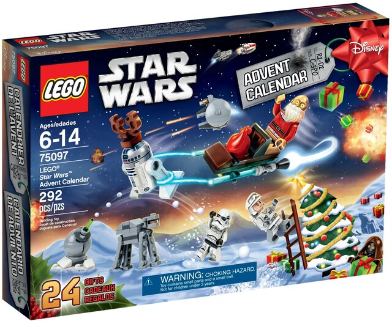](https://www.freelug.org/IMG/jpg/75097_main.jpg)

* * *

[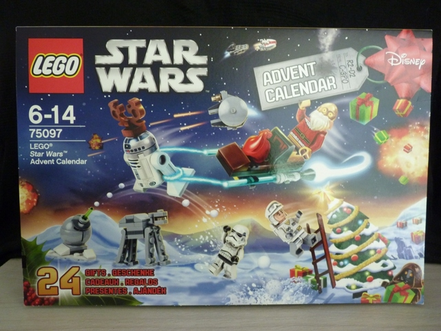](https://www.freelug.org/IMG/jpg/P1040653.jpg)

Le recto de la boîte met en scène la plupart des micro-sets et minifigurines présents dans la boîte sur fond de paysage festif et enneigé (oui, oui, à Noël normalement il neige !). Pour insister sur l’évènement de fin d’année auquel se rattache ce set, un peu de houx en bas à gauche caché derrière l’annonce des 24 petits cadeaux présents dans la boîte et, juste à côté d’un petit nœud rouge derrière le logo Disney™, un petit mot adressant ce présent à R2-D2™ de la part de C-3PO™ . On retrouve d’ailleurs cette précision sur la tranche de la boîte, ce que j’ai trouvé assez sympa mais ne me demandez pas pourquoi, ça a été un ressenti spontané inexplicable.

[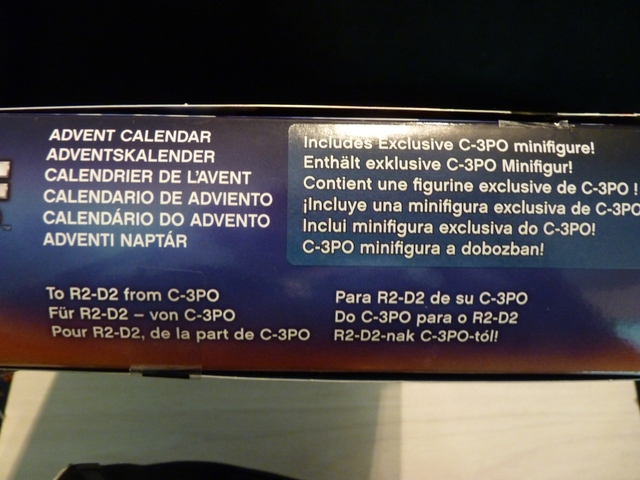](https://www.freelug.org/IMG/jpg/P1040708.jpg)

[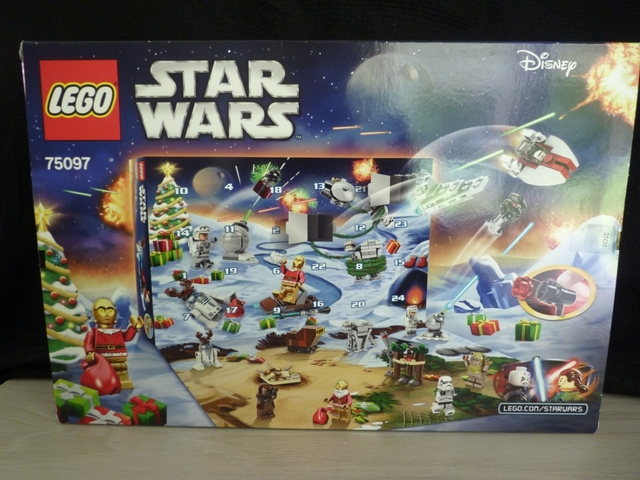](https://www.freelug.org/IMG/jpg/P1040654.jpg)

Le recto garde cette idée de mise en scène mais en utilisant le visuel du calendrier partiellement ouvert et le volet de la boîte ouvert également.

Parce que, oui, la boîte a un volet permettant de découvrir le calendrier à proprement dit et nous présente un petit décor mêlant 3 univers caractéristiques de la trilogie originale : Tatooine™, Endor™ et Hoth™.

[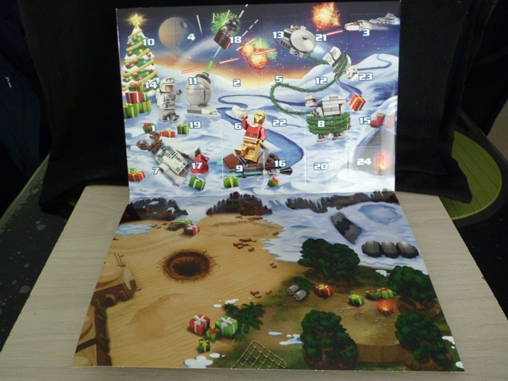](https://www.freelug.org/IMG/jpg/P1040655.jpg)

* * *

Bon, je pense que vous comprendrez que je ne vais pas prendre 24 jours pour faire cette review donc on rentre de suite dans le vif du sujet.

Premier volet, premier sachet. On retrouvera ce principe derrière toutes les fenêtres, y compris lors de la présence de minifigurines.

[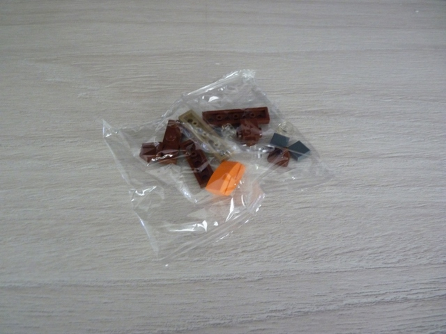](https://www.freelug.org/IMG/jpg/P1040656.jpg)

En ouvrant le volet, une notice la plus minimaliste possible (ce qui est parfois d’ailleurs un peu trop limite, surtout que le dessin n’est pas bien grand !).

[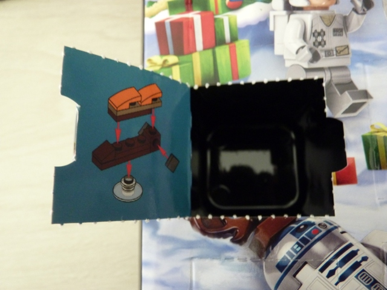](https://www.freelug.org/IMG/jpg/P1040658.jpg)

Le premier sachet nous permet de construire la Barge de Jabba™ version micro, comme tous les autres vaisseaux ou véhicules présents dans le calendrier.

[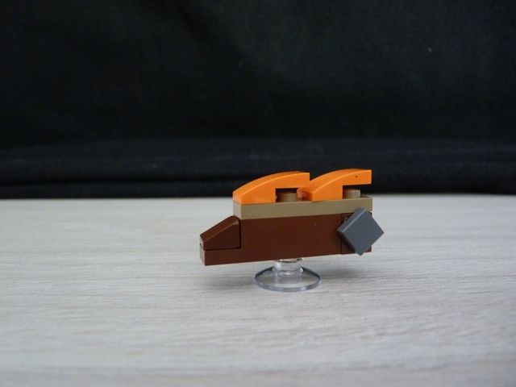](https://www.freelug.org/IMG/jpg/P1040659.jpg)

Deuxième sachet, on s’occupe de reproduire la fosse du Sarlacc™ (enfin c’est ce que je suppose).

[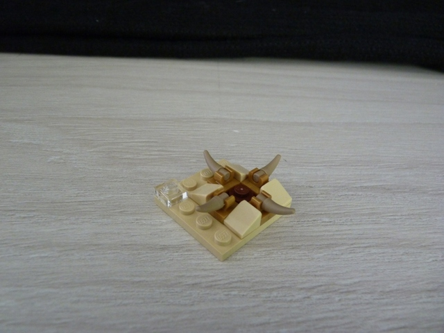](https://www.freelug.org/IMG/jpg/P1040660.jpg)

Troisième cadeau, le droïde de démolition LIN V8K vu avec les Jawas™ dans l’épisode IV.

[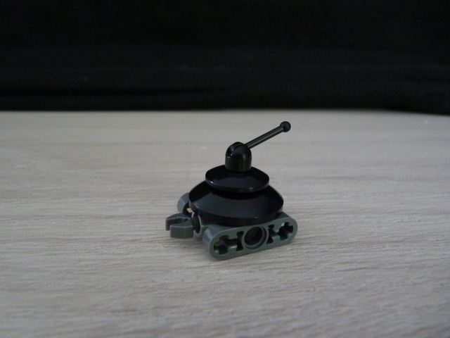](https://www.freelug.org/IMG/jpg/P1040661.jpg)

Et en parlant de Jawa™, nous en trouvons un derrière la 4ème fenêtre. La sérigraphie du torse et du dos est très réussie !

[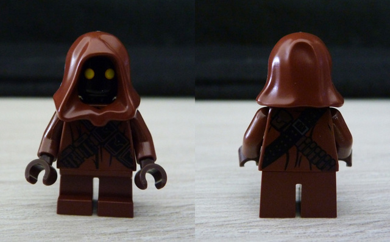](https://www.freelug.org/IMG/jpg/1-10.jpg)

Et pour finir avec nos récupérateurs de ferraille, on trouve ensuite leur Sandcrawler™. Ici, je me suis retrouvé très brièvement en difficulté face à la toute petite notice de montage compte tenu de toutes les pièces à assembler.

[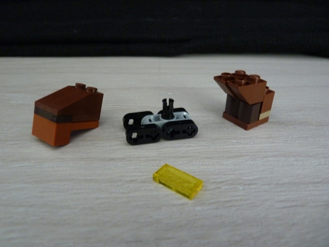](https://www.freelug.org/IMG/jpg/P1040669.jpg)

[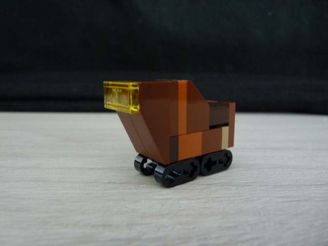](https://www.freelug.org/IMG/jpg/P1040668.jpg)

On change de planète et d’échelle en construisant un petit tambour / porte-arc Ewok™ avec les pièces contenues dans le 6ème emplacement.

[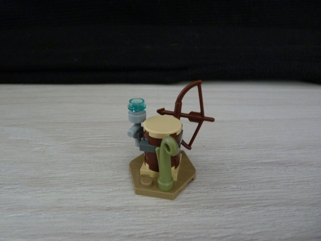](https://www.freelug.org/IMG/jpg/P1040671.jpg)

On repasse à de la construction micro avec la forêt des Ewoks™ version minimaliste.

[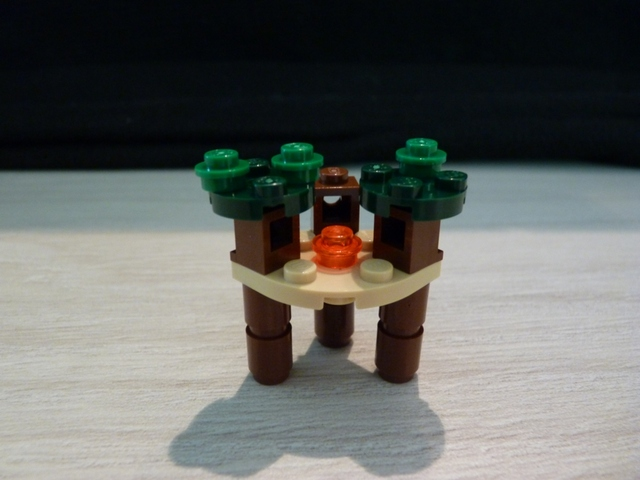](https://www.freelug.org/IMG/jpg/P1040673.jpg)

Et pour aller bien avec le petit accessoire de la fenêtre 6, on trouve derrière le 8ème volet un Ewok™ déjà présent dans le set 10236 **Le Village Ewok™**. Pas de sérigraphie particulière exceptée une petite couture sur le côté bonnet mais une jolie moulure en guise de tête / torse.

[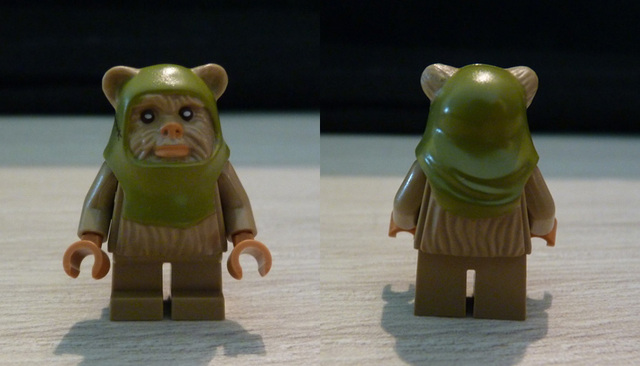](https://www.freelug.org/IMG/jpg/2-8.jpg)

Et pour que son attirail soit complet, on construit ensuite une petite catapulte.

[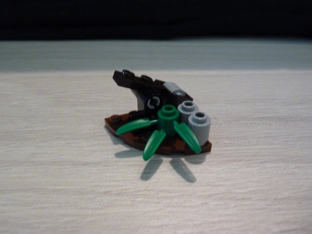](https://www.freelug.org/IMG/jpg/P1040676.jpg)

Fenêtre suivante, on trouve une minifigurine de Stormtrooper™ dont la jolie sérigraphie de la tête et du torse ne se retrouve que dans deux autres sets (75055 **Imperial Star Destroyer** et 75060 **Slave I**).

[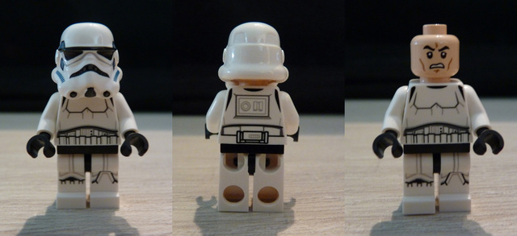](https://www.freelug.org/IMG/jpg/3-9.jpg)

Tant qu’à faire, on reste du côté Empire avec, derrière le 11ème volet, un mini Destroyer impérial.

[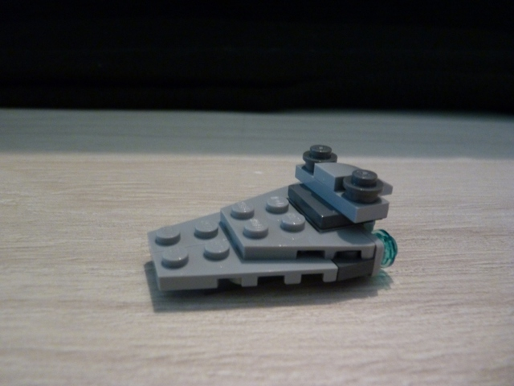](https://www.freelug.org/IMG/jpg/P1040681.jpg)

Un petit râtelier à pisto-lasers à l’échelle minifigurine se cache dans le 12ème emplacement.

[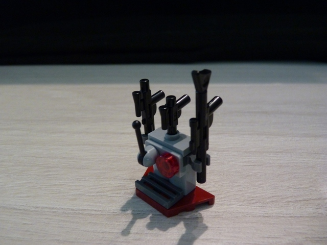](https://www.freelug.org/IMG/jpg/P1040683.jpg)

Et forcément, toutes ces armes attirent une nouvelle minifigurine : le Droïde assassin.

[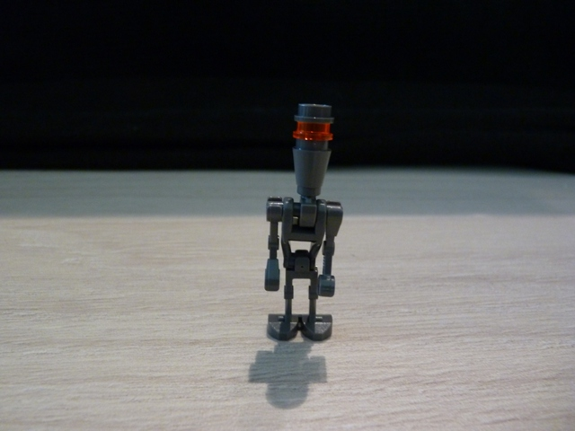](https://www.freelug.org/IMG/jpg/P1040686.jpg)

Allez, maintenant que la deuxième moitié du calendrier est entamée, on repasse du côté de la Rébellion avec un micro Faucon Millenium™.

[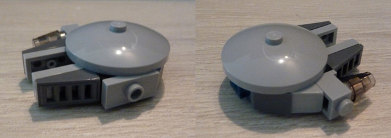](https://www.freelug.org/IMG/jpg/8-2.jpg)

Alors là, je ne vous cache pas que je ne reconnais pas la construction :

[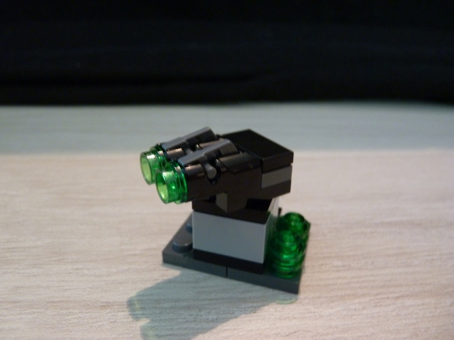](https://www.freelug.org/IMG/jpg/P1040689.jpg)

Je suppose très vaguement que cela pourrait être une des tours de tir de la première Étoile Noire™ que l’on aperçoit à la fin de l’Episode IV mais aucune certitude...

16ème fenêtre, un autre micro vaisseau : un A-Wing™.

[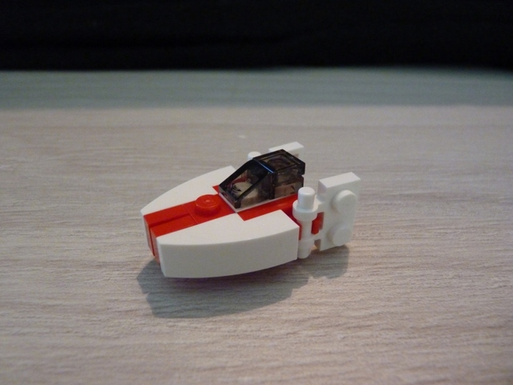](https://www.freelug.org/IMG/jpg/P1040690.jpg)

On attaque le dernier tiers du calendrier avec un soldat de la Rébellion dans sa tenue de la planète Hoth™. Une nouvelle fois une superbe sérigraphie recto-verso du torse qu’on ne retrouve que dans deux sets une fois de plus (75098 **Assault on Hoth**™ et 75138 **Hoth Attack**™).

[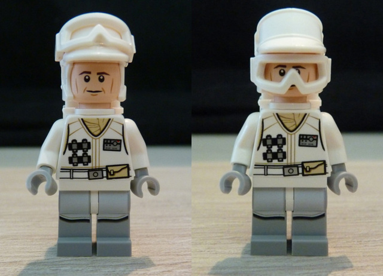](https://www.freelug.org/IMG/jpg/4-7.jpg)

[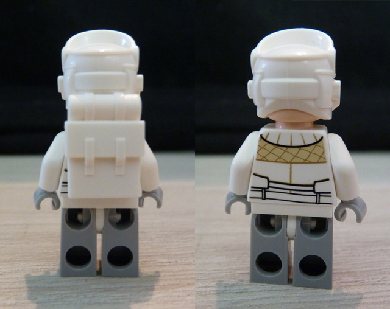](https://www.freelug.org/IMG/jpg/5-5.jpg)

On reste sur Hoth™ pour la 17ème fenêtre avec la construction d’un petit AT-AT™.

[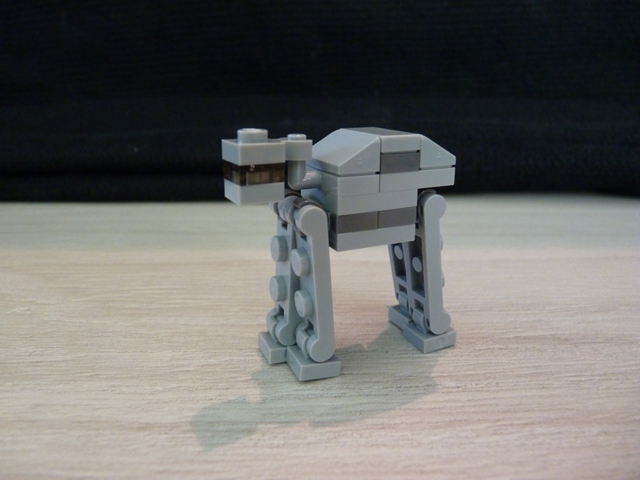](https://www.freelug.org/IMG/jpg/P1040695.jpg)

Sans quitter la planète enneigée, on s’attaque ensuite à un canon à ions.

[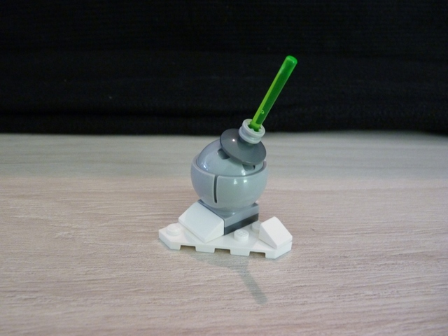](https://www.freelug.org/IMG/jpg/P1040696.jpg)

On continue l’alternance Empire / Rébellion avec, derrière le 19ème volet, un droïde sonde vipère.

[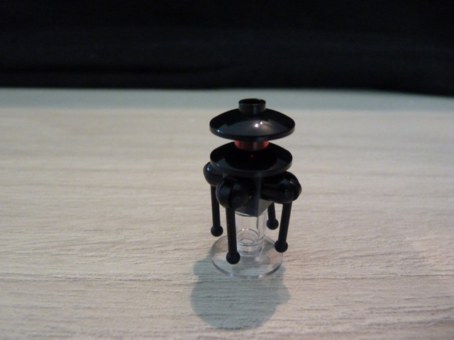](https://www.freelug.org/IMG/jpg/P1040697.jpg)

On revient chez les gentils avec ce que j’appellerai un petit poste de commande.

[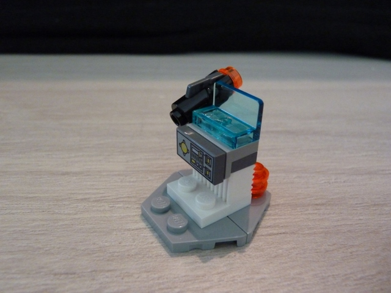](https://www.freelug.org/IMG/jpg/P1040698.jpg)

Plus que 3 et on tombe sur notre ami R2-D2™ qui, pour l’occasion, revêt son accoutrement de renne !

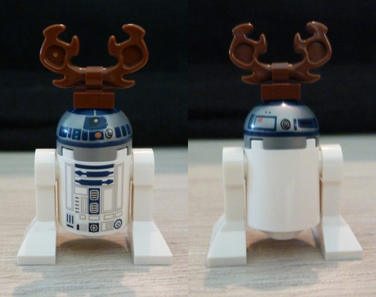

Avant-dernière fenêtre et là, grosse inconnue... j’ai pensé pendant un temps au Skiff du désert mais après avoir regardé quelques visuels de l’Episode VI, et bien non... Je vous laisse faire vos suppositions en espérant que vous serez meilleurs que moi !

[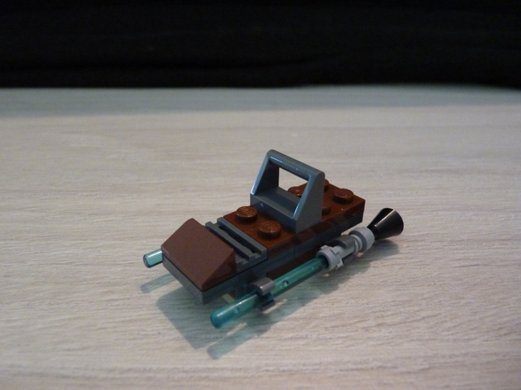](https://www.freelug.org/IMG/jpg/P1040701.jpg)

Et la fin du calendrier est là avec notre petit C-3PO™ avec sa veste de Père Noël qu’on a pu admirer à plusieurs reprises sur les différents visuels de la boîte.

[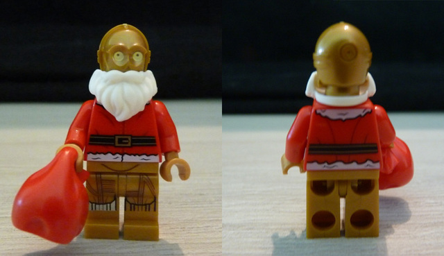](https://www.freelug.org/IMG/jpg/7-3.jpg)

A chaque petite construction, il y a des pièces en rab, ce qui fait qu’à la fin du calendrier, on se retrouve avec un petit stock de pièces supplémentaires.

[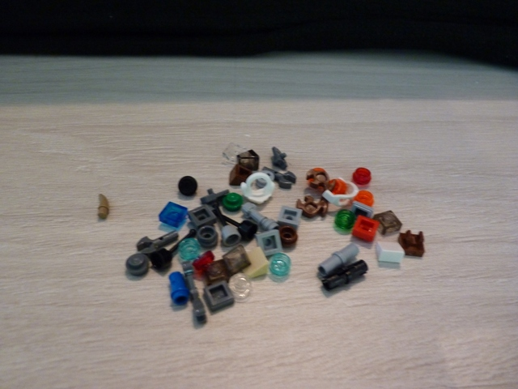](https://www.freelug.org/IMG/jpg/P1040704.jpg)

Voilà, pour finir, les différents "cadeaux" réunis sur le volet dépliant de la boîte.

[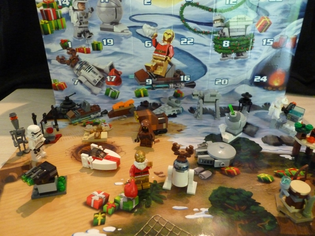](https://www.freelug.org/IMG/jpg/P1040705.jpg)

* * *

En résumé, je suis content d’avoir acheté cette boîte pour les minifigurines et il est toujours intéressant de voir à quel point les employés de chez LEGO™ arrivent à se creuser la cervelle pour nous proposer des reproductions reconnaissables avec un minimum de pièces même si j’émets un petit bémol pour quelques-unes difficilement reconnaissable (pour moi en tout cas !).  
Autre petit bémol, les "notices" de montage présent sur les volets du calendrier peut-être un peu trop minimaliste... surtout si le set s’adresse à des enfants !

Je ne vous souhaite pas de bonnes fêtes de Noël car on en est loin mais je vous dis à bientôt !

[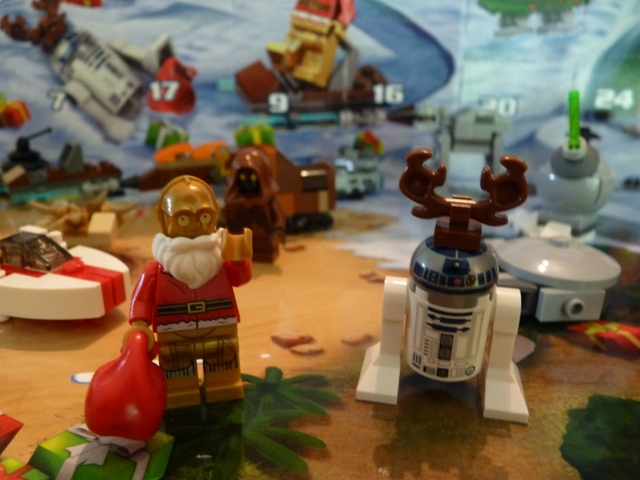](https://www.freelug.org/IMG/jpg/P1040707.jpg)

Merci de m’avoir lu !
