Aujourd’hui je vous propose la review du set 75131 dans la gamme _Star Wars_ : **Resistance Trooper Battle Pack**.  
Ce set sorti en 2016 au prix de 16,99 € est composé de 112 pièces, soit un ratio prix/pièce de 12 centimes d’euros.

[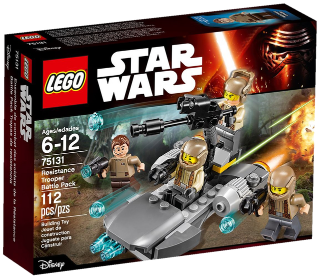](https://www.freelug.org/IMG/png/ResistanceTrooperBP_box.png)

Pour rappel les _Battle Pack_ sont des sets entre 15 et 17 euros contenant un petit véhicule, souvent anecdotique, et surtout quatre minifigures.  
Ce sont donc des sets très intéressants pour se constituer une troupe/armée à "bon prix".

* * *

Le visuel de la boite reprend une image du film original en fond. Le bandeau du haut est constitué des logos _LEGO_ et _Star Wars_ et du masque de _Kylo Ren._  
Le Speeder et les minifigs sont intégrés dans un décor forestier, on suppose que c’est sur la planète _Takodana_, bien que l’on ne voit pas ce véhicule dans _The Force Awakens._ L’ensemble, comme le reste de la gamme 2016, est plutôt réussi.

[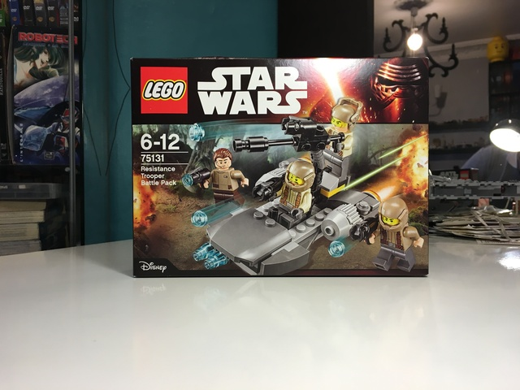](https://www.freelug.org/IMG/jpg/ResistanceTrooperBP_01.jpg)

Au verso plusieurs vignettes avec les éléments de jouabilité du set, une photo des armes ainsi qu’un simili plan sur console "vidéo".

[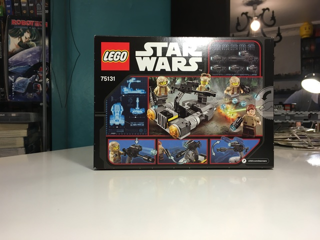](https://www.freelug.org/IMG/jpg/ResistanceTrooperBP_02.jpg)

La boite contient deux sachets, une plaque grise 10x4 et une notice de construction.

[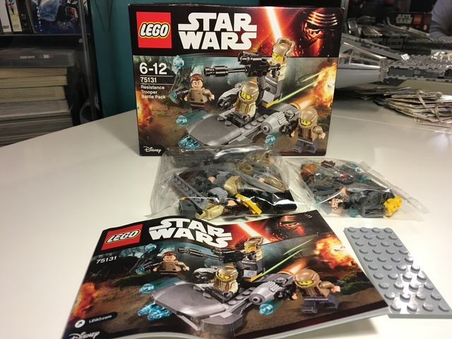](https://www.freelug.org/IMG/jpg/ResistanceTrooperBP_03.jpg)

La première minifig est un [_Officier de la Résistance_](http://brickset.com/minifigs/sw699/Resistance-Officer-Headset-\(75131\)) dont la sérigraphie est assez minimaliste. Cette fig est, comme les trois autres présentes dans le set, exclusive pour le moment.

[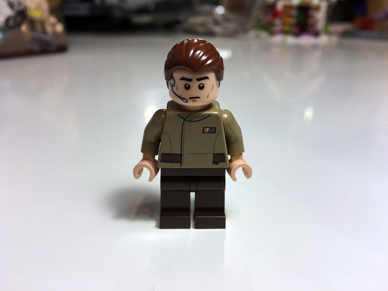](https://www.freelug.org/IMG/jpg/ResistanceTrooperBP_04.jpg)

Pas de visage alternatif et un dos plutôt dépouillé.

[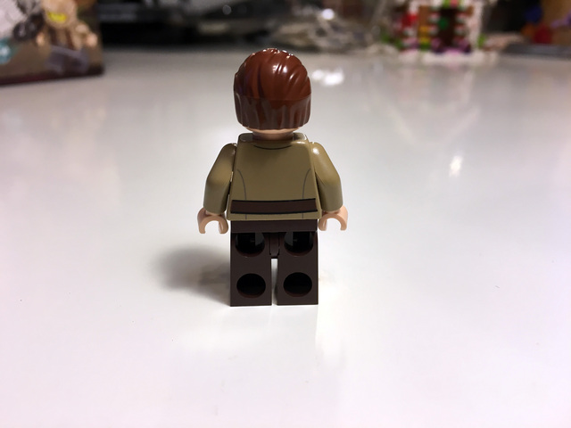](https://www.freelug.org/IMG/jpg/ResistanceTrooperBP_05.jpg)

Le [_Resistance Trooper - Tan Jacket, Frown Cheekline_s](http://brickset.com/minifigs/sw698/Resistance-Trooper-Tan-Jacket-Frown-Cheeklines-\(75131\)) est affublé d’un harnais du plus bel effet ainsi que d’un nouveau casque bi-injection (nous y reviendrons plus loin).

[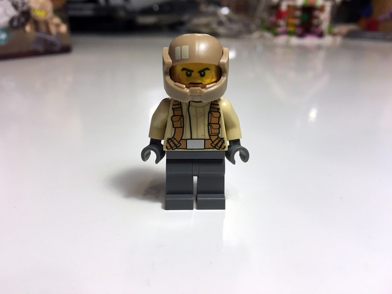](https://www.freelug.org/IMG/jpg/ResistanceTrooperBP_06.jpg)

Le _Resistance Trooper_ sans son casque, un visage qui ressemble à s’y méprendre à celui des _Clone Trooper_.

[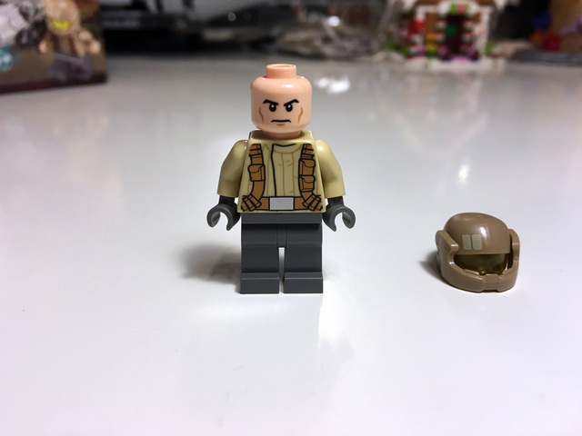](https://www.freelug.org/IMG/jpg/ResistanceTrooperBP_08.jpg)

Au dos on retrouve les bretelles du harnais, la réalisation est toujours impeccable avec de nombreuses boucles de sangles et le dos matelassé de la veste.

[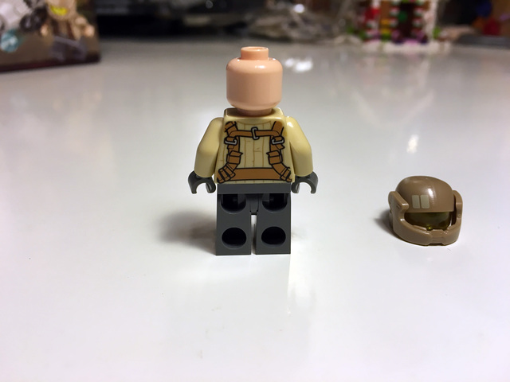](https://www.freelug.org/IMG/jpg/ResistanceTrooperBP_09.jpg)

Troisième minifig de ce set, le [_Resistance Trooper Dark Tan Jacket Frown Furrowed Eyebrows_](http://brickset.com/minifigs/sw697/Resistance-Trooper-Dark-Tan-Jacket-Frown-Furrowed-Eyebrows-\(75131\)) avec sa veste aux motifs et couleur différents.  
On remarque en outre que ce _Trooper_ ne porte pas de gants.

[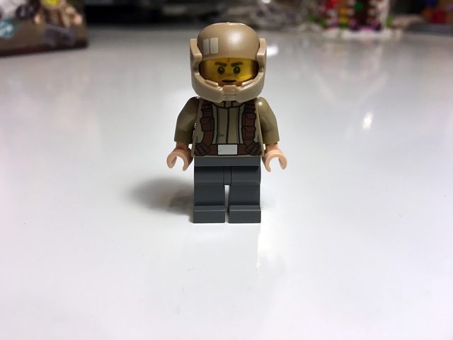](https://www.freelug.org/IMG/jpg/ResistanceTrooperBP_10.jpg)

Sans son casque la fig a un visage neutre avec une petite ride d’expression sur le front.

[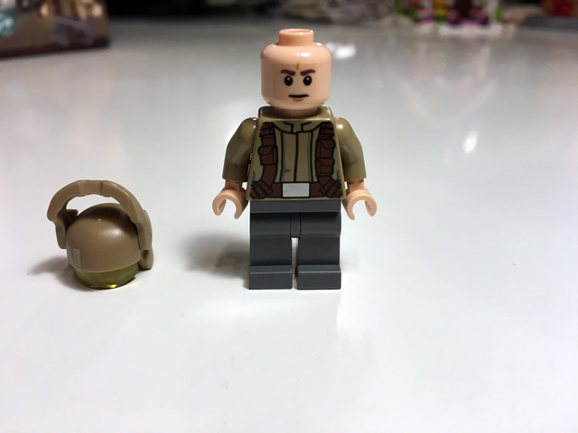](https://www.freelug.org/IMG/jpg/ResistanceTrooperBP_11.jpg)

De dos, là aussi c’est une réussite pour la sérigraphie.

[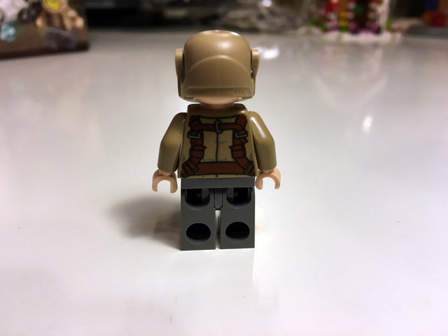](https://www.freelug.org/IMG/jpg/ResistanceTrooperBP_12.jpg)

Enfin, pour le [_Trooper Tan Jacket Moustache_](http://brickset.com/minifigs/sw696/Resistance-Trooper-Tan-Jacket-Moustache-\(75131\)), seul le visage change. Le corps étant le même que le premier Trooper.  
On a ici un visage à moustache, ce qui change un peu il faut bien l’avouer.

[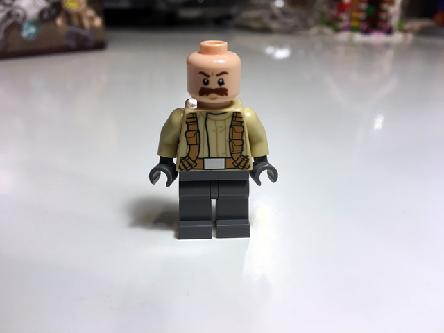](https://www.freelug.org/IMG/jpg/ResistanceTrooperBP_14.jpg)

De dos, toujours la même chose.

[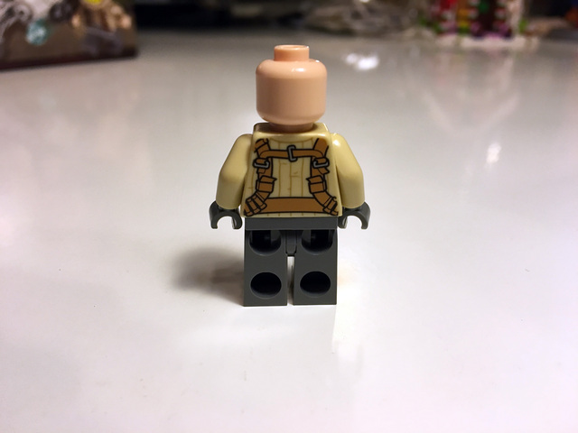](https://www.freelug.org/IMG/jpg/ResistanceTrooperBP_15.jpg)

Gros plan sur le nouveau, la visière tran-yellow est complètement intégrée au casque par bi-injection de matière.  
Très beau travail sur cette pièce, **le rendu est tout simplement superbe**.

[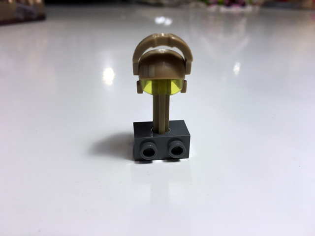](https://www.freelug.org/IMG/jpg/ResistanceTrooperBP_17.jpg)

[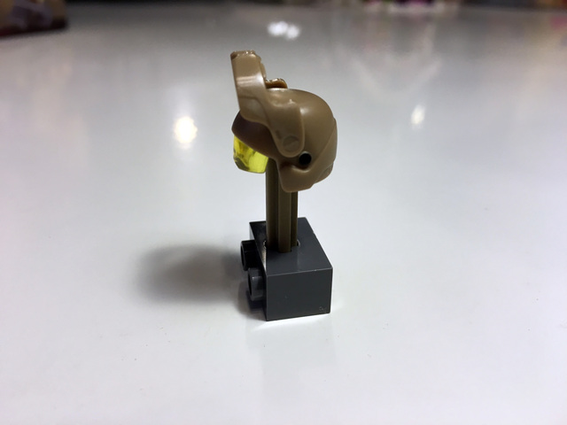](https://www.freelug.org/IMG/jpg/ResistanceTrooperBP_18.jpg)

[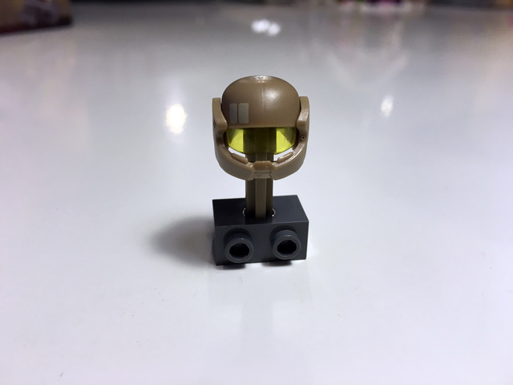](https://www.freelug.org/IMG/jpg/ResistanceTrooperBP_19.jpg)

[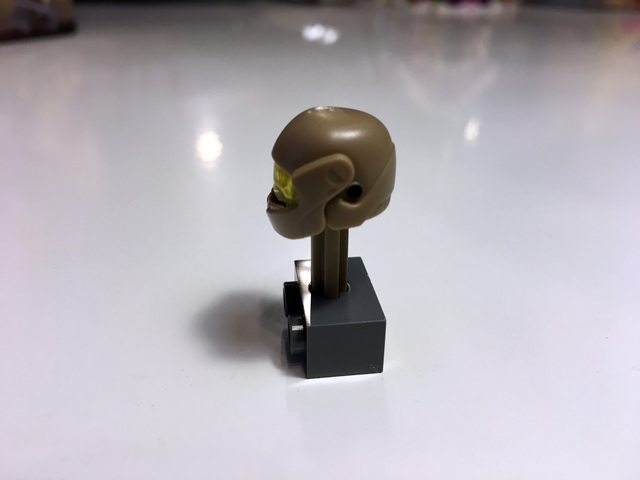](https://www.freelug.org/IMG/jpg/ResistanceTrooperBP_20.jpg)

On commence maintenant à monter le _Speeder_.

[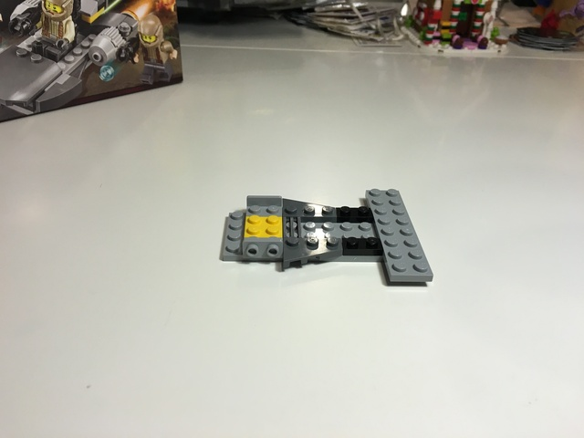](https://www.freelug.org/IMG/jpg/ResistanceTrooperBP_21.jpg)

On retrouve dessous les traditionnelles _Slide Shoe Round 2X2_ transparentes.

[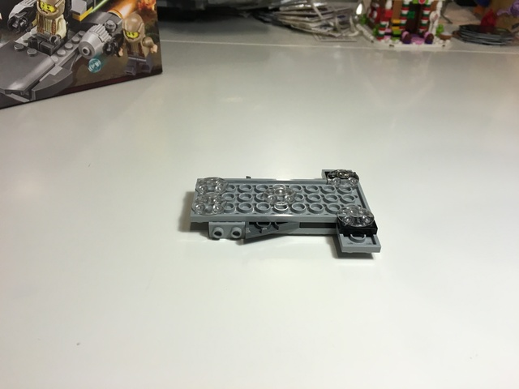](https://www.freelug.org/IMG/jpg/ResistanceTrooperBP_22.jpg)

On devine déjà le poste de pilotage et les pièces qui soutiendront les réacteurs.

[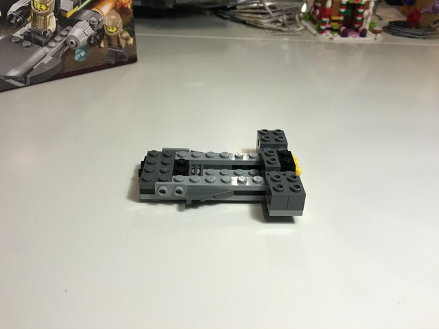](https://www.freelug.org/IMG/jpg/ResistanceTrooperBP_24.jpg)

Le montage de l’arrière des réacteurs est d’une simplicité enfantine et sans grand intérêt.

[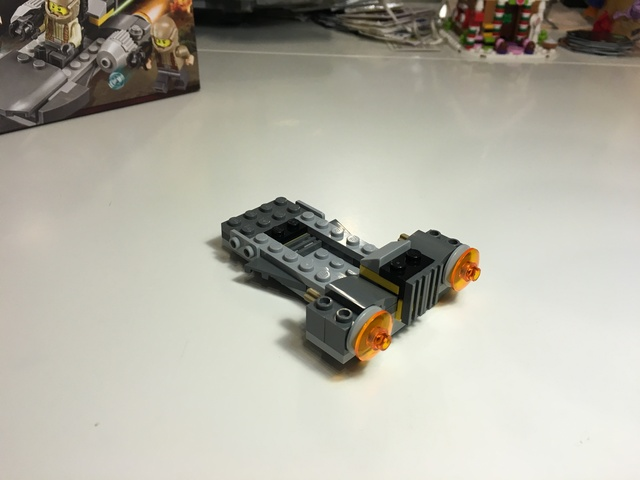](https://www.freelug.org/IMG/jpg/ResistanceTrooperBP_25.jpg)

Même motif, même punition pour l’avant des réacteurs.

[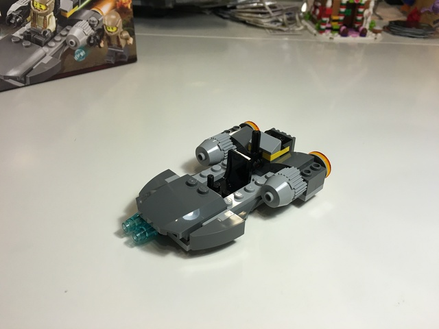](https://www.freelug.org/IMG/jpg/ResistanceTrooperBP_26.jpg)

Le poste d’artillerie est en place et ainsi s’achève la construction.

[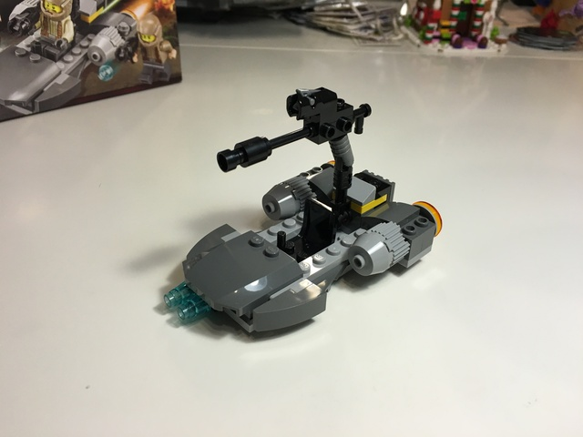](https://www.freelug.org/IMG/jpg/ResistanceTrooperBP_27.jpg)

L’ensemble du set vu sous plusieurs angles.

[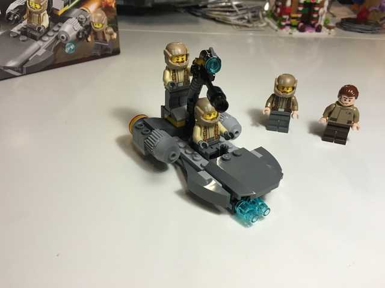](https://www.freelug.org/IMG/jpg/ResistanceTrooperBP_28.jpg)

[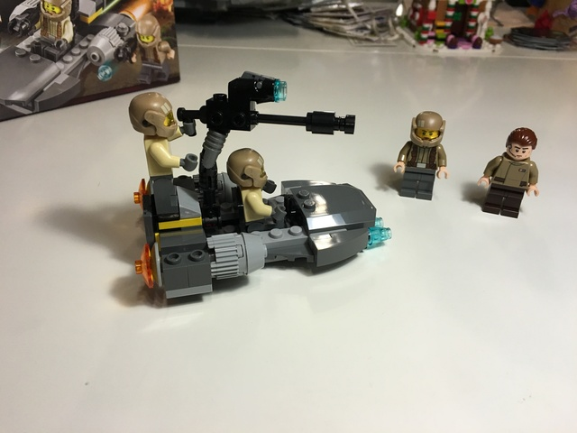](https://www.freelug.org/IMG/jpg/ResistanceTrooperBP_29.jpg)

[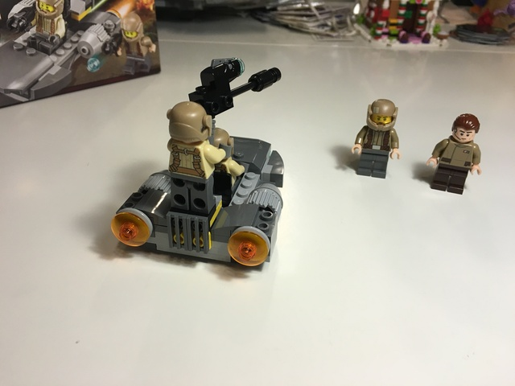](https://www.freelug.org/IMG/jpg/ResistanceTrooperBP_30.jpg)

[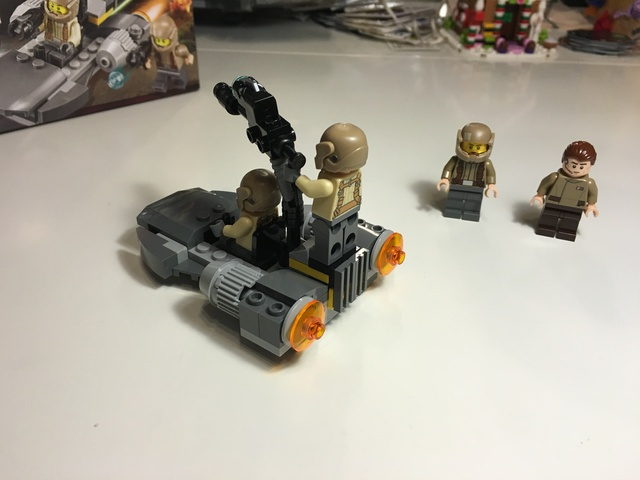](https://www.freelug.org/IMG/jpg/ResistanceTrooperBP_31.jpg)

[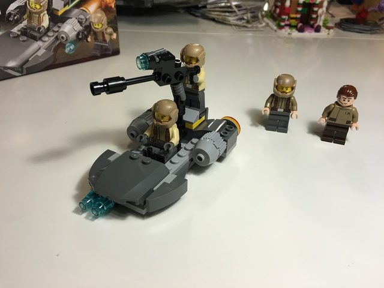](https://www.freelug.org/IMG/jpg/ResistanceTrooperBP_32.jpg)

**AVIS :**

Encore un véhicule de Battle Pack qui ne restera pas dans les mémoires. Ce qui n’est absolument pas le cas des Resistance Trooper qui sont eux superbement réalisés.  
C’est clairement un set à minifigs, le véhicule ira bien vite compléter votre vrac.

**BONUS :**

Voici un GIF animé réalisé avec la totalité des photos prises pour cette review (cliquez sur l’image pour lancer l’animation).

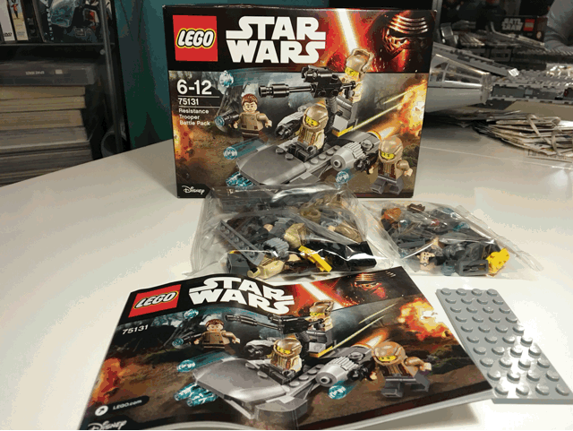
