Aujourd’hui je vous propose la review du set 75133 dans la gamme _Star Wars_ : **Rebel Alliance Battle Pack**.  
Ce set sorti en 2016 au prix de 16,99 € est composé de 101 pièces, soit un ratio prix/pièce de 17 centimes d’euros.

[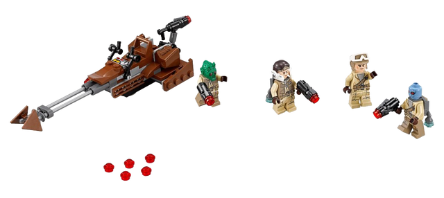](https://www.freelug.org/IMG/png/RebelAllianceBP.png)

Un _Battle Pack_ prometteur sur le papier, voyons voir ce qu’il en est en réalité.

* * *

Le contenu du set est intégré dans le décor de bataille dans un désert. Le bandeau du haut est constitué des logos _LEGO_ et _Star Wars_ et de _Kylo Ren_ (comme tout les sets sortis en 2016).

[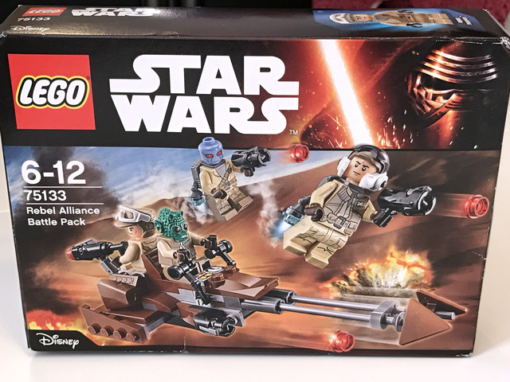](https://www.freelug.org/IMG/jpg/RebelAllianceBP_01.jpg)

Au verso plusieurs vignettes avec les quelques éléments de jouabilités du set.

[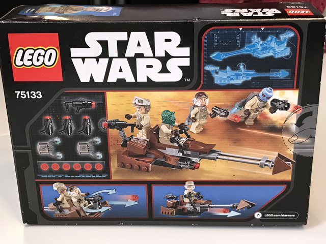](https://www.freelug.org/IMG/jpg/RebelAllianceBP_02.jpg)

Une fois ouvert, le set contient deux sachets et une notice de construction.

[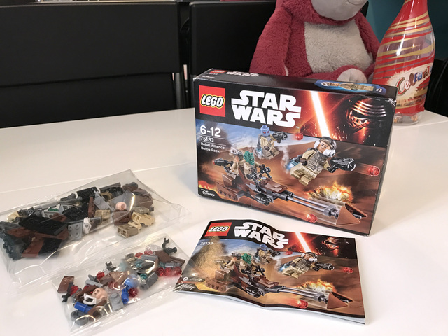](https://www.freelug.org/IMG/jpg/RebelAllianceBP_03.jpg)

* * *

Ce _Battle Pack_ contient quatre minifigures "différentes", en réalité c’est une combinaison de deux torsos et deux paires de jambes différentes.

Le _[Rebel Trooper Dark Tan Helmet](http://brickset.com/minifigs/sw688/rebel-trooper-goggles-dark-tan-helmet-\(75133\))_ au visage patibulaire (pour un "gentil") orné de sérigraphies représentants une veste, une ceinture à pochettes (un classique chez _LEGO_) et d’une bandoulière contenant des munitions.  
Problème d’alignement entre le torso et les jambes c’est bien dommage.

[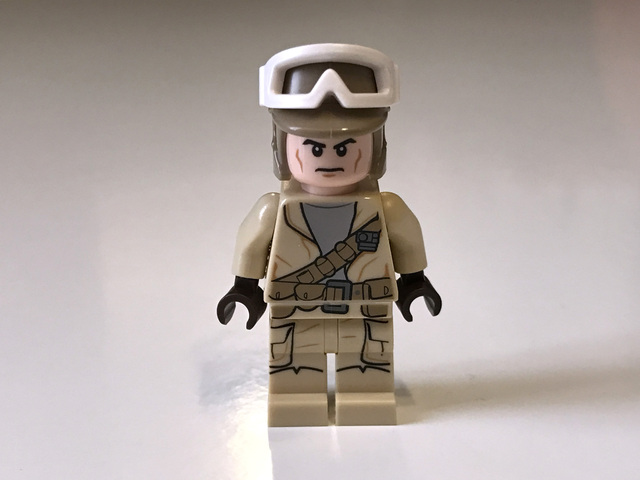](https://www.freelug.org/IMG/jpg/RebelAllianceBP_04.jpg)

Le verso est un peu moins fournit mais néanmoins bien réalisé. Pas de visage alternatif.

[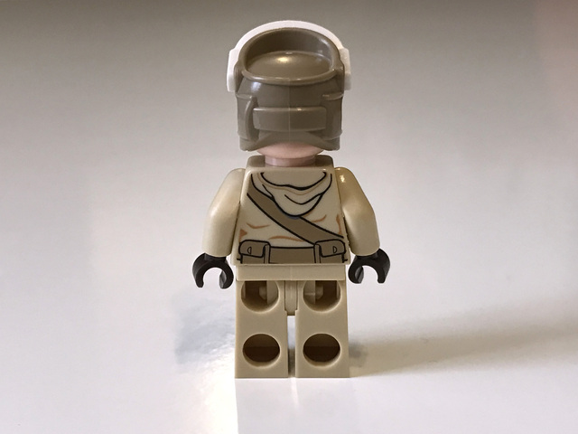](https://www.freelug.org/IMG/jpg/RebelAllianceBP_05.jpg)

Le _[Rodian Alliance Fighter](http://brickset.com/minifigs/sw687/rodian-alliance-fighter-\(75133\))_, là aussi la sérigraphie est réussi et là aussi il y a un problème de d’alignement entre le torso et les jambes. Dommage encore une fois.  
La tête _Rodian_ est superbe.

[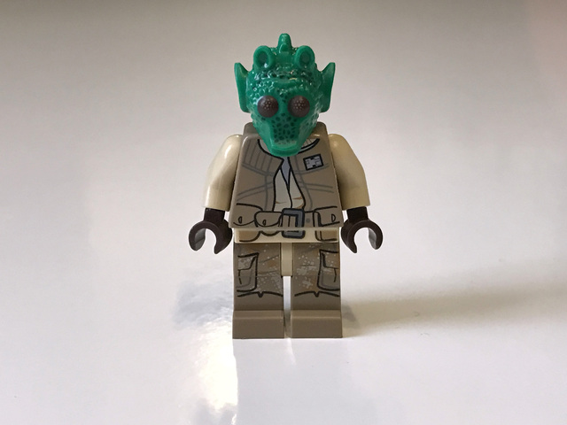](https://www.freelug.org/IMG/jpg/RebelAllianceBP_06.jpg)

Encore une fois le verso est moins fournis que le recto.

[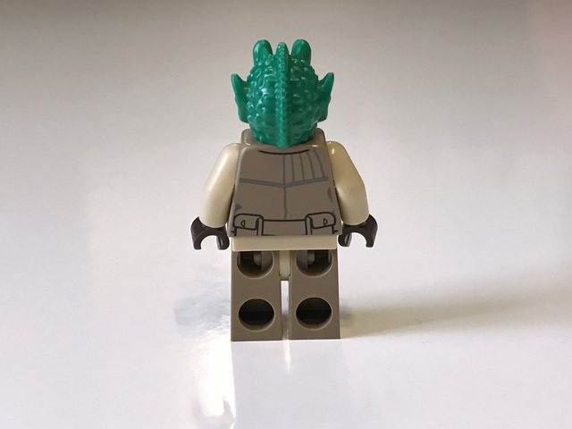](https://www.freelug.org/IMG/jpg/RebelAllianceBP_07.jpg)

Le _[Duros Alliance Fighter](http://brickset.com/minifigs/sw689/duros-alliance-fighter-jetpack-\(75133\))_ mélange le premier torso et les deuxième jambes vues plus haut. Ce mélange rend très bien et cette fois l’alignement est parfait.  
Le visage est joliment réalisé, tout en finesse.

[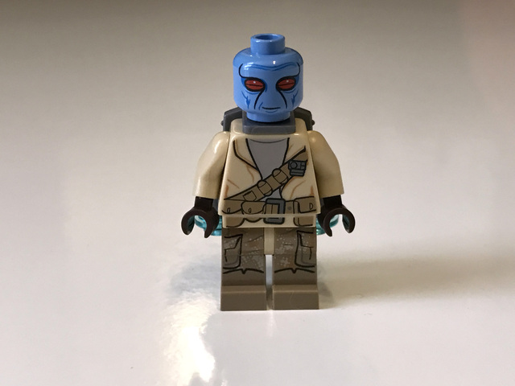](https://www.freelug.org/IMG/jpg/RebelAllianceBP_08.jpg)

Pas de visage alternatif et un jet-pack équipe cette fig.

[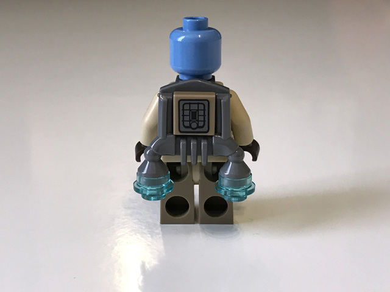](https://www.freelug.org/IMG/jpg/RebelAllianceBP_09.jpg)

Le _[Rebels Trooper, Rebel Helmet](http://brickset.com/minifigs/sw690/rebel-trooper-rebel-helmet-jetpack-\(75133\))_ mélange le deuxième torso et les première jambes vues plus haut. Le casque est magnifique et encore une fois les sérigraphies sont parfaitement alignées (deux sur quatre, il va falloir faire quelque chose M. _LEGO_).  
Le visage est sympathique et pourra être réutilisé facilement.

[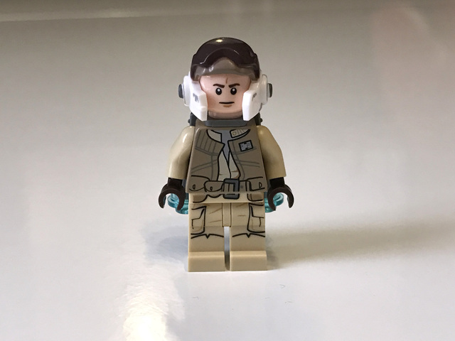](https://www.freelug.org/IMG/jpg/RebelAllianceBP_10.jpg)

Ici aussi, pas de visage alternatif et un jet-pack équipe cette fig.

[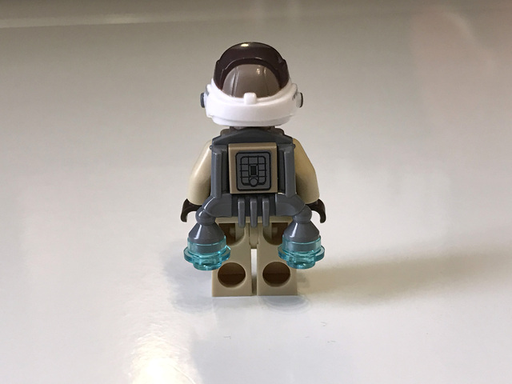](https://www.freelug.org/IMG/jpg/RebelAllianceBP_11.jpg)

* * *

On commence la construction du _Speeder-bike_.

[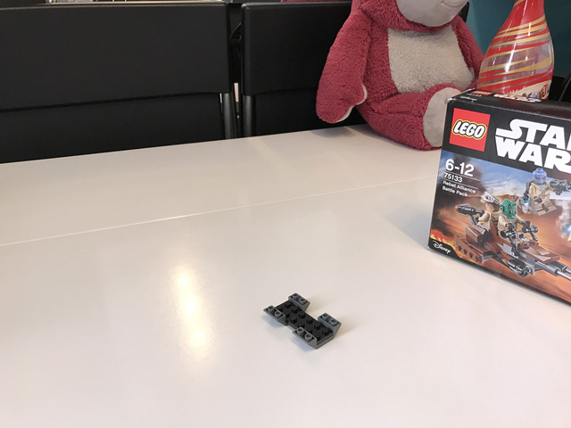](https://www.freelug.org/IMG/jpg/RebelAllianceBP_12.jpg)

Le montage est rapide sans être inintéressant.

[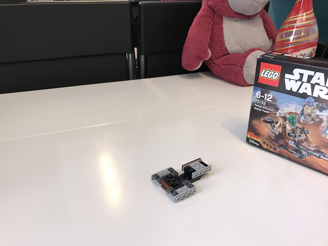](https://www.freelug.org/IMG/jpg/RebelAllianceBP_13.jpg)

Le corps du _Speeder-bike_ s’étoffe.

[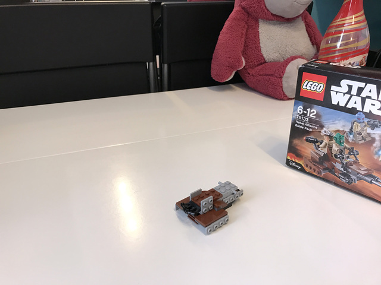](https://www.freelug.org/IMG/jpg/RebelAllianceBP_14.jpg)

Mine de rien ça prend forme de belle manière, pour une fois qu’un _Battle Pack_ est un tantinet intéressant à construire.

[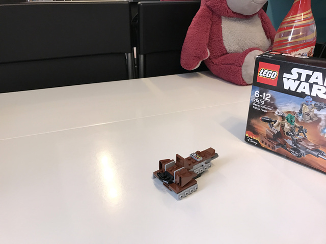](https://www.freelug.org/IMG/jpg/RebelAllianceBP_15.jpg)

Le poste de pilotage et la tourelle arrière.

[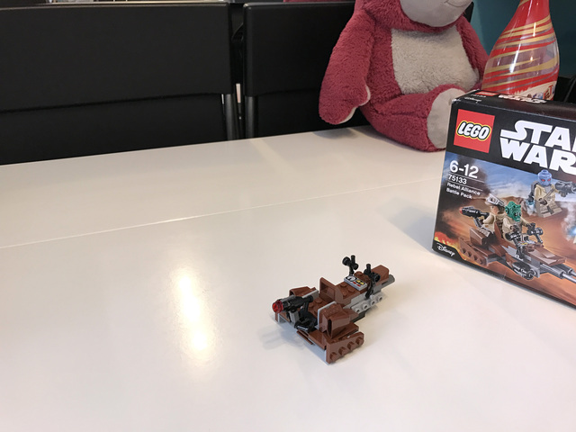](https://www.freelug.org/IMG/jpg/RebelAllianceBP_16.jpg)

Voilà l’engin terminé.

[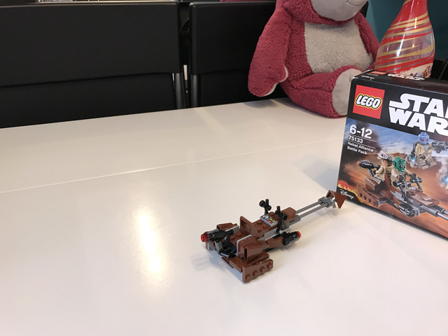](https://www.freelug.org/IMG/jpg/RebelAllianceBP_17.jpg)

Mise en situation.

[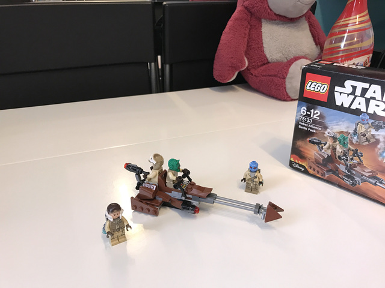](https://www.freelug.org/IMG/jpg/RebelAllianceBP_18.jpg)

D’autres photos, avec vue sous plusieurs angles.

[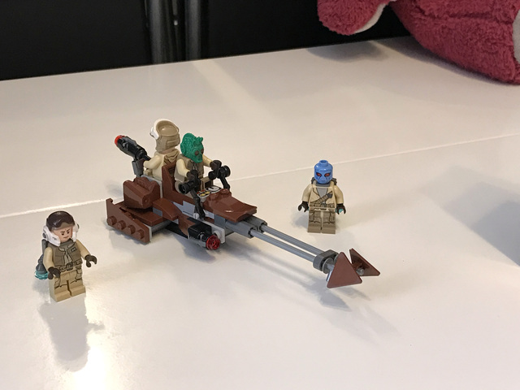](https://www.freelug.org/IMG/jpg/RebelAllianceBP_19.jpg)

[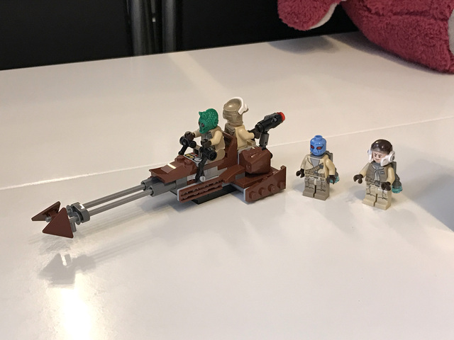](https://www.freelug.org/IMG/jpg/RebelAllianceBP_20.jpg)

[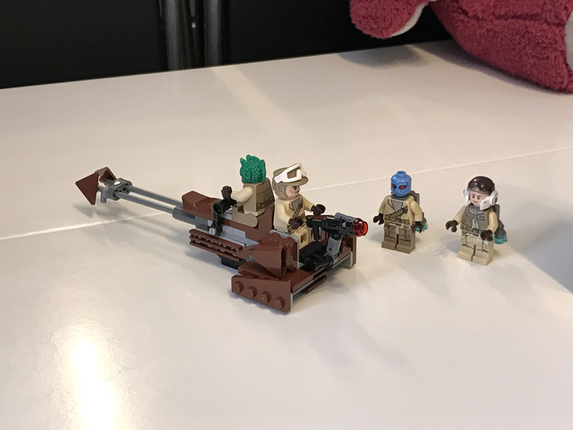](https://www.freelug.org/IMG/jpg/RebelAllianceBP_21.jpg)

[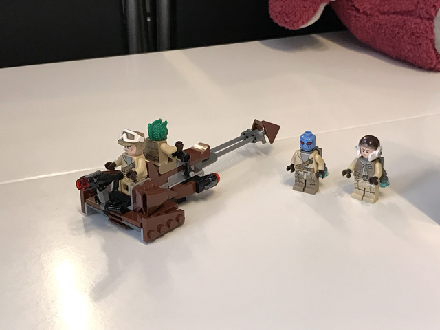](https://www.freelug.org/IMG/jpg/RebelAllianceBP_22.jpg)

* * *

**AVIS :**

Alors là, j’ai trouvé **LE** _Battle Pack_ qui offre à mes yeux le meilleurs véhicule que j’ai construit dans ce genre de set. Loin d’être insipide, ce _Speeder-bike_ a de la gueule et est bien fini.  
Bref on en a pour son argent, surtout que les figurines fournies sont belles et que _LEGO_ nous "offre" deux aliens dans ce set.

**BONUS :**

Voici un GIF animé réalisé avec la totalité des photos prises pour cette review (cliquez sur l’image pour lancer l’animation).

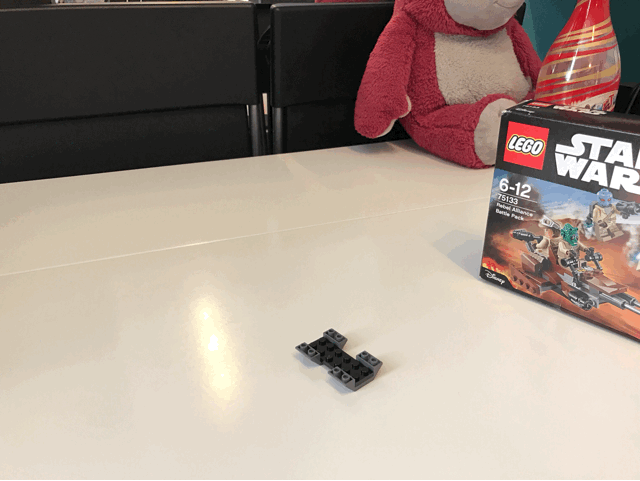
