Aujourd’hui je vous propose la review du set 75135 dans la gamme _Star Wars_ : **Obi-Wan’s Jedi Interceptor**.  
Ce set sorti en 2016 au prix de 29,99 € est composé de 215 pièces, soit un ratio prix/pièce de 12 centimes d’euros.

* * *

Le visuel de la boite reprend une image du film original en fond. Le bandeau du haut est constitué des logos _LEGO_ et _Star Wars_ et du masque de _Kylo Ren_.  
L’Intercepteur Jedi est inséré dans une scène de bataille spatiale, petite bourde de _LEGO_, le vaisseau touché à gauche de la photo du droïd astro-mécano est un Imperial Destroyer. Ce dernier n’existe pas encore au début du film _La Revanche des Sith_ où est sensée se passer cette scène.

[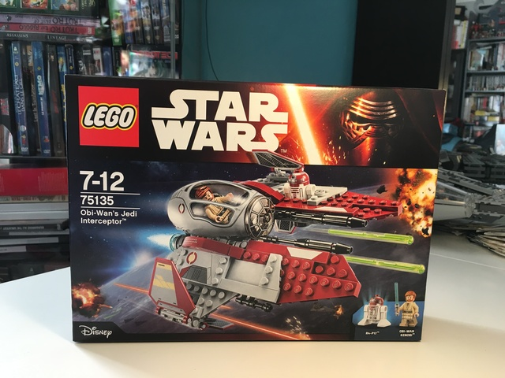](https://www.freelug.org/IMG/jpg/OWJediInterceptor_01.jpg)

Au verso, comme pour toutes les boites 2016, plusieurs vignettes avec les éléments de jouabilité du set, une photo des armes ainsi qu’un simili plan sur console "vidéo".

La boite contient trois sachets numérotés (le premier pour le cockpit du vaisseau puis un paquet par aile), une notice de construction ainsi qu’une **énorme** planche de stickers.

Les stickers en gros plan.

[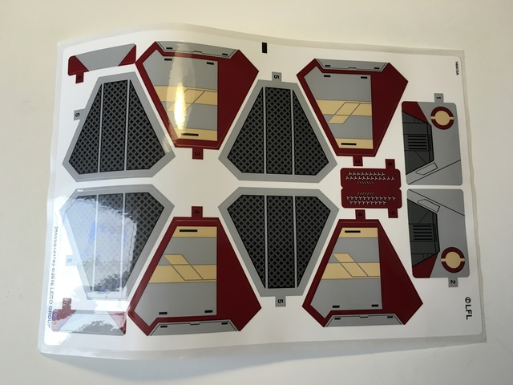](https://www.freelug.org/IMG/jpg/OWJediInterceptor_04.jpg)

Voici donc [_Obi-Wan Kenobi_](http://brickset.com/minifigs/sw704/Obi-Wan-Kenobi-with-Headset-\(75135\)) dont la sérigraphie est bien réalisée, sans être transcendante. On remarque les pans de sa tunique qui continue sur les jambes, la couleur n’est d’ailleurs pas vraiment raccord.  
Il porte en outre un casque de communication sur la tête.

[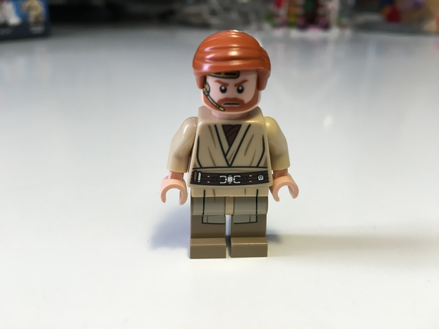](https://www.freelug.org/IMG/jpg/OWJediInterceptor_05.jpg)

Le dos est plutôt réussi avec les plis de la tunique. Le visage alternatif "apeuré" est très bien réalisé, "l’aversion" du pilotage d’_Obi-Wan_ est bien retranscrite.

[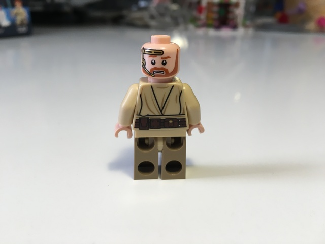](https://www.freelug.org/IMG/jpg/OWJediInterceptor_06.jpg)

[_R4-P17_](http://brickset.com/minifigs/sw706/R4-P17-Silver-Band-around-Dome-\(75135\)) le droïd astro-mécano d’_Obi-Wan Kenobi_ arbore une superbe coupole de couleur _New Dark Red_.  
Ici aussi, les sérigraphie sont fines et superbement réalisées.

[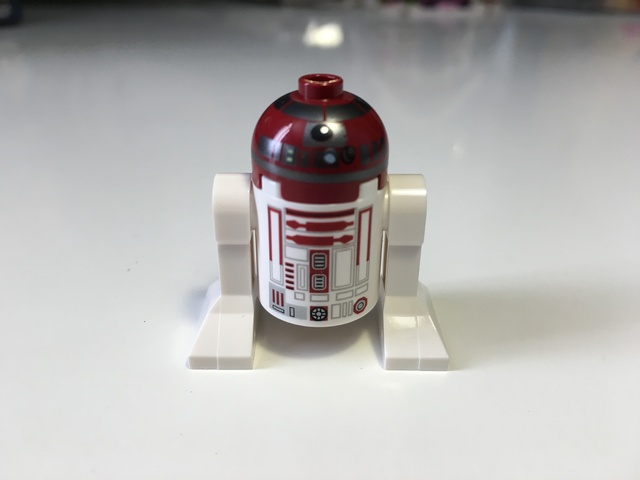](https://www.freelug.org/IMG/jpg/OWJediInterceptor_07.jpg)

Au dos, comme pour tous les droïds astro-mécano, c’est le minimum syndical. Heureusement que la coupole est sérigraphiée sur 360°.

[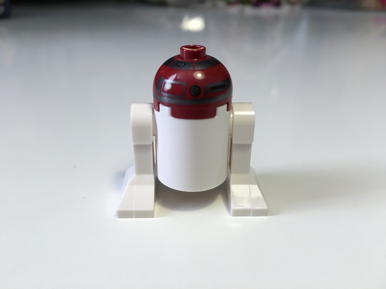](https://www.freelug.org/IMG/jpg/OWJediInterceptor_08.jpg)

Un petit focus sur les deux pièces sérigraphiées du sachet un.

[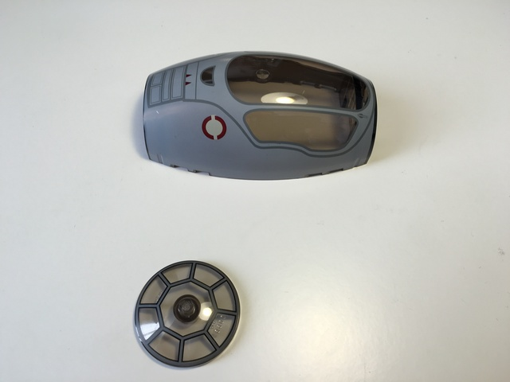](https://www.freelug.org/IMG/jpg/OWJediInterceptor_09.jpg)

On commence à construire le corps de l’intercepteur.

[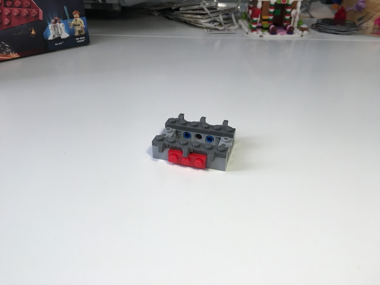](https://www.freelug.org/IMG/jpg/OWJediInterceptor_10.jpg)

On alterne entre montage traditionnel et montage _Technic_.

[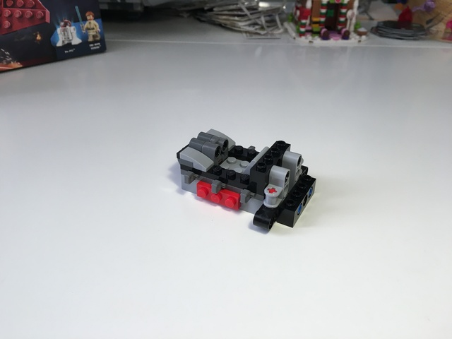](https://www.freelug.org/IMG/jpg/OWJediInterceptor_11.jpg)

Sous le corps viennent se placer les "fameux" lance-missiles à ressort.

[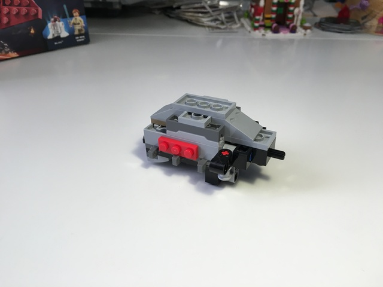](https://www.freelug.org/IMG/jpg/OWJediInterceptor_12.jpg)

Les réacteurs et la vitre avant du cockpit sont en place.

[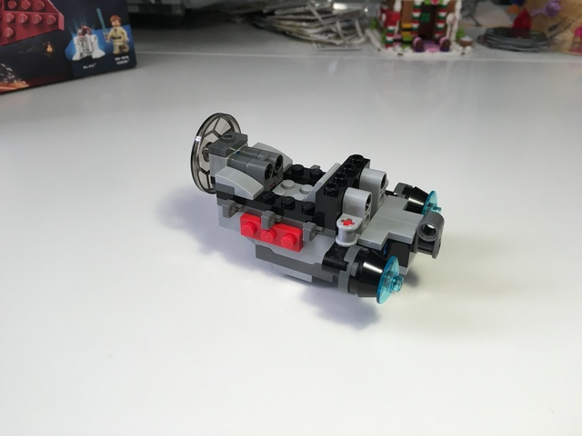](https://www.freelug.org/IMG/jpg/OWJediInterceptor_13.jpg)

A la fin du sachet 1, le corps/cockpit du vaisseau est terminé.  
Sans les ailes c’est vraiment compact.

[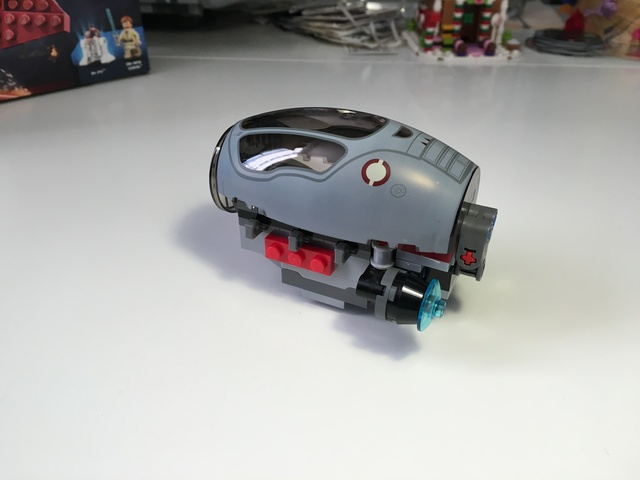](https://www.freelug.org/IMG/jpg/OWJediInterceptor_14.jpg)

On débute le sachet 2 par un petit focus sur deux pièces sérigraphiées.

[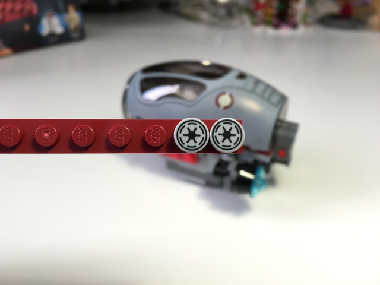](https://www.freelug.org/IMG/jpg/OWJediInterceptor_15.jpg)

Le sachet 2 contient le nécessaire pour construire l’aile gauche.

[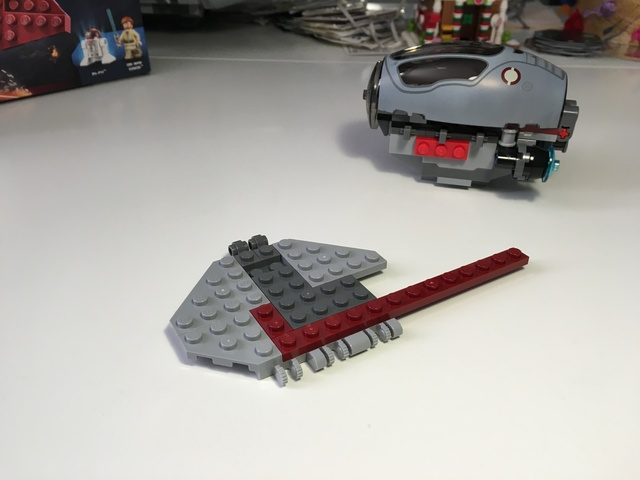](https://www.freelug.org/IMG/jpg/OWJediInterceptor_16.jpg)

Le montage alterne entre le dessus et le dessous de l’aile.

[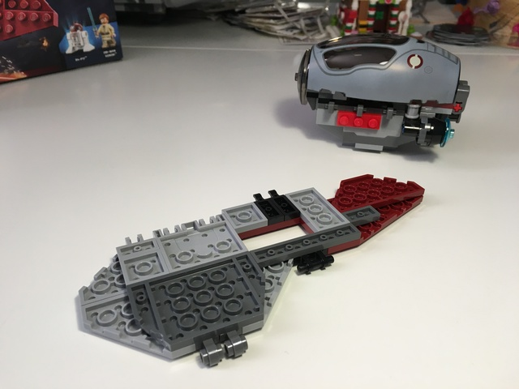](https://www.freelug.org/IMG/jpg/OWJediInterceptor_17.jpg)

On voit bien où sera placé le petit droid astro-mécano _R4-P17_.

[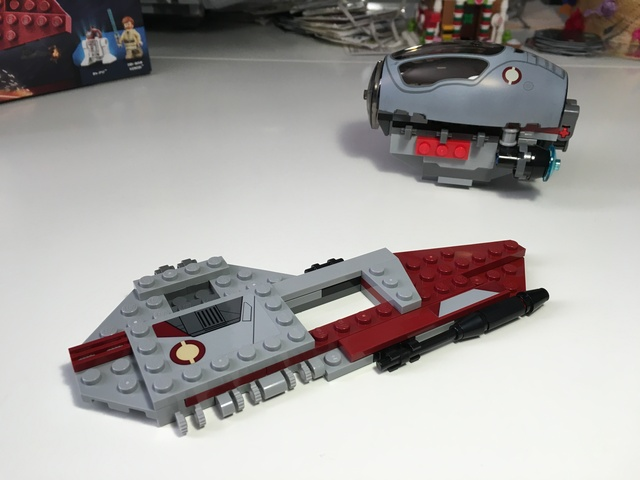](https://www.freelug.org/IMG/jpg/OWJediInterceptor_18.jpg)

On finalise le logement du droid sous l’aile.

[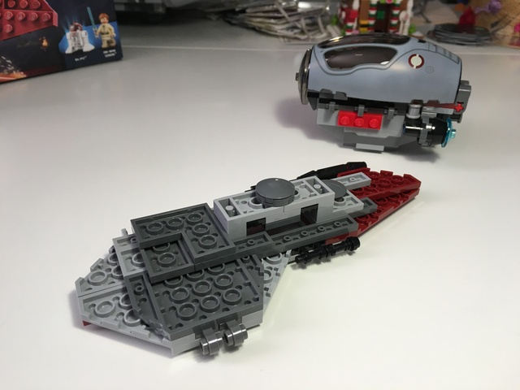](https://www.freelug.org/IMG/jpg/OWJediInterceptor_19.jpg)

Mise en place du volet supérieur.

[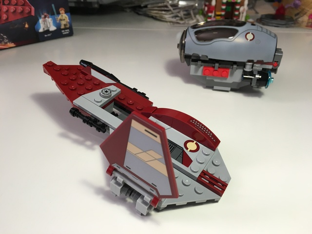](https://www.freelug.org/IMG/jpg/OWJediInterceptor_20.jpg)

Puis du volet inférieur.

[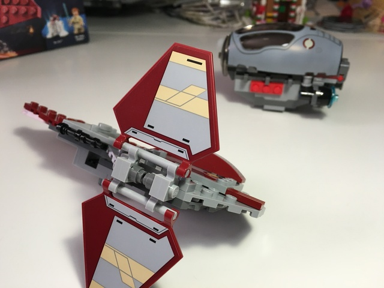](https://www.freelug.org/IMG/jpg/OWJediInterceptor_21.jpg)

Les deux ailes sont maintenant rattachées au cockpit.

[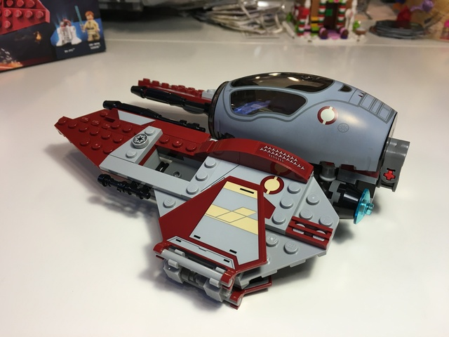](https://www.freelug.org/IMG/jpg/OWJediInterceptor_22.jpg)

Plusieurs vues du set terminé.

[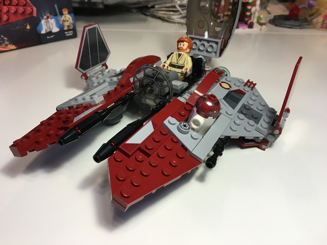](https://www.freelug.org/IMG/jpg/OWJediInterceptor_23.jpg)

[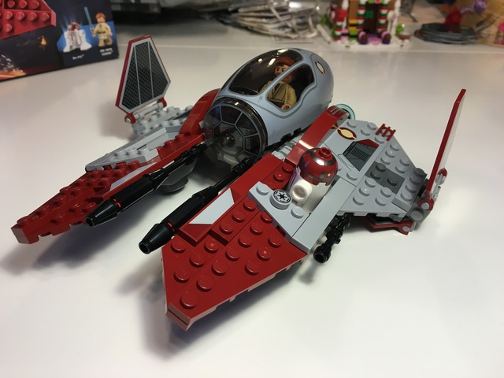](https://www.freelug.org/IMG/jpg/OWJediInterceptor_24.jpg)

[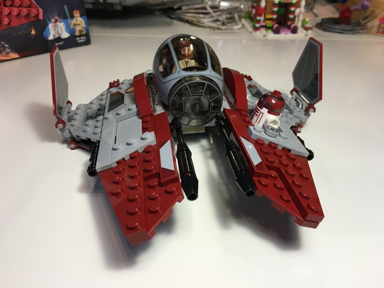](https://www.freelug.org/IMG/jpg/OWJediInterceptor_25.jpg)

[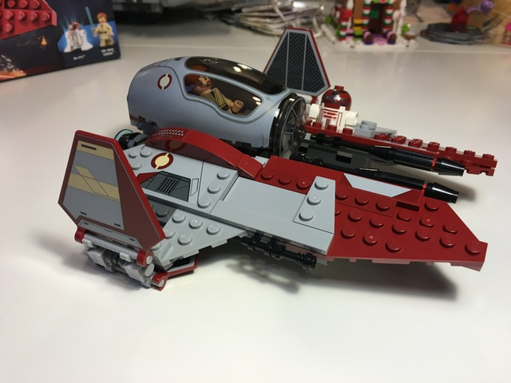](https://www.freelug.org/IMG/jpg/OWJediInterceptor_26.jpg)

[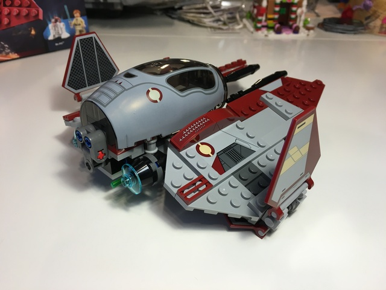](https://www.freelug.org/IMG/jpg/OWJediInterceptor_27.jpg)

[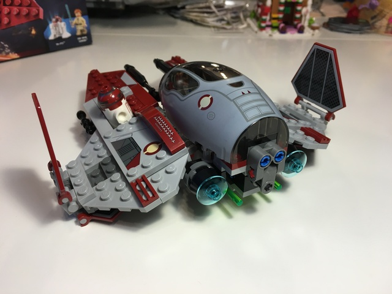](https://www.freelug.org/IMG/jpg/OWJediInterceptor_28.jpg)

[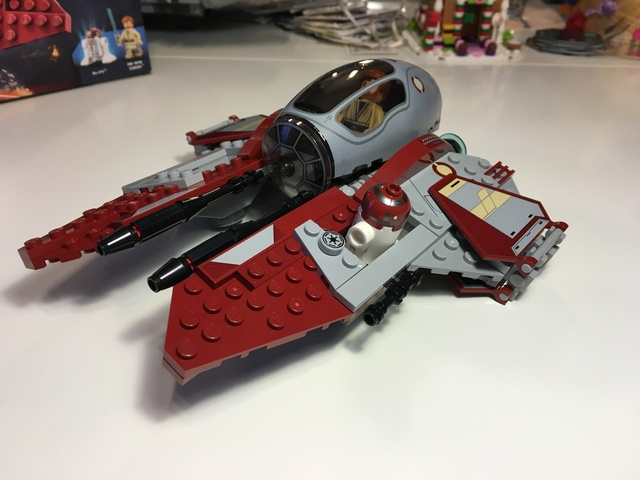](https://www.freelug.org/IMG/jpg/OWJediInterceptor_29.jpg)

Quelques photos avec le set [_75038 - Jedi Interceptor_](http://brickset.com/sets/75038-1/Jedi-Interceptor) d’_Anakin Skywalker_. Les deux modèles diffèrent un peu mais rien de bien choquant.  
Le seul détail qui me fait vraiment tiquer c’est que sur le vaisseau d’_Obi-Wan_ le droid ressort beaucoup plus que sur celui d’_Anakin_.

[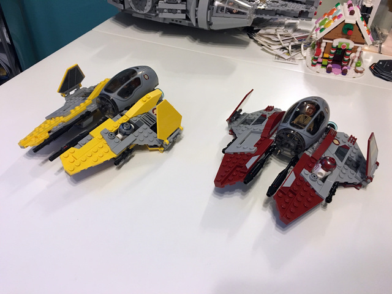](https://www.freelug.org/IMG/jpg/OWJediInterceptor_30.jpg)

[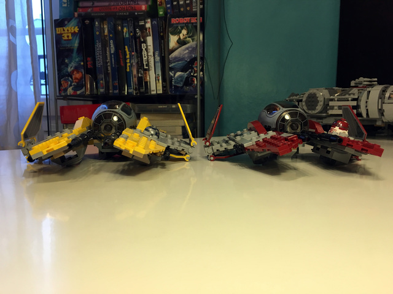](https://www.freelug.org/IMG/jpg/OWJediInterceptor_31.jpg)

[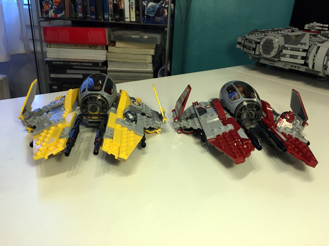](https://www.freelug.org/IMG/jpg/OWJediInterceptor_32.jpg)

[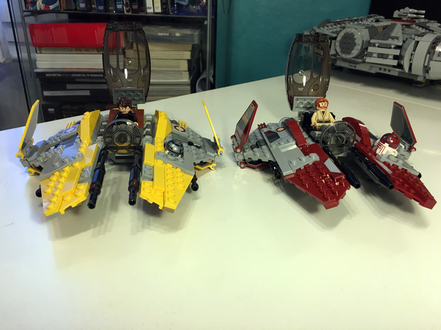](https://www.freelug.org/IMG/jpg/OWJediInterceptor_33.jpg)

[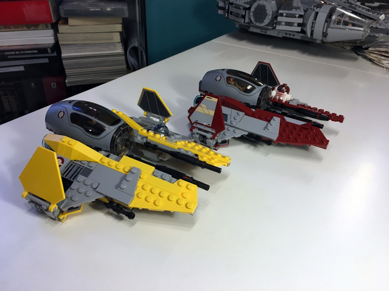](https://www.freelug.org/IMG/jpg/OWJediInterceptor_34.jpg)

[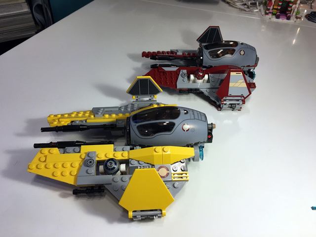](https://www.freelug.org/IMG/jpg/OWJediInterceptor_35.jpg)

[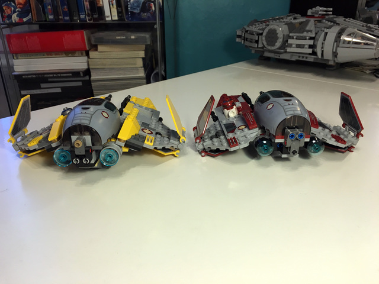](https://www.freelug.org/IMG/jpg/OWJediInterceptor_36.jpg)

[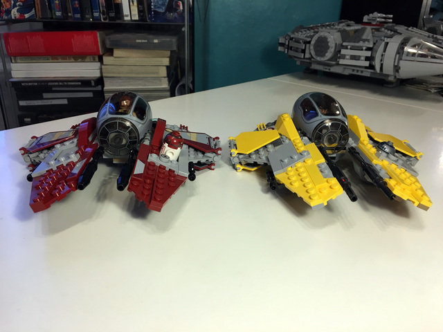](https://www.freelug.org/IMG/jpg/OWJediInterceptor_37.jpg)

[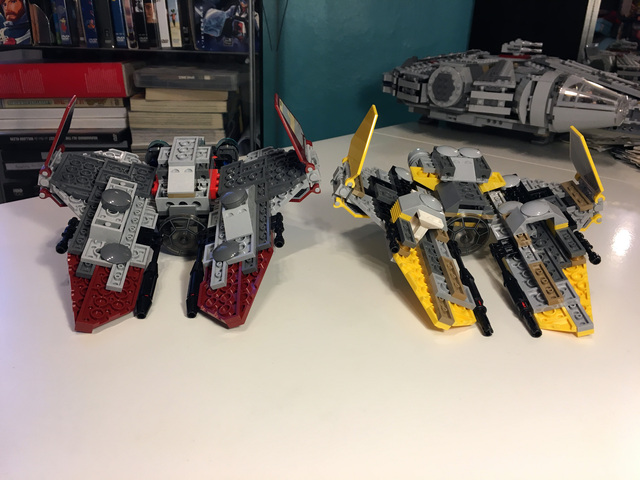](https://www.freelug.org/IMG/jpg/OWJediInterceptor_38.jpg)

[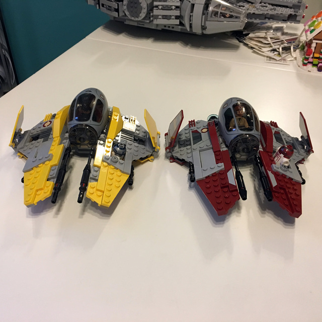](https://www.freelug.org/IMG/jpg/OWJediInterceptor_39.jpg)

**AVIS :**

Voilà un set comme on aimerait bien en avoir plus souvent. Bien que ne comportant "que" 215 pièces, on se retrouve au final avec un joli vaisseau compact et bien fini.  
On peux regretter les nombreux autocollants, mais franchement, il complète tellement bien le set [_75038_](http://brickset.com/sets/75038-1/Jedi-Interceptor) (comme on peut le voir sur les photos ci-dessus) que son achat en devient presque obligatoire.

**BONUS :**

Voici un GIF animé réalisé avec la totalité des photos prises pour cette review (cliquez sur l’image pour lancer l’animation).

