Aujourd’hui, je vous propose la review du set 75169 dans la gamme _Star Wars_ : **Duel on Naboo**.  
Ce set, sorti en 2017 au prix de 29,99 €, est composé de 208 pièces, soit un ratio prix/pièce de 14 centimes d’euro.

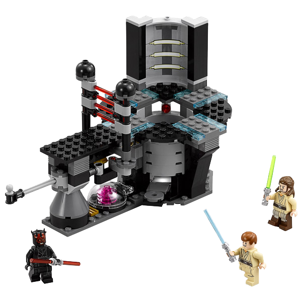

Une scène faite pour la première fois en _LEGO_, voyons si ce set vaut le coup.

* * *

Le contenu du set est intégré dans le décor des entrailles de _Naboo_. Le bandeau du haut est constitué des logos _LEGO_ et _Star Wars_ et d’un casque de _Death Trooper_ (comme tous les sets _Star Wars_ fournée 2017).

[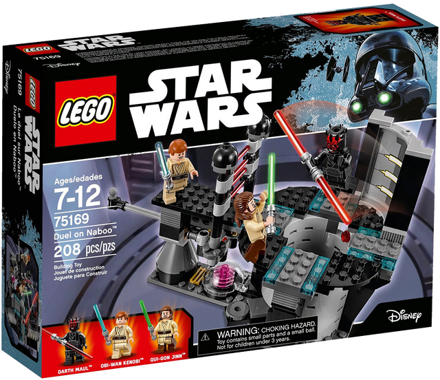](https://www.freelug.org/IMG/png/DuelNaboo_Recto.png)

Au verso, plusieurs vignettes avec les quelques éléments de jouabilité du set.

[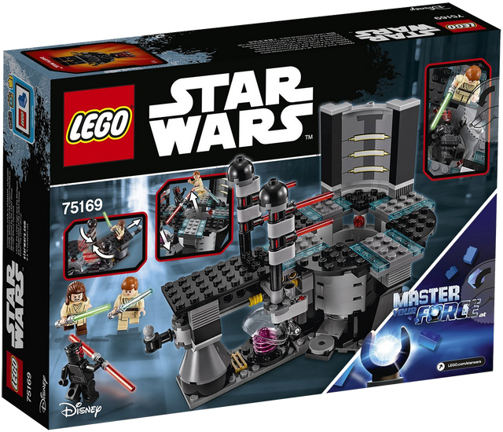](https://www.freelug.org/IMG/png/DuelNaboo_Verso.png)

Une fois ouvert, le set contient trois sachets, un sticker, deux pièces sans sachet et une notice de construction.

[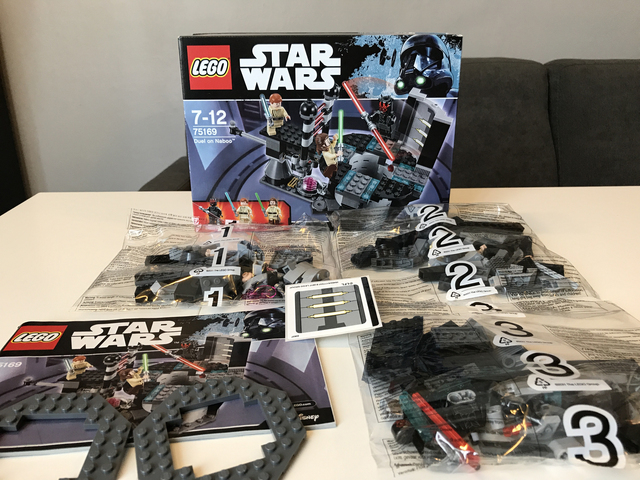](https://www.freelug.org/IMG/jpg/DuelNaboo_01.jpg)

* * *

_[Obi-Wan Kenobi (young)](https://brickset.com/minifigs/sw812/obi-wan-kenobi-young-printed-legs-without-cape-\(75169\))_, visage simple et juvénile, la sérigraphie est simple et pas des plus réussies pour la tresse (il aurait fallu en mettre une partie sur le visage) et le haut du torse (la couleur "peau" n’a pas du tout le même ton que la tête).

_

[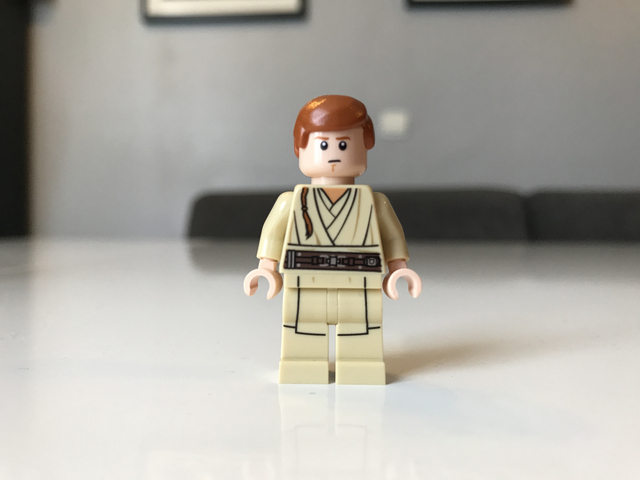](https://www.freelug.org/IMG/jpg/DuelNaboo_02.jpg)

_

Le verso est du même acabit, nous avons le droit à un visage alternatif "énervé".

[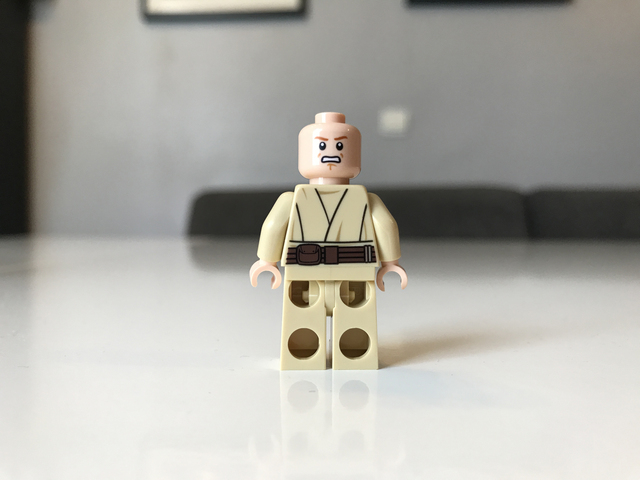](https://www.freelug.org/IMG/jpg/DuelNaboo_03.jpg)

_[Qui-Gon Jinn](https://brickset.com/minifigs/sw810/qui-gon-jinn-without-cape-\(75169\))_, maître d’_Obi-Wan_, ici aussi la fig laisse sur sa faim, la peau du torse est ratée (trop rouge) et la sur-impression de la tunique sur les jambes est trop claire. Je ne parlerai pas non plus des cheveux. Même le visage n’est pas ressemblant à _Liam NEESON_.

[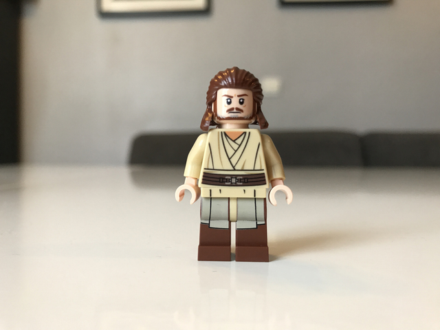](https://www.freelug.org/IMG/jpg/DuelNaboo_04.jpg)

Le verso est lui aussi très simple, il n’y a vraiment que le visage alternatif "étonné" qui relève un peu cette fig.

[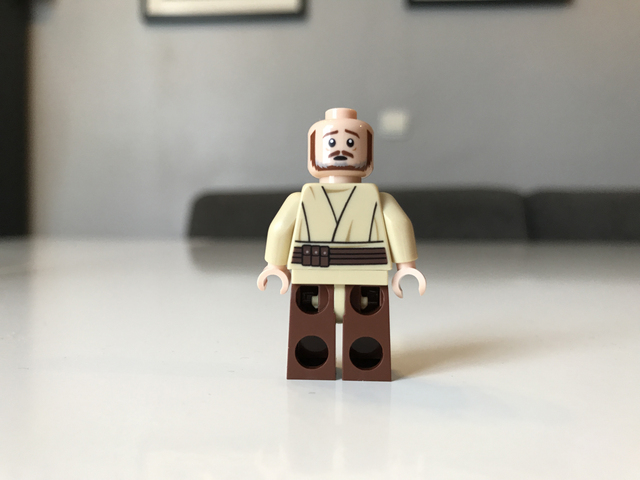](https://www.freelug.org/IMG/jpg/DuelNaboo_05.jpg)

Grand méchant de l’_Episode 1_, _[Darth Maul](https://brickset.com/minifigs/sw808/darth-maul-without-cape-\(75169\))_ est la fig qui sauve ce set. Bien que simple la tunique est bien sérigraphiée avec les nombreux plis.  
Le visage est superbement réalisé.

[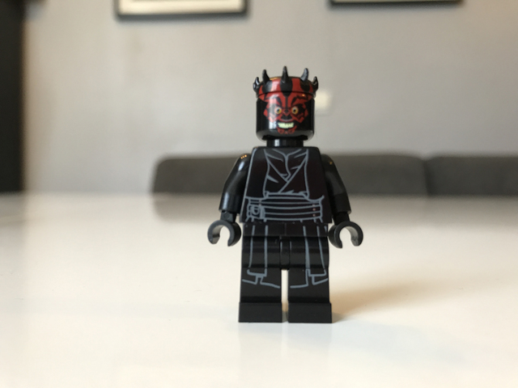](https://www.freelug.org/IMG/jpg/DuelNaboo_06.jpg)

Dos simple mais efficace.

[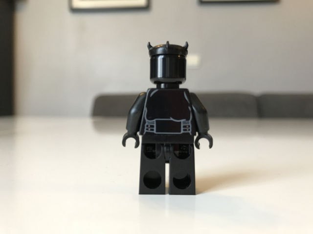](https://www.freelug.org/IMG/jpg/DuelNaboo_07.jpg)

* * *

On commence la construction par le puits et le système qui permet de faire sauter la fig d’_Obi-Wan_ afin de rejouer la scène du film.

[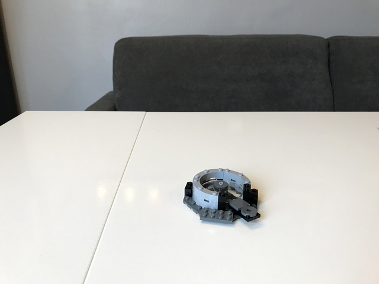](https://www.freelug.org/IMG/jpg/DuelNaboo_08.jpg)

Le montage est simple pour le moment.

[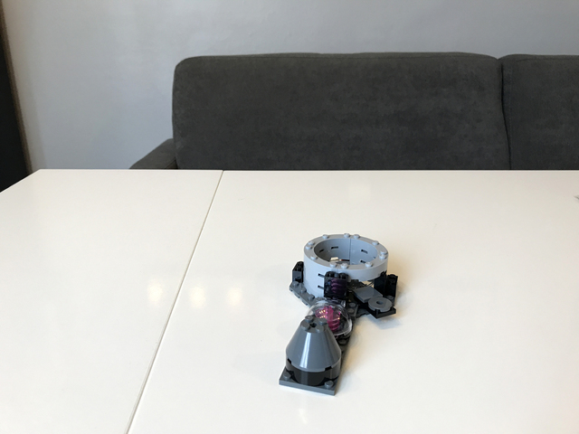](https://www.freelug.org/IMG/jpg/DuelNaboo_09.jpg)

On agrémente les cloisons du puits avec des piliers noirs.

[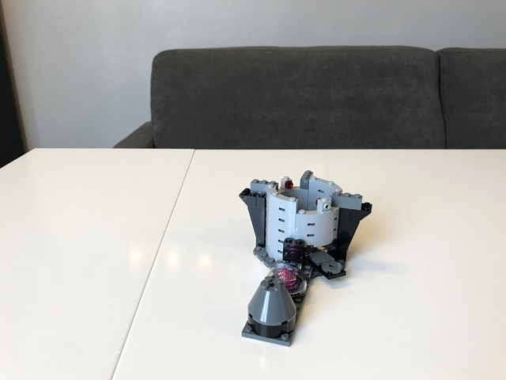](https://www.freelug.org/IMG/jpg/DuelNaboo_10.jpg)

La passerelle comprenant le système d’ouverture des portes laser.

[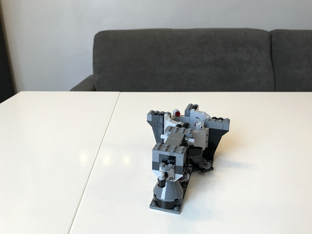](https://www.freelug.org/IMG/jpg/DuelNaboo_11.jpg)

La construction est quasiment achevée, pas déplaisante, mais sans grand intérêt niveau technique de construction.

[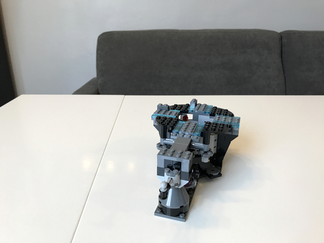](https://www.freelug.org/IMG/jpg/DuelNaboo_12.jpg)

Un petit GIF du fonctionnement des portes laser (cliquez sur l’image pour lancer l’animation).

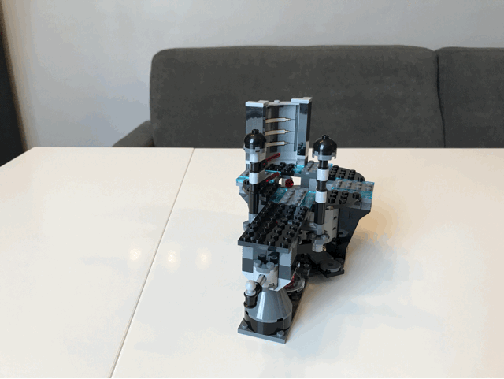

Mise en situation finale.

[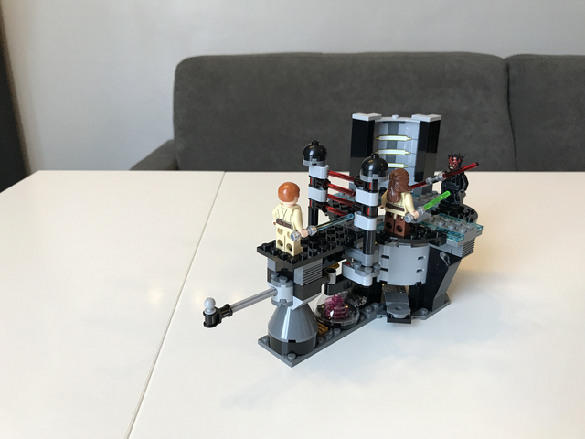](https://www.freelug.org/IMG/jpg/DuelNaboo_13.jpg)

D’autres photos, avec vue sous plusieurs angles.

[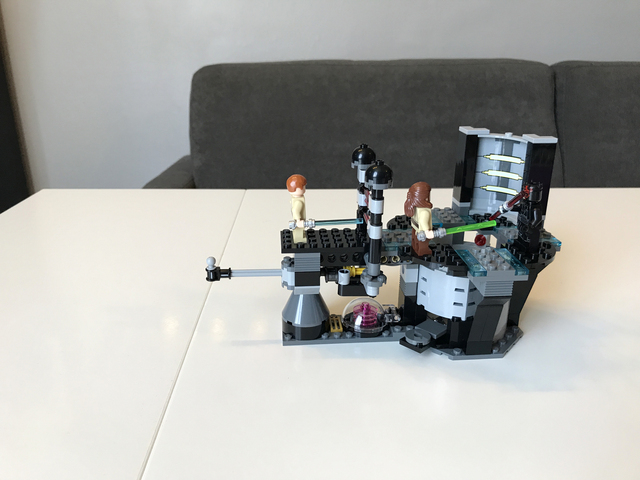](https://www.freelug.org/IMG/jpg/DuelNaboo_14.jpg)

[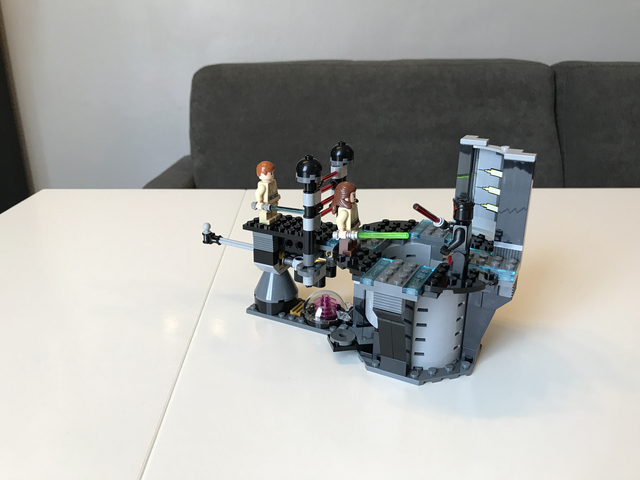](https://www.freelug.org/IMG/jpg/DuelNaboo_15.jpg)

[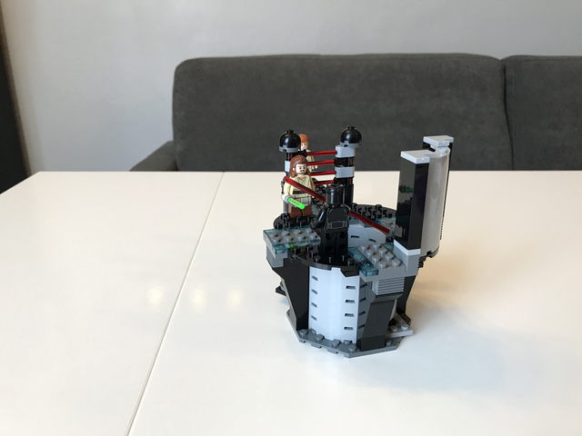](https://www.freelug.org/IMG/jpg/DuelNaboo_16.jpg)

[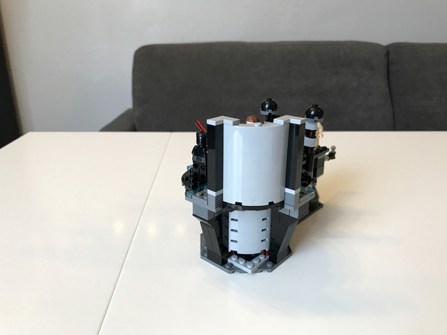](https://www.freelug.org/IMG/jpg/DuelNaboo_17.jpg)

[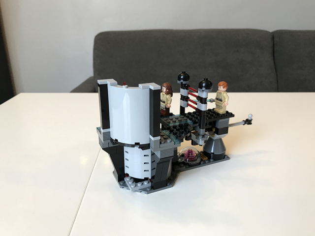](https://www.freelug.org/IMG/jpg/DuelNaboo_18.jpg)

[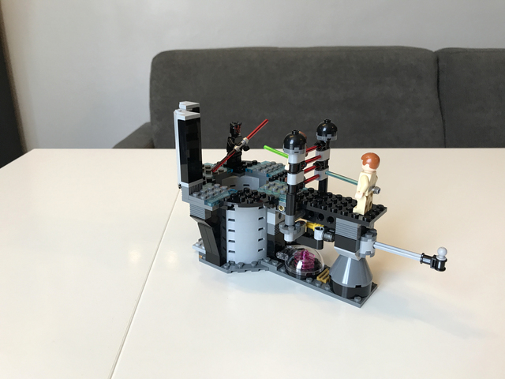](https://www.freelug.org/IMG/jpg/DuelNaboo_19.jpg)

[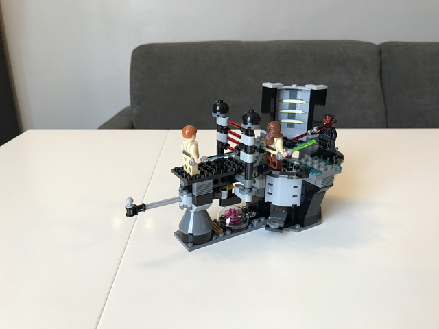](https://www.freelug.org/IMG/jpg/DuelNaboo_20.jpg)

**AVIS :**

Un petit set sans prétention mais qui n’est pourtant pas rébarbatif à construire même si aucune technique de montage transcendante ne vient agrémenter le montage. Des trois figs présentes, seul _Darth Maul_ tire son épingle du jeu. Les autres étant pour moi mal finies.

Pourtant cette boite ravira sûrement les enfants, car elle contient trois personnages connus et une occasion de rejouer la scène de combat du film _La Menace Fantôme_.

Conclusion en demi-teinte, car si à 30 euros ce set est trop cher, à 15-20 euros en promo il sera bien plus tentant à acquérir.

**BONUS :**

Voici un GIF animé réalisé avec la totalité des photos prises pour cette review (cliquez sur l’image pour lancer l’animation).

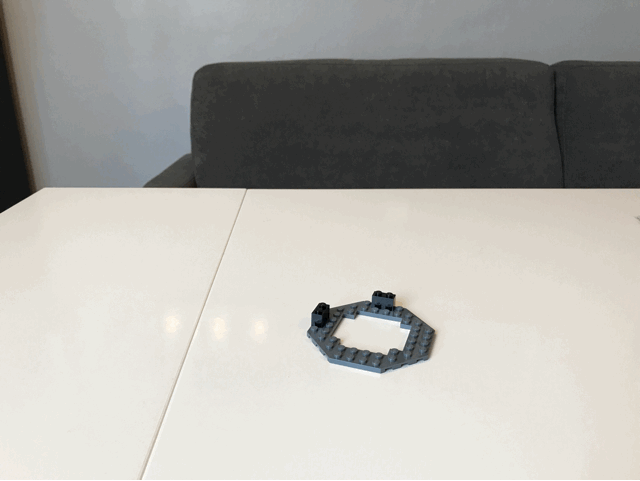
