Aujourd’hui je vous propose la review du set 75170 dans la gamme _Star Wars_ : **The Phantom**.

Ce set sorti en 2016 au prix de 39,99 € est composé de 269 pièces, soit un ratio prix/pièce de 15 centimes d’euros.

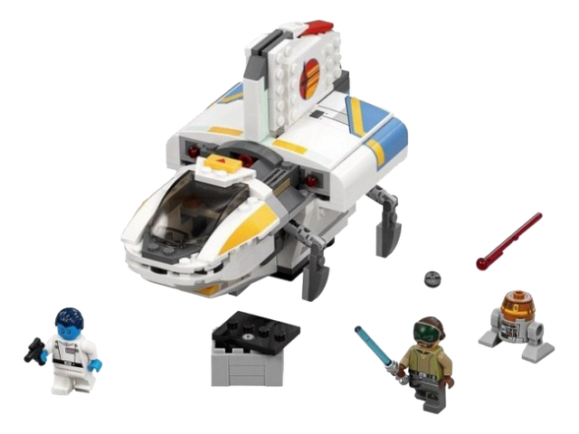

* * *

Le visuel de la boite met le set en scène dans une bataille spatiale. Le bandeau du haut est constitué des logos _LEGO_ et _Star Wars_ et d’un _Deathtrooper_.

[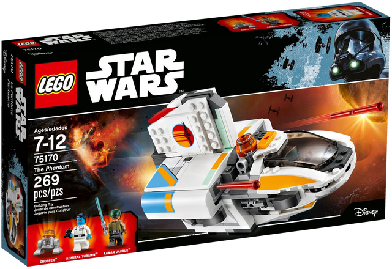](https://www.freelug.org/IMG/png/Phantom75170_BoxR.png)

Au verso plusieurs vignettes avec les éléments de jouabilités du set.

[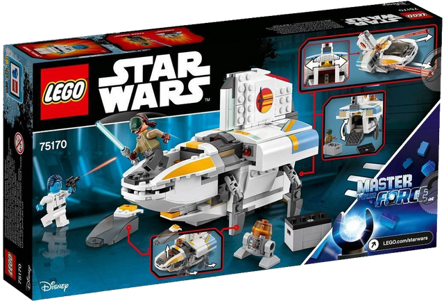](https://www.freelug.org/IMG/png/Phantom75170_BoxV.png)

Une fois ouvert, le set contient trois sachets, une planche de stickers et une notice de construction.

[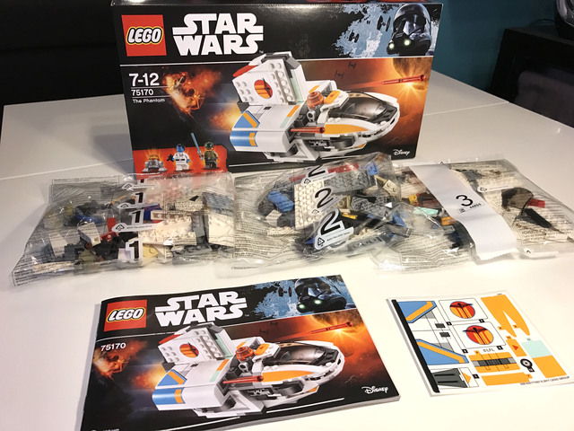](https://www.freelug.org/IMG/jpg/Phantom75170_01.jpg)

* * *

La minifig de _Kanan Jarrus_ correspond à la 3ème saison de la série. Ce dernier est donc aveugle, d’où le masque incorporé à la chevelure _LEGO_.  
Jambes sérigraphiées, alignées avec le torso (c’est toujours bon à noter). La sérigraphie du torso est originale même si ce n’est pas la plus belle que j’ai vue.

[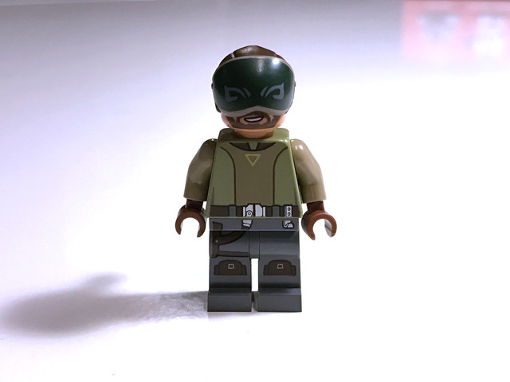](https://www.freelug.org/IMG/jpg/Phantom75170_02.jpg)

Au verso, belle continuité de la sérigraphie et visage alternatif à l’expression "neutre".

[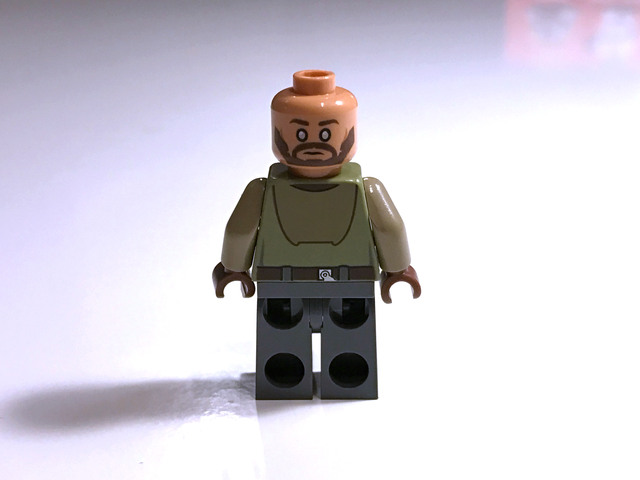](https://www.freelug.org/IMG/jpg/Phantom75170_03.jpg)

L’_Amiral Thrawn_ est une figurine attendue par les fans depuis longtemps. La réalisation de _LEGO_ est réussie, malgré une erreur sur les couleurs du grade.

[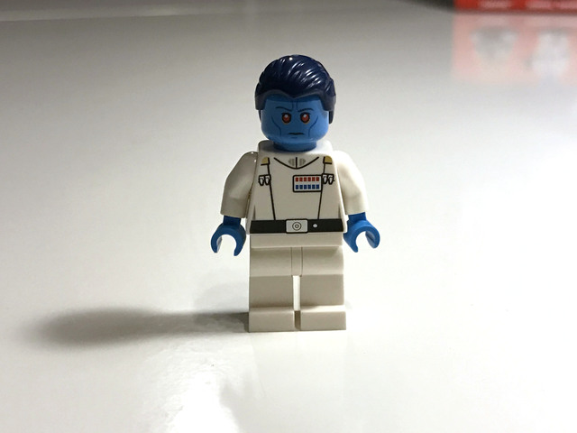](https://www.freelug.org/IMG/jpg/Phantom75170_04.jpg)

De dos c’est le strict minimum, LEGO nous gratifie d’un visage alternatif "énervé".

[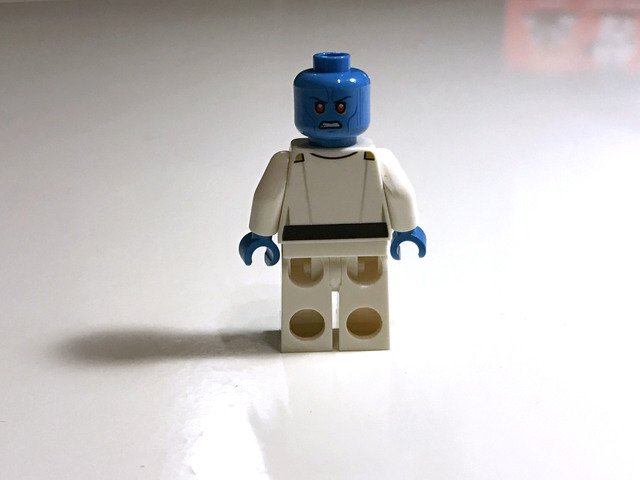](https://www.freelug.org/IMG/jpg/Phantom75170_05.jpg)

_Chopper_ (_C1-10P_) est la seule figurine non exclusive sur set. Il n’en reste pas moins que ce petit droïde est joliment réalisé, même si personnellement je ne suis pas fan des couleurs.

[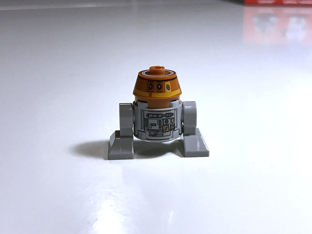](https://www.freelug.org/IMG/jpg/Phantom75170_06.jpg)

De dos c’est le désert, comme tout les droïdes astro-mécano chez _LEGO_.

[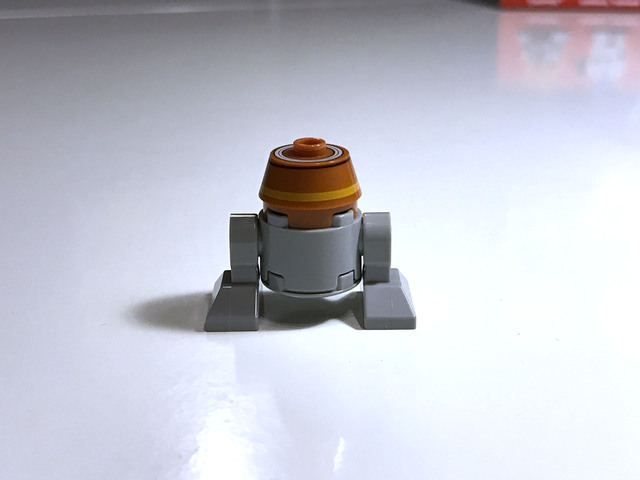](https://www.freelug.org/IMG/jpg/Phantom75170_07.jpg)

* * *

On commence la construction par la corps de la navette.

[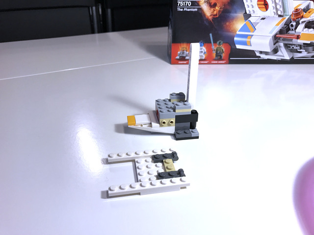](https://www.freelug.org/IMG/jpg/Phantom75170_10.jpg)

On l’habile un peu.

[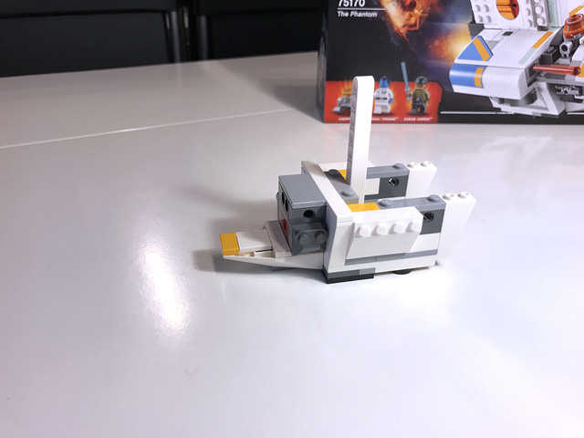](https://www.freelug.org/IMG/jpg/Phantom75170_13.jpg)

Puis on commence le haut du corps/ailes de la navette.

[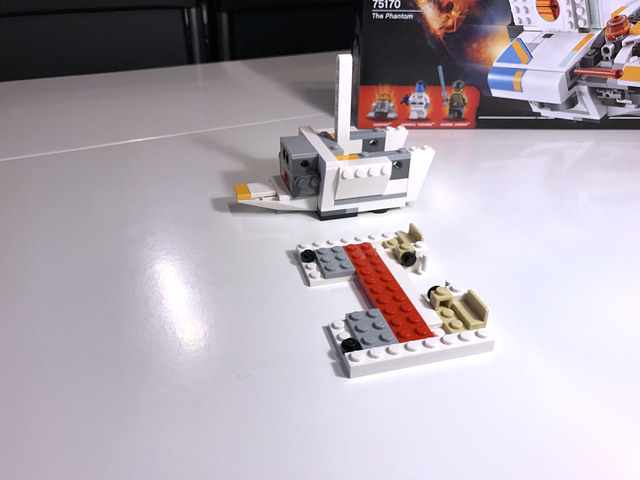](https://www.freelug.org/IMG/jpg/Phantom75170_14.jpg)

Une fois terminé la structure extérieure lisse reçoit pas moins de 6 stickers.

[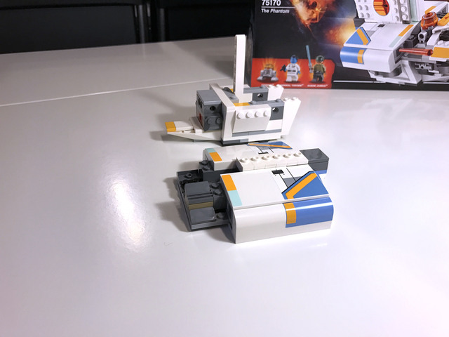](https://www.freelug.org/IMG/jpg/Phantom75170_16.jpg)

Montage intéressant pour maintenir l’aileron sur le reste de la structure.

[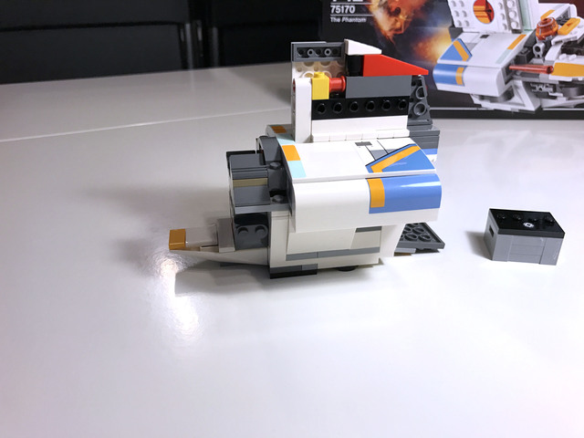](https://www.freelug.org/IMG/jpg/Phantom75170_17.jpg)

L’aileron complétement habillé, on monte le cockpit qui peut se séparer du reste du _Phantom_.

[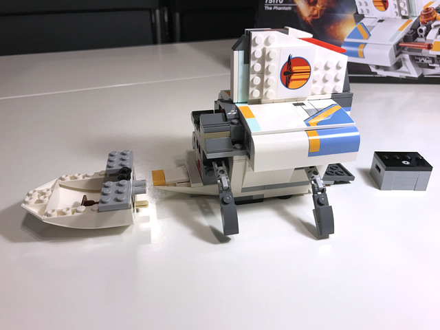](https://www.freelug.org/IMG/jpg/Phantom75170_18.jpg)

Voilà le set terminé.

[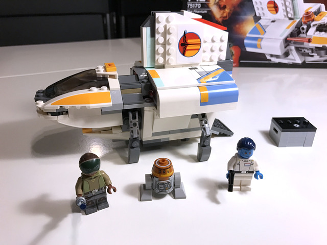](https://www.freelug.org/IMG/jpg/Phantom75170_21.jpg)

* * *

Quelques photos complémentaires.

[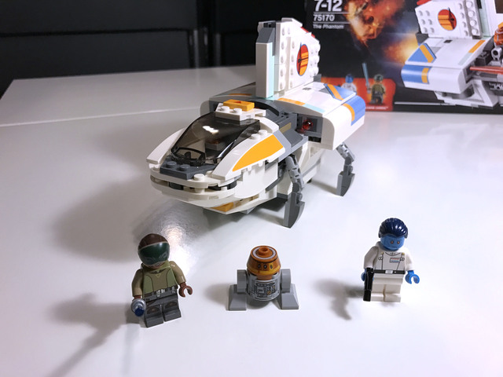](https://www.freelug.org/IMG/jpg/Phantom75170_22.jpg)

[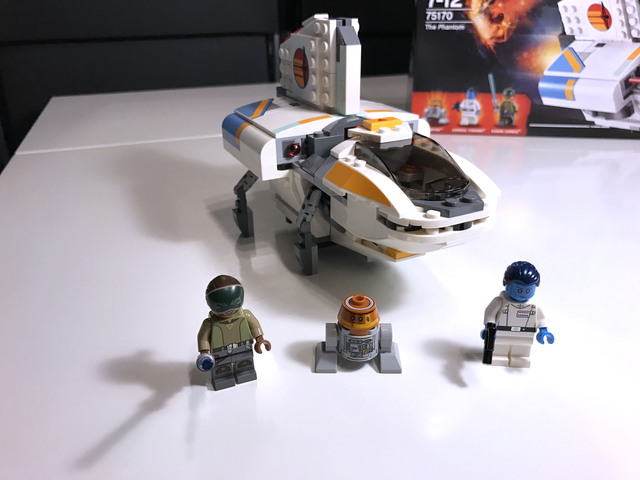](https://www.freelug.org/IMG/jpg/Phantom75170_23.jpg)

[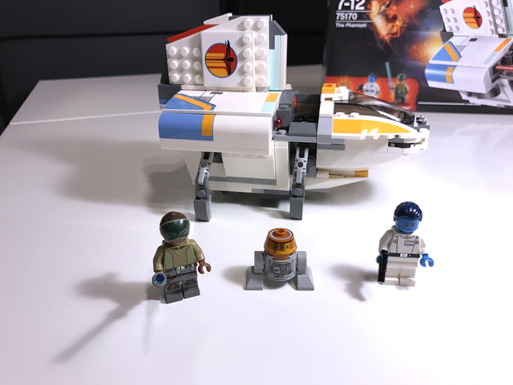](https://www.freelug.org/IMG/jpg/Phantom75170_24.jpg)

[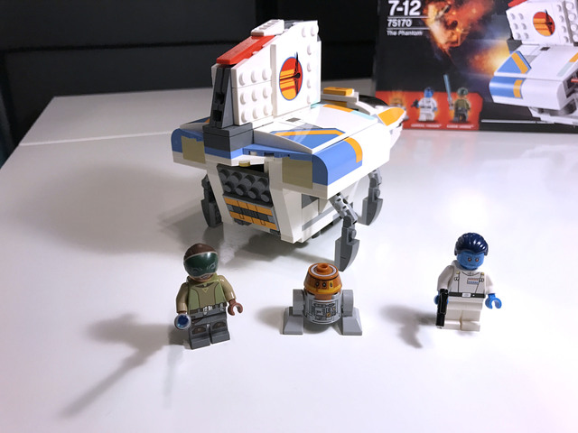](https://www.freelug.org/IMG/jpg/Phantom75170_25.jpg)

[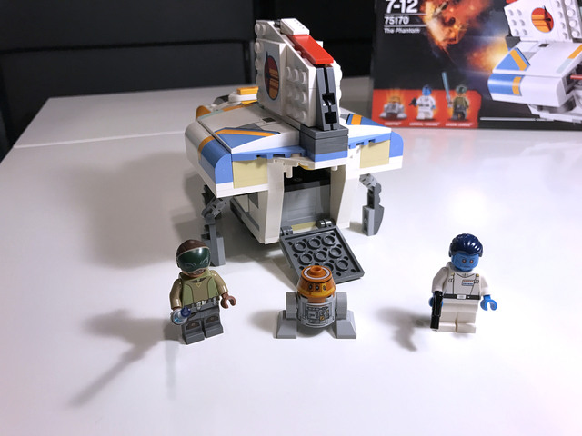](https://www.freelug.org/IMG/jpg/Phantom75170_26.jpg)

[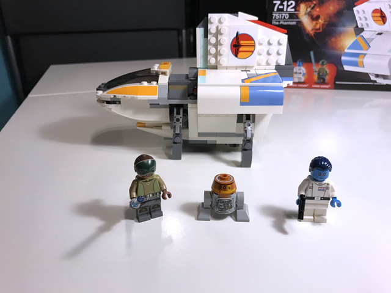](https://www.freelug.org/IMG/jpg/Phantom75170_27.jpg)

[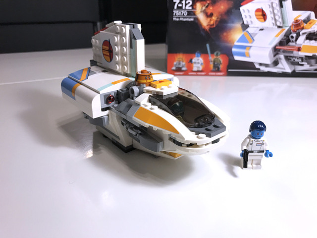](https://www.freelug.org/IMG/jpg/Phantom75170_28.jpg)

**Avis**

**

Belle réalisation pour ce _Phantom II_, deux figurine exclusives, construction pas rébarbative et jeux de couleur qui change un peu du traditionnel gris _Star Wars_.  
Cerise sur le gâteau, il compatible avec le set _[75053 - The Ghost](http://brickset.com/sets/75053-1/The-Ghost)_.  
Bref on en a pour son argent.

**Bonus**

Voici un GIF animé réalisé avec la totalité des photos prises pour cette review (cliquez sur l’image pour lancer l’animation).

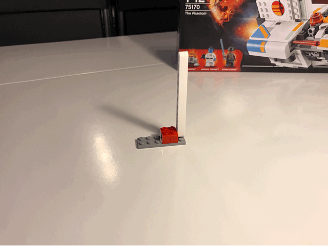

**
