On voit très peu le "Quadjumper" dans une scène de l’épisode 7. Mais il a tout de même été reproduit par la firme LEGO.

Pour la finalité d’une scène du film SW épisode 7 que je veux reproduire, et aussi parce que ces vaisseaux m’ont beaucoup plu, je me suis jeté sur une promo internet. Je peux donc vous faire partager le montage de ce set.

Unkar’s Brute est un "Crolute", personnage important du site de la planète Jakku. Un lieu où se tourne une scène principale de Star Wars épisode 7. Il récupère les métaux que lui rapportent les chasseurs d’épave, dont Rey. Il échange ceux-ci contre des portions de repas. Il définit lui-même la valeur de ces différents objets. Il tente même d’échanger BB-8. Il possède aussi un Quadjumper qui stationne devant l’enceinte du village un peu plus loin que le Faucon Millenium.

Les Quadjumpers ont été conçus par la Corporation Subpro. Quatre gros réacteurs, un émetteur de rayon tracteur et un cockpit entièrement vitré, voilà en résumé ce que sont réellement ces appareils utilitaires très répandus dans les spatioports les plus actifs de la Galaxie. Ils servent à tracter de gros vaisseaux cargo. Il peuvent ainsi les diriger plus facilement pour les mettre à quai. Je ne sais pas ce que ce genre de vaisseau fait sur Jakku. Les ferrailleurs de cette planète sont tellement mystérieux.

C’est au moment où Rey et Finn veulent échapper à une attaque de chasseurs TIE qu’ils se dirigent vers un Quadjumper. Heureusement ils n’auront pas le temps d’y arriver. Il sera touché avant par un tir de laser et complètement détruit. C’est là qu’ils vont se diriger vers le Faucon, rangé pas très loin, sous une bâche.

-   Référence 75178, date de sortie : 2017
-   Prix : 36,99 (en promotion sur un magasin virtuel), 64,99 Euros sur le Shop LEGO, en vente au moment où j’écris l’article.
-   Nombre de pièces : 438
-   Nombre de personnages : 4
-   Temps de montage : environ 1h30

[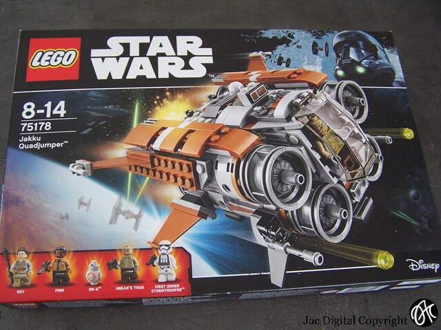](https://www.freelug.org/IMG/jpg/75178_1_.jpg)

[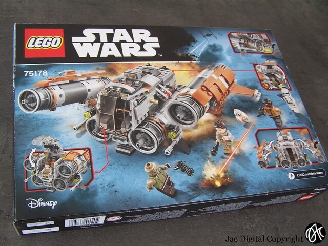](https://www.freelug.org/IMG/jpg/75178_2_.jpg)

La boite est d’une bonne taille et les sachets ont de la place dedans. Comme d’habitude nous avons en face avant une photo du vaisseau en action avec les minifigs présentes dans le set, derrière les différentes phases de jeux. L’ouverture est toujours identique maintenant, il faut pousser deux ergots prédécoupés. On y trouve le livret pour la notice, une petite planche d’autocollants et 4 sachets.

[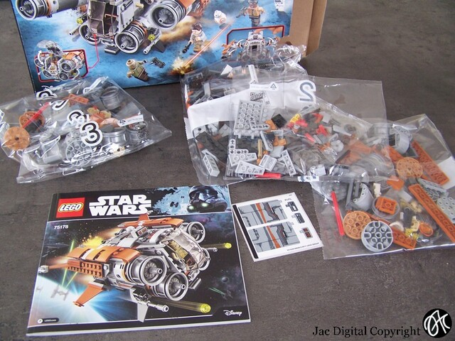](https://www.freelug.org/IMG/jpg/75178_3_.jpg)

Dans le premier sachet on trouvera Unkar’s Brute, Rey et sa lance. Le beau tas de pièces permettra d’assembler ce que l’on peut appeler le châssis du vaisseau. Il est tout en longueur et on devine déjà l’emplacement des réacteurs.

[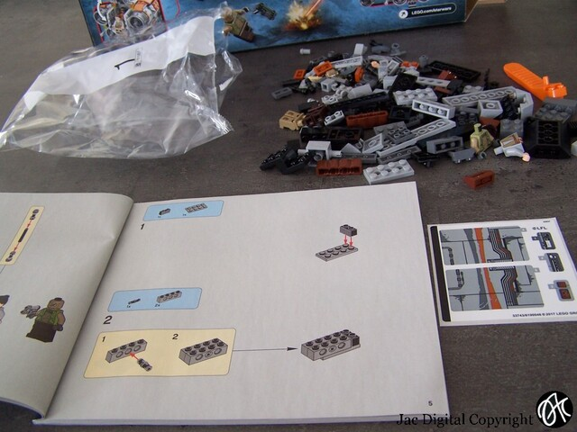](https://www.freelug.org/IMG/jpg/75178_4_.jpg)

Le châssis est pratiquement terminé et Unkar s’impatiente...

[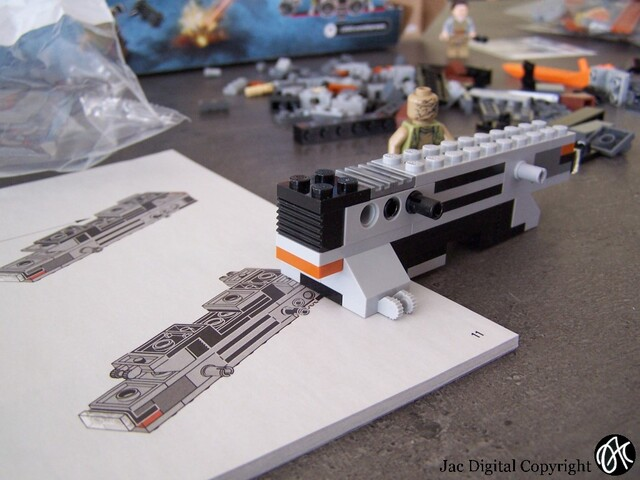](https://www.freelug.org/IMG/jpg/75178_5_.jpg)

Voilà la première phase terminée. Le démonte-brique fourni dans la boite est très utile en cas d’erreurs. Il reste déjà quelques pièces en plus.

[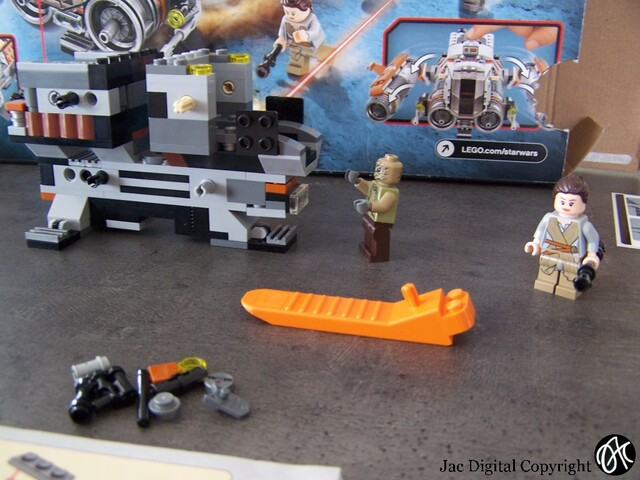](https://www.freelug.org/IMG/jpg/75178_6_.jpg)

Rey m’aide à ouvrir le deuxième sachet. Un sachet plus petit contenant les petites pièces se trouve à l’intérieur. C’est très courant ce genre de procédé dans les sets LEGO. Cela permet de séparer un peu les pièces. Mais je mélange quand même tout ! Sur cette construction, je vais mettre les autocollants. Et les premiers à mettre sont dans le cockpit. Ils sont facile à placer sauf si comme moi vous vous décidez un peu tard à les mettre. Du coup il faudra un peu démonter des pièces. C’est ce que j’ai fait, ça se voit car j’ai mal rassemblé !

[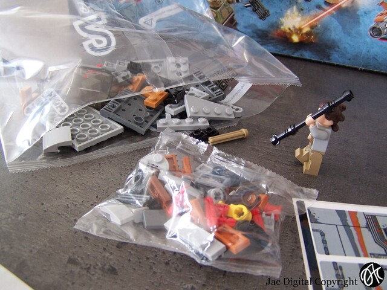](https://www.freelug.org/IMG/jpg/75178_9_.jpg)

Il est pressé lui, c’est pas encore le moment de mettre la vitre du cockpit !

[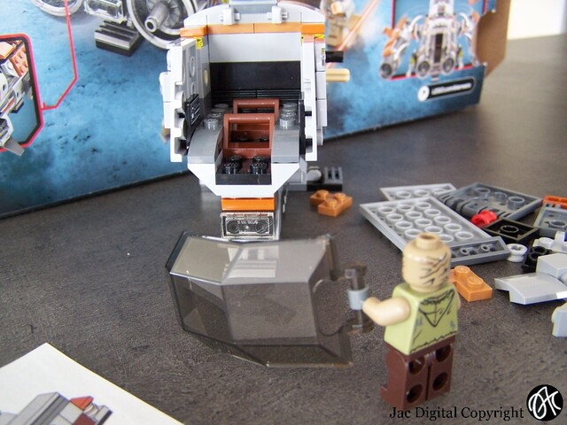](https://www.freelug.org/IMG/jpg/75178_10_.jpg)

Voilà le châssis terminé. Unkar peut enfin prendre place dans le cockpit.

[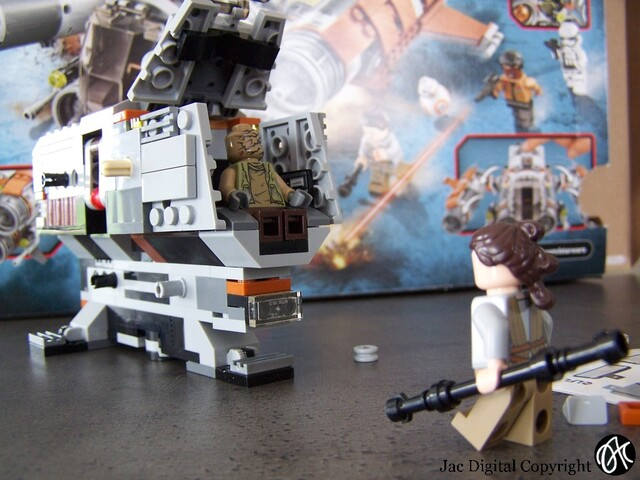](https://www.freelug.org/IMG/jpg/75178_11_.jpg)

Les pièces restantes pour cette deuxième partie du montage.

[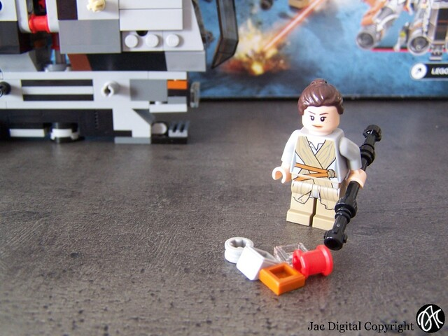](https://www.freelug.org/IMG/jpg/75178_12_.jpg)

Contenu du troisième sachet. On va pouvoir assembler la figurine de Finn et BB-8. Il y a beaucoup de pièces rondes, ça veut dire que l’on va s’attaquer aux réacteurs.

[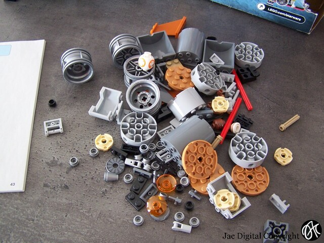](https://www.freelug.org/IMG/jpg/75178_13_.jpg)

Une pièce que je ne connaissais pas, le quart de rond de 2 briques de hauteur. Une des quelques pièces sérigraphiées, c’est quand même bien de ne pas tout coller !

[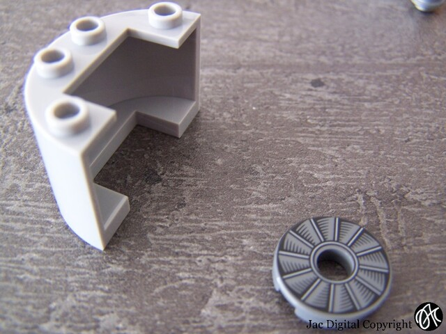](https://www.freelug.org/IMG/jpg/75178_14_.jpg)

Ce qui a fait que je me suis décidé à placer les autocollants. Les grandes pièces, sur les réacteurs. Ils sont assez simple à mettre et sans ça, c’est un peu fade quand même.

[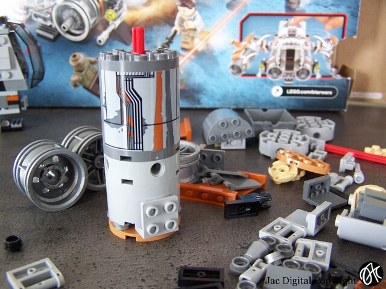](https://www.freelug.org/IMG/jpg/75178_16_.jpg)

Le premier réacteur a pris place sur le châssis. Vu qu’ils sont quasiment identiques, enfin à la symétrie près, je vais essayer de monter le deuxième de mémoire. Ça doit être faisable. En tout cas, vu que ce sont les puissants moteurs du remorqueur, le vaisseau commence à prendre forme.

[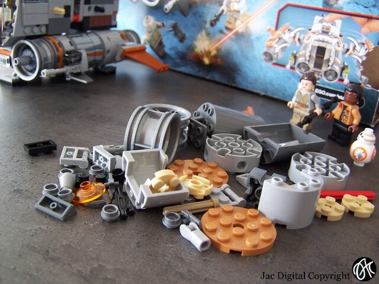](https://www.freelug.org/IMG/jpg/75178_17_.jpg)

Cool, ça a marché, voilà le deuxième réacteur inférieur en place. Voilà une vue d’ensemble avec les personnages déjà assemblés et les nouvelles pièces en plus.

[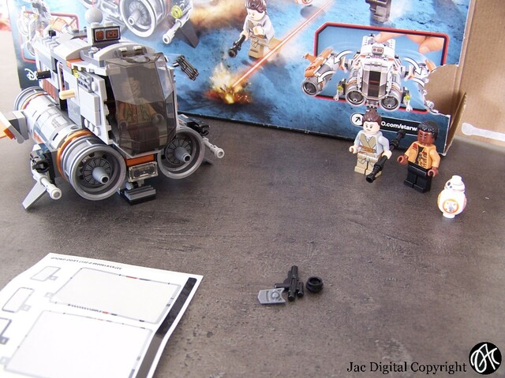](https://www.freelug.org/IMG/jpg/75178_18_.jpg)

Contenu du quatrième et dernier sachet. Avec les pièces de celui-là nous allons pouvoir assembler un Stormtrooper du Premier Ordre et les deux moteurs supérieurs du vaisseaux.

[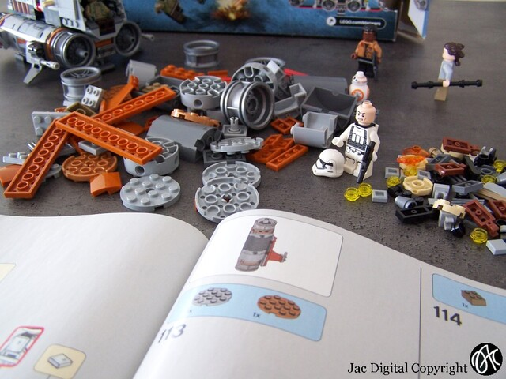](https://www.freelug.org/IMG/jpg/75178_19_.jpg)

Non mais ! Vous avez vu la tête enragée de ce Stormtrooper ? Heureusement que je n’ai pas mis BB-8 à côté lorsque je l’ai assemblé. J’espère que je vais pouvoir finir le vaisseau sans devoir faire la police.

[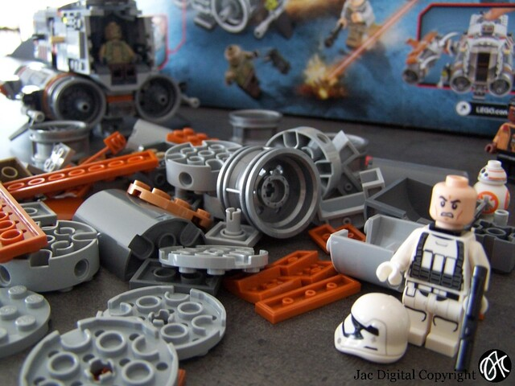](https://www.freelug.org/IMG/jpg/75178_20_.jpg)

Mince, il s’en est rendu compte... Heureusement que Finn et Rey sont sur leurs gardes. Bon, comment vais-je récupérer mes pièces, moi ? Et surtout finir un vaisseau qui doit exploser !

[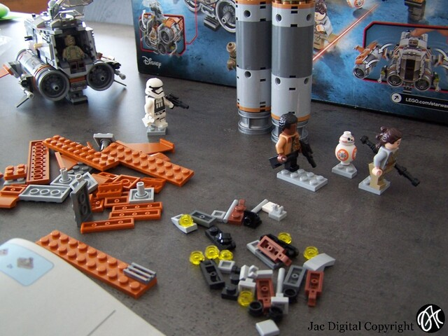](https://www.freelug.org/IMG/jpg/75178_21_.jpg)

Voici le Quadjumper terminé. Il a bonne allure, je trouve même qu’il est un peu petit. Mais on retrouve cela sur tous les vaisseaux de la gamme LEGO SW. C’est un peu normal, ce sont des jouets. Si on voulait vraiment les faire comme ils devraient être on atteindrait des prix exorbitants. Je pense sûrement plus que le Millenium Falcon UCS pour certains.

[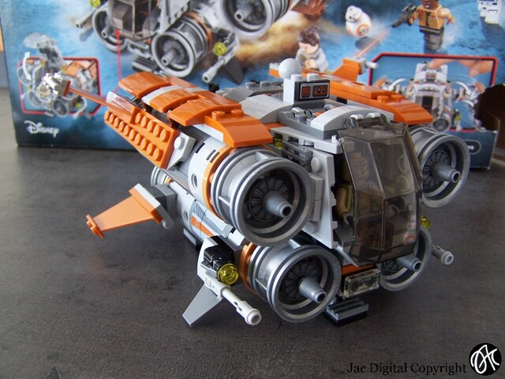](https://www.freelug.org/IMG/jpg/75178_24_.jpg)

Voyons voir maintenant la jouabilité annoncée de ce set.

[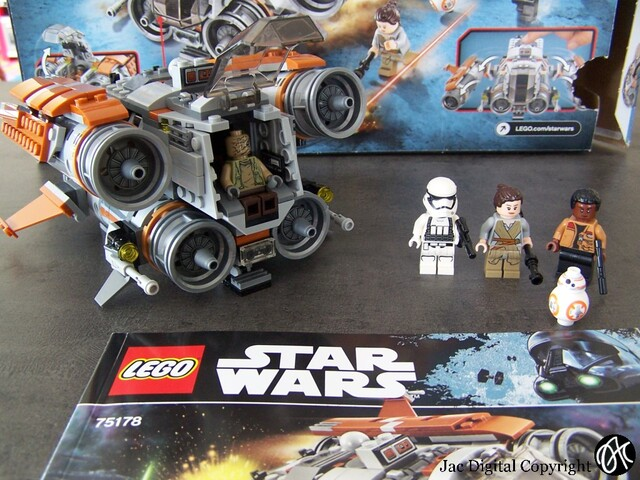](https://www.freelug.org/IMG/jpg/75178_29_.jpg)

En appuyant franchement sur le bouton du dessus, les réacteurs supérieurs sont projetés à terre. Ça donne un air un peu détruit, suffisant peut-être. Mais ça ne correspond sûrement pas à une explosion complète. En même temps on ne va pas reconstruire le vaisseau entièrement à chaque fois. Mais un peu plus de pièces qui s’enlèvent ça aurait été bien. Je me suis un peu retenu pour la photo.

4 personnages dans cette boite plus un droïde astromécanique bien connu. C’est pas mal quand même. Je vous ai dit 4 et il en manque un. Ah oui le pilote, ben décidément !

[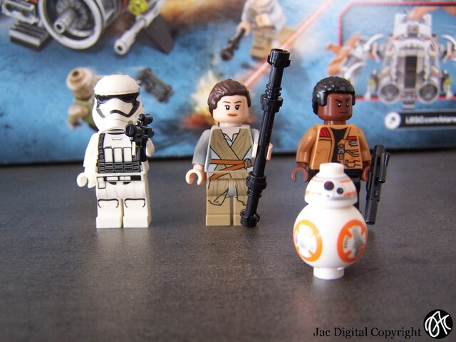](https://www.freelug.org/IMG/jpg/75178_31_.jpg)

Ah ben le voilà, maintenant que je prends une photo pour vous montrer la belle gravure du dos des personnages. Justement puisqu’il est là, il tombe bien, on a du mal à le comparer vraiment avec le personnage du film. Je trouve que la tête est un peu ratée, on dirait une momie. Le corps ne correspond pas vraiment non plus. Pour tout vous dire, au début j’ai eu un peu de mal à le reconnaître. Peut-être que les designers l’ont habillé d’une tenue de protection du sable que l’on ne connait pas !

Sinon, les autres personnages sont vraiment réussis et la tête du Stormtrooper est parfaite.

[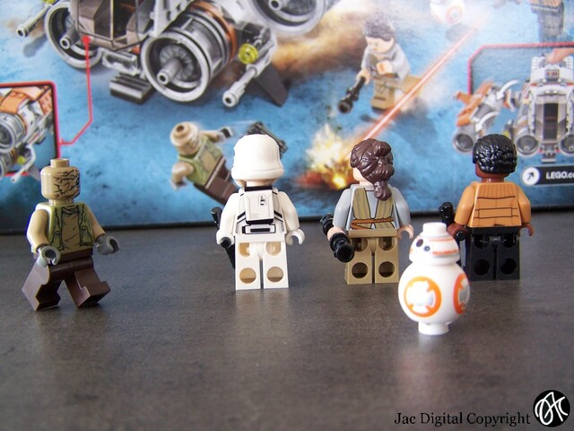](https://www.freelug.org/IMG/jpg/75178_33_.jpg)

J’ai relâché un peu ma vigilance et le Stormtrooper en a profité. Heureusement que Rey était là... Le laser de l’image de la boite correspond au bout du bâton de Rey. J’ai vraiment pas fait exprès !

[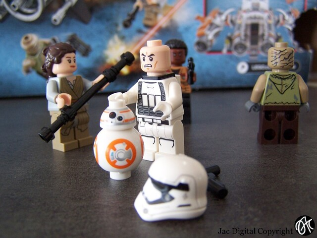](https://www.freelug.org/IMG/jpg/75178_36_.jpg)

Lien vers ma galerie pour plus de photos :  
[75178 Quadjumper](https://photos.freelug.org/main.php/v/JAC/review/75178/)
