Aujourd’hui, je vous propose la review du set 75199 dans la gamme _Star Wars_ : **General Grevious’ Combat Speeder**.  
Ce set, sorti en 2018 au prix de 29,99 €, est composé de 157 pièces, soit un ratio prix/pièce de 30 centimes d’euro.

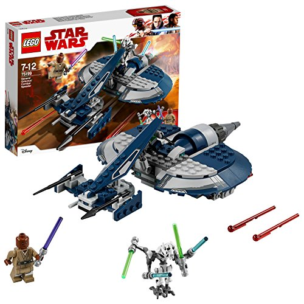

Qu’en est-il de ce véhicule tout droit sorti du dessin animé _Star Wars : The Clone War_ ?

* * *

Le contenu du set est intégré dans le décor de combat ressemblant à _Geonosis_. Le bandeau du haut est constitué des logos _LEGO_ et _Star Wars_ et des trois héros de la nouvelle trilogie, _Poe_, _Rey_ et _Finn_ (comme tous les sets _Star Wars_ fournée 2018).

[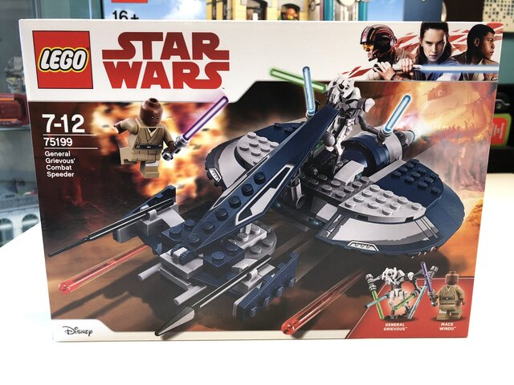](https://www.freelug.org/IMG/jpg/greviouscombatspeeder_01.jpg)

Au verso, plusieurs vignettes avec les quelques éléments de jouabilité du set.

[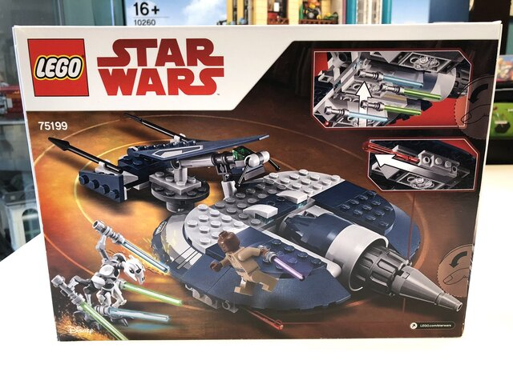](https://www.freelug.org/IMG/jpg/greviouscombatspeeder_02.jpg)

Une fois ouvert, le set contient deux sachets numérotés, une planche de stickers (quatre au total) et une notice de construction.

[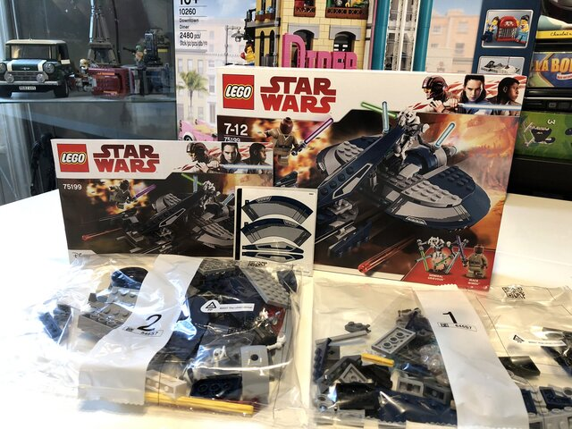](https://www.freelug.org/IMG/jpg/greviouscombatspeeder_03.jpg)

* * *

**[Mace Windu](https://brickset.com/minifigs/sw889/mace-windu-\(75199\))** est une belle réalisation, surtout quand on sait que les bure _Jedi_ ne sont pas les plus simples à représenter. Un petit bémol pour la sérigraphie des jambes, les lignes noires ont l’air à moitié usées. Bizarre !  
Le visage n’est pas des plus ressemblant, mais on retrouve tout de même l’air renfrogné du maître _Jedi_.

Il est à noter que cette fig est exclusive à ce set.

[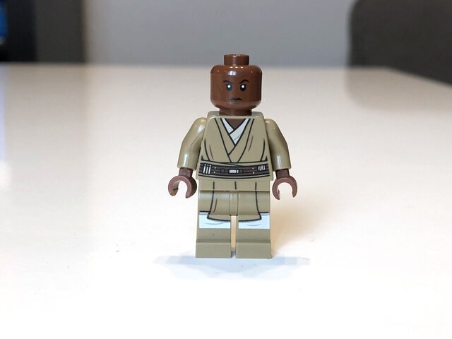](https://www.freelug.org/IMG/jpg/greviouscombatspeeder_04.jpg)

Au verso, là encore c’est plutôt réussi avec les nombreux plis et la ceinture.

[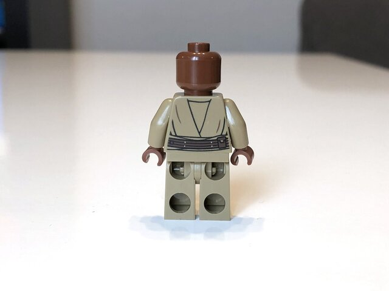](https://www.freelug.org/IMG/jpg/greviouscombatspeeder_05.jpg)

**[General Grevious (White Armor)](https://brickset.com/minifigs/sw515/general-grievous-bent-legs-white-armor)** est lui aussi une belle figurine vu la difficulté de le représenter à ce format.

[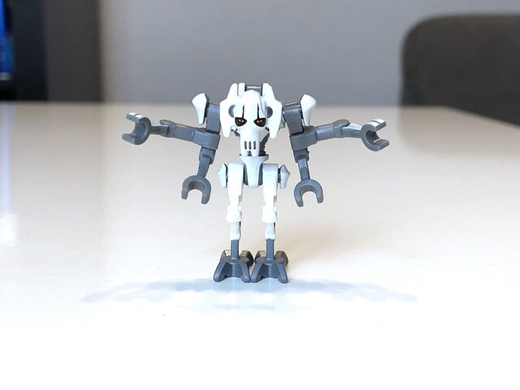](https://www.freelug.org/IMG/jpg/greviouscombatspeeder_06.jpg)

Le dos est loin d’être lisse, _LEGO_ a réussi à retranscrire les multiples aspérités de l’armure.

[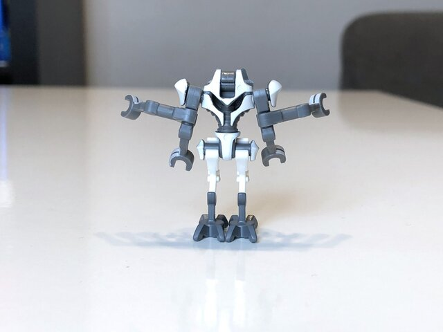](https://www.freelug.org/IMG/jpg/greviouscombatspeeder_07.jpg)

Avec quatre sabres laser, le _General Grevious_ est tout de même impressionnant.  
C’est définitivement une figurine réussie.

[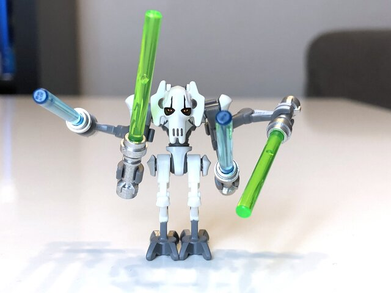](https://www.freelug.org/IMG/jpg/greviouscombatspeeder_08.jpg)

* * *

On commence la construction par le poste de pilotage du _Combat Speeder_.

[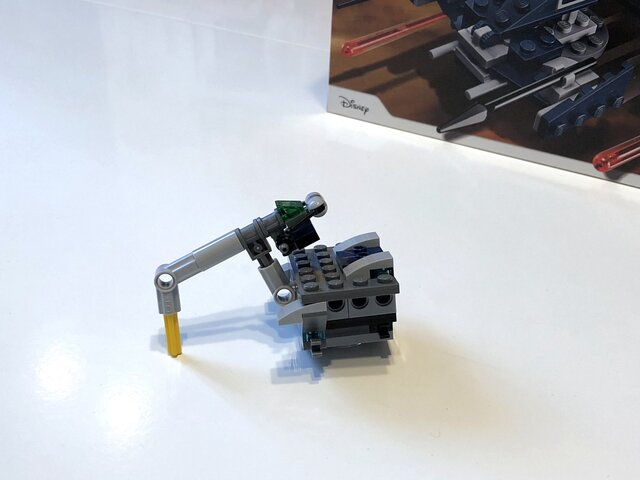](https://www.freelug.org/IMG/jpg/greviouscombatspeeder_09.jpg)

A la fin du sachet 1 on se retrouve avec le poste de pilotage et les ailettes de stabilisation avant.

[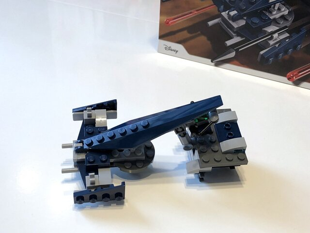](https://www.freelug.org/IMG/jpg/greviouscombatspeeder_10.jpg)

Début du sachet 2 avec la construction du réacteur.

[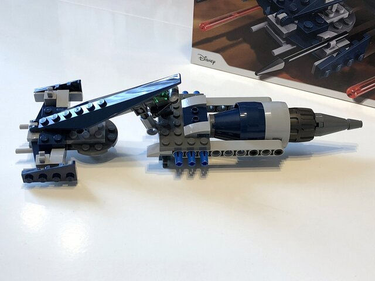](https://www.freelug.org/IMG/jpg/greviouscombatspeeder_11.jpg)

Puis le corps du _Speeder_ avec deux plateformes de part et d’autre du réacteur.

[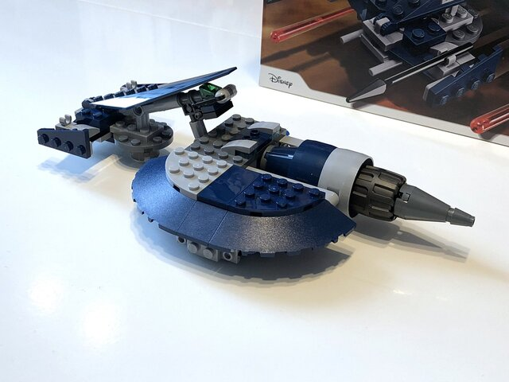](https://www.freelug.org/IMG/jpg/greviouscombatspeeder_13.jpg)

[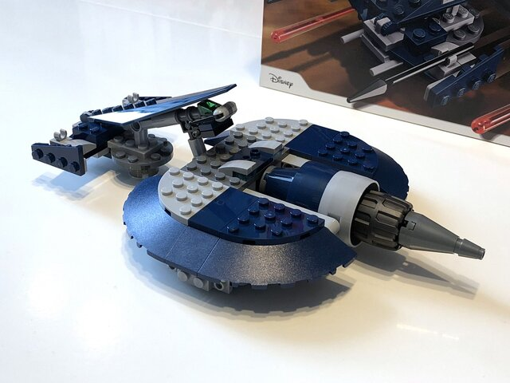](https://www.freelug.org/IMG/jpg/greviouscombatspeeder_14.jpg)

Voici le set terminé (sans les autocollants).

[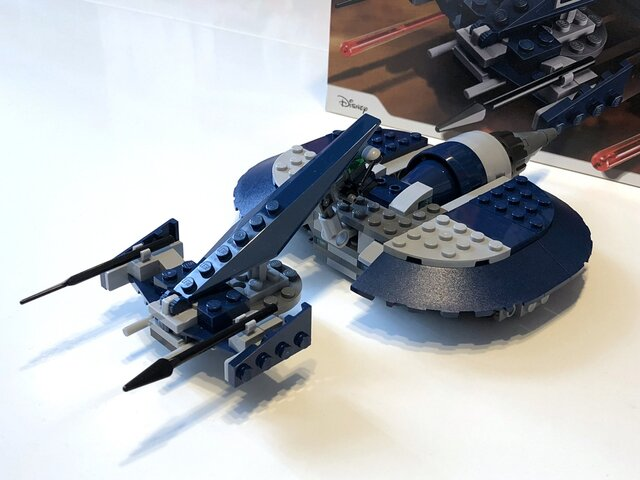](https://www.freelug.org/IMG/jpg/greviouscombatspeeder_15.jpg)

Mis en situation avec les minifigs.

[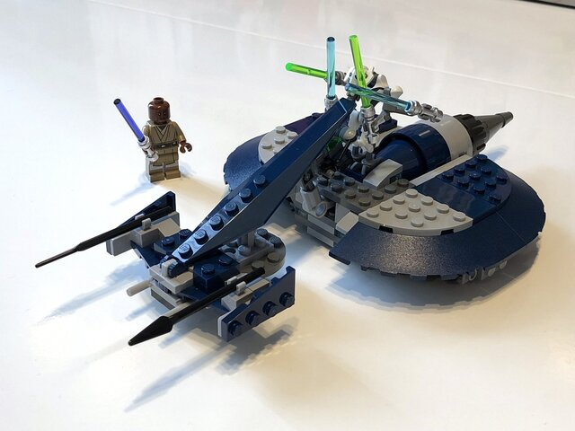](https://www.freelug.org/IMG/jpg/greviouscombatspeeder_16.jpg)

* * *

**AVIS :**

Un set au montage intéressant, au final seul les deux Minifigs justifient l’achat à mon sens. Pour autant cela reste cher, surtout quand on sait que pour le même prix on peut encore avoir le set 75183 _Darth Vader Transformation_ qui compte trois figs et le double de pièces.

Bref, si vraiment vous voulez ces deux figurines (par ailleurs très réussies), attendez les soldes.

**BONUS :**

Voici un GIF animé réalisé avec la totalité des photos prises pour cette review (cliquez sur l’image pour lancer l’animation).

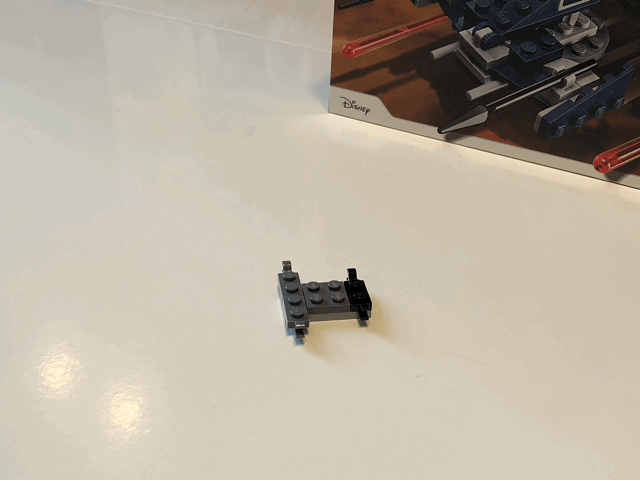
