Partons à la découverte de cette boite avec un petit dinosaure !

[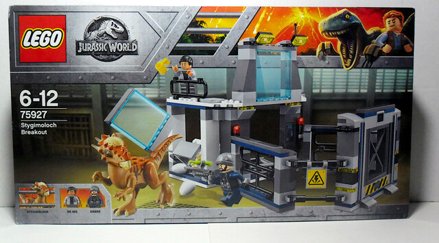](https://www.freelug.org/IMG/jpg/sam_3880.jpg)

Le set comprend 222 pièces avec deux personnages et un dinosaure. Pour un prix de 39,99 € soit un rapport prix/pièces de 0,18 euros, c’est cher mais logique pour un set sous licence.  
Une petite vue arrière donne une idée de la jouabilité du set :

[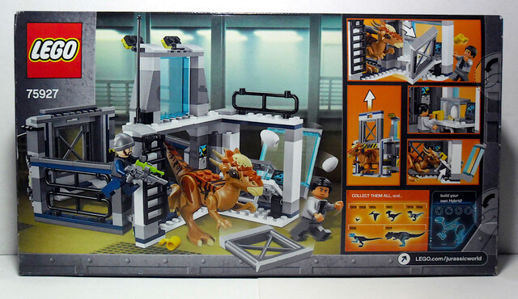](https://www.freelug.org/IMG/jpg/sam_3882.jpg)

Venons au principal, le contenu de la boite :

[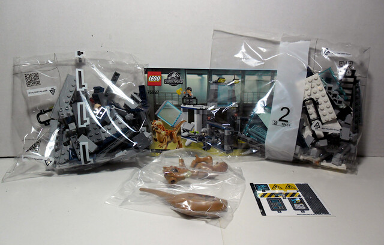](https://www.freelug.org/IMG/jpg/sam_3883.jpg)

soit 2 sachets de pièces, une petite planche de stickers

[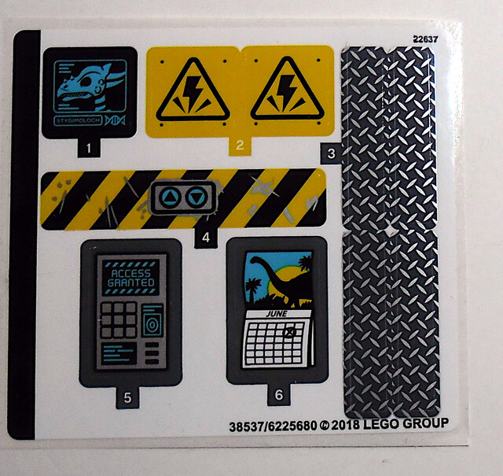](https://www.freelug.org/IMG/jpg/sam_3885.jpg)

et un dinosaure :

[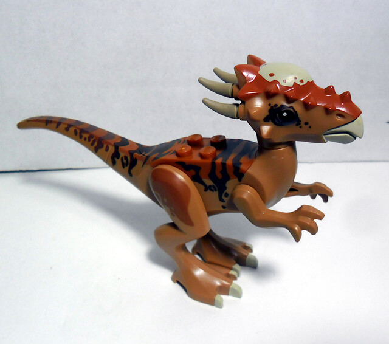](https://www.freelug.org/IMG/jpg/sam_3887.jpg)

Côté personnage, un garde :

[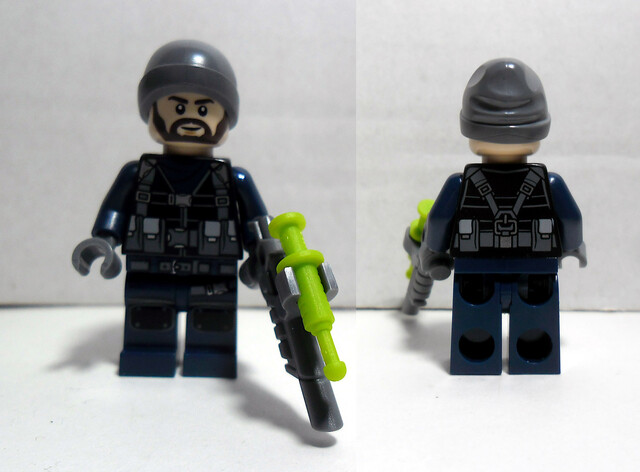](https://www.freelug.org/IMG/jpg/sam_3888.jpg)

Et le Docteur Henri Wu :

[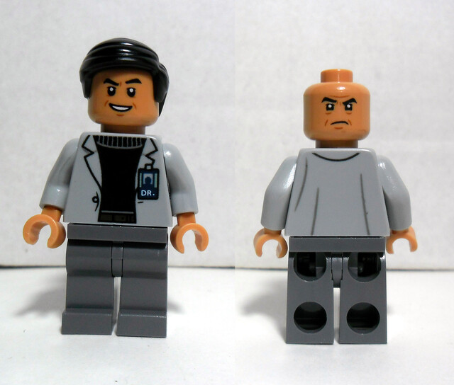](https://www.freelug.org/IMG/jpg/sam_3898.jpg)

Passons à la construction, un enclos :

[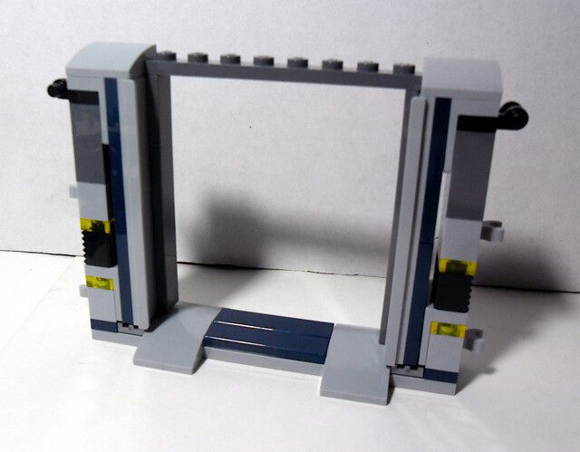](https://www.freelug.org/IMG/jpg/sam_3892.jpg)

[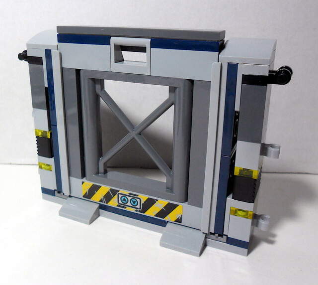](https://www.freelug.org/IMG/jpg/sam_3893.jpg)

[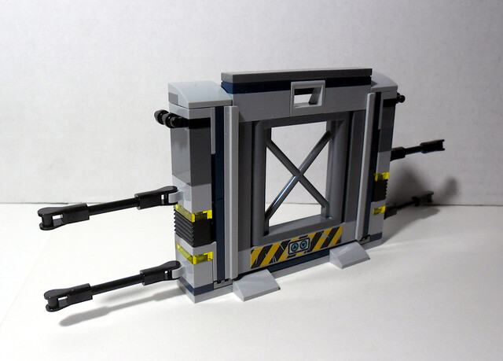](https://www.freelug.org/IMG/jpg/sam_3894.jpg)

[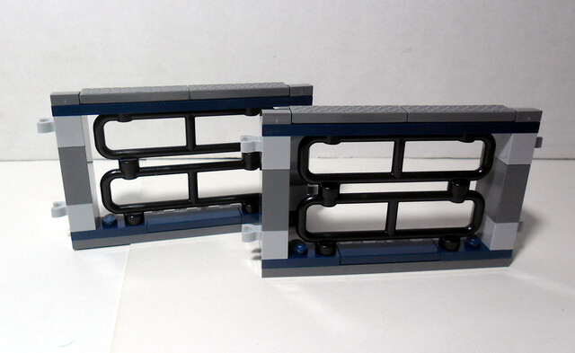](https://www.freelug.org/IMG/jpg/sam_3895.jpg)

Qui donne :

[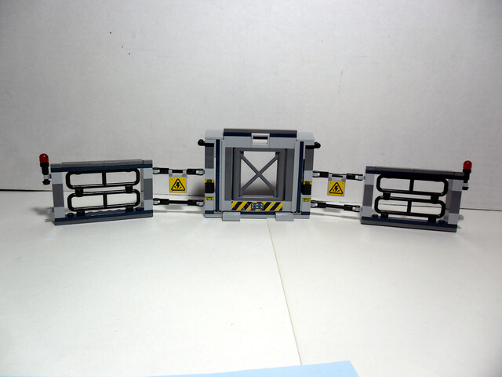](https://www.freelug.org/IMG/jpg/sam_3896.jpg)

Puis le laboratoire : Nota, les murs peuvent tomber.

[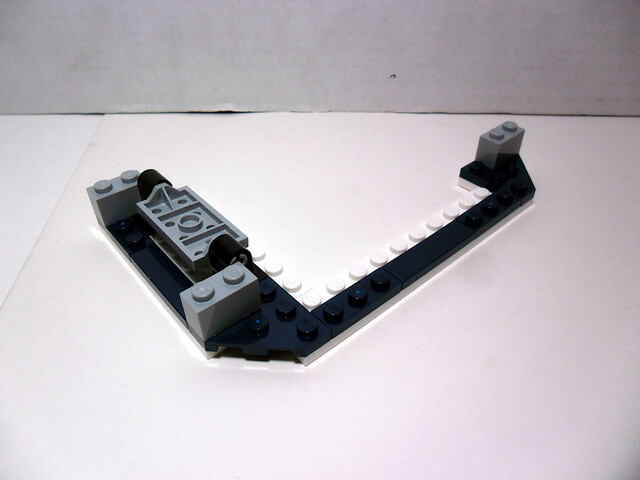](https://www.freelug.org/IMG/jpg/sam_3902.jpg)

[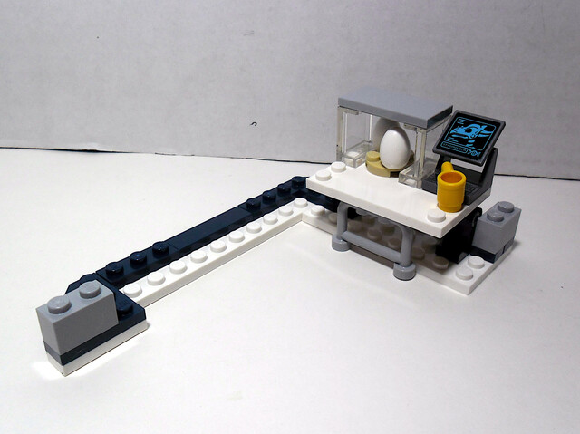](https://www.freelug.org/IMG/jpg/sam_3904.jpg)

[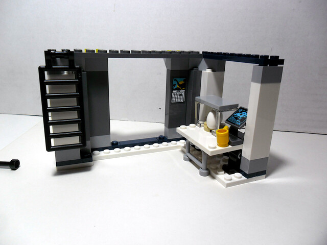](https://www.freelug.org/IMG/jpg/sam_3905.jpg)

[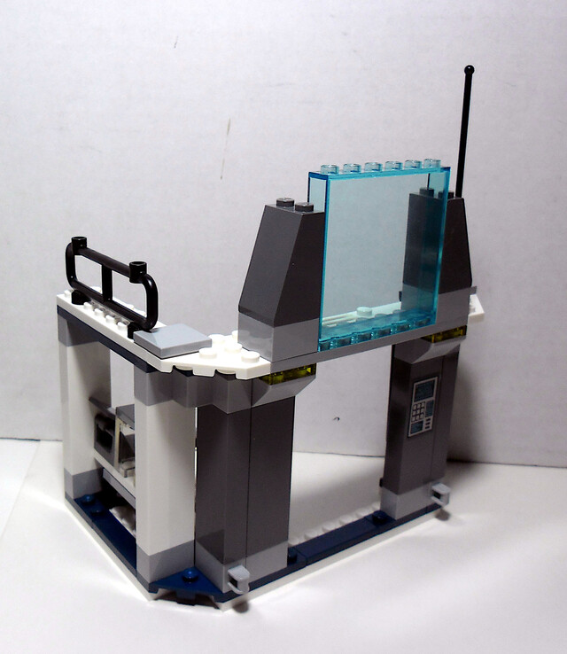](https://www.freelug.org/IMG/jpg/sam_3906.jpg)

[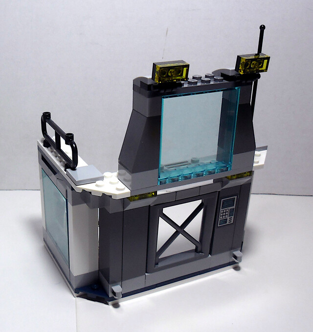](https://www.freelug.org/IMG/jpg/sam_3907.jpg)

Voilà fini, une petite photo de famille !

[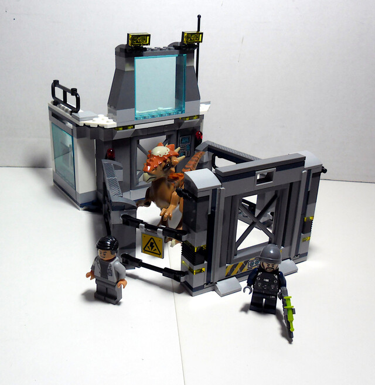](https://www.freelug.org/IMG/jpg/sam_3908.jpg)

Et pour terminer les extra parts :

[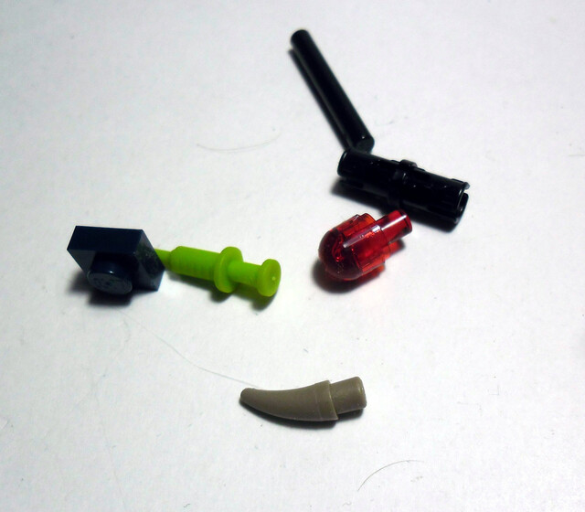](https://www.freelug.org/IMG/jpg/sam_3911.jpg)

**Conclusion**

Alors achat ou pas ? Pour moi, ce set permet d’avoir un nouveau dinosaure : le stigymoloch. Mais le rapprochement avec la scène du film est très éloigné, on voit bien que la production ne donne pas beaucoup d’informations.  
Côté jouabilité, deux murs permettent au dinosaure de s’enfuir et... C’est tout !

Donc bof.
