Voici une présentation rapide d’un petit ensemble Harry Potter cuvée 2019.

Le set présenté ici s’intitule _La cabane de Hagrid : le sauvetage de Buck_, numéro 75947.

Sorti en 2019, il comporte 496 pièces et coûte chez LEGO 64,99 €, soit un ratio de 13 centimes par pièces. C’est le prix de la licence Harry Potter j’imagine...

Ce set reprend une scène du troisième film, _Harry Potter et le prisonnier d’Azkaban_, dans laquelle l’hippogriffe Buck est condamné à mort pour avoir blessé Malefoy.

* * *

La boîte contient 3 gros sachets numérotés de 1 à 3, plus Buck dans un sac à part. Chacun des sachets numérotés contient 2 sous-sachets. Une notice et une plaquette d’autocollants complètent le tout. À noter que je n’ai pas posé les autocollants.

Voici l’arrière de la boîte avec la notice et le sachet 1 assemblé en totalité, ainsi que les sachets 2 et 3 non ouverts.

[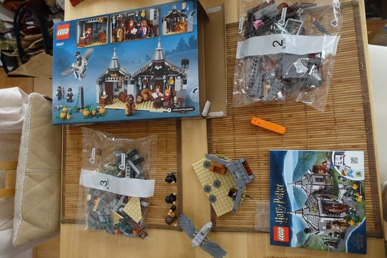](https://www.freelug.org/IMG/jpg/dsc02459.jpg)

Ce premier sachet permet d’assembler trois côtés de la hutte de Hagrid, avec notamment la porte d’entrée. J’aime bien la mini-façade avec l’escalier. Un peu de verdure agrémente les murs.

[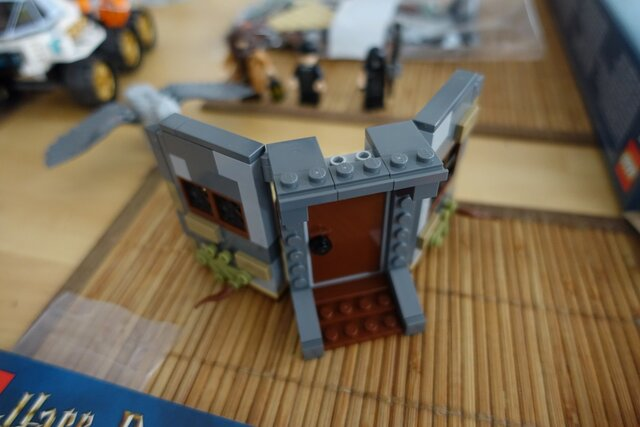](https://www.freelug.org/IMG/jpg/dsc02460.jpg)

L’intérieur ressemble déjà à quelque chose, avec un bon fauteuil équipé d’une chandelle (la flamme est la nouvelle version apparue dernièrement, dans les sets Harry Potter me semble-t-il), et une caisse contenant une pelle et le fameux parapluie rose d’Hagrid.

[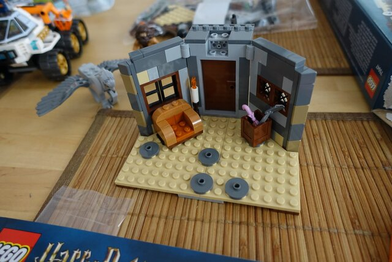](https://www.freelug.org/IMG/jpg/dsc02461.jpg)

Buck est également assemblé avec ce premier sachet. Il suffit de lui ajouter les deux ailes, le reste du corps est un bloc unique. La plaque 2x2 permet d’asseoir un personnage si l’on veut. La tête de Buck peut bouger verticalement, et les ailes battre, en revanche les pieds sont fixes, dommage.

[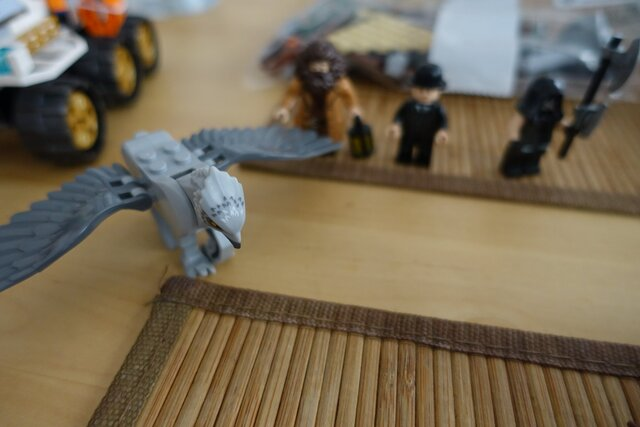](https://www.freelug.org/IMG/jpg/dsc02462.jpg)

Trois personnages sont présents dans ce sachet. Hagrid est une grosse figurine avec de petits pieds fixes. Ses bras s’accrochent via un pin format Technic au corps. Il tient une lanterne nouveau modèle. Le manteau est joliment tampographié, avec du relief pour les poches, on voit sa ceinture, et j’aime bien également sa barbe.

Le ministre de la magie est habillé à l’anglaise, avec son chapeau melon et un costume sobre. Il n’a pas l’air vraiment ravi... À noter que le raccord des plis est raté entre le torse et la bande fixe des jambes et cette bande et les jambes elles-mêmes. C’est dommage que LEGO ne réussisse pas à faire quelque chose de vraiment propre...

Enfin le bourreau, avec comme il se doit son capuchon noir, tient une magnifique hache et arbore un joli sourire presque vicieux. À noter que c’est un patin à glace qui est sur l’avant de celle-ci, comme quoi ça peut servir à tout !

[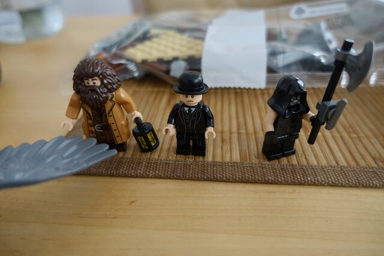](https://www.freelug.org/IMG/jpg/dsc02463.jpg)

Le dos de ces personnages est minimaliste, quelques plis pour le ministre et le bourreau, Hagrid est uniforme...

[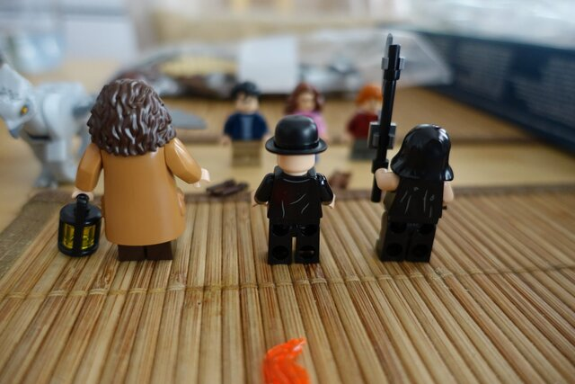](https://www.freelug.org/IMG/jpg/dsc02473.jpg)

On continue la construction dans le sachet 2 avec la poutre qui servira de support au toit de la partie gauche de la hutte. J’aime bien tous les ustensiles accrochés : hachoir, seau, fouet, cuillère, poêle. Cette sous-partie fait appel à des pièces que je ne connaissais pas, des angles Technic 5x5 à coin biseauté. Le sommet du toit est une pièce nostalgique pour moi, un réacteur de vaisseau spatial, en gris foncé ici.

[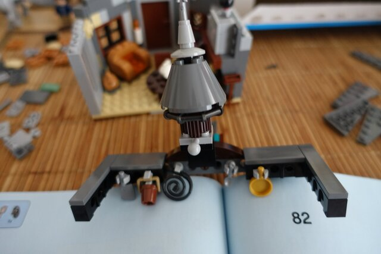](https://www.freelug.org/IMG/jpg/dsc02464.jpg)

On fixe le support du toit (après avoir rajouté deux murs) et on pose quelques objets ici et là : un sac, une table avec théière et deux chaises (montées sur des pièces rondes 2x2 avec un seul tenon, donc elles peuvent tourner), on accroche un balai, ça prend forme.

[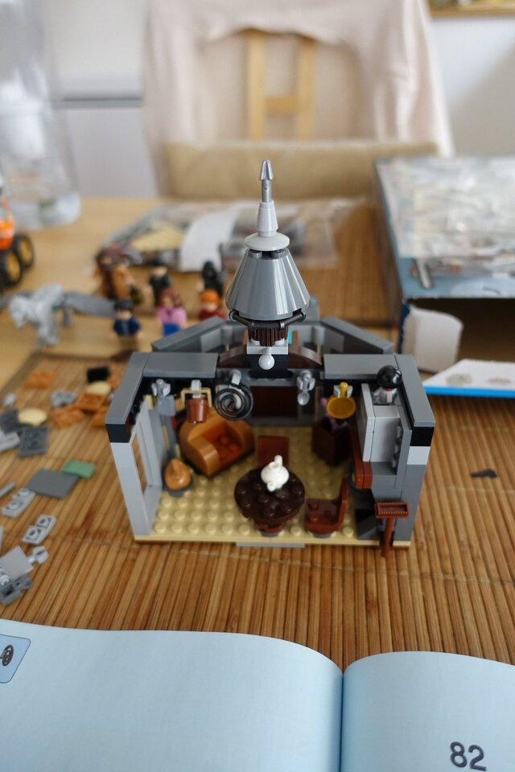](https://www.freelug.org/IMG/jpg/dsc02465-r90.jpg)

Le toit lui-même est en partie constitué de 3 morceaux identiques accrochés à la pièce sous le réacteur via un clips, ce qui permet de les incliner pour obtenir un toit en pente.

[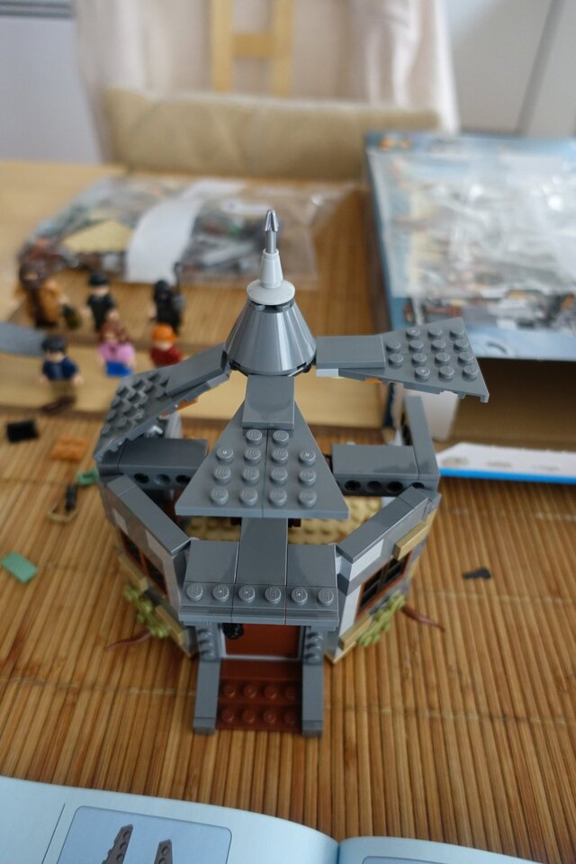](https://www.freelug.org/IMG/jpg/dsc02466-r90.jpg)

On rajoute sur le même principe 2 morceaux pour compléter le toit. Je trouve le rendu acceptable, ok il y a des trous, mais au final ça passe bien à mon goût.

[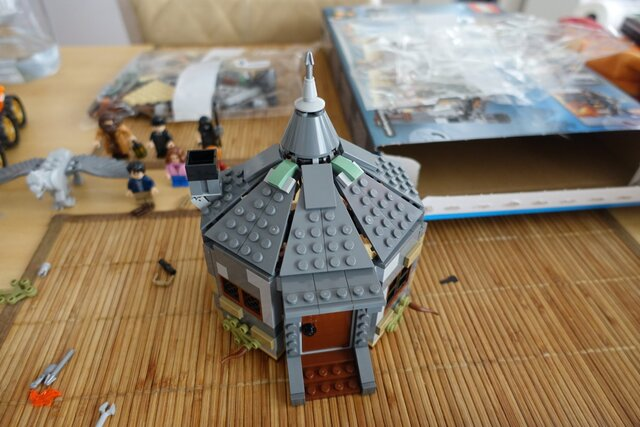](https://www.freelug.org/IMG/jpg/dsc02467.jpg)

Dans le troisième sachet se trouvent Harry, Hermione et Ron. Chacun a une baguette de couleur différente. Il s’agit des nouveaux modèles, avec prise non pas ronde mais géométrique. Les tenues des personnages sont assez simples, on remarque qu’Hermione porte son retourneur de temps au cou, tandis que Ron porte un pull probablement fait par sa mère. Tous ont des petites jambes articulées, même si uniformes.

[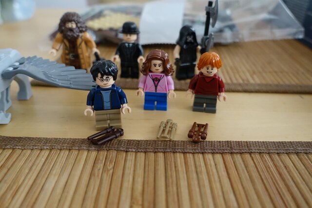](https://www.freelug.org/IMG/jpg/dsc02471.jpg)

Le dos n’est pas très intéressant, quelques plis, mais les trois héros ont un visage alternatif : Harry a l’air sérieux, Hermione et Ron en colère.

[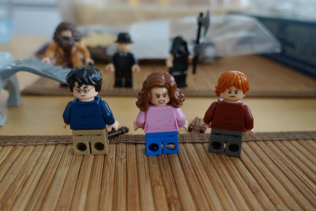](https://www.freelug.org/IMG/jpg/dsc02472.jpg)

On construit avec ce troisième et dernier sachet la partie droite de la hutte, qui ressemble à la partie déjà construire en plus petit. On y trouve un bureau avec une chandelle à côté, le journal posé est un classique Daily Prophet titré « The boy who lived ». Dans le coffre se trouve une grenouille marron - j’admets que là je ne vois pas la référence, à part que Hagrid est connu pour aimer les animaux bizarres...

[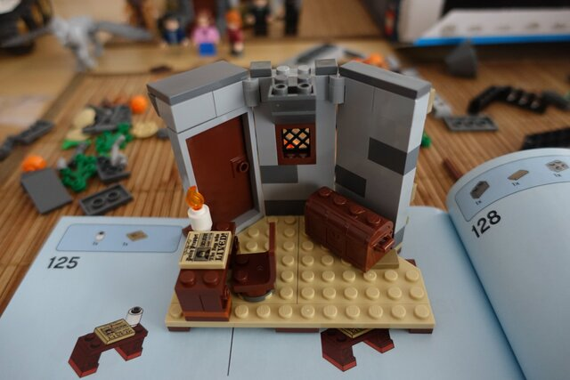](https://www.freelug.org/IMG/jpg/dsc02474.jpg)

Tout comme la première hutte on fabrique une poutre qui soutiendra le toit, avec ici une belle araignée accrochée via un pin Technic. Sur le côte droit on voit les accroches qui permettront de relier les deux morceaux de hutte.

[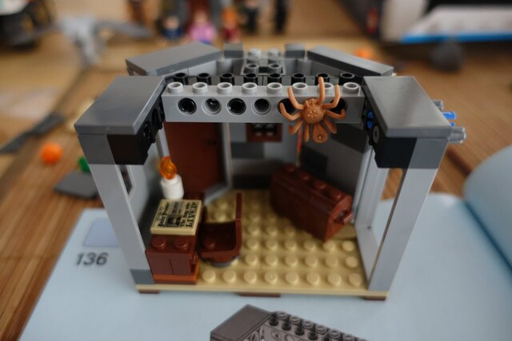](https://www.freelug.org/IMG/jpg/dsc02475.jpg)

Le toit, qui est similaire au précédent mais en format plus petit, utilise de même un accrochage décalé d’un demi-tenon entre la pièce courbe et la plate inversée 1x2. Cette technique est classique, mais je ne suis pas certain qu’elle soit utilisée si souvent dans des modèles officiels LEGO.

[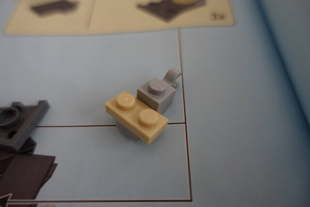](https://www.freelug.org/IMG/jpg/dsc02476.jpg)

Du coup le morceau de toit a un bout centré sur un demi-tenon, c’est amusant à voir.

[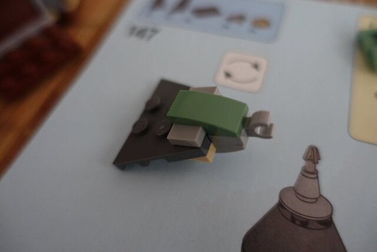](https://www.freelug.org/IMG/jpg/dsc02477.jpg)

Sans transition, on passe au champ à côté de la hutte, où sera attaché Buck. Ce champ contient de nombreuses citrouilles, et j’admets trouver joli cet assemblage entre citrouille (surmontée d’une pièce ronde 1x1) et feuille style nénuphar.

[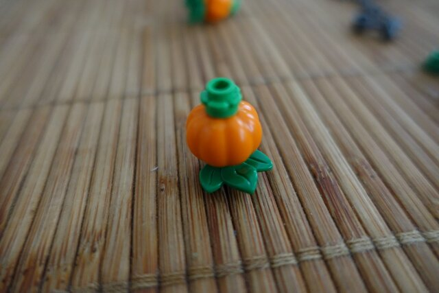](https://www.freelug.org/IMG/jpg/dsc02478.jpg)

Le champ est symbolisé par quelques feuilles de verdure, 3 petites citrouilles (format tête de figurine) et 4 grosses (nouvelles pièces peut-être ?). Un poteau permet de fixer la chaîne qui emprisonne Buck.

[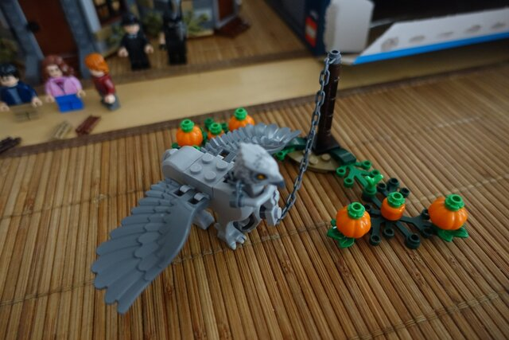](https://www.freelug.org/IMG/jpg/dsc02479.jpg)

Le collier lui-même est un assemblage amusant entre un clips (pour relier à la longue chaîne fixée au poteau), un guidon et une petite chaîne accrochée à ce guidon pour encercler la tête sur l’arrière. Je peux confirmer que ça bloque bien la tête, impossible pour le pauvre Buck de s’en libérer tout seul !

[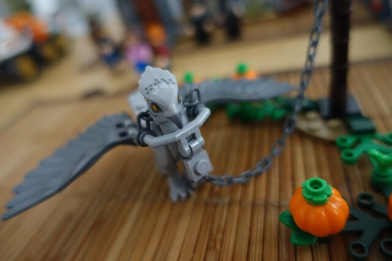](https://www.freelug.org/IMG/jpg/dsc02480.jpg)

Et voici le set complété. La disposition est totalement arbitraire, j’ignore de quel côté se situe le champ. Pas tant de pièces que ça, mais c’est assez large, en fait.

[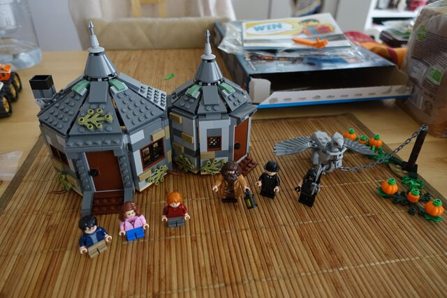](https://www.freelug.org/IMG/jpg/dsc02482.jpg)

[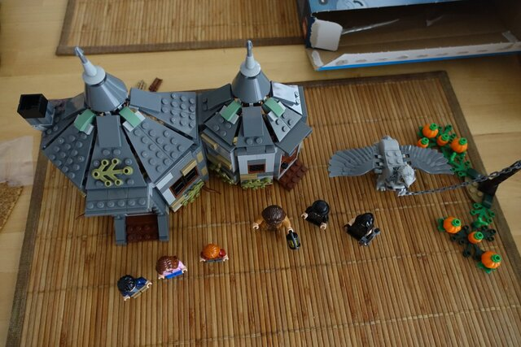](https://www.freelug.org/IMG/jpg/dsc02483.jpg)

Voici l’arrière de la hutte, en deux parties reliées par une porte. C’est assez spartiate, mais il y a pas mal de petits détails.

[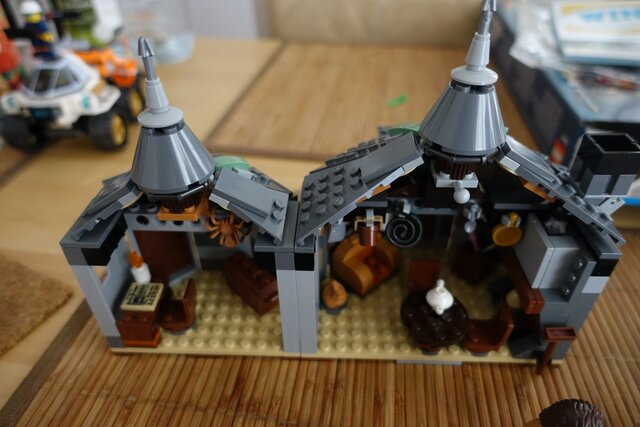](https://www.freelug.org/IMG/jpg/dsc02484.jpg)

Bonus, le foyer (dans lequel chauffe un œuf, de quel animal s’agit-il ? Mystère...) s’allume quand on appuie sur la cheminée extérieure. En fait le morceau de toit arrive pile sur l’arrière de la brique lumineuse fournie, quand on appuie hop elle s’allume. Je dois dire qu’elle est plutôt bien dissimulée. Bon, ça ne révolutionne rien, mais quand même.

[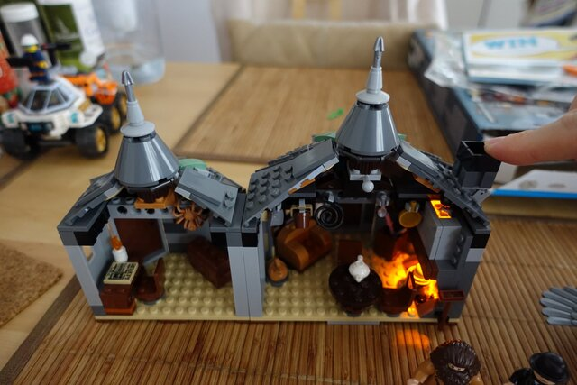](https://www.freelug.org/IMG/jpg/dsc02486.jpg)

Pour terminer, les pièces bonus des trois sachets - le 3 est le plus radin. Toujours sympathique d’avoir une cuillère et une flamme de chandelle en plus.

[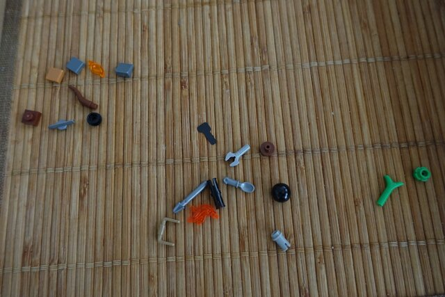](https://www.freelug.org/IMG/jpg/dsc02488.jpg)

* * *

**Avis :** j’aime bien le rendu de ce set. Il n’est pas exceptionnel, mais je trouve qu’il comporte pas mal de petits détails amusants, tout le bazar dans la cabane d’Hagrid par exemple. Le champ de citrouilles est symbolique certes, mais franchement ça rend pas mal, et ça ne serait pas très dur à agrandir si on veut.

La cabane est plutôt bien rendue, bien sûr il y a des trous dans les murs et le toit mais peu importe, la forme globale est présente, ça me suffit.
