Aujourd’hui, je vous propose la review du set 76026 dans la gamme _DC Comics Super Heroes_ : **Gorilla Grodd goes Bananas**.  
Ce set, sorti en 2015 au prix de 69,99 €, est composé de 347 pièces, soit un ratio prix/pièce de 20 centimes d’euro.

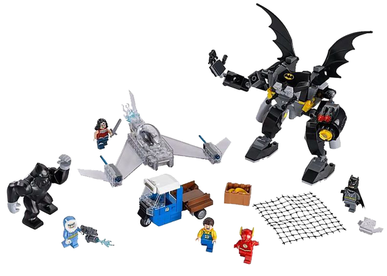

Voyons si ce set vaut son pesant de bananes.

* * *

Le contenu du set est intégré dans le décor de ville. Le bandeau du haut est constitué des logos _LEGO_ et _DC Comics Super Heroes_ et de l’équipe de la _Justice League of America_. En bas à droite l’intégralité des Minifigures présentes dans le set.  
La mise en scène est, comme toujours, très dynamique.

[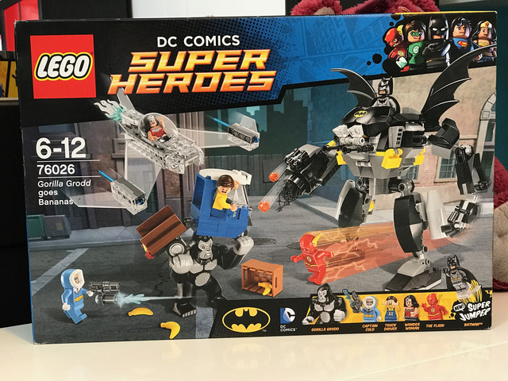](https://www.freelug.org/IMG/jpg/GorillaGrodd_01.jpg)

Au verso, plusieurs vignettes avec les éléments de jouabilités du set. Ici encore la mise en scène est dopée à la testostérone.

[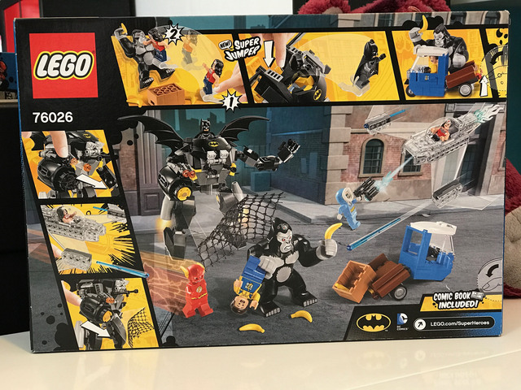](https://www.freelug.org/IMG/jpg/GorillaGrodd_02.jpg)

Une fois ouvert, le set contient quatre sachets, une petite planche d’autocollants, une BD et deux notices de construction.

[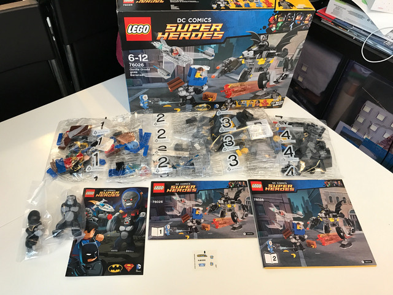](https://www.freelug.org/IMG/jpg/GorillaGrodd_03.jpg)

* * *

Avant de détailler les minifigures de ce set, nous allons faire une présentation des différents protagonistes.

-   **Gorilla Grodd** :

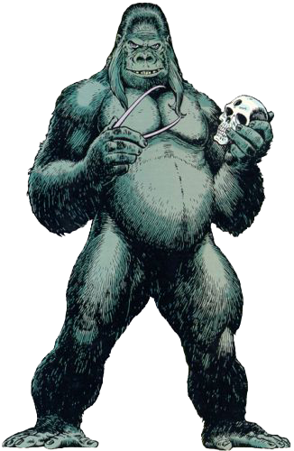

> **Gorilla Grodd** est un super-vilain de l’univers de _DC Comics_. Créé par John Broome et Carmine Infantino, le personnage de fiction apparaît pour la première fois dans le comic book _Flash #106_ en mai 1959.
> 
> Gorille doté d’une haute intelligence et de vastes pouvoirs psychiques, _Grodd_ est principalement connu comme un des pires ennemis de _Flash_, bien qu’il ait également affronté l’ensemble de la _Justice League of America_ (_Ligue de justice d’Amérique_) à certaines occasions.
> 
> Source _[Wikipedia](https://fr.wikipedia.org/wiki/Gorilla_Grodd)_.

-   **Batman** :

[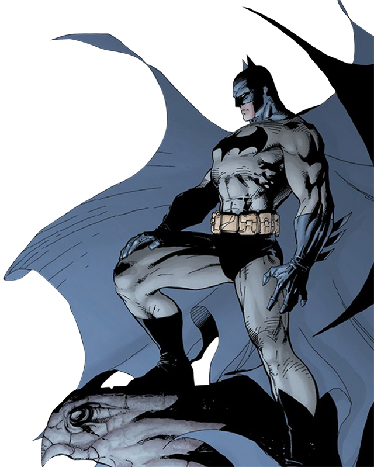](https://www.freelug.org/IMG/png/Batman.png)

> **Batman** (_Bruce Wayne_) est un personnage de fiction appartenant à l’univers de _DC Comics_. Créé par le dessinateur Bob Kane et le scénariste Bill Finger, il apparaît pour la première fois dans le comic book _Detective Comics no 27_ (date de couverture : mai 1939 mais la date réelle de parution est le 30 mars 1939) avec le nom de _The Bat-Man_.
> 
> Bien que ce soit le succès de _Superman_ qui ait amené sa création, il se détache de ce modèle puisqu’il n’a aucun pouvoir surhumain. _Batman_ n’est qu’un simple humain qui a décidé de lutter contre le crime après avoir vu ses parents se faire abattre par un voleur dans une ruelle de Gotham City, la ville où se déroulent la plupart de ses aventures. Malgré sa réputation de héros solitaire, il sait s’entourer d’alliés, comme _Robin_, son majordome _Alfred Pennyworth_ ou encore le commissaire de police _James Gordon_.
> 
> Source : _[Wikipedia](https://fr.wikipedia.org/wiki/Batman)_.

-   **Flash** :

[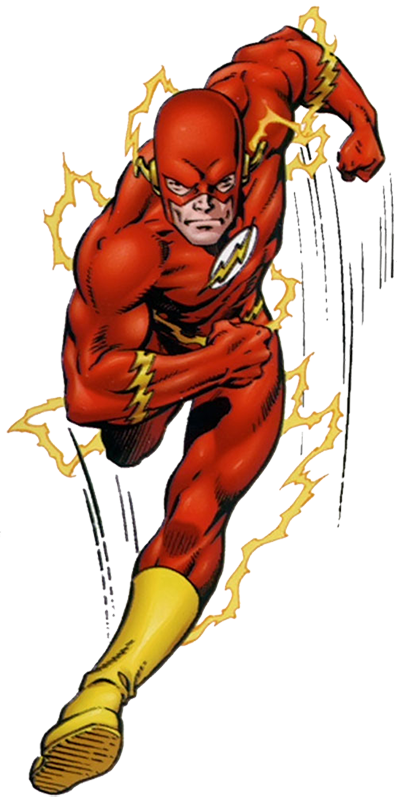](https://www.freelug.org/IMG/png/Flash.png)

> **Flash** est le nom de plusieurs personnages de fiction appartenant à l’univers de DC Comics. Les différents _Flash_ sont tous dotés de la capacité de se déplacer à très grande vitesse. Le costume du super-héros _Flash_ est souvent de couleur rouge et jaune qui rappelle l’éclair avec au centre un éclair sur un fond blanc pour désigner sa vitesse. Mais le tout premier avait également un casque d’acier, inspiré du dieu grec _Hermès_ (ou _Mercure_ chez les Romains), doté lui aussi, d’une vitesse hors du commun. Il a été créé par Gardner Fox et Harry Lampert.
> 
> Source : _[Wikipedia](https://fr.wikipedia.org/wiki/Flash_\(comics\))_.

-   **Wonder Woman** :

[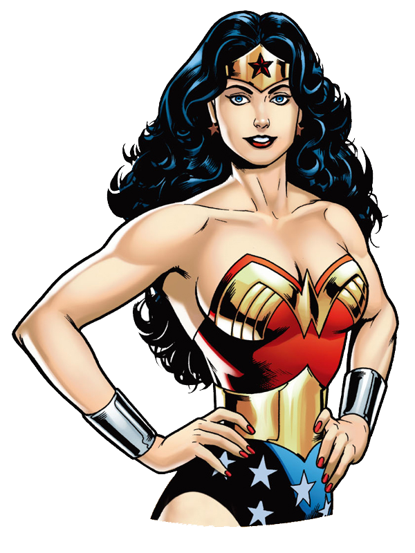](https://www.freelug.org/IMG/png/WonderWoman.png)

> **Wonder Woman** est une super-héroïne de bande dessinée américaine créée par William Moulton Marston (sous le pseudonyme de Charles Moulton) en décembre 1941 dans _All Star Comics_. Elle était à l’époque l’une des premières super-héroïnes et elle est certainement encore aujourd’hui la plus célèbre d’entre elles.
> 
> Dans la plupart des adaptations, _Wonder Woman_ est la princesse _Diana_ d’une tribu d’amazones dont les origines sont liées à la mythologie grecque. Ambassadrice amazone dans notre monde, elle possède différents pouvoirs surnaturels ainsi que des cadeaux des dieux grecs, comme un lasso magique et des bracelets à l’épreuve des balles. Elle fait aussi partie de la _Justice League of America_ (_Ligue de Justice d’Amérique_).
> 
> Marston a voulu faire de _Wonder Woman_ un personnage féministe et la plupart des scénaristes qui ont repris le personnage, particulièrement ceux des années 1980 et suivantes, l’ont représentée ainsi.
> 
> Source : _[Wikipedia](https://fr.wikipedia.org/wiki/Wonder_Woman)_.

-   **Captain Cold** :

[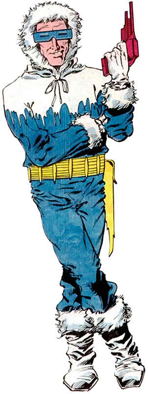](https://www.freelug.org/IMG/png/CaptainCold.png)

> **Captain Cold** est un personnage de fiction créé par John Broome et Carmine Infantino. Il apparait pour la première fois en juin 1957 dans _Showcase #8_. C’est l’un des ennemis de _Flash_. Il tire son pseudonyme de son pistolet réfrigérant (ou cold-gun) et de sa parka et est le deuxième super-vilain à avoir affronté _Barry Allen_, le _Flash_ de l’Âge d’argent et est resté un ennemi de son successeur _Wally West_.
> 
> Source : _[Wikipedia](https://fr.wikipedia.org/wiki/Captain_Cold)_.

* * *

_[Gorilla Grodd](http://brickset.com/minifigs/sh147/gorilla-grodd)_, sérigraphie plutôt réussie pour cette Maxifig. Le visage est très expressif.

[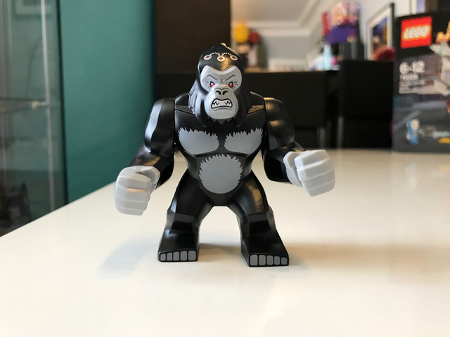](https://www.freelug.org/IMG/jpg/GorillaGrodd_04.jpg)

De dos pas grand-chose à dire.

[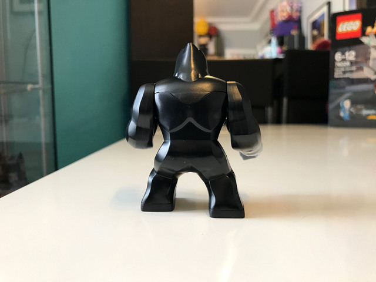](https://www.freelug.org/IMG/jpg/GorillaGrodd_05.jpg)

_[Batman](http://brickset.com/minifigs/sh151/batman-dark-bluish-gray-suit-gold-belt-black-hands-spongy-cape)_ est bien réalisé, les sérigraphies sont propres. Dommage que les jambes n’aient pas le droit au même traitement.  
Malheureusement les déclinaisons de ce personnage ont tendance à toutes se ressembler.

[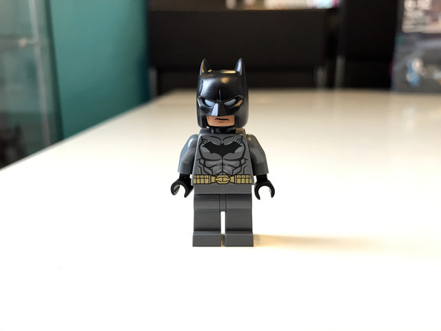](https://www.freelug.org/IMG/jpg/GorillaGrodd_06.jpg)

Le dos fait vraiment bâclé pour le coup, on dirait un costume en latex. Le visage alternatif en mode "énervé".

[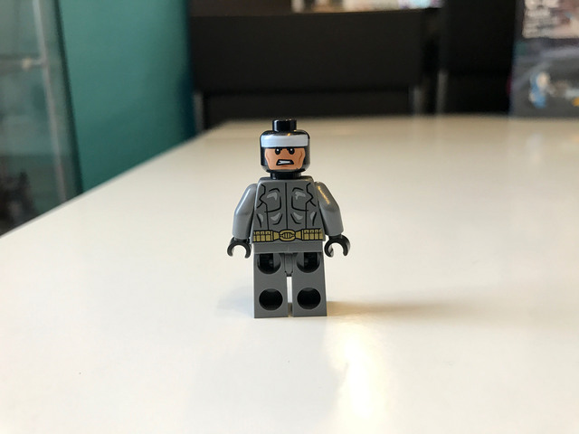](https://www.freelug.org/IMG/jpg/GorillaGrodd_07.jpg)

_[Flash](http://brickset.com/minifigs/sh087/the-flash)_, personnage connu de l’univers _DC_, est plutôt rare car n’apparaissant que dans deux sets _LEGO_. Ici la sérigraphie est simple mais efficace et le casque est une réussite.  
Avec la sortie prochaine du film _Justice League_, on espère une nouvelle version de ce personnage avec des jambe bi-injection rouge/jaune.

[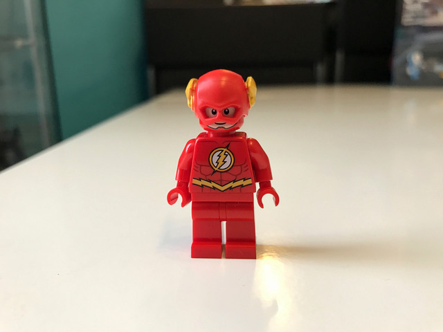](https://www.freelug.org/IMG/jpg/GorillaGrodd_08.jpg)

Le verso est assez décevant mais cadre plutôt bien avec la sobriété du recto. Le visage alternatif énervé est une réussite.

[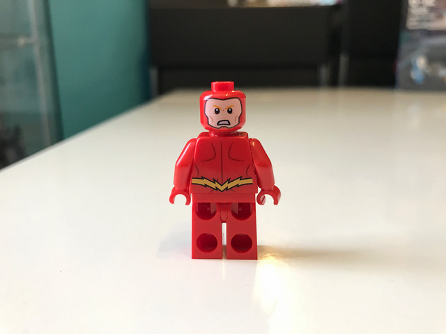](https://www.freelug.org/IMG/jpg/GorillaGrodd_09.jpg)

_[Wonder Woman](http://brickset.com/minifigs/sh150/wonder-woman-dark-blue-legs)_ sans short mais avec un collant. Encore un personnage simple au niveau sérigraphies. La peau du décolleté parait blanche et non chair. La sérigraphie des jambes n’est pas alignée. Bref une belle déception.

[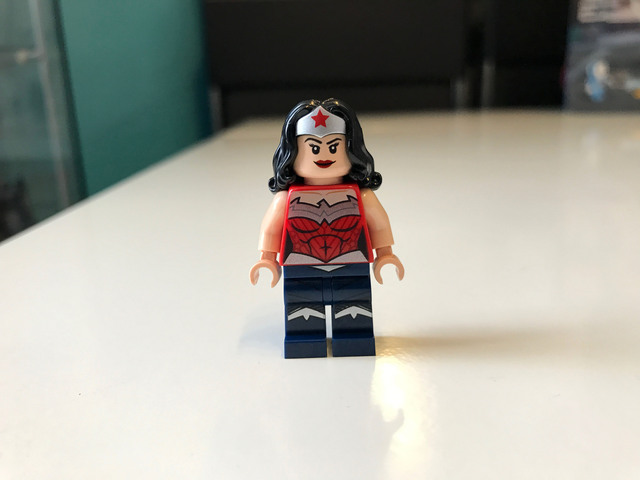](https://www.freelug.org/IMG/jpg/GorillaGrodd_10.jpg)

Le verso n’est pas folichon non plus, le visage alternatif reste l’élément le plus sympa de cette fig.

[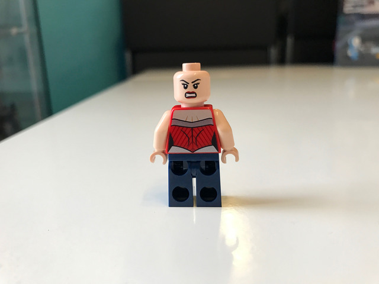](https://www.freelug.org/IMG/jpg/GorillaGrodd_11.jpg)

_[Captain Cold](http://brickset.com/minifigs/sh148/captain-cold)_, bien que simple d’aspect, cette fig colle complétement au personnage du comics. Le visage est une réussite.

[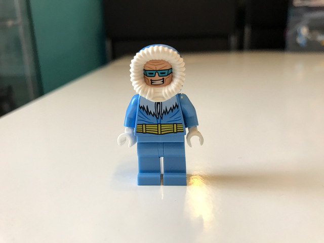](https://www.freelug.org/IMG/jpg/GorillaGrodd_12.jpg)

Le dos est à l’image du recto, simple mais réussi. Le visage alternatif énervé complète le tableau.

[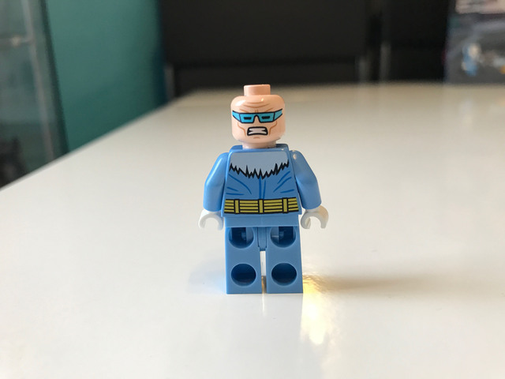](https://www.freelug.org/IMG/jpg/GorillaGrodd_13.jpg)

Le _[Truck Driver](http://brickset.com/minifigs/sh149/truck-driver-overalls)_ est surement la minifig que je préfère dans ce set. En effet la sérigraphie du torso est superbe et le visage apeuré est juste tordant.

[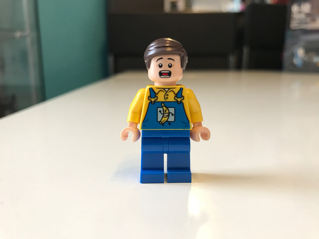](https://www.freelug.org/IMG/jpg/GorillaGrodd_14.jpg)

Pas de visage alternatif mais un verso là aussi réussi.

[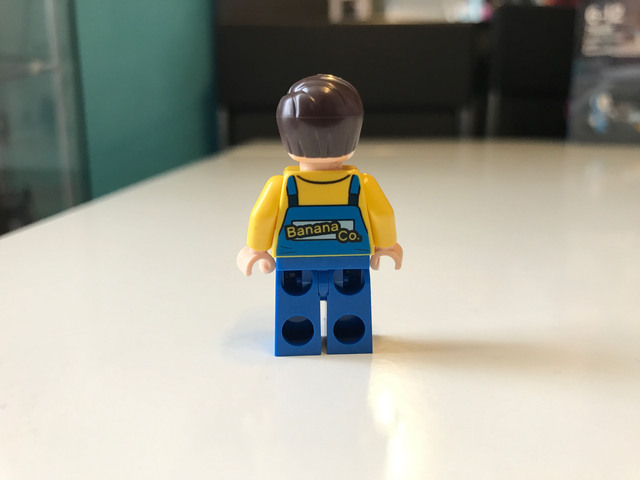](https://www.freelug.org/IMG/jpg/GorillaGrodd_15.jpg)

Photo de famille, on voit ici le fossé qui sépare les productions 2014 par rapport à celles d’aujourd’hui en terme de sérigraphie.

[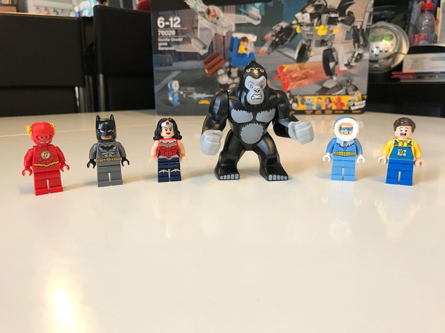](https://www.freelug.org/IMG/jpg/GorillaGrodd_16.jpg)

* * *

Le premier sachet permet de monter le tricycle motorisé du livreur de bananes.

[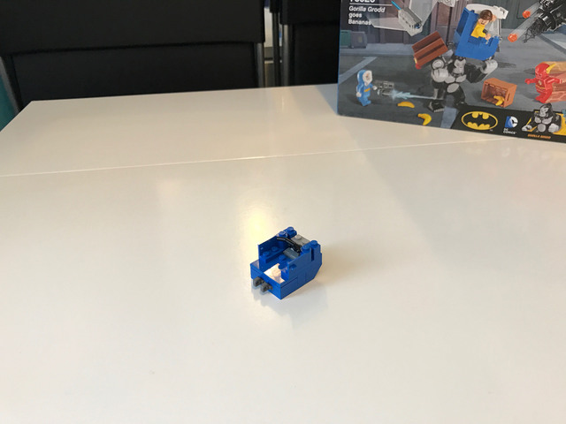](https://www.freelug.org/IMG/jpg/GorillaGrodd_17.jpg)

Montage rapide mais efficace.

[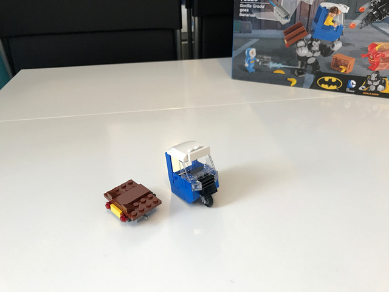](https://www.freelug.org/IMG/jpg/GorillaGrodd_18.jpg)

Malgré la simplicité, ce petit modèle fait parfaitement le job.

[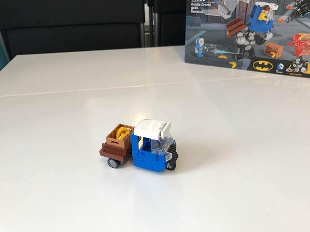](https://www.freelug.org/IMG/jpg/GorillaGrodd_19.jpg)

Avec le sachet 2 nous nous attaquons à l’avion invisible de _Wonder Woman_.

[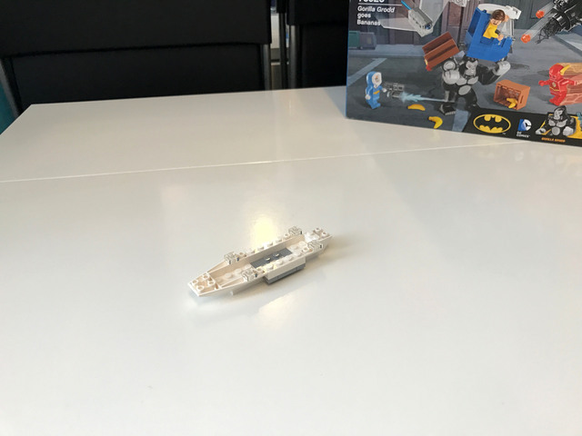](https://www.freelug.org/IMG/jpg/GorillaGrodd_20.jpg)

Ici aussi le montage est plutôt simple.

[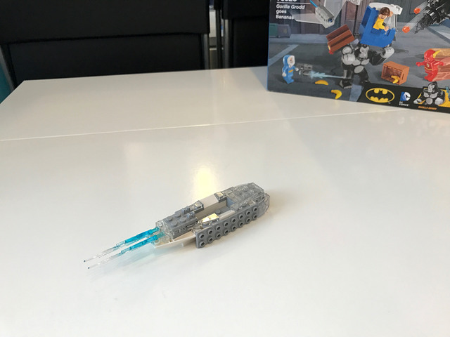](https://www.freelug.org/IMG/jpg/GorillaGrodd_21.jpg)

Malgré tout le rendu n’est pas désagréable. Le nombre important de pièces _Trans-Clear_ y est sûrement pour beaucoup.

[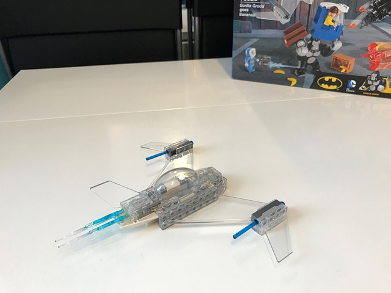](https://www.freelug.org/IMG/jpg/GorillaGrodd_22.jpg)

On conclut par le troisième sachet avec le _Bat-Mecha_.

[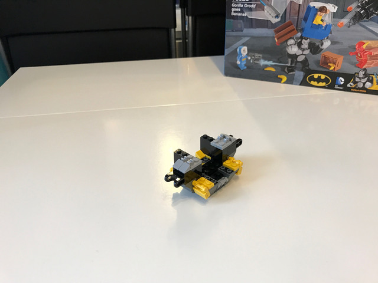](https://www.freelug.org/IMG/jpg/GorillaGrodd_24.jpg)

Montage un poil plus long pour ce véhicule, pourtant rien de transcendant niveau techniques.

[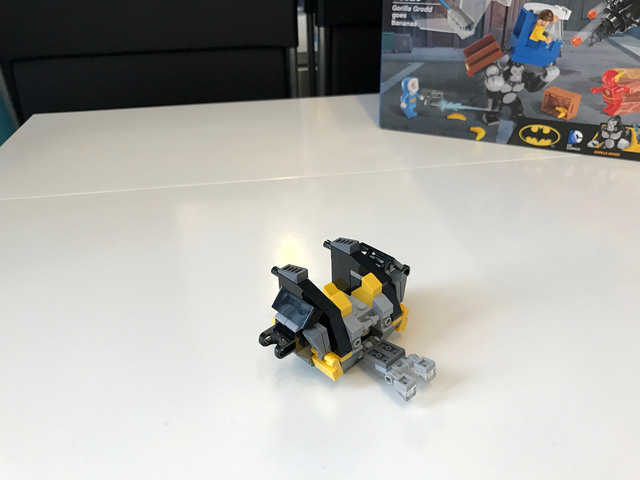](https://www.freelug.org/IMG/jpg/GorillaGrodd_26.jpg)

Le plastron du _Bat-Mecha_, la seule pièce sérigraphiée de ce set.

[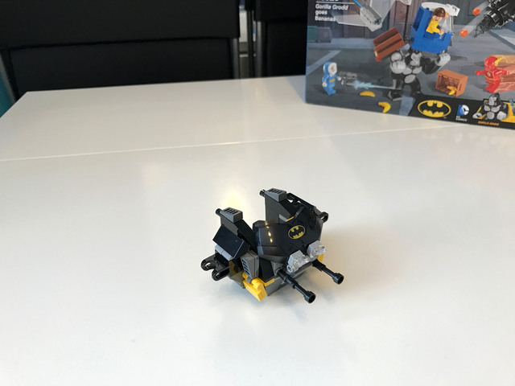](https://www.freelug.org/IMG/jpg/GorillaGrodd_27.jpg)

Une fois les ailes fixées, on s’attaque aux jambes.

[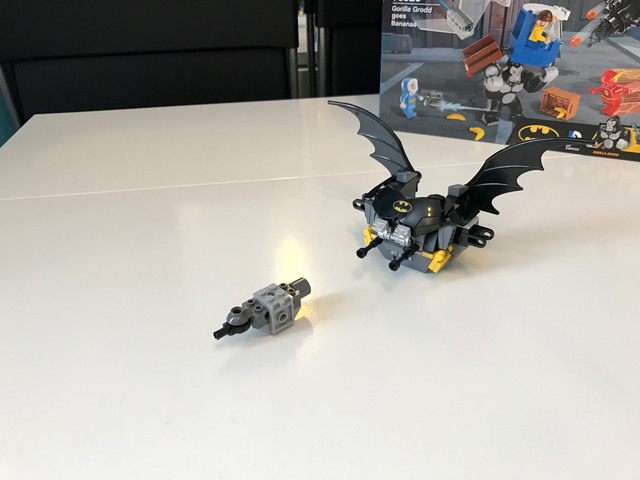](https://www.freelug.org/IMG/jpg/GorillaGrodd_28.jpg)

Avec de tels réacteurs et ses ailes, la fonction "vol" est assurée.

[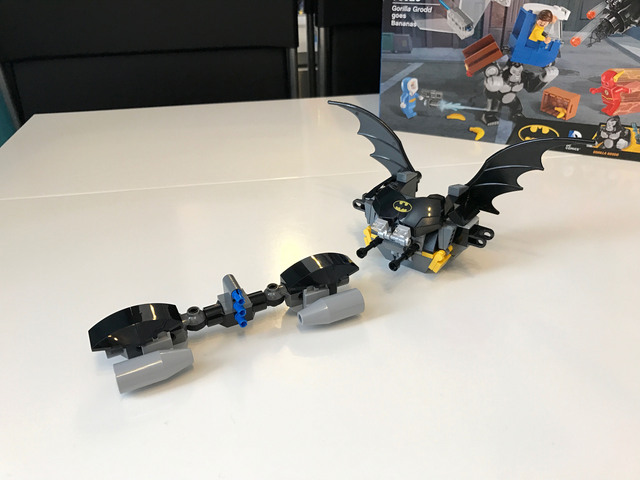](https://www.freelug.org/IMG/jpg/GorillaGrodd_29.jpg)

Les deux pieds et leur système de fixation.

[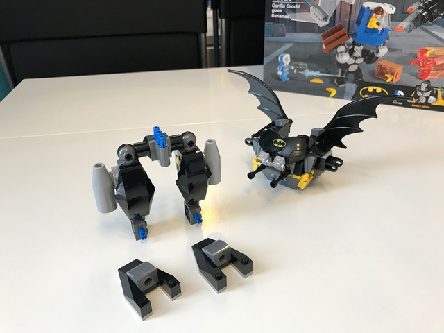](https://www.freelug.org/IMG/jpg/GorillaGrodd_30.jpg)

Simple mais efficace.

[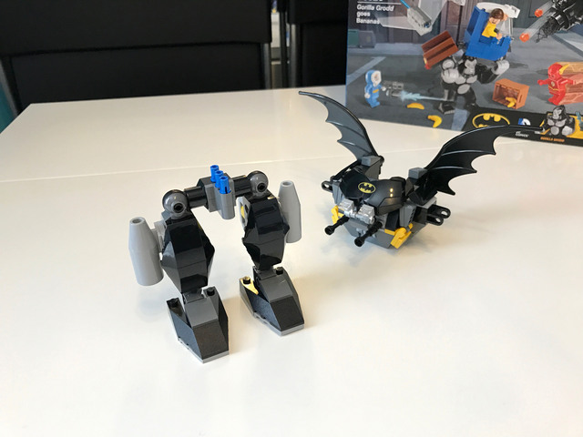](https://www.freelug.org/IMG/jpg/GorillaGrodd_31.jpg)

On passe maintenant au bras gauche.

[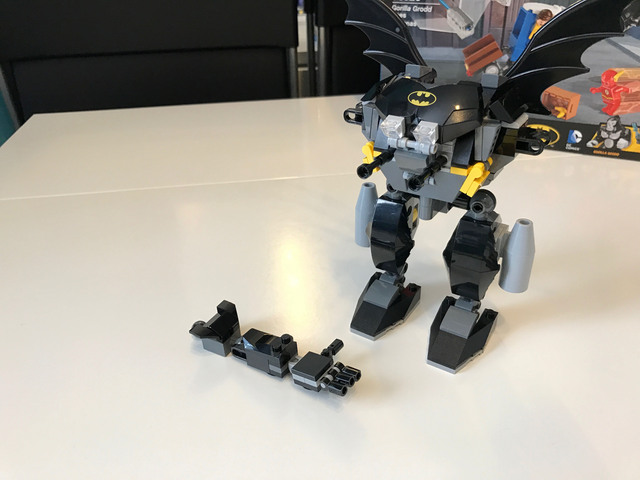](https://www.freelug.org/IMG/jpg/GorillaGrodd_32.jpg)

Puis au bras droit.

[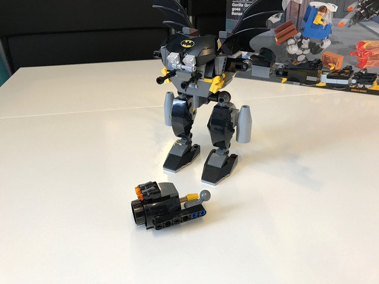](https://www.freelug.org/IMG/jpg/GorillaGrodd_33.jpg)

Une belle différence d’allonge.

[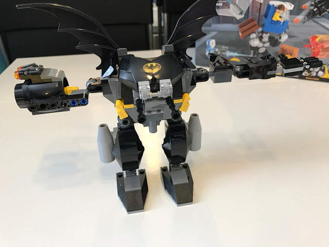](https://www.freelug.org/IMG/jpg/GorillaGrodd_34.jpg)

Voici l’intégralité du set.

[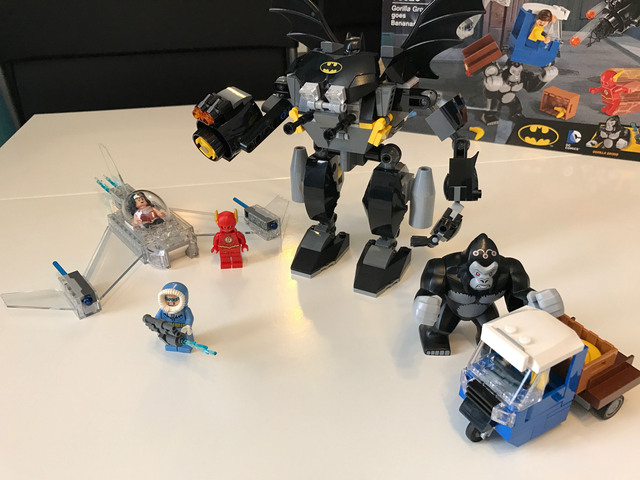](https://www.freelug.org/IMG/jpg/GorillaGrodd_35.jpg)

* * *

**AVIS :**

Une fois de plus, je suis mitigé avec ce set _DC_, les figs ne sont pas géniales, mais pas pourries non plus. Les véhicules laissent le même sentiment.

Bref, trouvé à bon prix il permet d’obtenir quatre figs exclusives et une quasi-exclusive (_Flash_ disponible dans seulement deux sets). Pour le reste les véhicules ne vous laisseront pas un souvenir impérissable.

**BONUS :**

Voici quatre GIF animés, réalisés avec la totalité des photos prises pour cette review (cliquez sur les images pour lancer les animations).

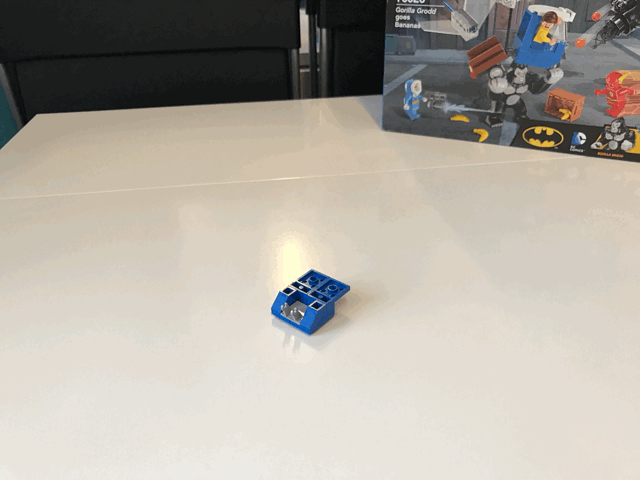

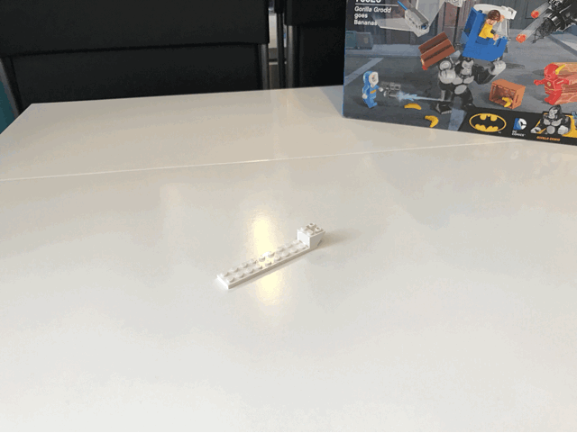

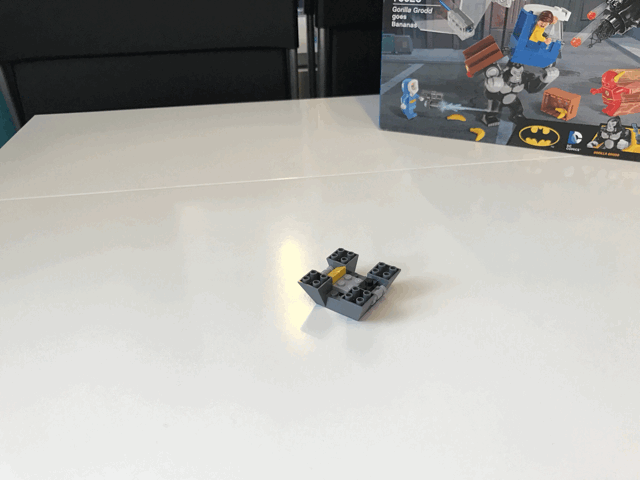

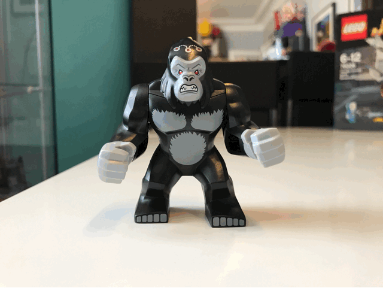
