Aujourd’hui je vous propose la review du set 76044 dans la gamme _DC Comics Super Heroes_ : **Clash of the Heroes**.  
Ce set sorti en 2016 au prix de 14,99 € est composé de 92 pièces, soit un ratio prix/pièce de 16 centimes d’euros.

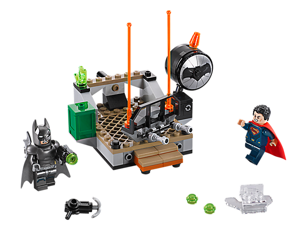

* * *

Le visuel de la boite est composé en haut d’un bandeau constitué des logos _LEGO_ et _DC Comics Super Heroes_ et des deux héros du film _Batman VS Superman_ au format minifigures.  
Le set est inséré dans une scène ce passant sur le toit d’un gratte-ciel avec les deux protagonistes en action.

[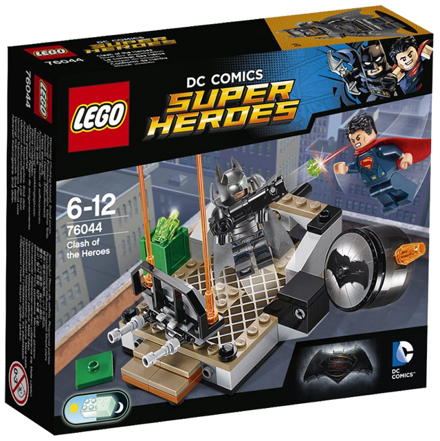](https://www.freelug.org/IMG/png/ClashOfTheHeroes_box_recto.png)

Au verso, on retrouve plusieurs vignettes avec les éléments de jouabilités du set.

[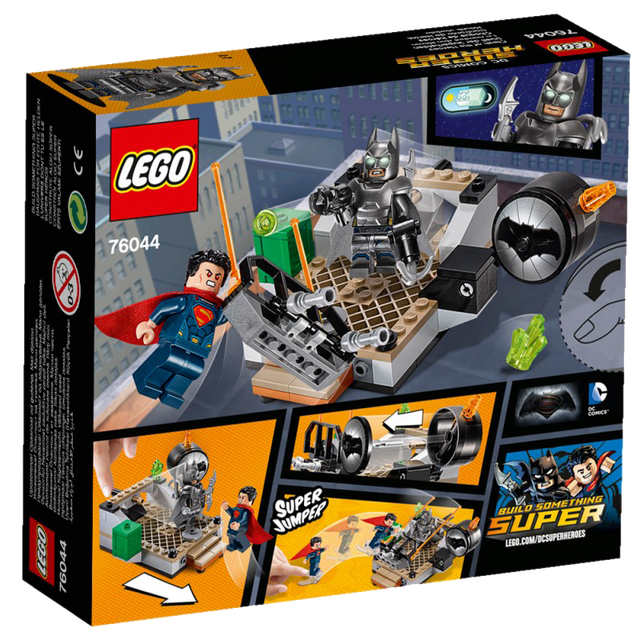](https://www.freelug.org/IMG/png/ClashOfTheHeroes_box_verso.png)

La boite contient deux sachets, d’une plaque grillagée (_Grille Plate 8x8 Dark Tan_), d’une notice de construction ainsi qu’un unique stickers (on ne va pas se plaindre).

[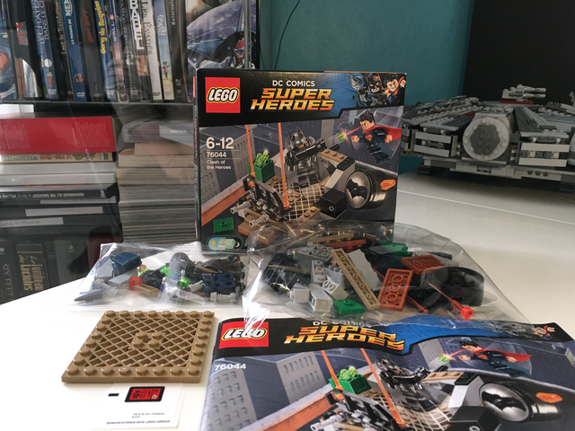](https://www.freelug.org/IMG/jpg/ClashOfTheHeroes_01.jpg)

* * *

Première minifig, le fameux _[Superman](http://brickset.com/minifigs/sh219/Superman-Dark-Blue-Suit-Tousled-Hair-\(76044\))_. Les sérigraphies du torso sont magnifiques et le visage goguenard vraiment expressif.

[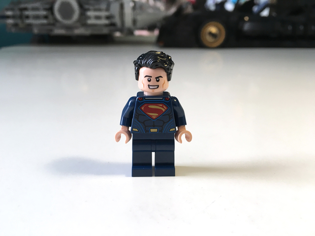](https://www.freelug.org/IMG/jpg/ClashOfTheHeroes_02.jpg)

Le dos est lui aussi réussi, et le visage alternatif avec les yeux rouge est juste magnifique.

[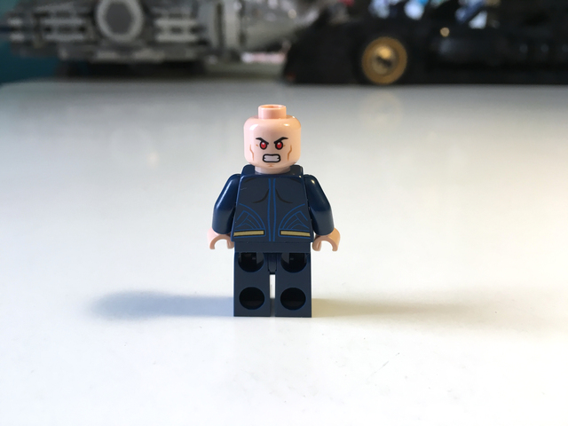](https://www.freelug.org/IMG/jpg/ClashOfTheHeroes_03.jpg)

Deuxième fig, _[Batman](http://brickset.com/minifigs/sh217/Batman-Armored-\(76044\))_ version armure lourde (le minimum pour affronter le _Fils de Krypton_).

[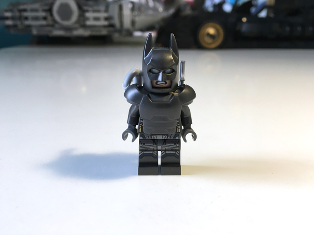](https://www.freelug.org/IMG/jpg/ClashOfTheHeroes_04.jpg)

Sans l’armure, les sérigraphies du _Bat-costume_ sont une réussite. Le torso et les jambes fourmillent de détails.

[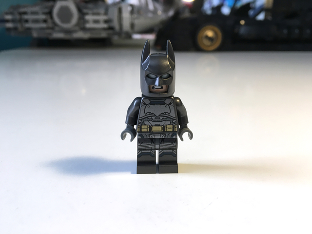](https://www.freelug.org/IMG/jpg/ClashOfTheHeroes_05.jpg)

_Bruce Wayne_ tombe le masque sur un visage serrant les dents.

[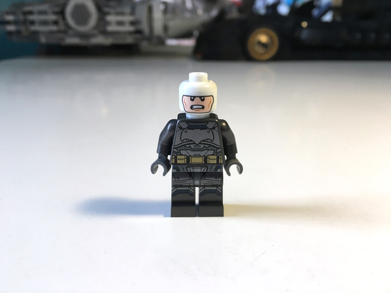](https://www.freelug.org/IMG/jpg/ClashOfTheHeroes_06.jpg)

Au dos, même débordement de détails et un visage faisant la moue.

[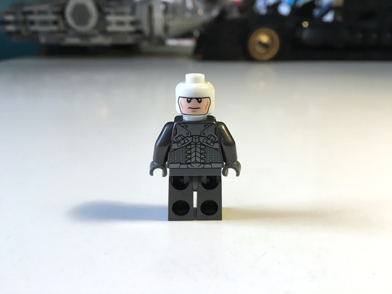](https://www.freelug.org/IMG/jpg/ClashOfTheHeroes_07.jpg)

Gros plus de cette fig, une tête phosphorescente.

[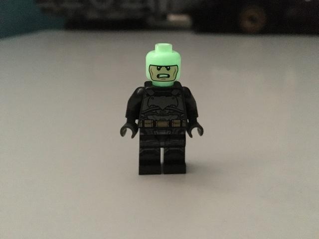](https://www.freelug.org/IMG/jpg/ClashOfTheHeroes_08.jpg)

C’est avec le masque que l’effet "wahou" est le plus saisissant.  
J’ADORE tout simplement.

[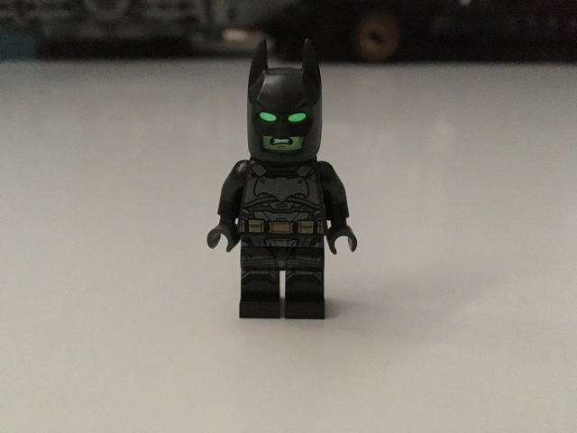](https://www.freelug.org/IMG/jpg/ClashOfTheHeroes_09.jpg)

* * *

Gros plan sur la magnifique pièce sérigraphiée. Les possibilités de réutilisation pour des MOC sont nombreuses.

[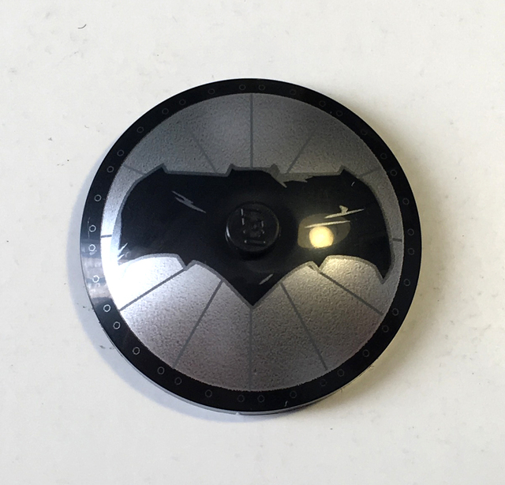](https://www.freelug.org/IMG/jpg/ClashOfTheHeroes_10.jpg)

On commence le montage par les escaliers menant à la future plate-forme.

[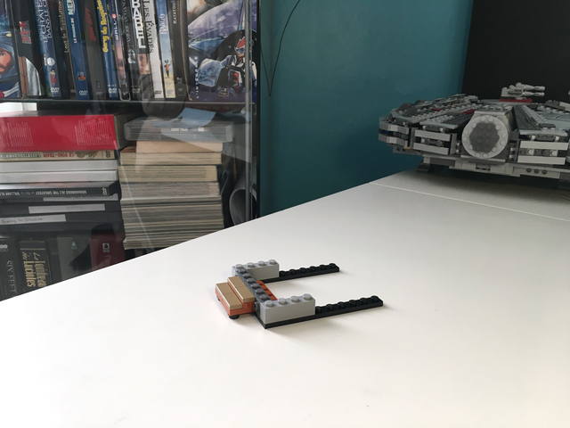](https://www.freelug.org/IMG/jpg/ClashOfTheHeroes_11.jpg)

La construction est rapide et propose aucunes techniques compliquées.

[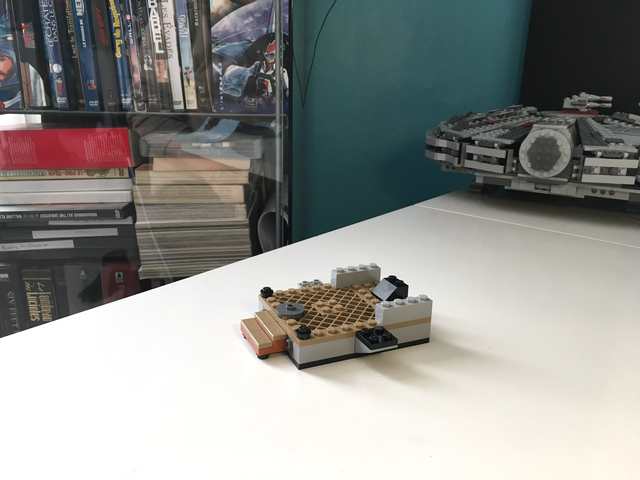](https://www.freelug.org/IMG/jpg/ClashOfTheHeroes_12.jpg)

Une barre Technic qui permettra de projeter Batman contre son "ennemi". Le stickers représente un écran de contrôle.

[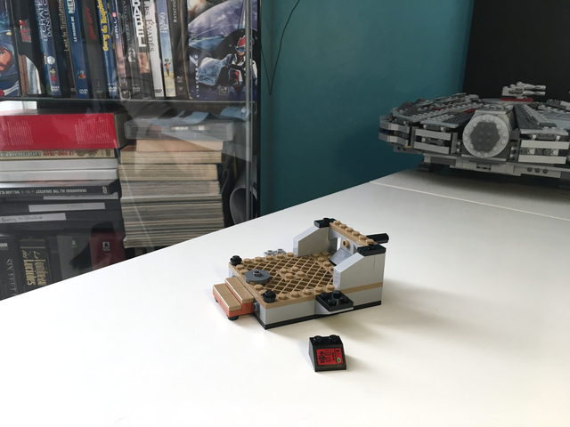](https://www.freelug.org/IMG/jpg/ClashOfTheHeroes_13.jpg)

Tiens de la _Kryptonite_... _Superman_ va passer un sale quart-d’heure.

[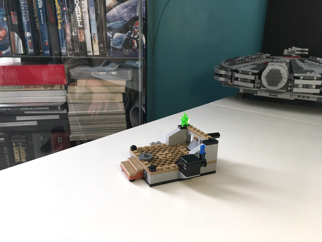](https://www.freelug.org/IMG/jpg/ClashOfTheHeroes_14.jpg)

La pièce sérigraphiée servant de Bat-signal.

[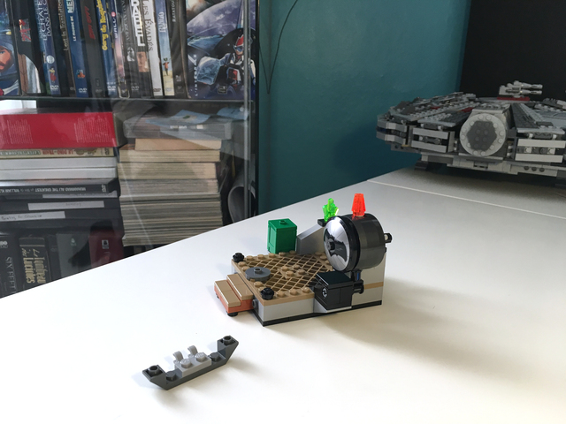](https://www.freelug.org/IMG/jpg/ClashOfTheHeroes_15.jpg)

Début de la construction de la rambarde (dont je n’ai toujours pas compris l’intérêt).

[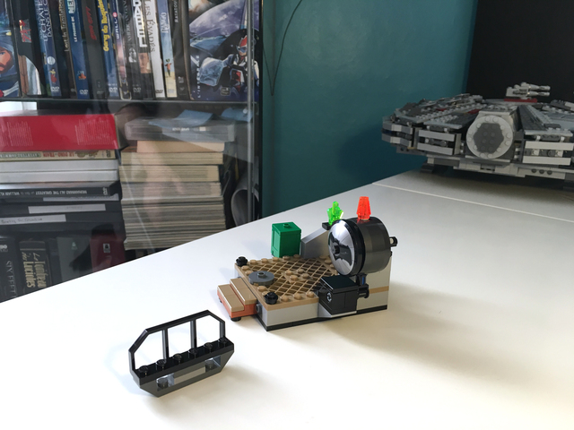](https://www.freelug.org/IMG/jpg/ClashOfTheHeroes_16.jpg)

On l’agrémente avec des antennes.

[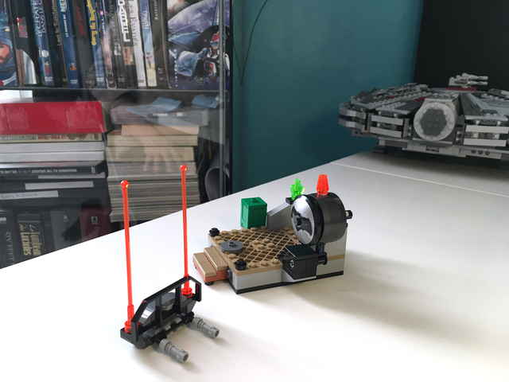](https://www.freelug.org/IMG/jpg/ClashOfTheHeroes_17.jpg)

Et voilà le set terminé.

[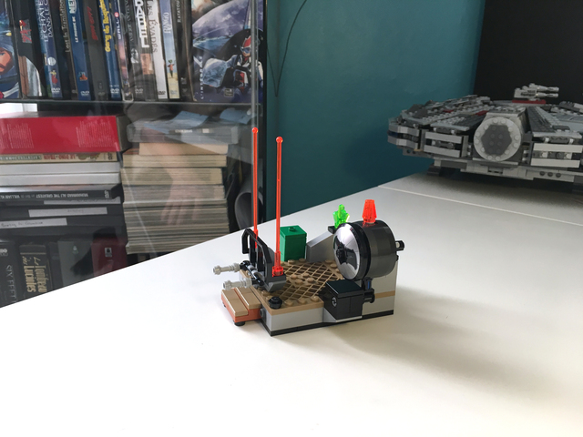](https://www.freelug.org/IMG/jpg/ClashOfTheHeroes_18.jpg)

Mise en situation avec nos deux héros.

[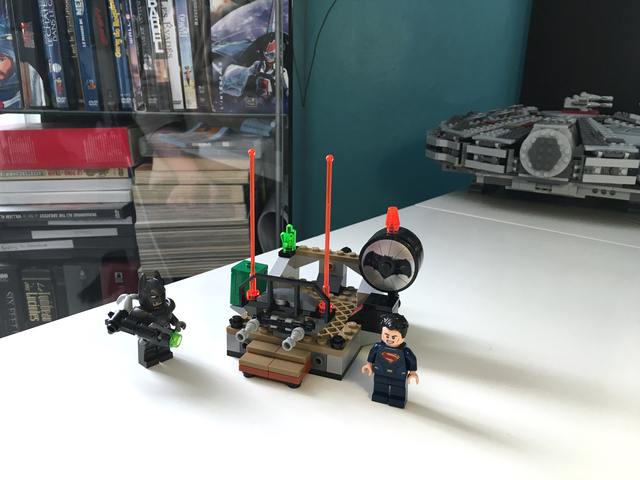](https://www.freelug.org/IMG/jpg/ClashOfTheHeroes_19.jpg)

**AVIS :**

Même si la construction est sans intérêt, je vous recommande chaudement ce petit set. En effet, pour moins de 15 euros ont à deux figurines exclusives et une pièce sérigraphiée de toute beauté. Le _Batman_ est sublissime et la tête énervée de _Superman_ apporte un vrai plus à la minifig.

**Bref, foncez !**

**BONUS :**

Voici un GIF animé réalisé avec la totalité des photos prises pour cette review (cliquez sur l’image pour lancer l’animation).

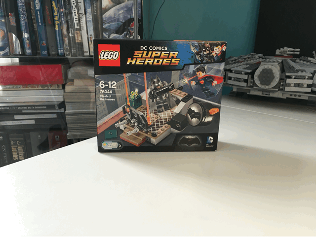
