Aujourd’hui, je vous propose la review du set 76078 dans la gamme _Marvel Super Heroes_ : **Hulk vs. Red Hulk**.  
Ce set, sorti en 2017 au prix de 64,99 €, est composé de 375 pièces, soit un ratio prix/pièce de 17 centimes d’euro.

[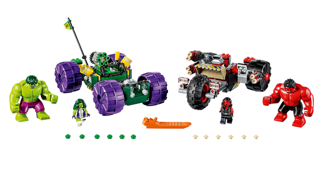](https://www.freelug.org/IMG/png/HulkVsRedHulk.png)

Voyons ce que ce set nous propose en terme de jouabilité.

* * *

Le contenu du set est intégré dans le décor de bataille dans un désert. Le bandeau du haut est constitué des logos _LEGO_ et _Marvel Super Heroes_ et de l’équipe des _Avengers_ version comics.  
En bas à droite le logo _Marvel Avengers_ apparait, _LEGO_ joue à fond la carte de la franchise.  
La mise en scène est très dynamique.

[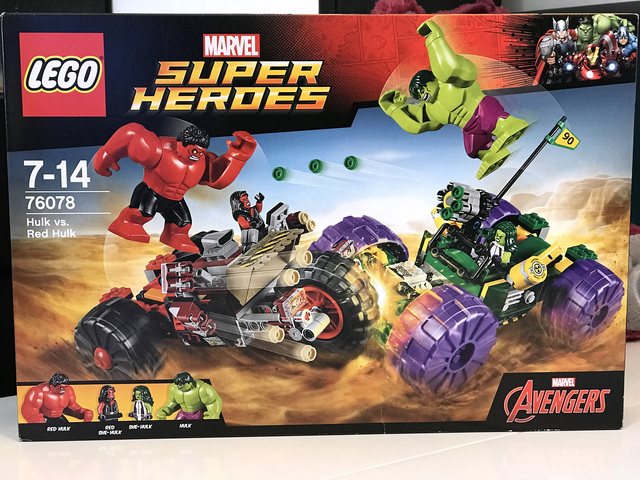](https://www.freelug.org/IMG/jpg/HulkVsRedHulk_01.jpg)

Au verso, plusieurs vignettes avec les éléments de jouabilités du set. Ici encore la mise en scène est dopée à la testostérone.

[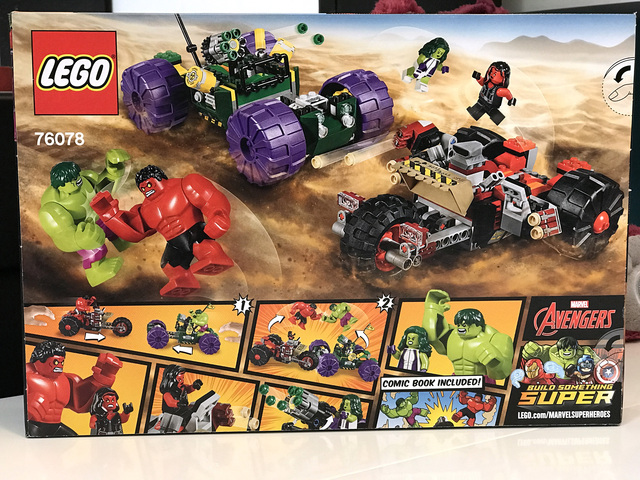](https://www.freelug.org/IMG/jpg/HulkVsRedHulk_02.jpg)

Une fois ouvert, le set contient pas moins de sept sachets, une planche d’autocollants, une BD et deux notices de construction (une par engin).

[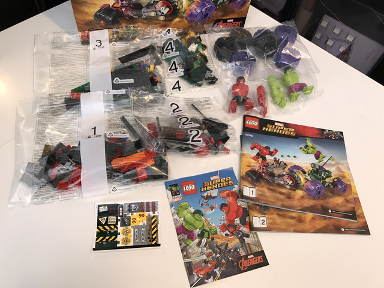](https://www.freelug.org/IMG/jpg/HulkVsRedHulk_03.jpg)

* * *

Avant de détailler les minifigures de ce set, nous allons faire une présentation des différents protagonistes :

-   **Red Hulk** (_Hulk Rouge_ en VF) :

[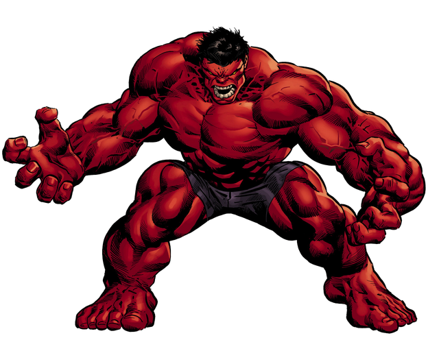](https://www.freelug.org/IMG/png/01_RedHulk.png)

> Le général **Thaddeus E. « Thunderbolt » Ross** est un personnage de fiction appartenant à l’univers _Marvel_. Créé par le scénariste Stan Lee et le dessinateur Jack Kirby, il apparaît pour la première fois dans le comic book _Incredible Hulk #1_ en 1962.  
> C’est un militaire qui pourchasse **Hulk**. Il ne possède aucun super-pouvoir jusqu’en 2008. **Red Hulk**, parfois abrégé en **Rulk**, (en français **Hulk Rouge**), apparaît pour la première fois dans le comic book _Hulk vol.2 #1_ en 2008, scénarisé par Jeph Loeb et dessiné par Ed McGuinness.  
> L’identité secrète de ce personnage est un mystère pendant plusieurs numéros jusqu’à ce que l’on apprenne que c’est **Thunderbolt Ross**.
> 
> Source _[Wikipedia](https://fr.wikipedia.org/wiki/Thunderbolt_Ross)_.

-   **Red She-Hulk** (_Miss Hulk Rouge_ en VF) :

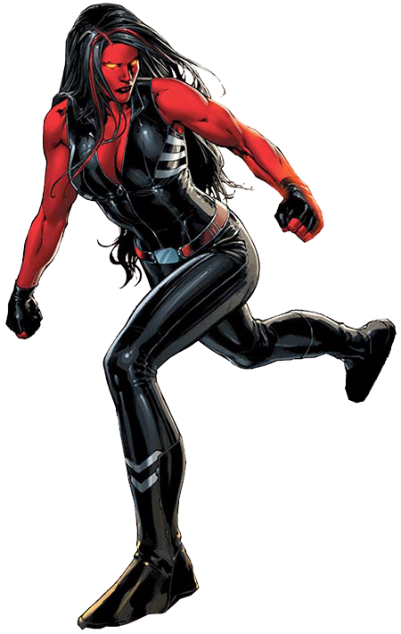

> **Betty Ross** est à l’origine la fiancée de **Bruce Banner**. Elle apparaît dans _The Incredible Hulk #1_. Elle est aussi la fille du général _« Thunderbolt » Ross_ qui dirige la base où va être testée la première bombe Gamma.  
> Le départ de **Banner** après sa métamorphose en **Hulk** va les séparer mais elle apparaît couramment dans la série, son destin étant lié à celui de **Banner**. Elle épouse d’ailleurs celui-ci et apprend sa double identité.
> 
> Durant la saga _Fall of the Hulks_, elle reçoit les pouvoirs du **Hulk Rouge** et elle prend l’identité de "**Red She-Hulk**" (_Miss Hulk Rouge_).
> 
> Source : _[Wikipedia](https://fr.wikipedia.org/wiki/Betty_Ross)_.

-   **Hulk** :

[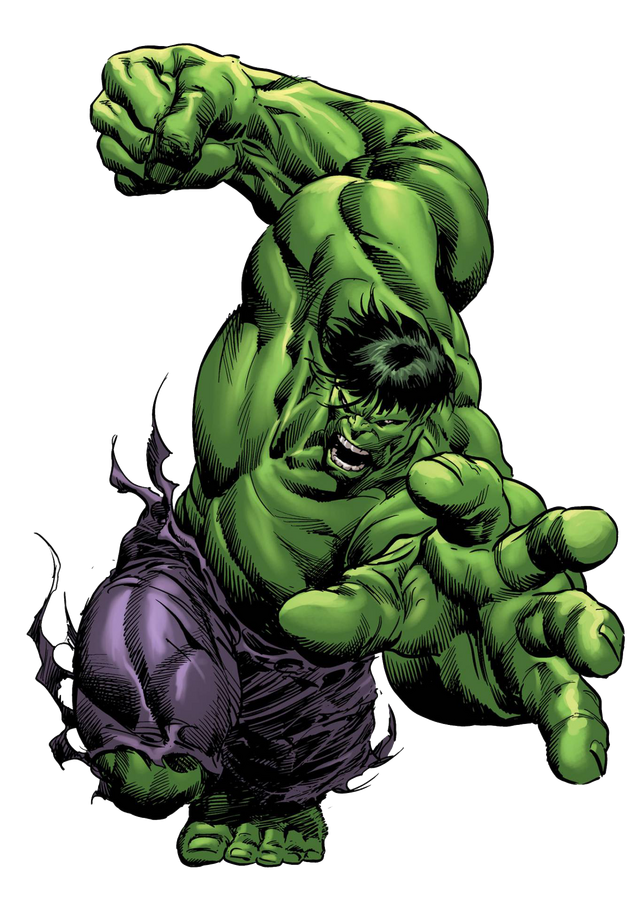](https://www.freelug.org/IMG/png/01_Hulk.png)

> **Hulk**, alias le Dr **Robert Bruce Banner**, est un personnage de fiction appartenant à l’univers _Marvel_. Créé par le scénariste Stan Lee et le dessinateur Jack Kirby, le personnage apparaît pour la première fois dans le comic book _The Incredible Hulk #1_ de mai 1962.  
> En France, il apparaît pour la première fois dans _Étranges Aventures n°23_ (novembre 1971) et ses premières aventures sont traduites dans _Gamma no 1_.
> 
> **Hulk**, alias le _Titan Vert_, est devenu l’un des super-héros les plus forts et les plus résistants de l’univers _Marvel_, à la suite d’une exposition accidentelle du Dr **Banner** aux rayons _Gamma_ lors d’une explosion atomique.
> 
> Dans le classement du magazine _Wizard_ paru en juin 2008, **Hulk** est classé dix-neuvième parmi les meilleurs personnages de comic books.
> 
> Source : _[Wikipedia](https://fr.wikipedia.org/wiki/Hulk)_.

-   **She-Hulk** (_Miss Hulk_ en VF) :

[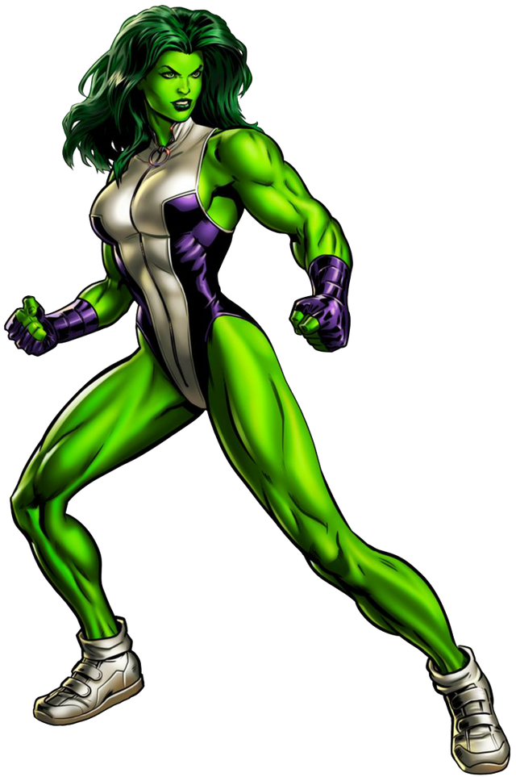](https://www.freelug.org/IMG/png/01_SheHulk.png)

> **She-Hulk** (_Miss Hulk_ en version Française), alias **Jennifer Walter**s, est un personnage de fiction, une super-héroïne appartenant à l’univers _Marvel_. Créée par Stan Lee et John Buscema, elle apparaît pour la première fois dans _Savage She-Hulk_, en 1980.
> 
> L’avocate **Jennifer Walters** est la cousine de **Bruce Banner**, le scientifique irradié de rayons _Gamma_ qui se transforme en **Hulk**.
> 
> Dans sa ville natale de Los Angeles, elle est un jour blessée par balle, lors d’un règlement de compte perpétré par le caïd **Nicholas Trask**. **Bruce**, de passage en ville, lui donne son sang car il était compatible. Affectée par la transfusion, **Jennifer** devient **She-Hulk** (_Miss Hulk_), sorte de version féminine de **Hulk**.  
> Contrairement à son cousin, elle retrouve vite un équilibre mental et toute son intelligence.
> 
> Source : _[Wikipedia](https://fr.wikipedia.org/wiki/Miss_Hulk)_.

* * *

**Red Hulk**, une maxifig de plus dans l’univers **LEGO**. Même si je ne suis pas fan, elles sont plutôt de bonne facture, dommage que les jambes soient fixes.  
La couleur est nickel et la sérigraphie du visage est très représentative du personnage du comics. L’aplat pour le short est net et uniforme.

[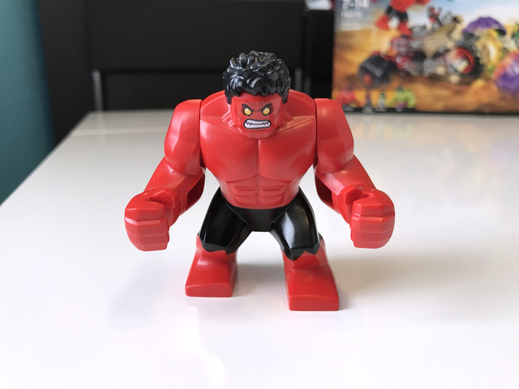](https://www.freelug.org/IMG/jpg/HulkVsRedHulk_04.jpg)

De dos et de côté, pas grand-chose à dire.

[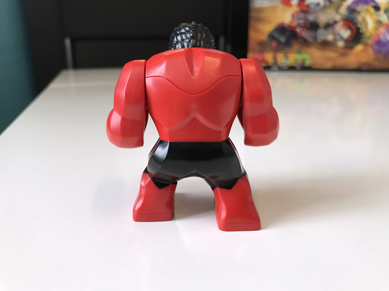](https://www.freelug.org/IMG/jpg/HulkVsRedHulk_05.jpg)

[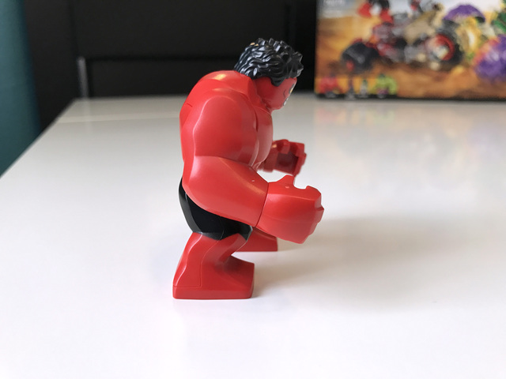](https://www.freelug.org/IMG/jpg/HulkVsRedHulk_06.jpg)

[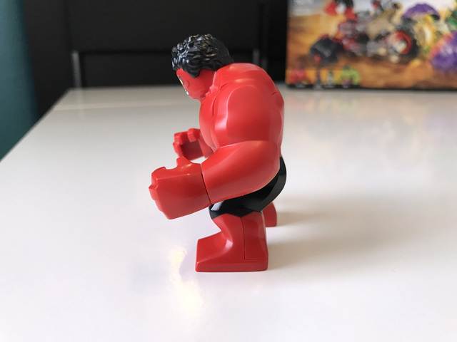](https://www.freelug.org/IMG/jpg/HulkVsRedHulk_07.jpg)

**Red She-Hulk** est bien réalisée, même si les sérigraphies du torso sont assez simples elles font néanmoins le travail. Le visage est expressif et les mèches rouge dans les cheveux apportent un réel plus.  
Le torse sera facilement réutilisable pour faire des personnages customs.

[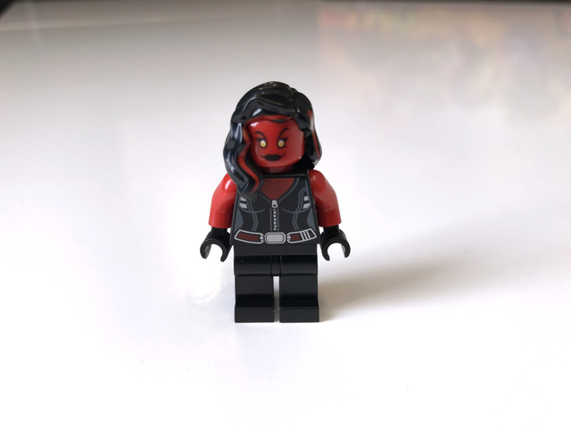](https://www.freelug.org/IMG/jpg/HulkVsRedHulk_08.jpg)

Le dos est simple mais s’accorde parfaitement avec le recto. Le visage alternatif énervé est vraiment superbe.

[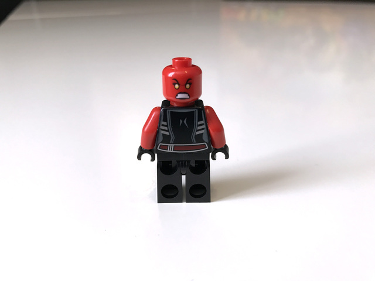](https://www.freelug.org/IMG/jpg/HulkVsRedHulk_09.jpg)

Une quatrième version maxifig pour **Hulk**, la couleur est assez proche du personnage du comics c’est un bon point. La sérigraphie du visage est extrêmement fidèle au personnage.

[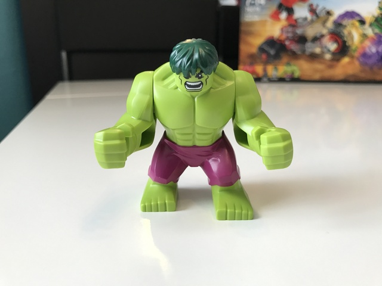](https://www.freelug.org/IMG/jpg/HulkVsRedHulk_10.jpg)

Comme pour _Red Hulk_, de dos et de côté, pas grand-chose à dire.

[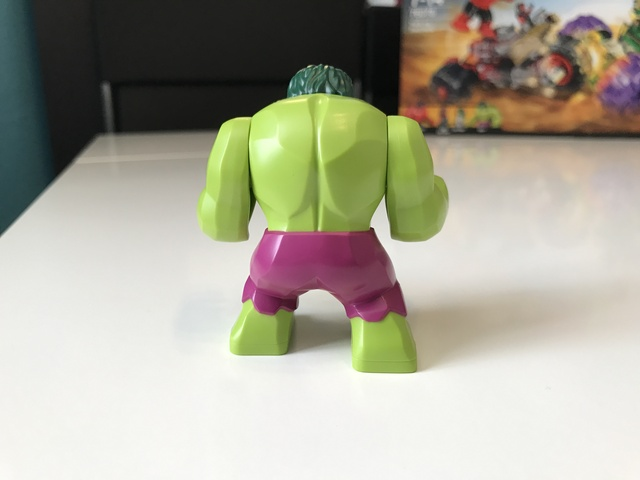](https://www.freelug.org/IMG/jpg/HulkVsRedHulk_11.jpg)

[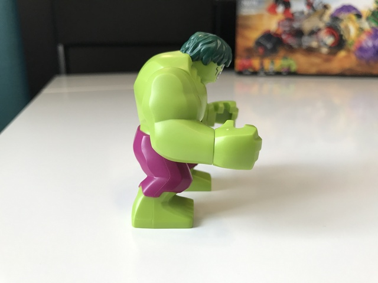](https://www.freelug.org/IMG/jpg/HulkVsRedHulk_12.jpg)

[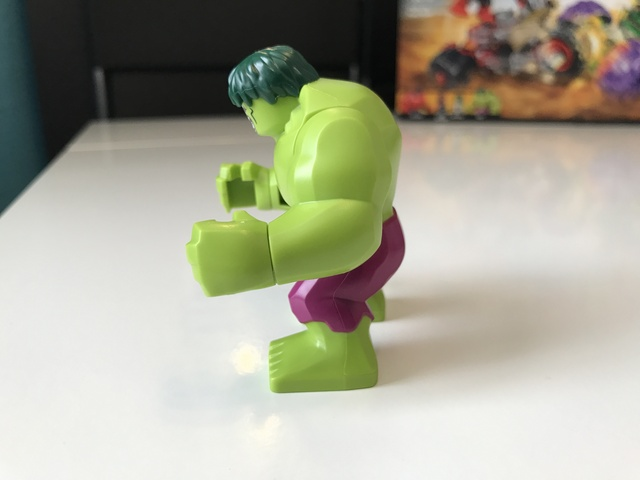](https://www.freelug.org/IMG/jpg/HulkVsRedHulk_13.jpg)

Dernière figurine de ce set, **She-Hulk** (je préfère nettement le nom en VF, _Miss Hulk_). Très belle réalisation pour ce personnage, vraiment ressemblante à la version comics (voir image plus haut). La coiffure et l’air mutin du visage sont complètement raccord avec le personnage.

C’est clairement la plus belle fig du set.

[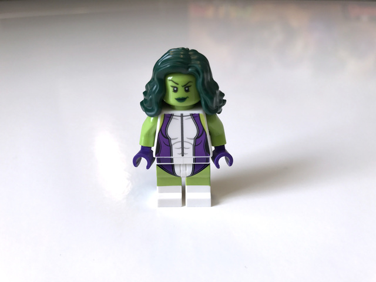](https://www.freelug.org/IMG/jpg/HulkVsRedHulk_14.jpg)

Au verso c’est simple mais efficace, le visage alternatif énervé est lui aussi une belle réalisation.

Un bémol tout de même, _LEGO_ aurait pu utiliser des jambes bi-injection pour une meilleure finition (notamment de dos).

[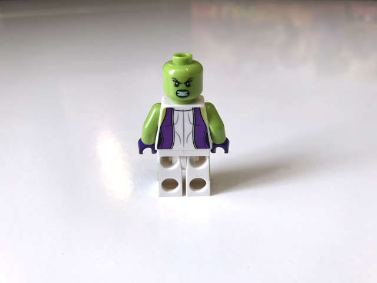](https://www.freelug.org/IMG/jpg/HulkVsRedHulk_15.jpg)

Photo de famille

[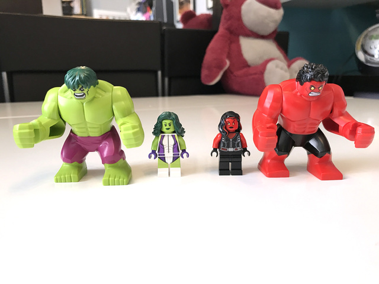](https://www.freelug.org/IMG/jpg/HulkVsRedHulk_16.jpg)

* * *

Les deux premiers sachets permettent de construire l’engin à trois roues de _Red Hulk_ et _Red She-Hulk_.

[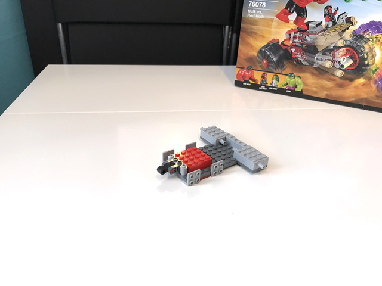](https://www.freelug.org/IMG/jpg/HulkVsRedHulk_17.jpg)

Les deux grandes barres _Technic_ permettront d’enclencher le système d’éjection en cas de collision.

[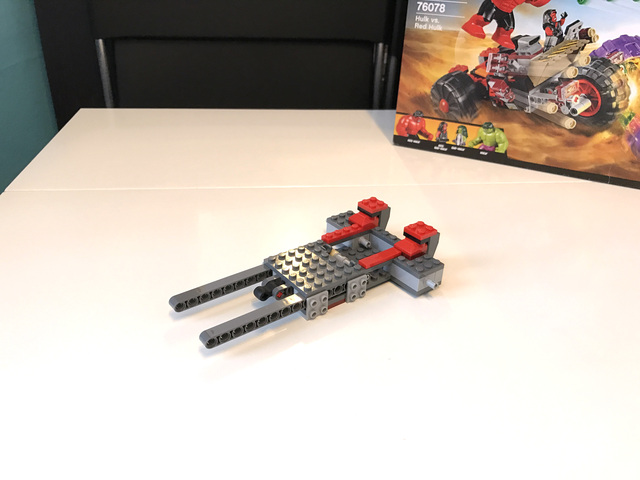](https://www.freelug.org/IMG/jpg/HulkVsRedHulk_18.jpg)

Nous voici à la fin du sachet 1.

[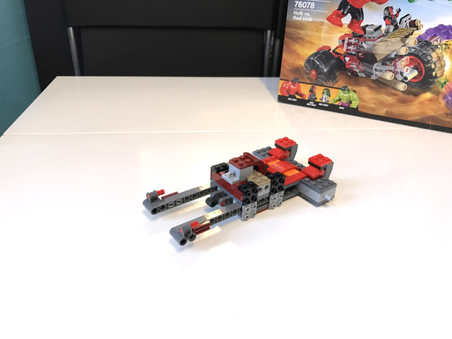](https://www.freelug.org/IMG/jpg/HulkVsRedHulk_19.jpg)

Le sachet 2 va nous permettre d’étoffer et de "décorer" la structure.

[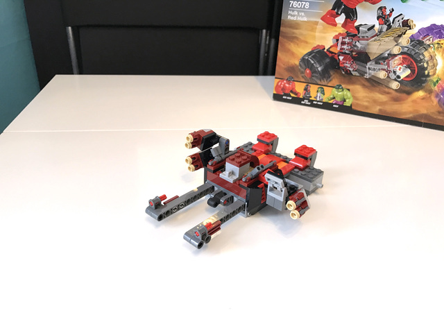](https://www.freelug.org/IMG/jpg/HulkVsRedHulk_20.jpg)

On pose les roues et voici le premier engin terminé.

[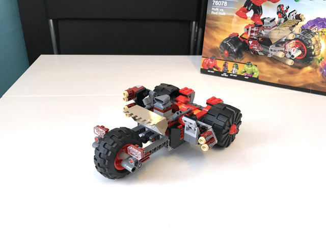](https://www.freelug.org/IMG/jpg/HulkVsRedHulk_21.jpg)

Tout le début de construction du véhicule de _Hulk_ et _She-Hulk_ est une copie du premier. Cela commence à différer après la pose des barres _Technic_, puisque nous aurons ici quatre roues au lieu de trois.

[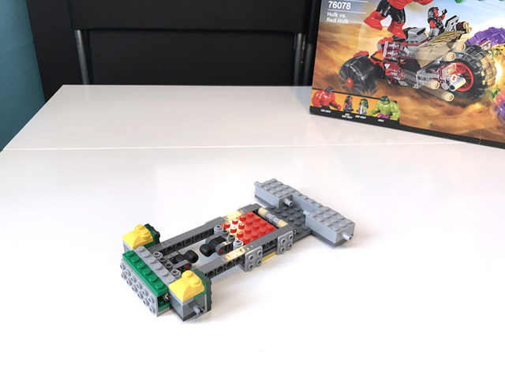](https://www.freelug.org/IMG/jpg/HulkVsRedHulk_22.jpg)

La construction reste quand même très similaire.

[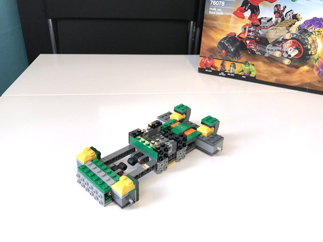](https://www.freelug.org/IMG/jpg/HulkVsRedHulk_23.jpg)

Comme pour le premier véhicule, le sachet 4 nous permet d’habiller le véhicule.

[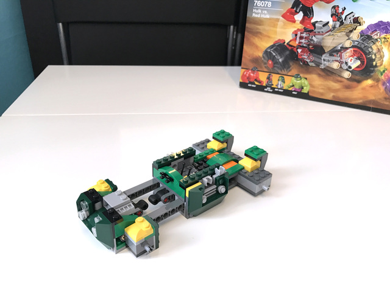](https://www.freelug.org/IMG/jpg/HulkVsRedHulk_24.jpg)

Malgré cela, il reste tout de même très dépouillé.

[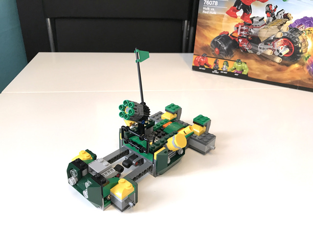](https://www.freelug.org/IMG/jpg/HulkVsRedHulk_25-2.jpg)

Il ne reste plus qu’à fixer les roues.

[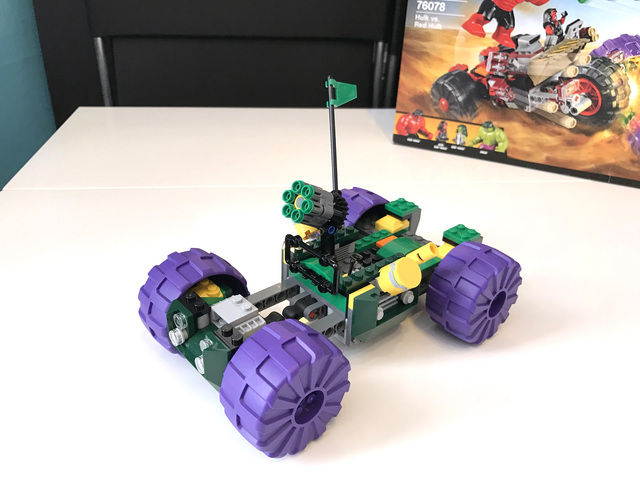](https://www.freelug.org/IMG/jpg/HulkVsRedHulk_26.jpg)

Les véhicules sous divers angles avec leurs personnages :

[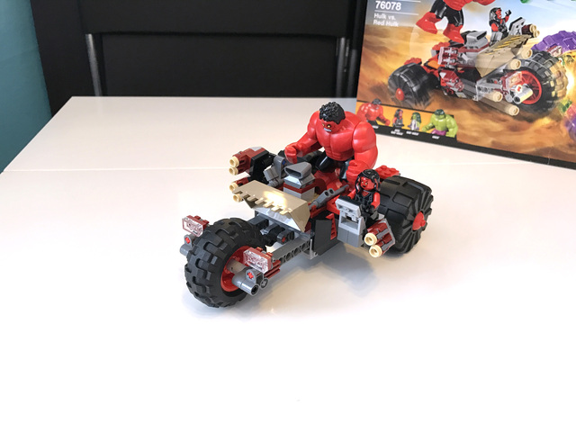](https://www.freelug.org/IMG/jpg/HulkVsRedHulk_27.jpg)

[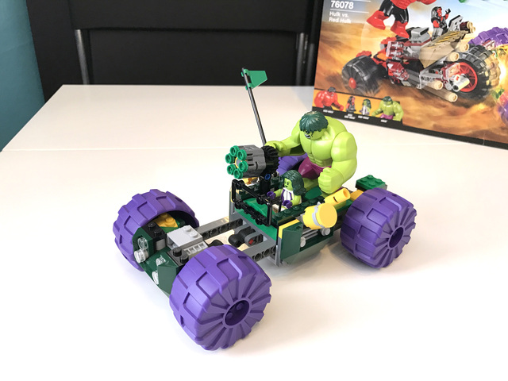](https://www.freelug.org/IMG/jpg/HulkVsRedHulk_28.jpg)

[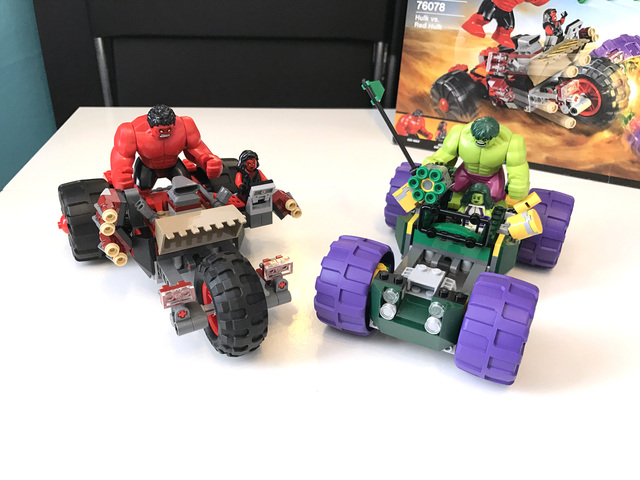](https://www.freelug.org/IMG/jpg/HulkVsRedHulk_29.jpg)

[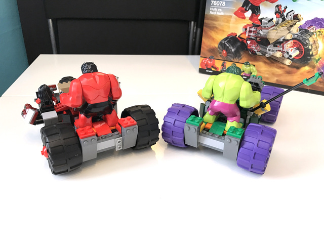](https://www.freelug.org/IMG/jpg/HulkVsRedHulk_30.jpg)

[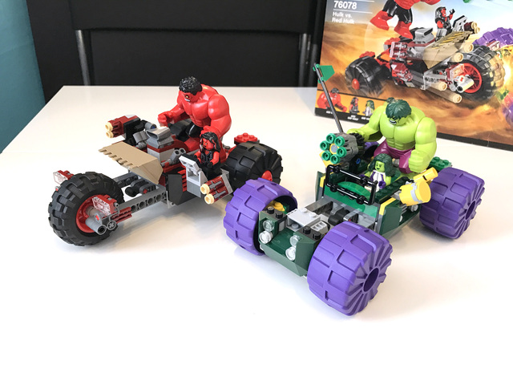](https://www.freelug.org/IMG/jpg/HulkVsRedHulk_31.jpg)

[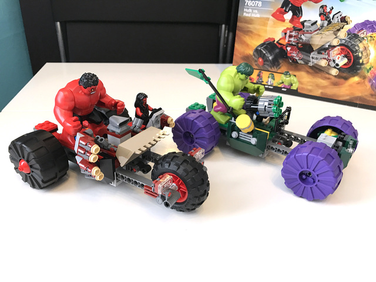](https://www.freelug.org/IMG/jpg/HulkVsRedHulk_32.jpg)

* * *

**AVIS :**

Je suis plus que mitigé sur ce set, il a un indéniable potentiel de jeu pour les enfants qui les lanceront l’un contre l’autre pour éjecter les _Hulk_.  
Néanmoins la construction n’est pas intéressante et au vu de l’esthétique, personne n’aura envie de l’exposer.

Reste les quatre figs exclusives, méritent-elles qu’on débourse 65€ ?  
Les collectionneurs vous diront que oui (je l’ai bien pris juste parce que j’adore le personnage de _Miss Hulk_ et que j’ai craqué sur la minifig). Les autres attendront sagement une bonne promo.

**BONUS :**

Voici un GIF animé réalisé avec la totalité des photos prises pour cette review (cliquez sur l’image pour lancer l’animation).

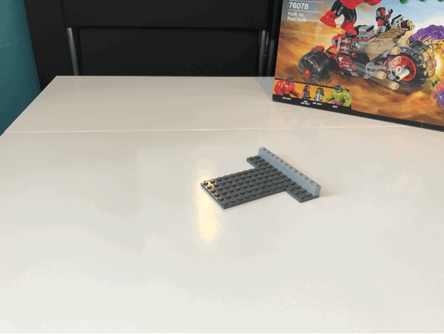
