Partons à la découverte de cette boite avec des dinosaures !

[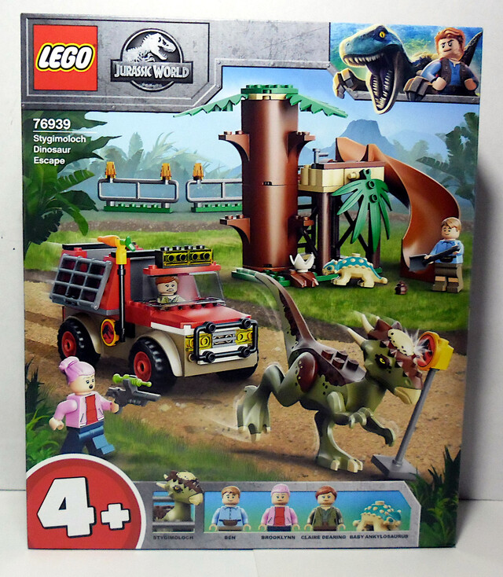](https://www.freelug.org/IMG/jpg/1-14.jpg)

Le set comprend 129 pièces avec trois personnages, un bébé dinosaure et un dinosaure adulte. Pour un prix de 39,99€ soit un rapport prix/pièces de 0,31 Euros, c’est très cher pour un set sous licence. Mais est-il plus jouable que le set de même nom :[75927](/articles/review-lego-75927-l-evasion-du-stygimoloch/) ?  
Une petite vue arrière donne une idée de la jouabilité du set :

[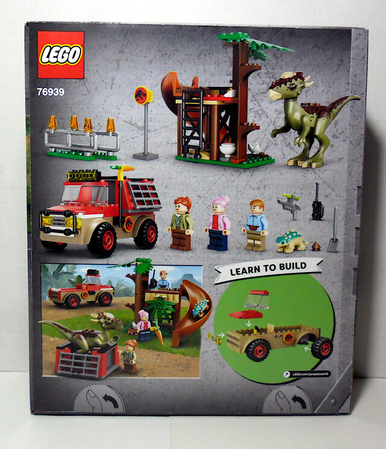](https://www.freelug.org/IMG/jpg/2-11.jpg)

Venons au principal : le contenu de la boite :  
soit 3 sachets de pièces, un gros dinosaure, un toboggan, et le châssis du véhicule

[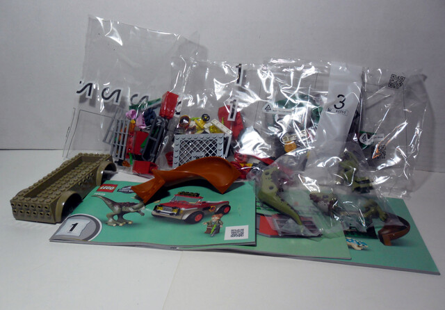](https://www.freelug.org/IMG/jpg/3-11.jpg)

Nous avons en personnage : déjà Claire Dearing :

[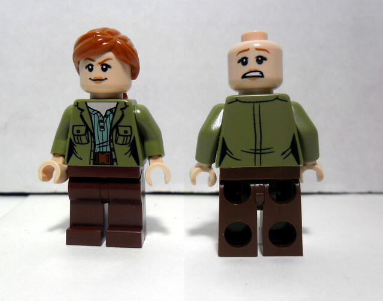](https://www.freelug.org/IMG/jpg/4-10.jpg)

Puis deux personnages de la série Netflix : Brooklynn :

[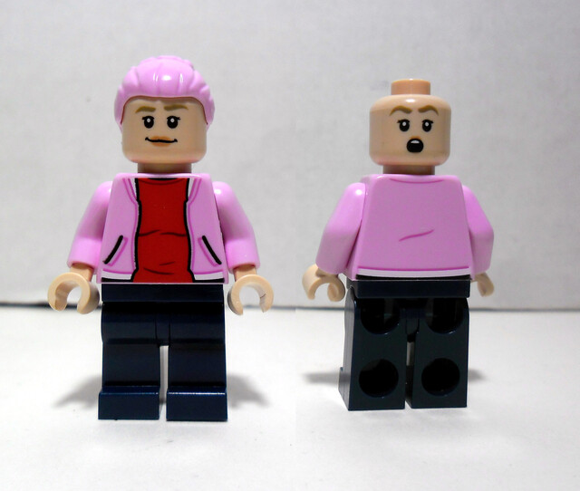](https://www.freelug.org/IMG/jpg/5-6.jpg)

Puis Ben :

[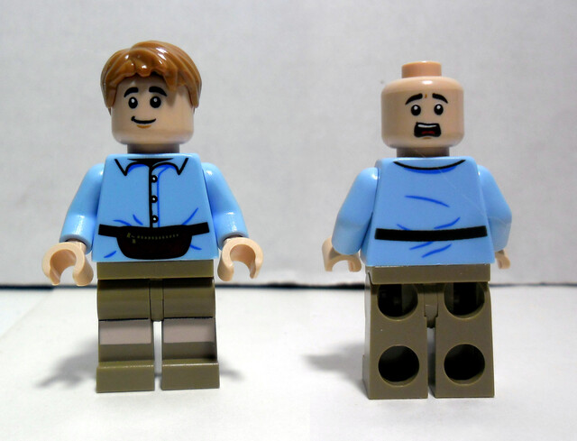](https://www.freelug.org/IMG/jpg/6-4.jpg)

Accompagné par le bébé Ankylosaure : « Bumpy »

[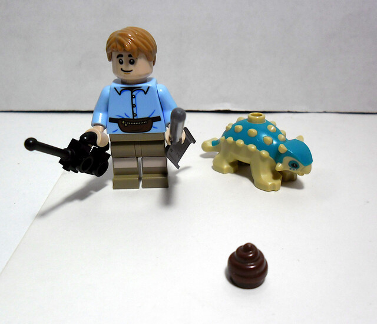](https://www.freelug.org/IMG/jpg/7-4.jpg)

Et finissons avec le fameux Repeint : Stygimoloch :

[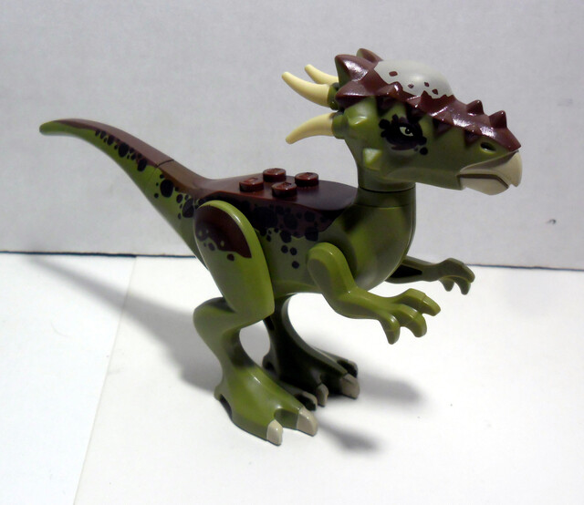](https://www.freelug.org/IMG/jpg/8-5.jpg)

Le reste des constructions est assez sommaire :  
Un véhicule :

[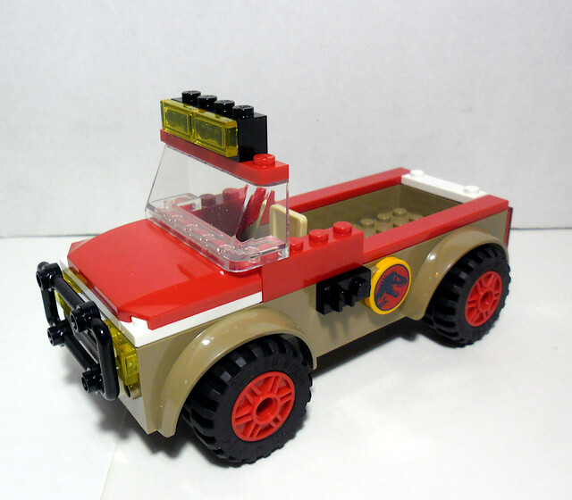](https://www.freelug.org/IMG/jpg/9.jpg)

Divers accessoires (cage, barrière, panneau)

[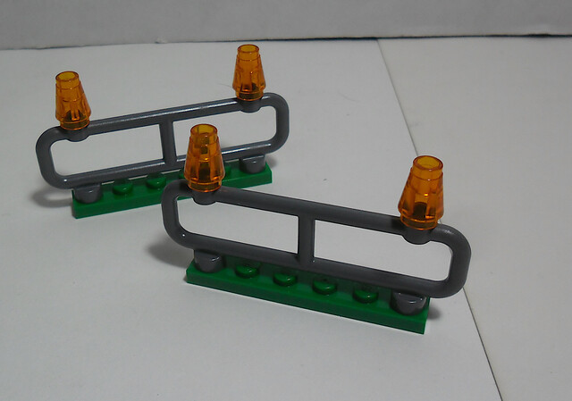](https://www.freelug.org/IMG/jpg/sam_3927.jpg)

[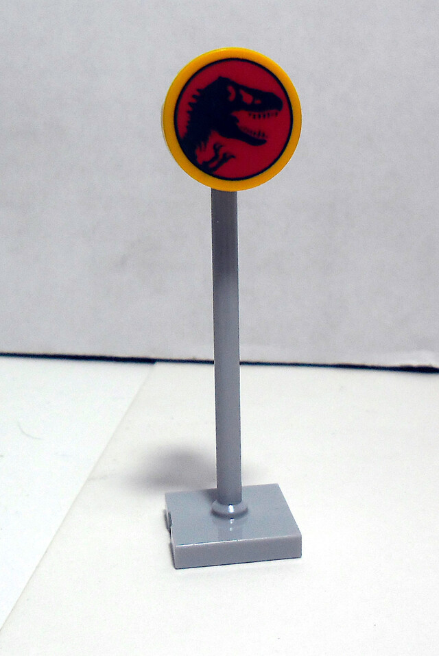](https://www.freelug.org/IMG/jpg/sam_3932.jpg)

[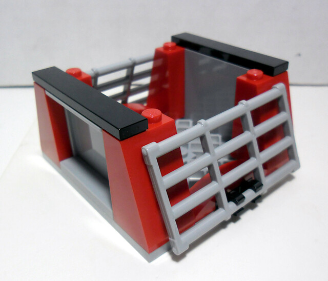](https://www.freelug.org/IMG/jpg/10-5.jpg)

Et pour finir une petite construction avec Toboggan :

[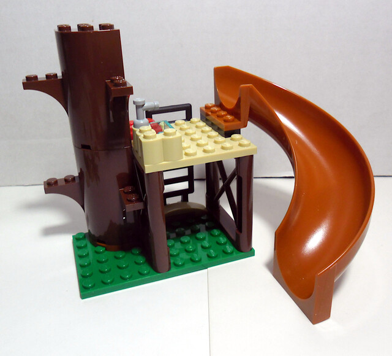](https://www.freelug.org/IMG/jpg/sam_3933.jpg)

[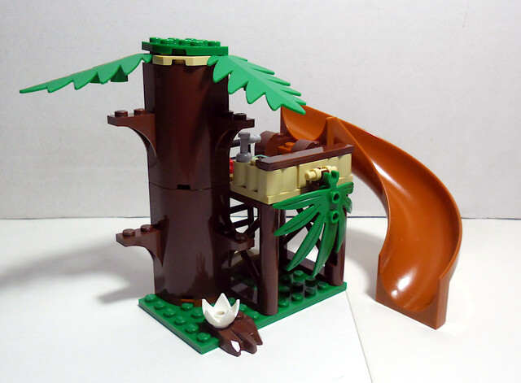](https://www.freelug.org/IMG/jpg/sam_3934.jpg)

Voilà fini, une petite photo de famille !

[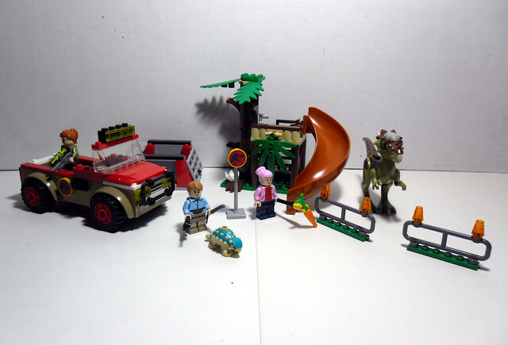](https://www.freelug.org/IMG/jpg/sam_3936.jpg)

**Conclusion**

Alors achat ou pas ? Pour moi ça dépend. La comparaison en nombre de pièces donne le set 75927 bien plus attractif. Mais en personnage et jouabilité, la comparaison s’inverse. Remarque pour avoir le stigymoloch, c’est soit l’un soit l’autre donc…  
Donc chacun choisit, mais pour moi la jouabilité est meilleure ici, même si les constructions sont très simplifiées.
