Partons à la découverte de cette boite avec un gros squelette de dinosaure !

[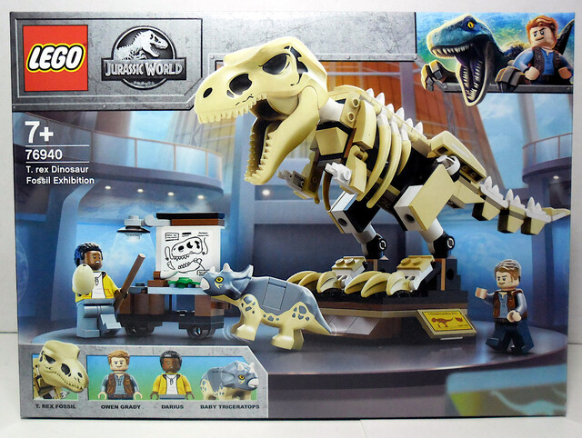](https://www.freelug.org/IMG/jpg/sam_3738.jpg)

Le set comprend 198 pièces avec deux personnages, un gros squelette et un petit dinosaure. Pour un prix de 29,99 € soit un rapport prix/pièces de 0,151 euros, c’est à priori un peu cher, mais est-ce que le le gros dinosaures rattrape le tout ? Nous allons vite voir.

Une petite vue arrière donne une idée de la jouabilité du set :

[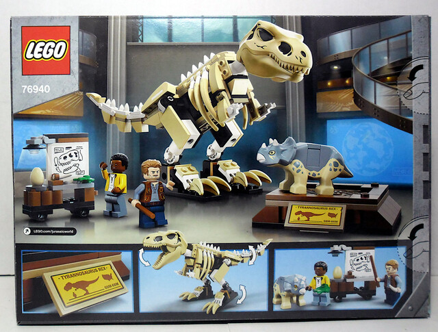](https://www.freelug.org/IMG/jpg/sam_3739.jpg)

Une petite planche de sticker :

[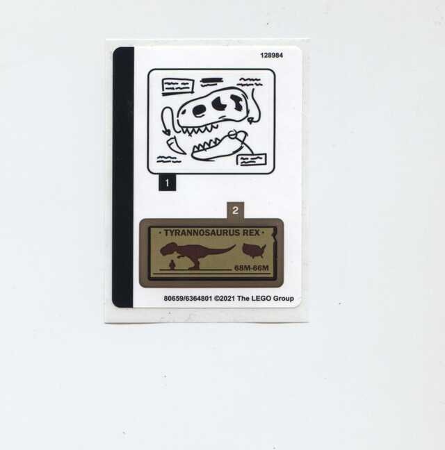](https://www.freelug.org/IMG/jpg/sam_3741.jpg)

Passons au petit dinosaure, un repeint du bébé Triceratops

[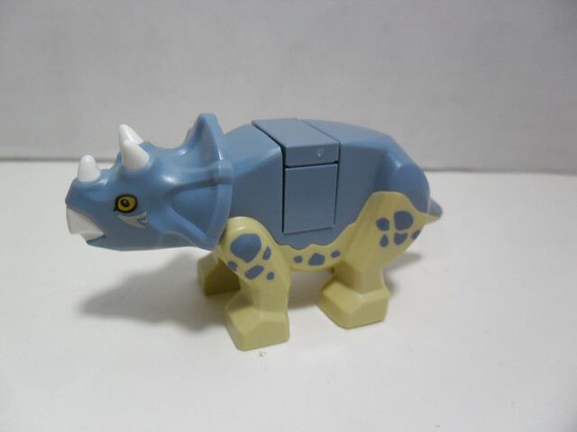](https://www.freelug.org/IMG/jpg/sam_3745.jpg)

Puis aux deux personnages  
Nous avons pour commencer Owen Grady :

[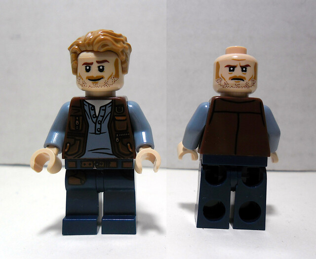](https://www.freelug.org/IMG/jpg/sam_3746.jpg)

Puis un personnage de la série Netflix, Darius :

[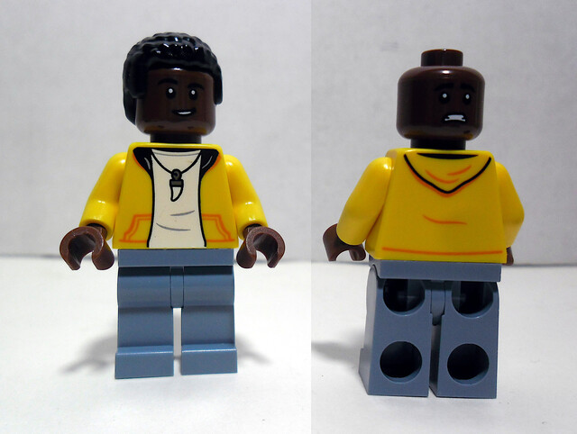](https://www.freelug.org/IMG/jpg/sam_3759.jpg)

Maintenant les constructions :  
Un petit présentoir :  
On remarquera un très beau sticker d’illustration d’un fossile.

[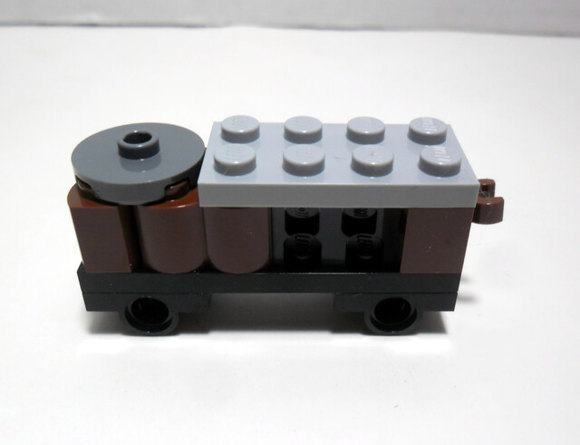](https://www.freelug.org/IMG/jpg/sam_3748.jpg)

[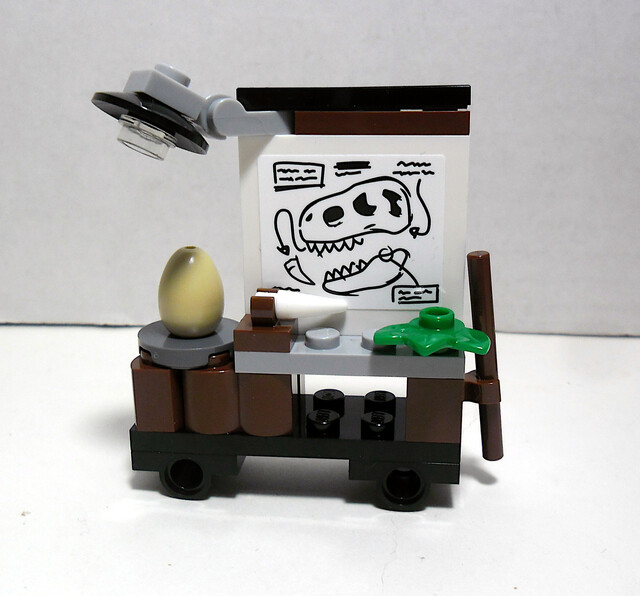](https://www.freelug.org/IMG/jpg/sam_3750.jpg)

Et maintenant voici le socle de présentation du squelette :

[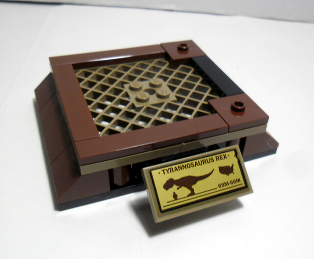](https://www.freelug.org/IMG/jpg/sam_3751.jpg)

Et le bouquet final ; le fameux squelette de T-Rex :

[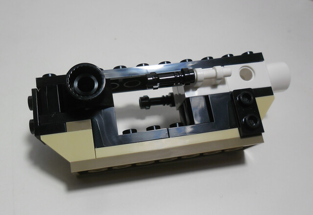](https://www.freelug.org/IMG/jpg/sam_3754.jpg)

[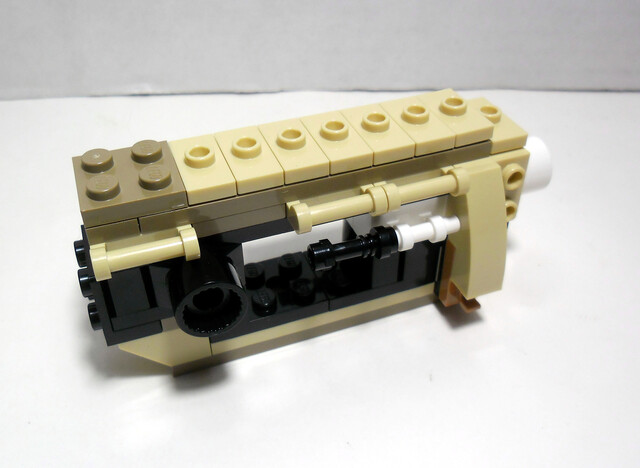](https://www.freelug.org/IMG/jpg/sam_3755.jpg)

[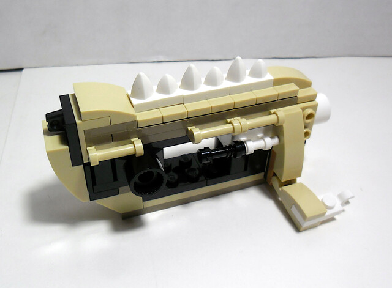](https://www.freelug.org/IMG/jpg/sam_3756.jpg)

[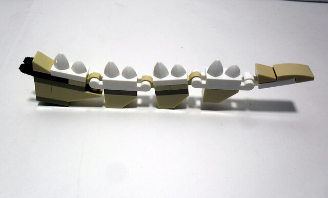](https://www.freelug.org/IMG/jpg/sam_3762.jpg)

[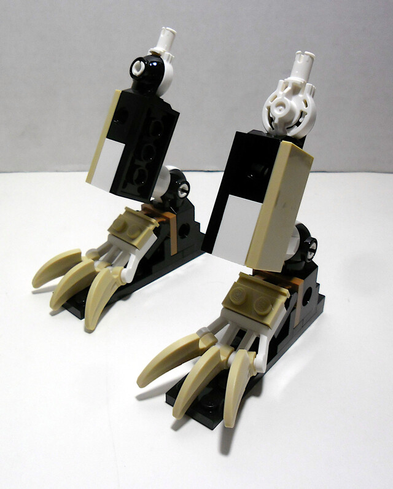](https://www.freelug.org/IMG/jpg/sam_3764.jpg)

[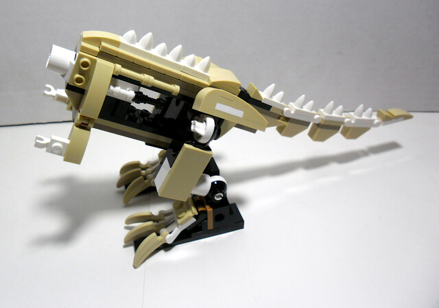](https://www.freelug.org/IMG/jpg/sam_3766.jpg)

[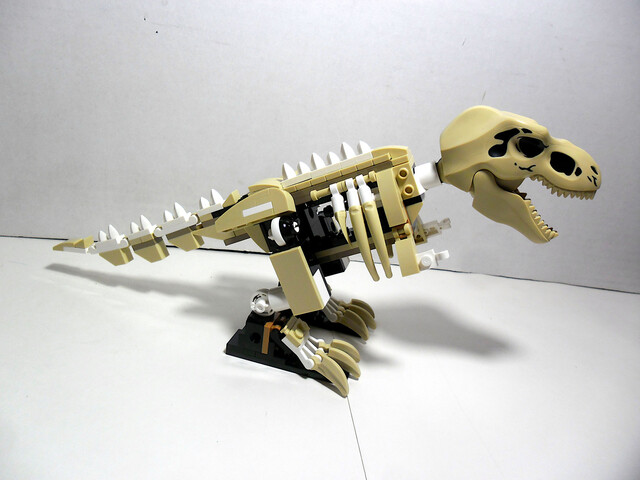](https://www.freelug.org/IMG/jpg/sam_3768.jpg)

Voilà fini, une petite photo de famille !

[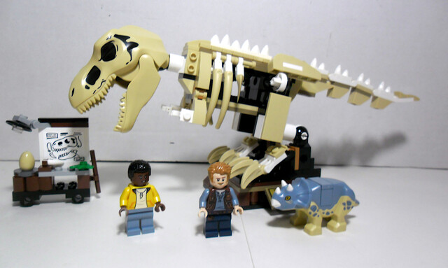](https://www.freelug.org/IMG/jpg/sam_3770.jpg)

Et pour terminer les extra parts :

[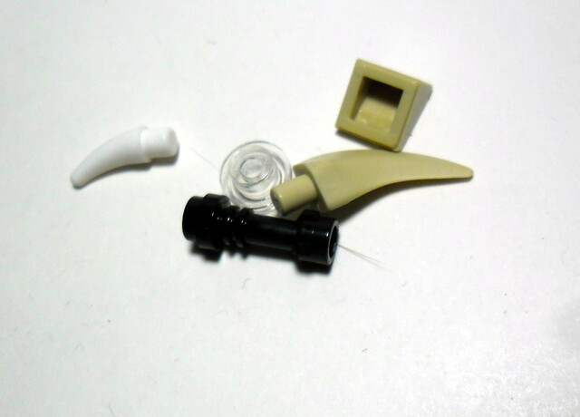](https://www.freelug.org/IMG/jpg/sam_3772.jpg)

**Conclusion**

Alors achat ou pas ? Pour moi oui sans hésiter. C’est déjà celui qui a le plus de contenu par rapport au prix. Ensuite, le squelette est très réussi. Pour moi c’est le plus réussi de cette nouvelle vague.  
En revanche, côté jouabilité, c’est ici pas le but. Donc pour adulte !
