Aujourd’hui je vous propose la review du set 7956 dans la gamme _Star Wars_ : **Ewok Attack**.  
Ce set sorti en 2011 au prix de 29,99 € est composé de 166 pièces, soit un ratio prix/pièce de 18 centimes d’euros.

[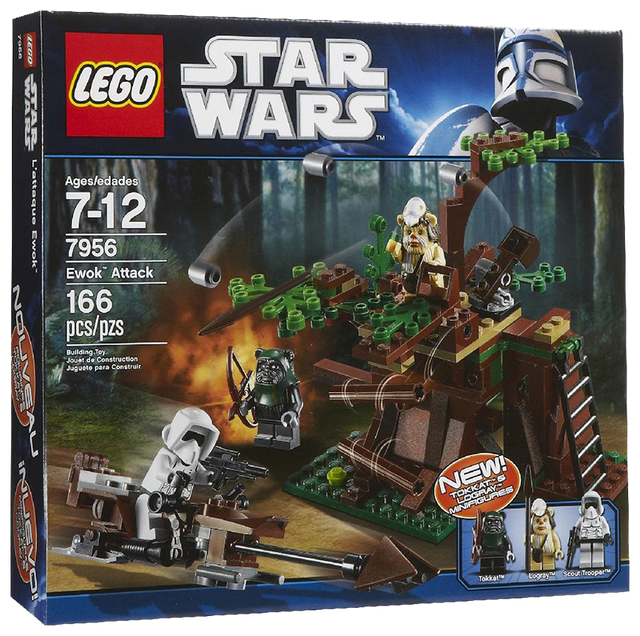](https://www.freelug.org/IMG/png/EwokAttack_box_mini.png)

Les sets de la trilogie originale traitant de _Tatooine_, de _Hoth_ ou comme ici d’_Endor_ sont plutôt prisés des collectionneurs, voyons si ce set à 30 euros vaut la peine d’être possédé.

* * *

Le visuel de la boite reprend une scène du film _Le Retour du Jedi_. Le bandeau du haut est constitué des logos LEGO et _Star Wars_ et d’un _Clone Trooper_ (comme toute la gamme sortie en 2011).  
Le contenu du set est intégré dans le décor de la forêt d’_Endor_.

[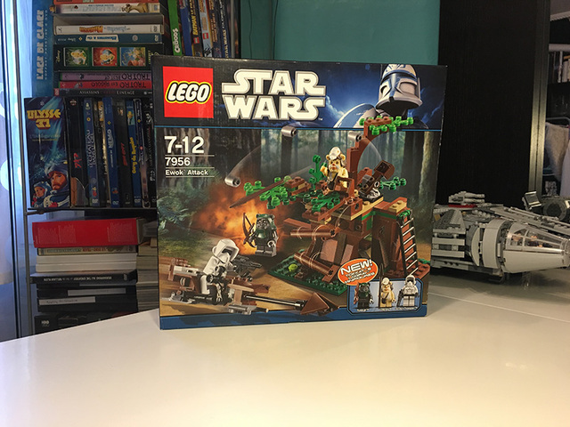](https://www.freelug.org/IMG/jpg/EwokAttack_00_mini.jpg)

Au verso plusieurs vignettes avec les éléments de jouabilité du set. Sont présentés sur la gauche trois autres sets sortis en 2011 ainsi qu’une pub pour le jeu vidéo _LEGO Star Wars III_.

[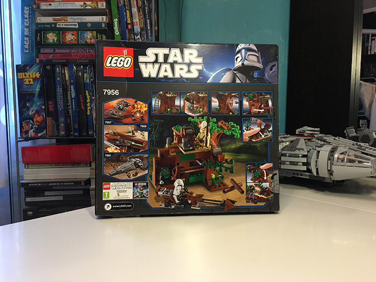](https://www.freelug.org/IMG/jpg/EwokAttack_01_mini.jpg)

Une fois ouvert, le set contient quatre sachets et une notice de construction.

[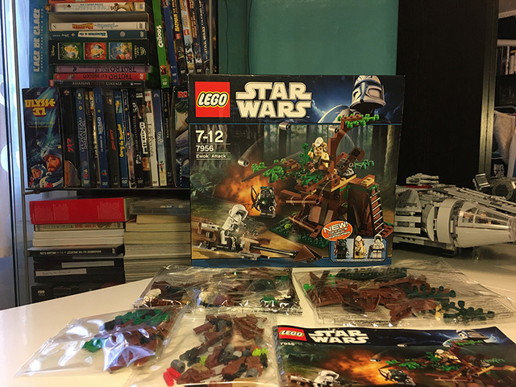](https://www.freelug.org/IMG/jpg/EwokAttack_02_mini.jpg)

La minifig du [_Scout Trooper_](http://brickset.com/minifigs/sw005a/Scout-Trooper-\(Black-Head-Dark-Bluish-Gray-Torso-Pattern\)) est plutôt simple même si la sérigraphie est de bonne facture.  
On voit bien ici le fossé qui sépare les sérigraphies de 2011 et celles des derniers sets de 2016.

[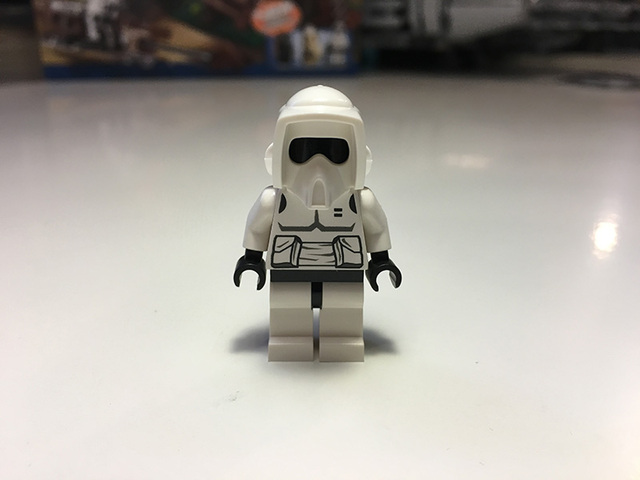](https://www.freelug.org/IMG/jpg/EwokAttack_03_mini.jpg)

Service plus que minimum pour la tête puisque aucune sérigraphie n’est présente.

[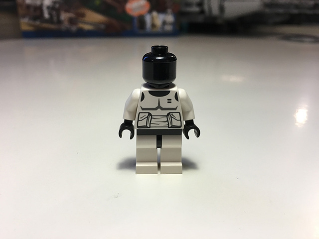](https://www.freelug.org/IMG/jpg/EwokAttack_04_mini.jpg)

Même combat pour le dos où aucune sérigraphie ne vient agrémenter le torso.

[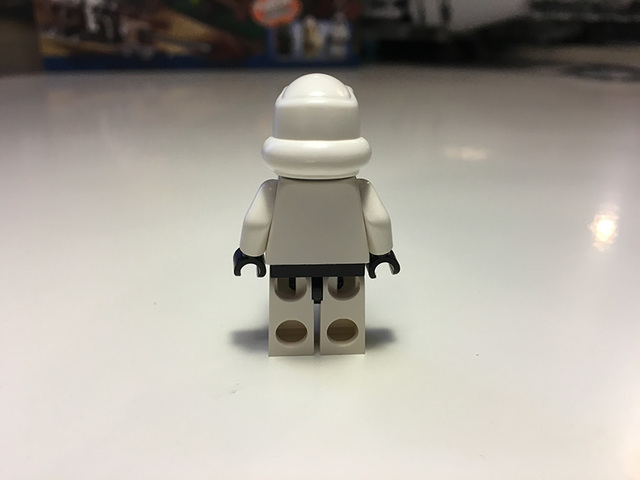](https://www.freelug.org/IMG/jpg/EwokAttack_05_mini.jpg)

[_Logrey_](http://brickset.com/minifigs/sw338/Logray-\(Ewok\)) le petit _Ewok_ est bien réalisé pour l’époque avec cinq couleurs sérigraphiées (blanc, noir, rose, marron et gris).

[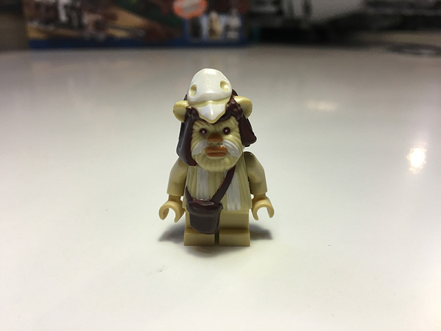](https://www.freelug.org/IMG/jpg/EwokAttack_06_mini.jpg)

De dos on peut apercevoir la cinquième couleur sur la droite.

[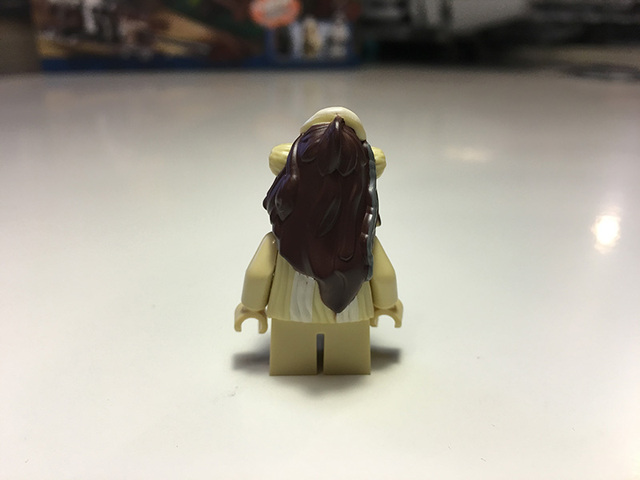](https://www.freelug.org/IMG/jpg/EwokAttack_07_mini.jpg)

Enfin nous découvrons [_Tokkat_](http://brickset.com/minifigs/sw339/Tokkat-\(Ewok\)), seule figurine exclusive à ce set.

[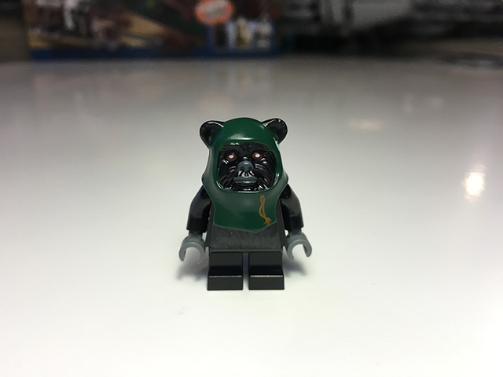](https://www.freelug.org/IMG/jpg/EwokAttack_08_mini.jpg)

De dos c’est encore le minimum syndical.

[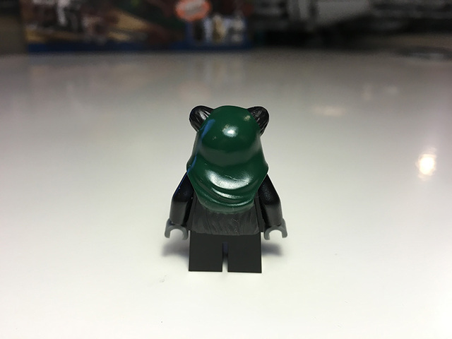](https://www.freelug.org/IMG/jpg/EwokAttack_09_mini.jpg)

On commence par construire la _Speeder Bike_.

[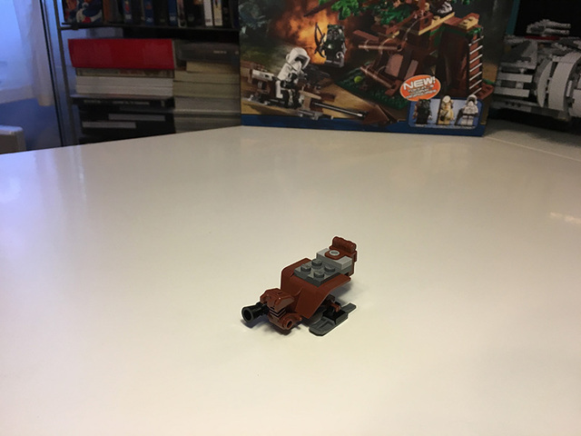](https://www.freelug.org/IMG/jpg/EwokAttack_10_mini.jpg)

Le _Scout Trooper_ prend place sur sa monture.

[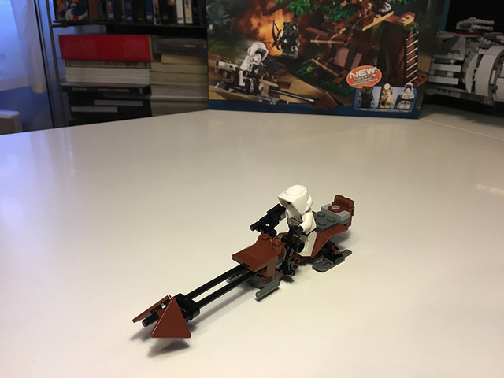](https://www.freelug.org/IMG/jpg/EwokAttack_11_mini.jpg)

Puis on attaque le montage de l’arbre des _Ewok_.

[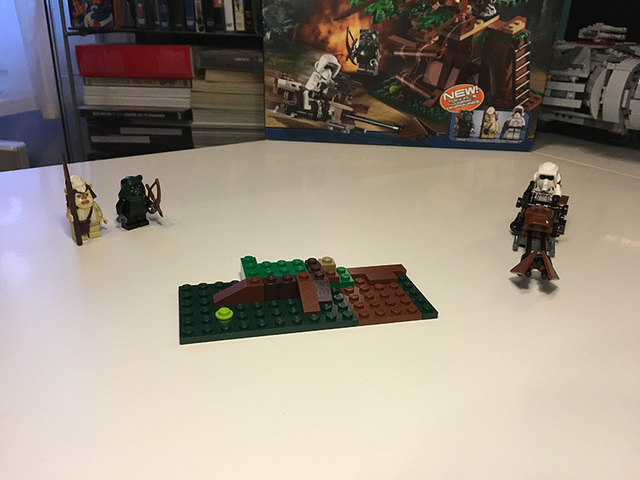](https://www.freelug.org/IMG/jpg/EwokAttack_12_mini.jpg)

Un petit tour au dos de la construction.

[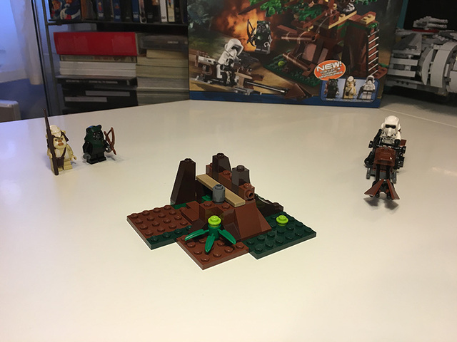](https://www.freelug.org/IMG/jpg/EwokAttack_13_mini.jpg)

Le montage est plutôt simple.

[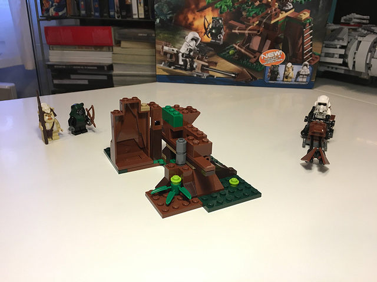](https://www.freelug.org/IMG/jpg/EwokAttack_14_mini.jpg)

Malgré cela, l’arbre prend forme de belle manière.

[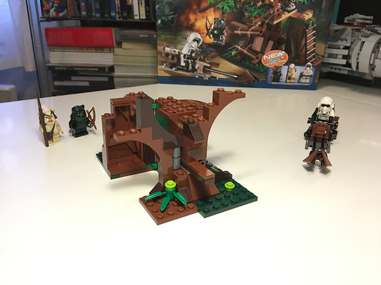](https://www.freelug.org/IMG/jpg/EwokAttack_15_mini.jpg)

Surtout une fois le feuillage mis en place.

[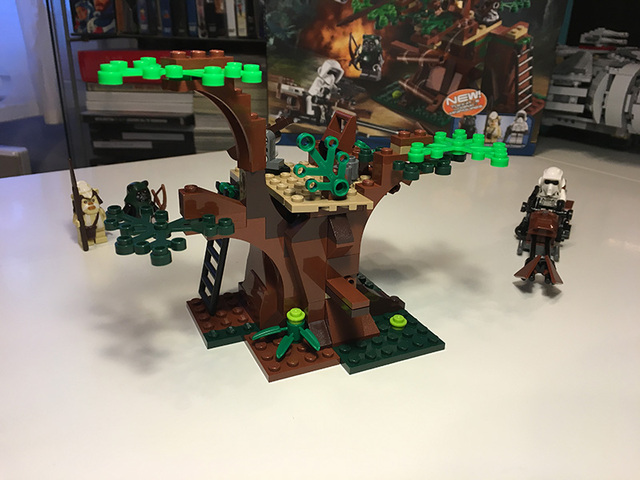](https://www.freelug.org/IMG/jpg/EwokAttack_16_mini.jpg)

[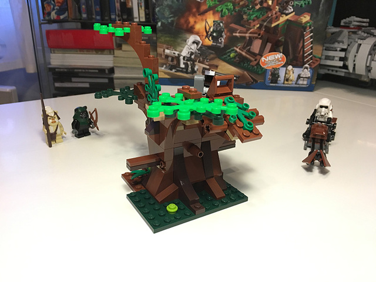](https://www.freelug.org/IMG/jpg/EwokAttack_17_mini.jpg)

[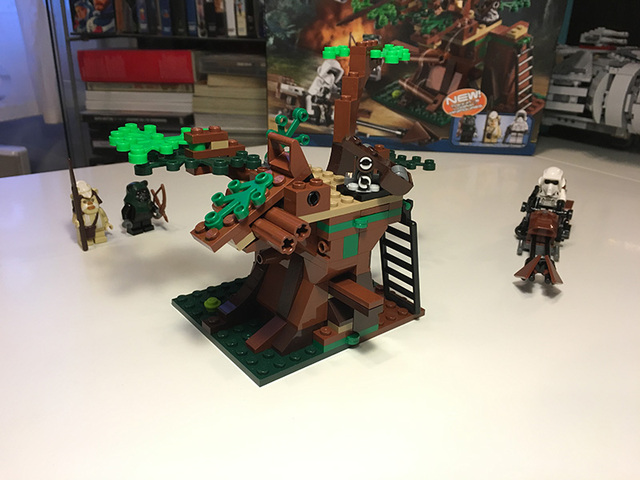](https://www.freelug.org/IMG/jpg/EwokAttack_18_mini.jpg)

[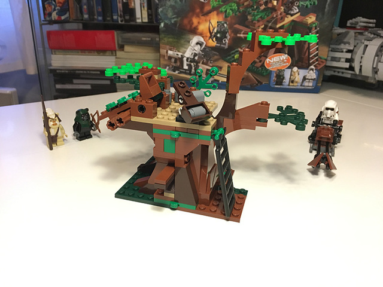](https://www.freelug.org/IMG/jpg/EwokAttack_19_mini.jpg)

[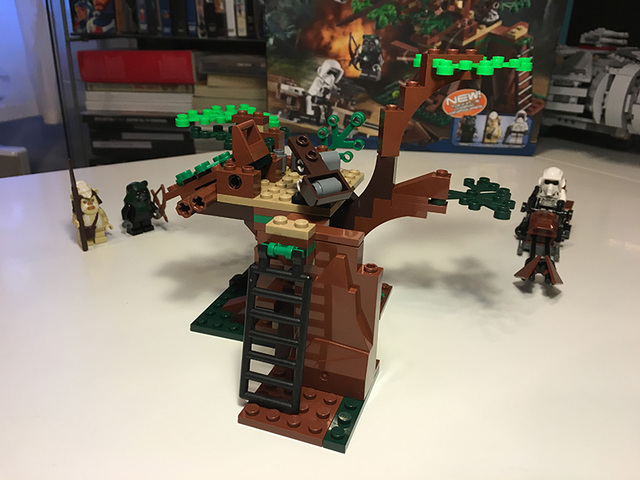](https://www.freelug.org/IMG/jpg/EwokAttack_20_mini.jpg)

[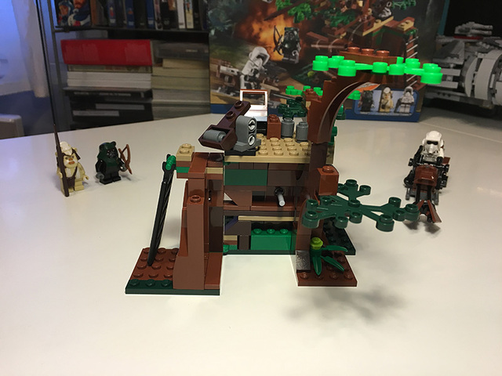](https://www.freelug.org/IMG/jpg/EwokAttack_21_mini.jpg)

[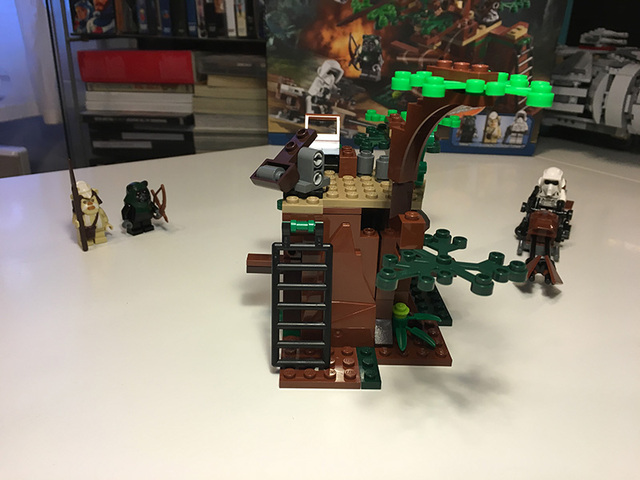](https://www.freelug.org/IMG/jpg/EwokAttack_22_mini.jpg)

Voici un petit GIF des quelques options de jouabilité du set (cliquez pour lancer l’animation).

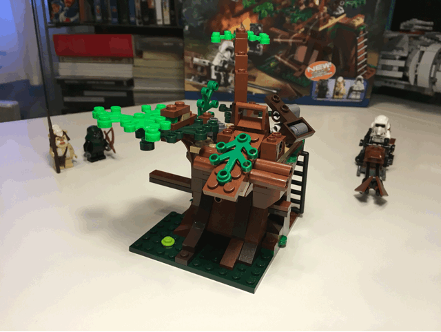

**AVIS :**

Au final ce petit set est vraiment sympa, je suis bien content de l’avoir trouvé il y a peu car il devient de plus en plus rare. De plus pour ceux qui ont la chance de posséder l’_UCS Ewok Village_ ou le set _The Batle of Endor_, il agrémentera ces derniers à merveille.

**BONUS :**

Voici un GIF animé réalisé avec la totalité des photos prises pour cette review (cliquez pour lancer l’animation).

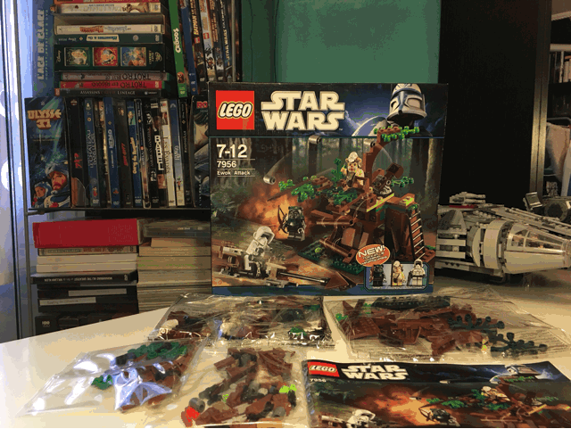
