Aujourd’hui, je vous propose la review du set 7957 dans la gamme _Star Wars_ : **Sith Nightspeeder**.  
Ce set, sorti en 2011 au prix de 29,99 euros, est composé de 213 pièces, soit un ratio prix/pièce de 14 centimes d’euro.

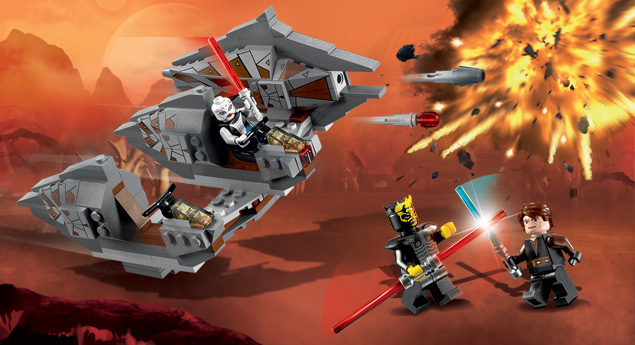

* * *

Le contenu du set est intégré dans le décor ressemblant à une planète désertique. Le bandeau du haut est constitué des logos _LEGO_ et _Star Wars_ et du casque de _Clone Trooper_ de la _501ST_ (comme tous les sets _Star Wars_ fournée 2011).

[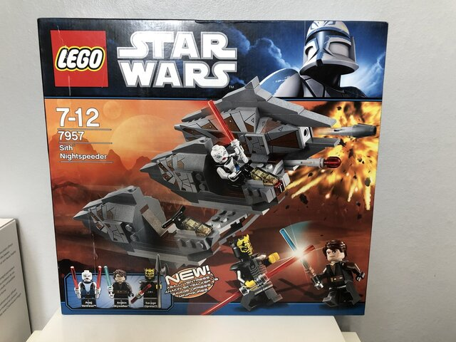](https://www.freelug.org/IMG/jpg/sithnightspeeder_01-r180.jpg)

Au verso, plusieurs vignettes contenant éléments de jouabilité du set ainsi que d’autres sets sortis en 2011 (_[7956](https://brickset.com/sets/7956-1/Ewok-Attack)_, _[7959](https://brickset.com/sets/7959-1/Geonosian-Starfighter)_ et _[7961](https://brickset.com/sets/7961-1/Darth-Maul-s-Sith-Infiltrator)_).

[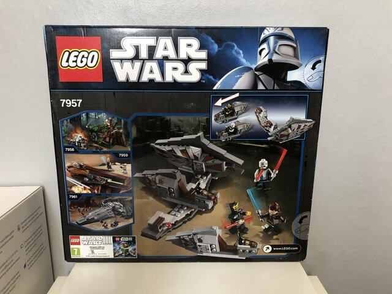](https://www.freelug.org/IMG/jpg/sithnightspeeder_02-r180.jpg)

Une fois ouvert, le set contient trois sachets, une planche de stickers et une notice de construction.

[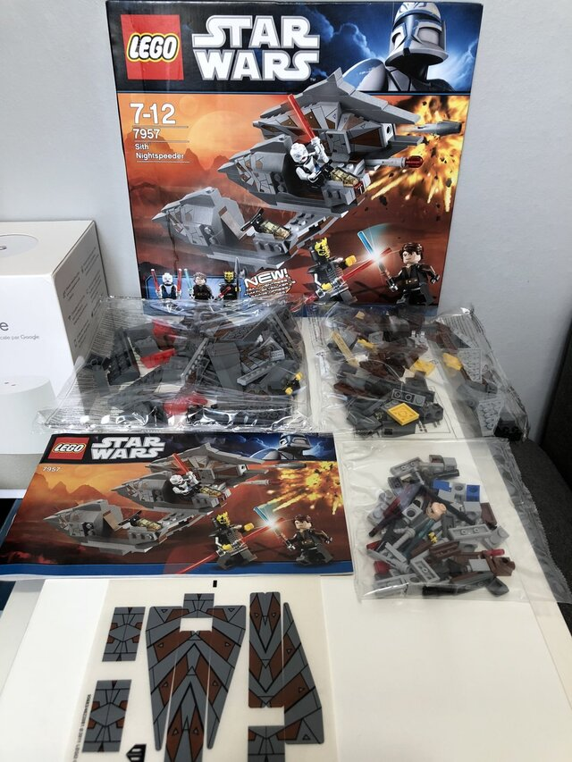](https://www.freelug.org/IMG/jpg/sithnightspeeder_03-r90.jpg)

* * *

_[Savage Opress](https://brickset.com/minifigs/sw316/savage-opress)_ est une très belle figurine. Les sérigraphies du visage et du torso sont précises et détaillées. Dommage que les jaunes des cornes, du visage et du torso n’aient pas la même teinte.

**Il est à noter que ces trois figs sont exclusives à ce set**.

[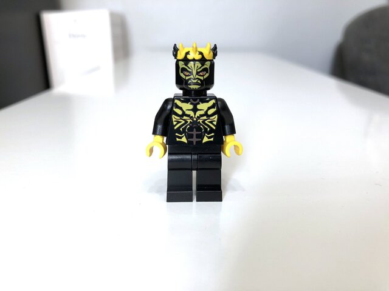](https://www.freelug.org/IMG/jpg/sithnightspeeder_04.jpg)

Le dos est plus dépouillé.

[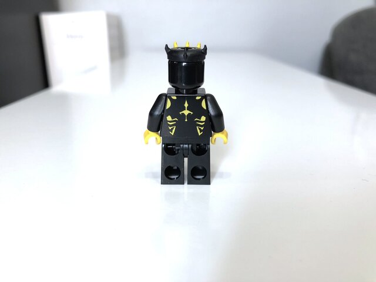](https://www.freelug.org/IMG/jpg/sithnightspeeder_05.jpg)

_Savage Opress_ avec son armure.

[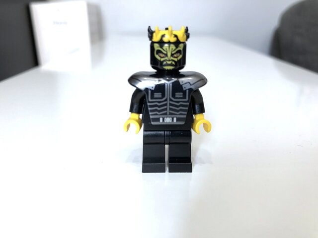](https://www.freelug.org/IMG/jpg/sithnightspeeder_06.jpg)

[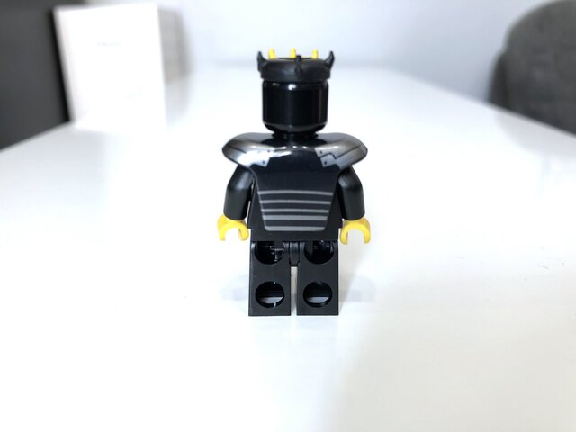](https://www.freelug.org/IMG/jpg/sithnightspeeder_07.jpg)

_[Anakin Skywalker (Clone War)](https://brickset.com/minifigs/sw317/anakin-skywalker-\(clone-wars-7957\))_ est un _Jedi_ comme tant d’autres niveau réalisation, une ceinture, une pochette, quelques plis pour les vêtements…

[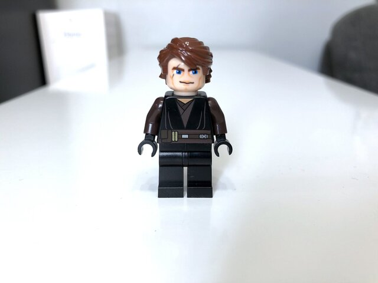](https://www.freelug.org/IMG/jpg/sithnightspeeder_08.jpg)

Le verso est à l’image du recto, c’est propre mais rien de transcendant. Pas de visage alternatif.

[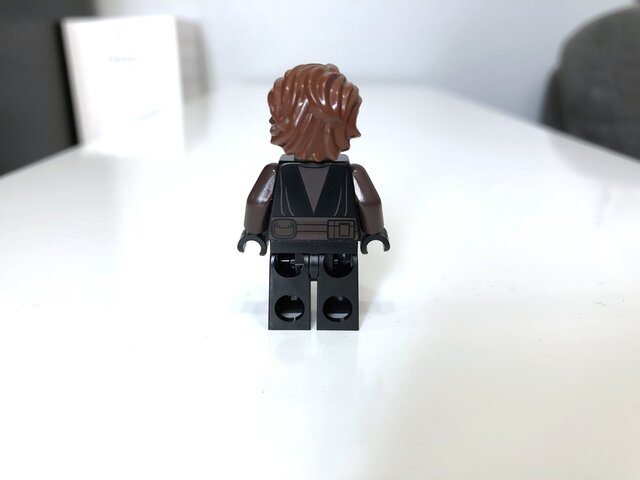](https://www.freelug.org/IMG/jpg/sithnightspeeder_09.jpg)

_[Asajj Ventress](https://brickset.com/minifigs/sw318/asajj-ventress-black-torso)_ est une très jolie figurine, la seule de ce set à avoir des jambes sérigraphiées. Le visage est magnifique, dommage que l’alignement de la boucle de ceinture soit raté entre le torso et les jambes.

[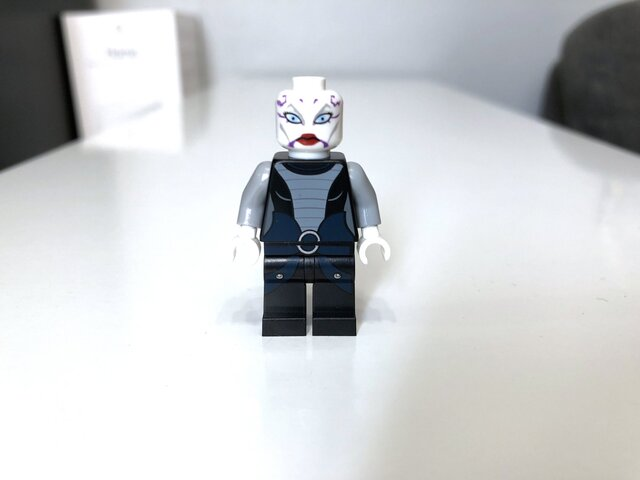](https://www.freelug.org/IMG/jpg/sithnightspeeder_10.jpg)

Le dos est lui aussi réussi, surtout l’arrière de la tête.

[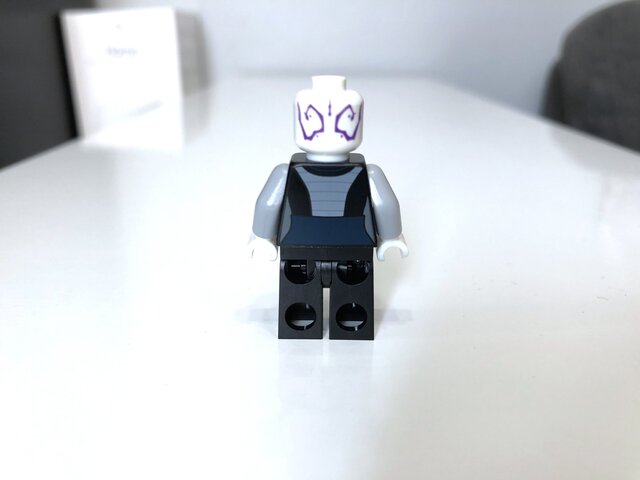](https://www.freelug.org/IMG/jpg/sithnightspeeder_11.jpg)

Les trois minifigs de ce set avec leurs armes, une très belle brochette de personnages.

[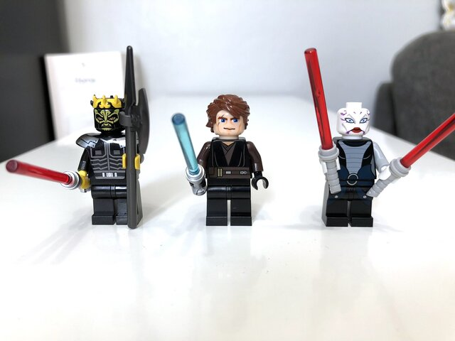](https://www.freelug.org/IMG/jpg/sithnightspeeder_12.jpg)

* * *

On commence la construction du _Sith Nightspeeder_ par les modules détachables.

[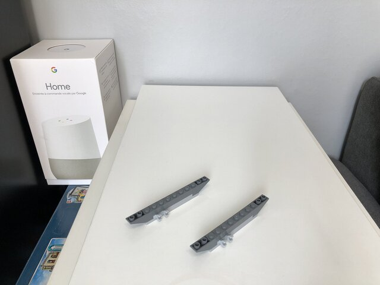](https://www.freelug.org/IMG/jpg/sithnightspeeder_13.jpg)

La construction est rapide mais pas inintéressante.

[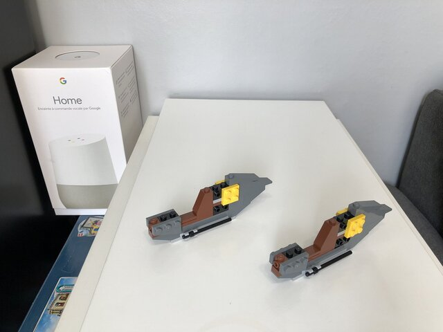](https://www.freelug.org/IMG/jpg/sithnightspeeder_15.jpg)

[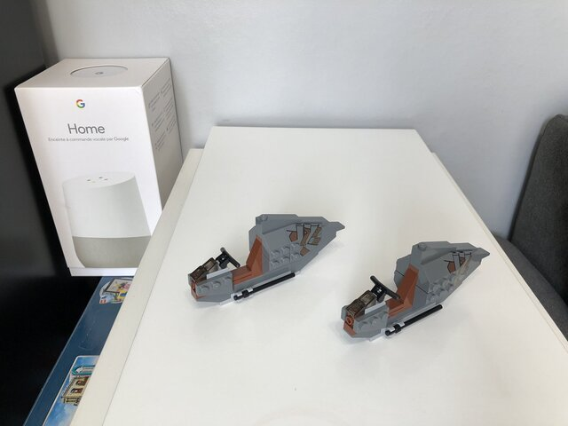](https://www.freelug.org/IMG/jpg/sithnightspeeder_16.jpg)

On passe maintenant au montage de la plateforme du véhicule.

[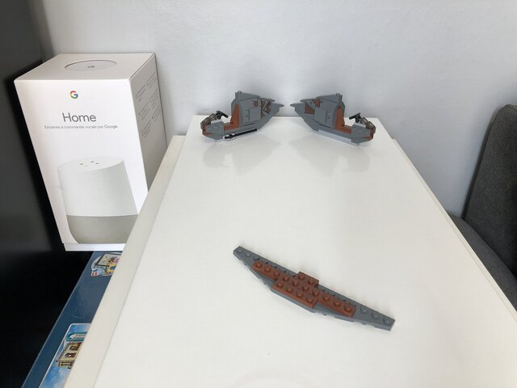](https://www.freelug.org/IMG/jpg/sithnightspeeder_17.jpg)

[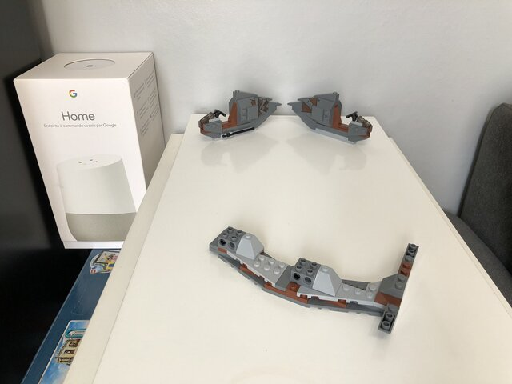](https://www.freelug.org/IMG/jpg/sithnightspeeder_18.jpg)

Ingénieux système permettant de lancer le missile clic.

[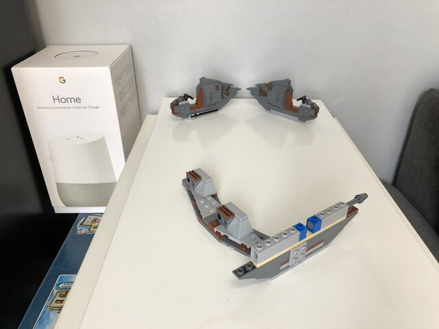](https://www.freelug.org/IMG/jpg/sithnightspeeder_19.jpg)

Le vaisseau commence à prendre forme.

[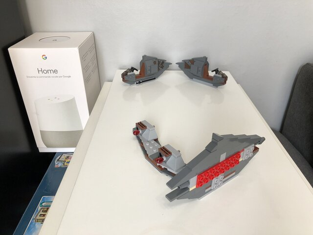](https://www.freelug.org/IMG/jpg/sithnightspeeder_20.jpg)

On habille l’intérieur.

[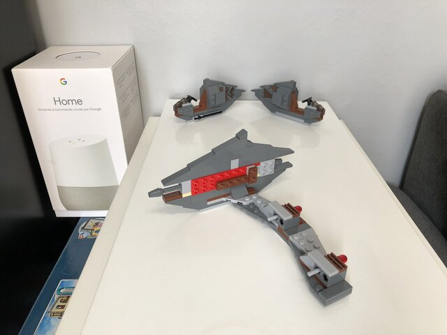](https://www.freelug.org/IMG/jpg/sithnightspeeder_21.jpg)

[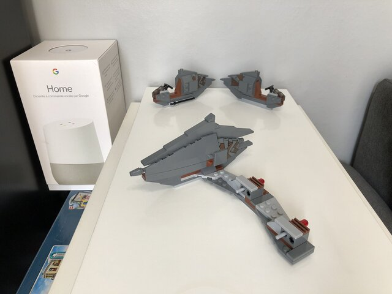](https://www.freelug.org/IMG/jpg/sithnightspeeder_22.jpg)

Puis l’extérieur.

[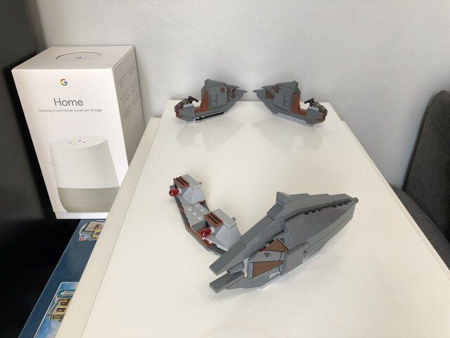](https://www.freelug.org/IMG/jpg/sithnightspeeder_23.jpg)

Finalisation du vaisseau en incorporant les modules détachables.

[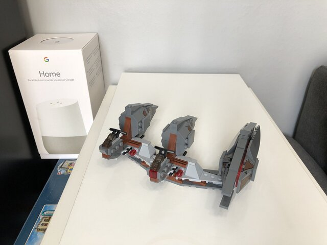](https://www.freelug.org/IMG/jpg/sithnightspeeder_24.jpg)

Mise en situation avec les minifigs du set.

[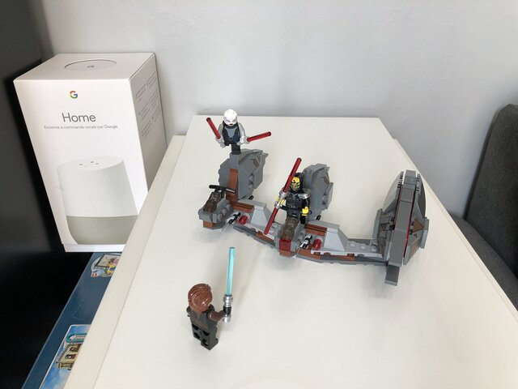](https://www.freelug.org/IMG/jpg/sithnightspeeder_37.jpg)

Photos du véhicule sous plusieurs angles de vue.

[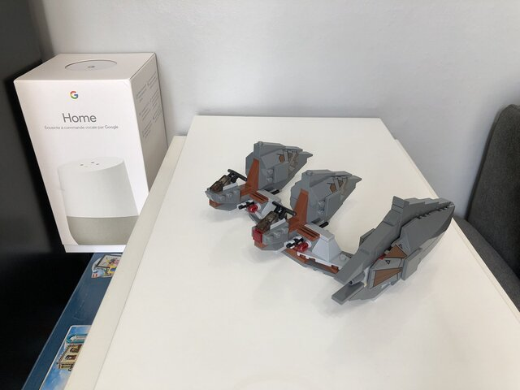](https://www.freelug.org/IMG/jpg/sithnightspeeder_25.jpg)

[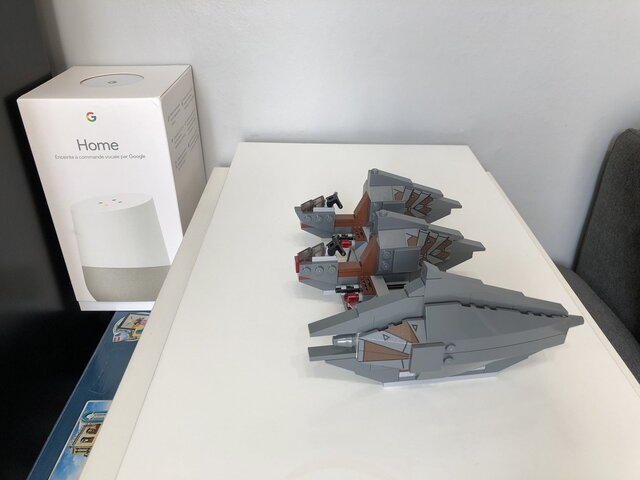](https://www.freelug.org/IMG/jpg/sithnightspeeder_26.jpg)

[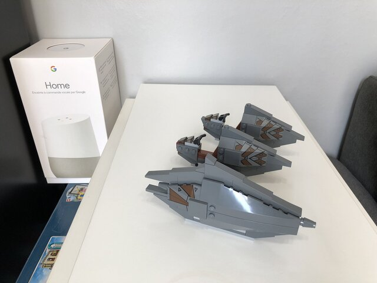](https://www.freelug.org/IMG/jpg/sithnightspeeder_27.jpg)

[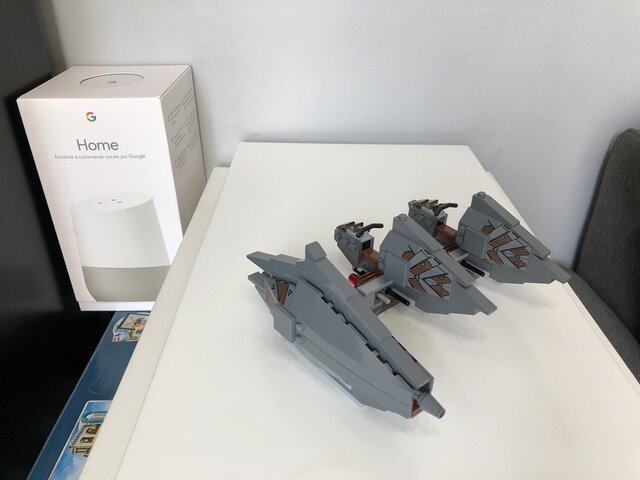](https://www.freelug.org/IMG/jpg/sithnightspeeder_28.jpg)

[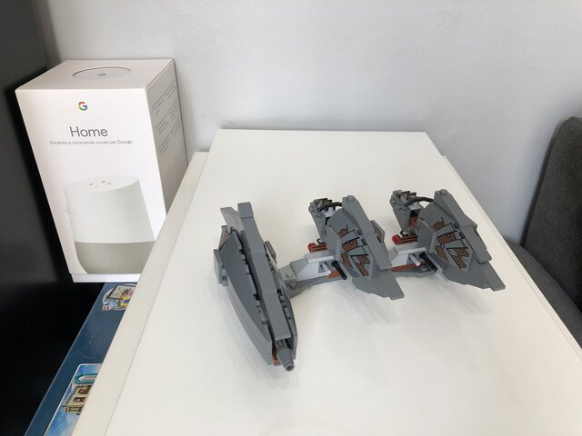](https://www.freelug.org/IMG/jpg/sithnightspeeder_29.jpg)

[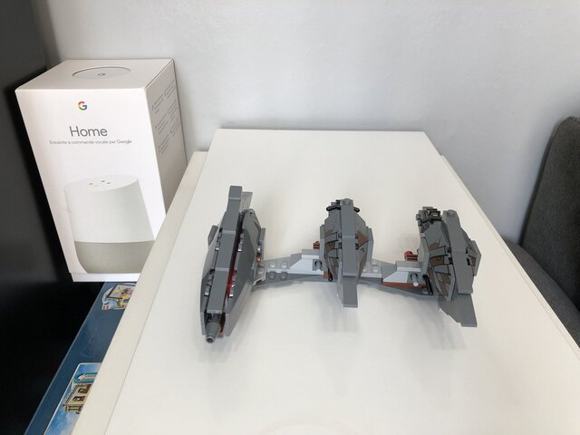](https://www.freelug.org/IMG/jpg/sithnightspeeder_30.jpg)

[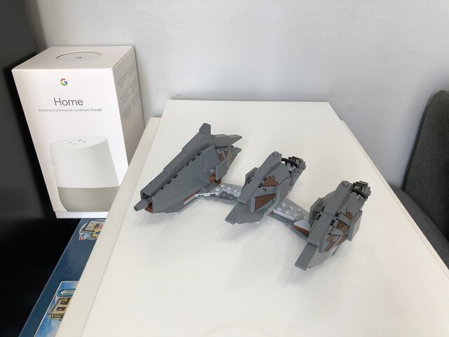](https://www.freelug.org/IMG/jpg/sithnightspeeder_31.jpg)

[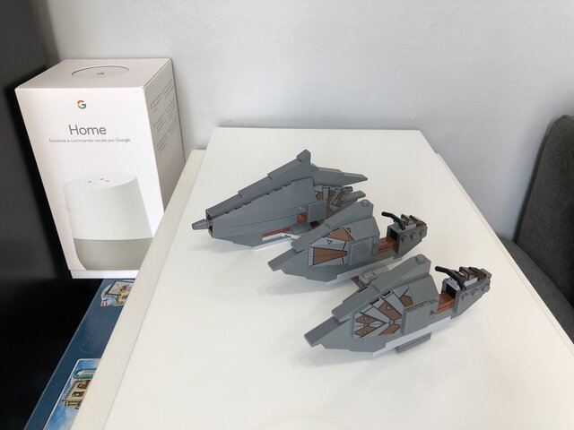](https://www.freelug.org/IMG/jpg/sithnightspeeder_32.jpg)

[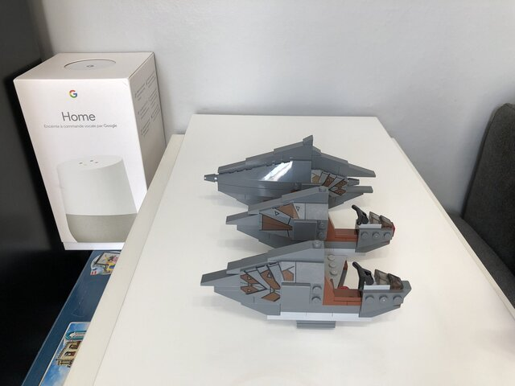](https://www.freelug.org/IMG/jpg/sithnightspeeder_33.jpg)

[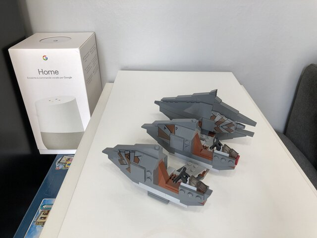](https://www.freelug.org/IMG/jpg/sithnightspeeder_34.jpg)

[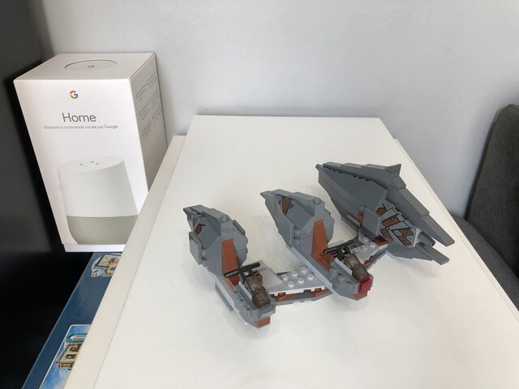](https://www.freelug.org/IMG/jpg/sithnightspeeder_35.jpg)

[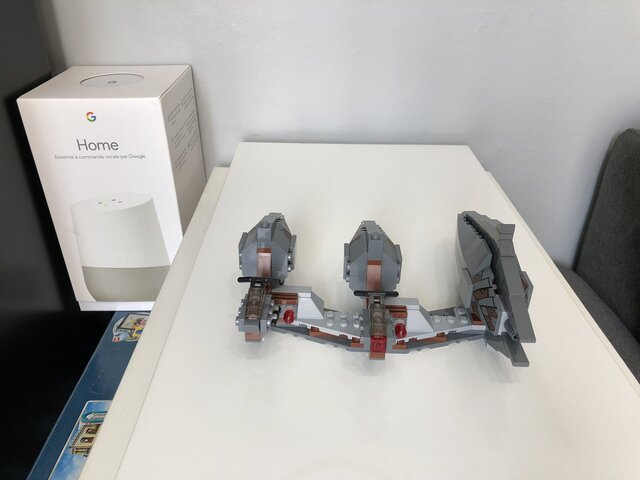](https://www.freelug.org/IMG/jpg/sithnightspeeder_36.jpg)

* * *

**AVIS :**

Sans être des plus intéressant niveau montage, ce _Nightspeeder_ est tout de même plaisant à construire. Le rendu est quant à lui plutôt sympa et bien agressif et les modules détachables en font un set avec une belle jouabilité. Ajoutez à ça trois superbes figurines représentant des personnages importantS du dessin animé _Clone Wars_, vous obtenez un petit set must have comme je les aime.

Bref, un set que tout collectionneur se doit de posséder.

**BONUS :**

Le traditionnel GIF animé réalisé avec la totalité des photos prises pour cette review (cliquez sur l’image pour lancer l’animation).

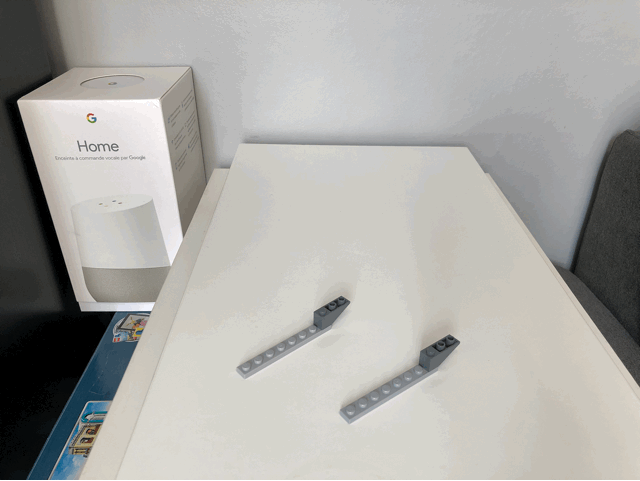
