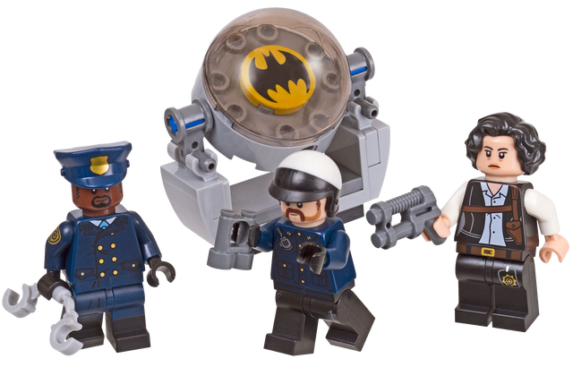
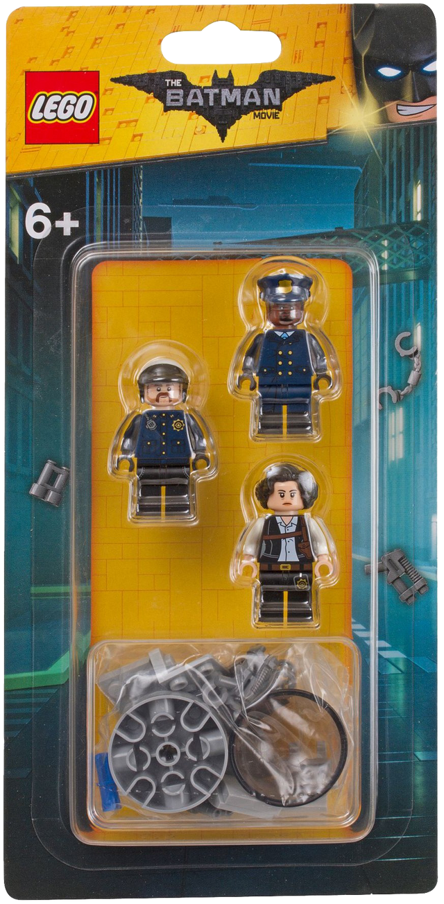
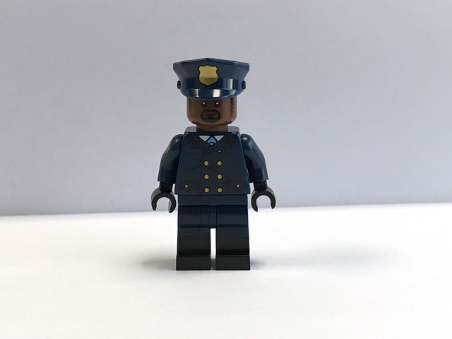
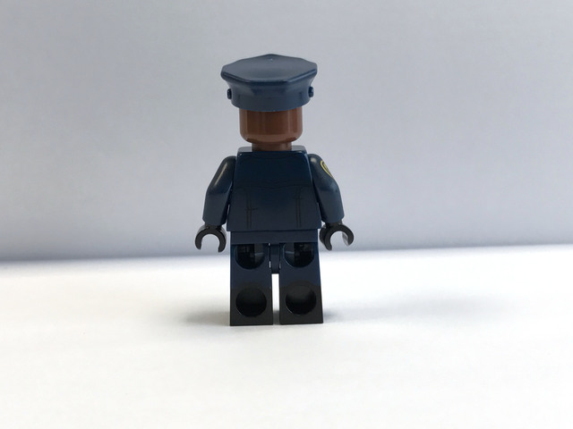
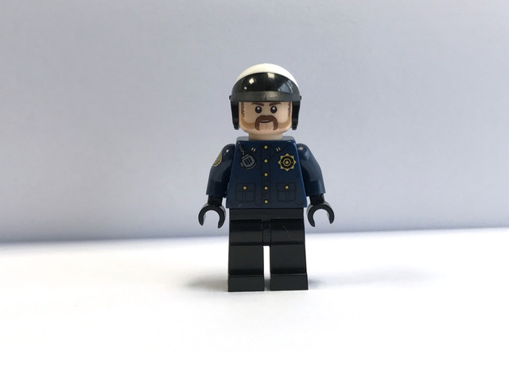
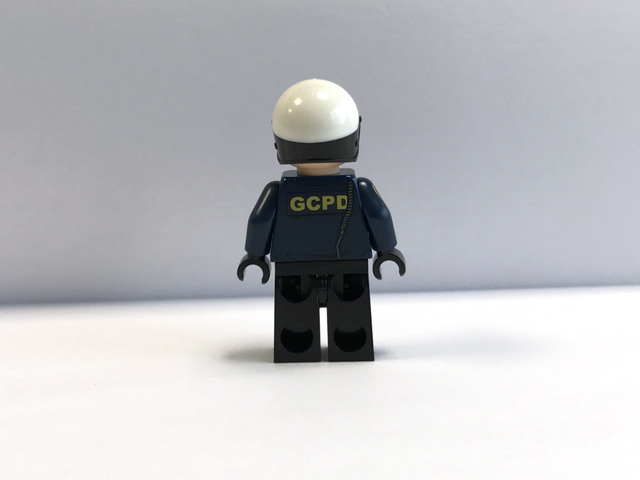
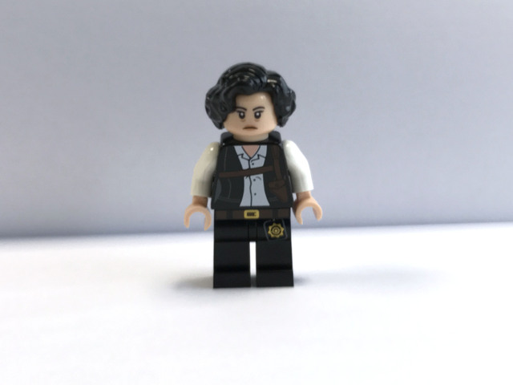
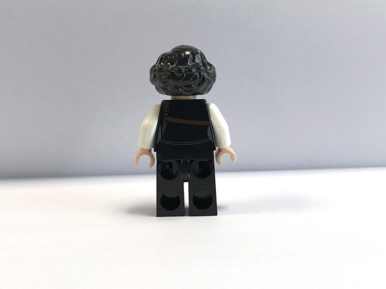
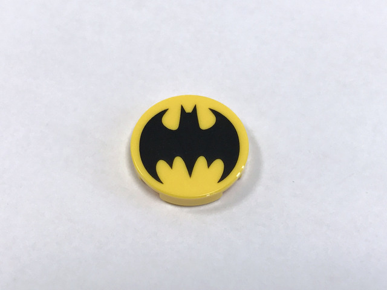
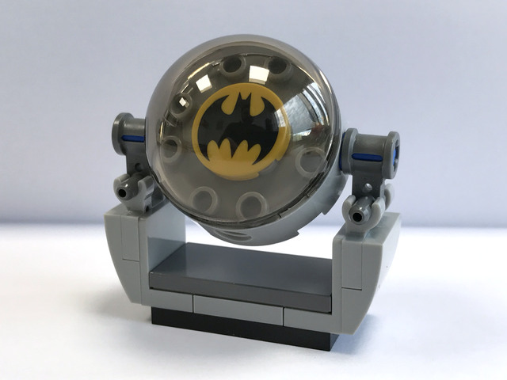

Aujourd’hui, je vous propose la review du set 853651 dans la gamme _The LEGO Batman Movie_ : **The LEGO Batman Movie Accessory Set**.  
Ce set, sorti en 2017 au prix de 12,99 €, est composé de 31 pièces, soit un ratio prix/pièce de 42 centimes d’euro.

Un set d’accessoires à l’air alléchant, voyons ça de plus près.

* * *

Le contenu de ce display est comparable à ce que _LEGO_ fait dans les autres gammes. L’avantage du plastique thermo-formé c’est que l’on a un visuel direct sur les figurines, on sait tout de suite ce qu’on achète.

* * *

Belle réalisation pour ce policier, casquette et uniforme, _LEGO_ nous offre même une sérigraphie sur le bras droit avec un écusson de police.  
Jambes bi-injection qu’on ne distingue pas trop au vu des couleurs utilisées, c’est bien dommage. Le visage pourra être réutilisé sans problème.

Le verso c’est pas folichon et l’association de couleurs est toujours aussi problématique. Casquette oblige, pas de visage alternatif.

Le motard de la police, qu’on croirait tout droit sorti du clip "_YMCA_" des _Village People_, est lui aussi réussi. Mention spéciale au visage.

Le dos est un poil plus fourni que son collègue à pied. L’inscription "_GCPD_" (_Gotham City Police Department_) ajoute un plus indéniable à ce torso (même si du coup il sera plus difficile à réutiliser dans un autre univers).

Pour finir l’inspectrice de terrain au visage fatigué (les cernes nous assurent qu’elle carbure au café et qu’elle ne dort pas beaucoup). le torso avec une veste ouverte sur une chemise et le holster parant la poitrine. J’aime beaucoup l’insigne accroché à la ceinture qui pend sur le pantalon.

Dos assez simple mais on voit la continuité du holster qui finit très bien le personnage. Pas de visage alternatif c’est bien dommage, cette fig le méritait.

* * *

Une petite _Round Tile 2x2_ sérigraphiée avec le logo _Batman_, c’est toujours appréciable dans un si petit set.

Le projecteur à _Bat-signal_ au montage rapide mais pas dénué d’intérêt. Et le rendu, bien que simple, est loin d’être mauvais.

* * *

**AVIS :**

Un petit display plutôt sympathique avec figurines réussies et _Bat-signal_ avec _tile_ sérigraphiée.  
Pour ce prix on aurait quand même aimé une minifig supplémentaire, dommage.
