Aujourd’hui je vous propose la review du set 918 dans la gamme _Space Classic_ : **One Man Space Ship** (communément appelé **LL918**).  
Ce set sorti en 1979 (j’avais 3 ans Oo’ ) est composé de 86 pièces. N’ayant pas trouvé le prix de vente à l’époque, je ne peux pas vous dire quel est le ratio prix/pièce.

[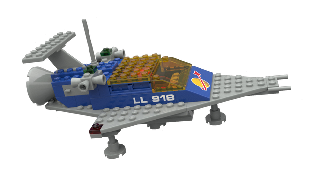](https://www.freelug.org/IMG/png/918.png)

Les sets _Space Classic_ sont aujourd’hui recherché par les collectionneurs et les nostalgiques. Certains modèles se vendent à plus de 100 euros, le 918 se négocie à partir de 20 euros en _loose_ (sans boite, ni notice) et à partir de 130 euros en bon état avec boite et notice (source _[Bricklink](http://www.bricklink.com/v2/catalog/catalogitem.page?id=5829#T=S&O={{ '{%' }}22pi%22:%223%22})_).

* * *

Le visuel de la boite intègre le contenu du set, le _LL918_, dans un décor spatial. A cette époque la mention _System_ n’est pas présente sur les boites.

[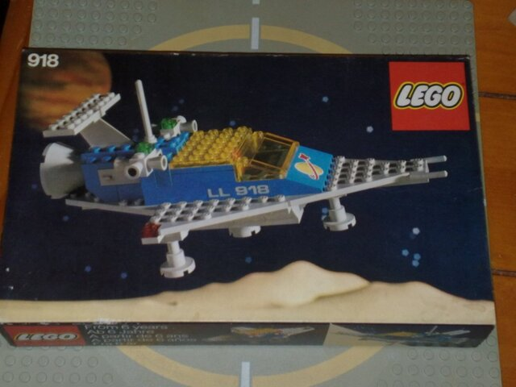](https://www.freelug.org/IMG/jpg/918_Box.jpg)

J’ai acheté ce set d’occasion, je n’ai donc ni la boite, ni les instructions. Je vous reproduis ici une photo trouvée sur _Google image_.

* * *

La minifig de ce set est un _[Classic Space Red](http://brickset.com/minifigs/sp005/Classic-Space-Red-with-Airtanks)_. Ces figs bien que simples par rapport à ce qui se fait de nos jours arborent sur le torse le célèbre écusson doré _Space_ de la firme danoise. Nous sommes de plus en présence des premiers casques fabriqués par _LEGO_, sans visières et qui avait la fâcheuse tendance à se casser au niveau de la mentonnière (d’où le casque de _[Benny](http://brickset.com/minifigs/tlm057/Benny)_ dans _[The LEGO Movie](https://fr.wikipedia.org/wiki/La_Grande_Aventure_Lego)_).

[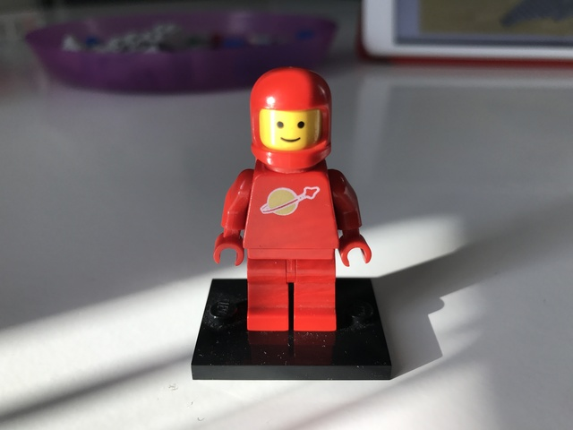](https://www.freelug.org/IMG/jpg/918_01.jpg)

De dos la minifig possède les fameux _Airtank_ qui servent de réserve à oxygène.

[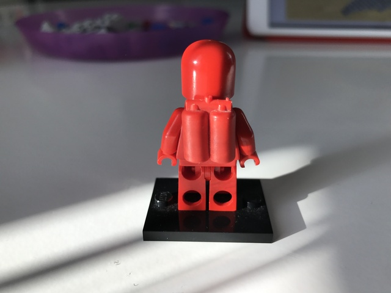](https://www.freelug.org/IMG/jpg/918_02.jpg)

* * *

On commence la construction avec des pièces simples, comme tous les sets de l’époque.

[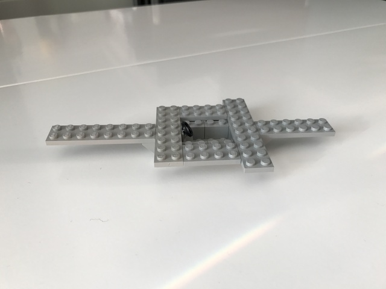](https://www.freelug.org/IMG/jpg/918_03.jpg)

L’armature prend rapidement forme et on ajoute les trains d’atterrissage.

[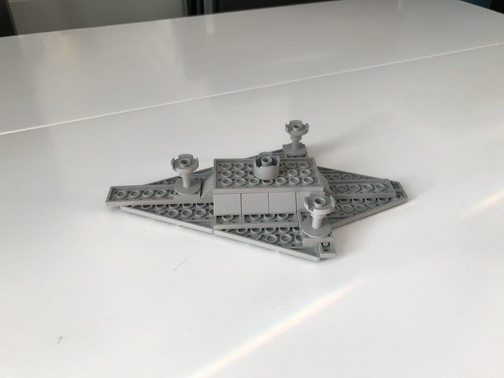](https://www.freelug.org/IMG/jpg/918_04.jpg)

Les pièces sérigraphiées sont simples et pourtant superbes. Le logo _Space_ sur le devant du vaisseau est assez impressionnant par sa taille comparé à ce qui se pratique aujourd’hui par _LEGO_ (vive les stickers :-x ).

[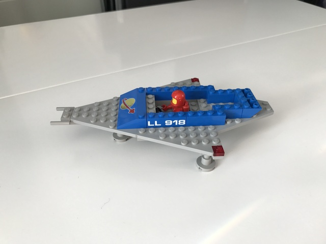](https://www.freelug.org/IMG/jpg/918_05.jpg)

On pose le cockpit et les portes du compartiment arrière.

[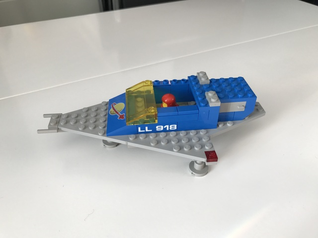](https://www.freelug.org/IMG/jpg/918_06.jpg)

Terminé, il en jette un max le papy.

[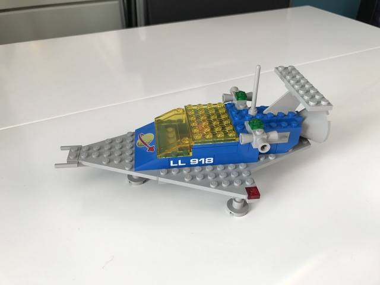](https://www.freelug.org/IMG/jpg/918_07.jpg)

Le _LL918_ sous différents angles.

[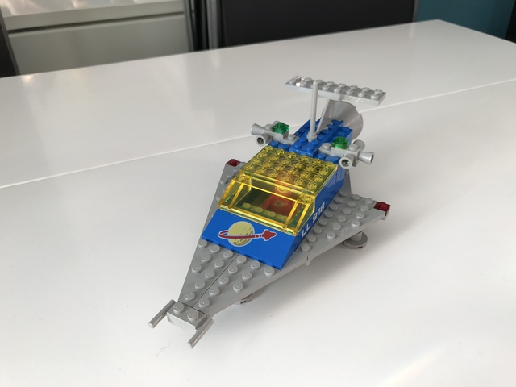](https://www.freelug.org/IMG/jpg/918_08.jpg)

[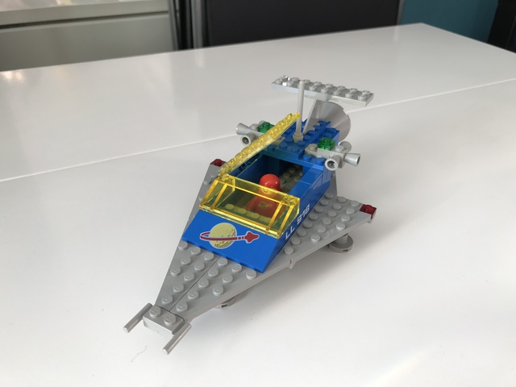](https://www.freelug.org/IMG/jpg/918_09.jpg)

[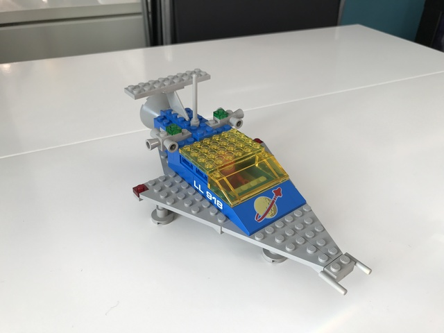](https://www.freelug.org/IMG/jpg/918_10.jpg)

[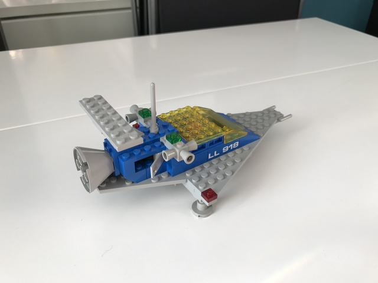](https://www.freelug.org/IMG/jpg/918_11.jpg)

[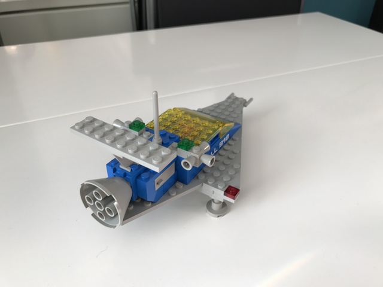](https://www.freelug.org/IMG/jpg/918_12.jpg)

[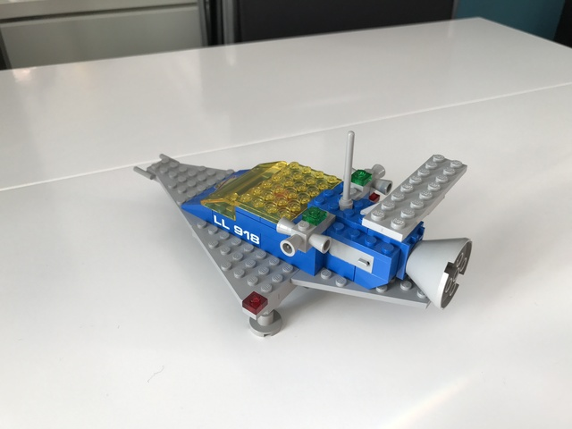](https://www.freelug.org/IMG/jpg/918_13.jpg)

[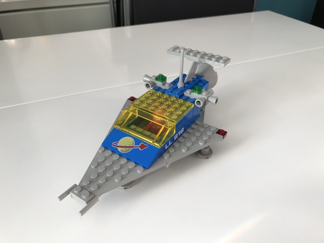](https://www.freelug.org/IMG/jpg/918_14.jpg)

**AVIS :**

Bien que de réalisation simple, comme la quasi-totalité des sets de l’époque, le _LL918_ n’en reste pas moins redoutable d’efficacité dans sa construction.  
De plus il possède un indéniable effet _Swooshable_, ce qui n’est pas négligeable.

Personnellement, je viens de réaliser un rêve de gosse en achetant ce set.

**BONUS :**

Voici un GIF animé réalisé avec la totalité des photos prises pour cette review (cliquez sur l’image pour lancer l’animation).

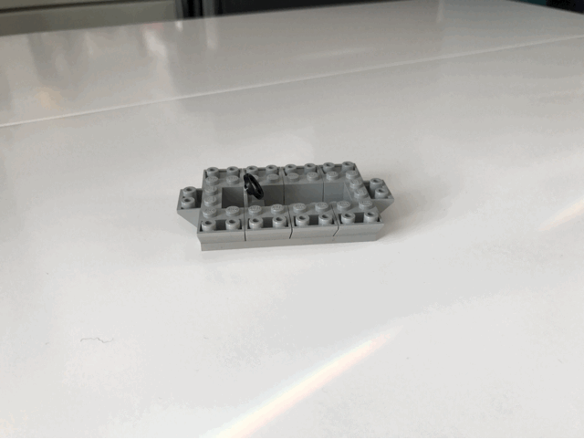
