Aujourd’hui je vous propose la review du set 9488 dans la gamme _Star Wars_ : **Elite Clone Trooper & Commando Droid Battle Pack**.  
Ce set sorti en 2012 au prix de 16,99 € est composé de 98 pièces, soit un ratio prix/pièce de 17 centimes d’euros.

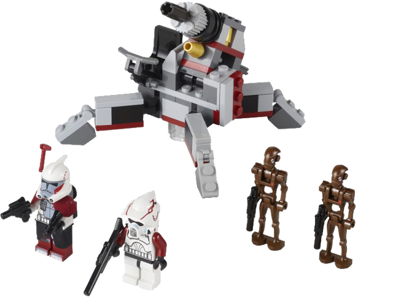

_La Guerre des Clones_ étant un sujet que beaucoup de MOCeurs aiment, voyons si ce set vaut la peine d’être possédé.

* * *

Le visuel de la boite reprend une scène du film _L’Attaque des Clones_. Le bandeau du haut est constitué des logos _LEGO_ et _Star Wars_ et de _Darth Maul_ (comme toute la gamme sortie en 2012).  
Le contenu du set est intégré dans le décor de la bataille de _Geonosis_.

[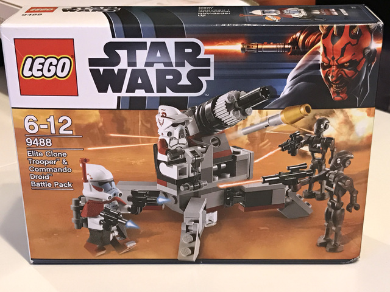](https://www.freelug.org/IMG/jpg/CloneTrooper_CommandoDroid_01.jpg)

Au verso plusieurs vignettes avec les éléments de jouabilités du set.

[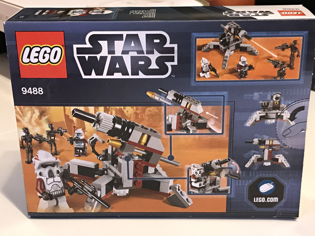](https://www.freelug.org/IMG/jpg/CloneTrooper_CommandoDroid_02.jpg)

Une fois ouvert, le set contient deux sachets et une notice de construction.

* * *

Voici les deux minifigs _[Commando Droid](http://brickset.com/minifigs/name-Commando-Droid)_. De couleur marron, il n’y a pas grand chose à en dire. Personnellement j’ai toujours trouvé ces figs hideuses.

[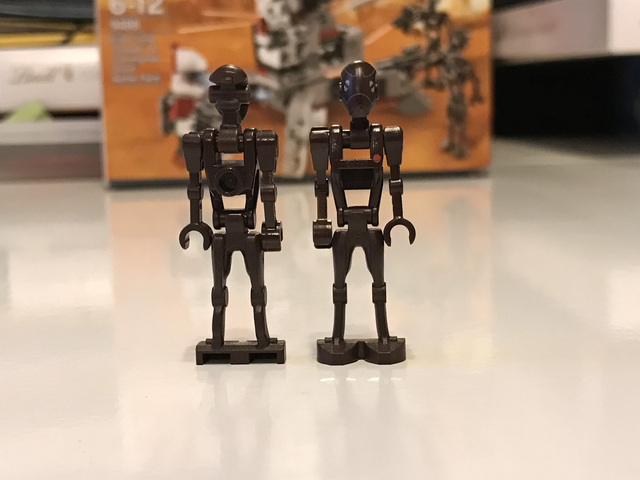](https://www.freelug.org/IMG/jpg/CloneTrooper_CommandoDroid_03.jpg)

Très belle réalisation pour cet _[ARC Trooper Elite Clone](http://brickset.com/minifigs/sw377/ARC-Trooper-with-Backpack-Elite-Clone-Trooper-\(9488\))_. Les sérigraphies sont magnifiques, surtout qu’elles couvrent l’intégralité du corps (casque, torso, jambes).

[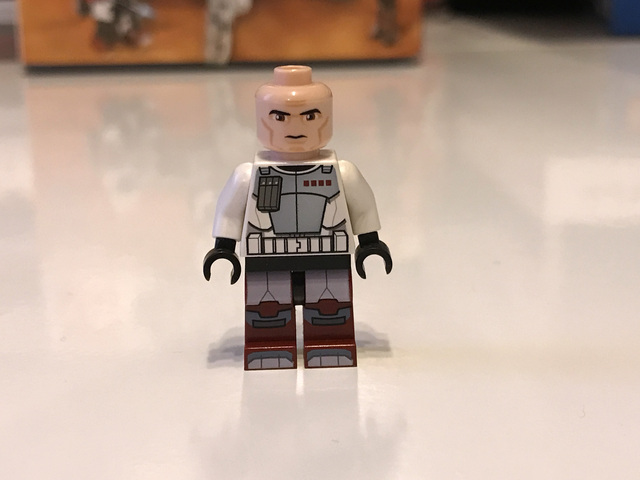](https://www.freelug.org/IMG/jpg/CloneTrooper_CommandoDroid_04.jpg)

[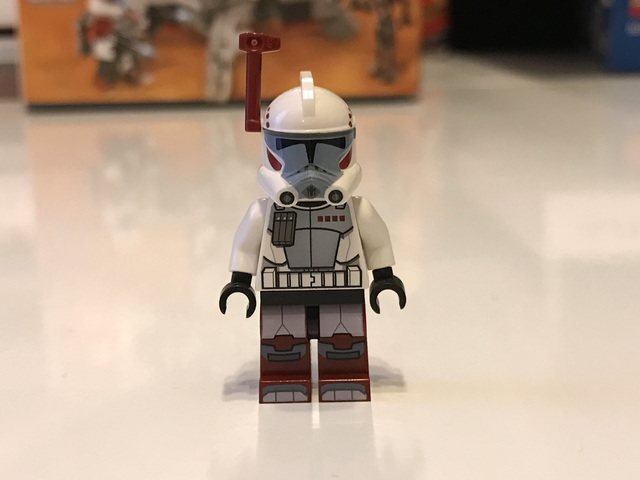](https://www.freelug.org/IMG/jpg/CloneTrooper_CommandoDroid_05.jpg)

Le dos fait presque simpliste tant le recto est fourni. Pourtant là aussi on a une belle sérigraphie pour l’arrière de l’armure.

[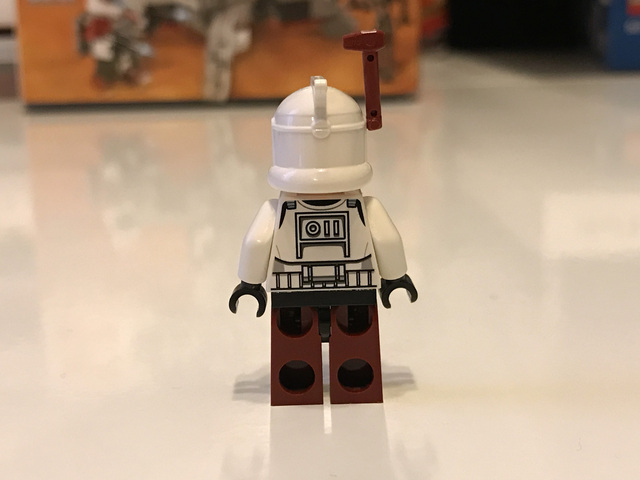](https://www.freelug.org/IMG/jpg/CloneTrooper_CommandoDroid_06.jpg)

L’_ARC Trooper Elite Clone_ avec ses épaulettes, sa jupe et son sac a dos.

[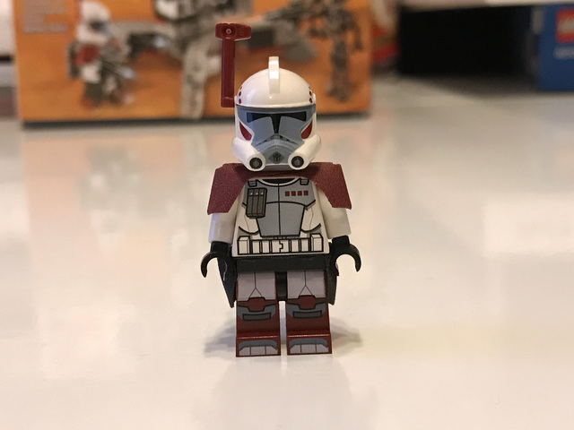](https://www.freelug.org/IMG/jpg/CloneTrooper_CommandoDroid_07.jpg)

[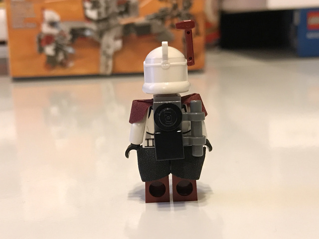](https://www.freelug.org/IMG/jpg/CloneTrooper_CommandoDroid_08.jpg)

Dernière fig de ce pack, l’_[ARF Trooper Elite Clone](http://brickset.com/minifigs/sw378/ARF-Trooper-Elite-Clone-Trooper-\(9488\))_, là aussi une très belle prestation (même si moins fournie que l’_ARC Trooper_). Un casque magnifique (moulage comme sérigraphies) et une armure sobre mais très détaillée.

[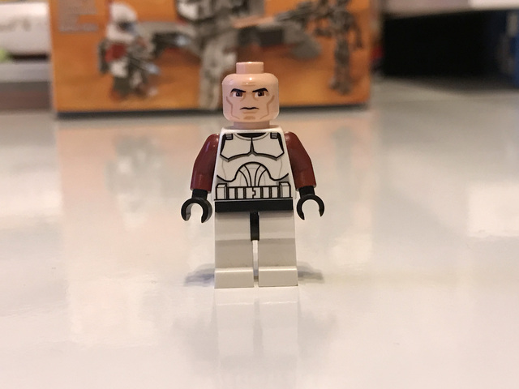](https://www.freelug.org/IMG/jpg/CloneTrooper_CommandoDroid_09.jpg)

[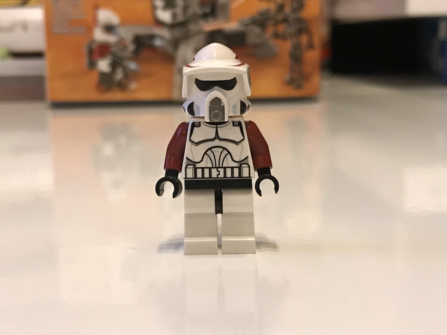](https://www.freelug.org/IMG/jpg/CloneTrooper_CommandoDroid_10.jpg)

Dos identique à l’_ARC Trooper_.

[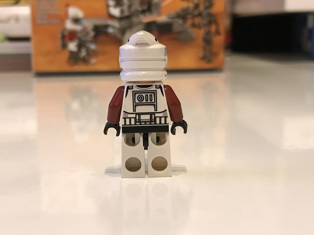](https://www.freelug.org/IMG/jpg/CloneTrooper_CommandoDroid_11.jpg)

* * *

On commence la construction et on comprend tout de suite que la brique _Round 2x2 Trans Clear_ servira de soutien à la canonnière.

[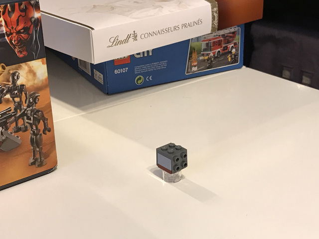](https://www.freelug.org/IMG/jpg/CloneTrooper_CommandoDroid_12.jpg)

Bien que simpliste, le poste de tir prend forme.

[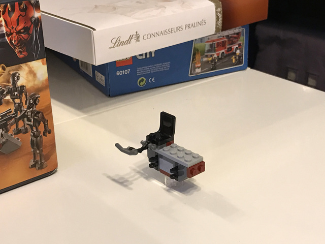](https://www.freelug.org/IMG/jpg/CloneTrooper_CommandoDroid_13.jpg)

La barre _Technic_ qui servira à propulser le missile clic.

[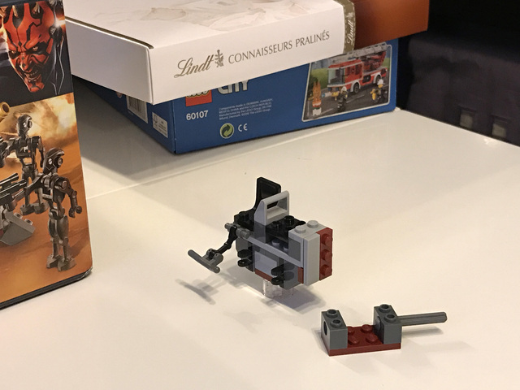](https://www.freelug.org/IMG/jpg/CloneTrooper_CommandoDroid_14.jpg)

Les jambes du véhicule.

[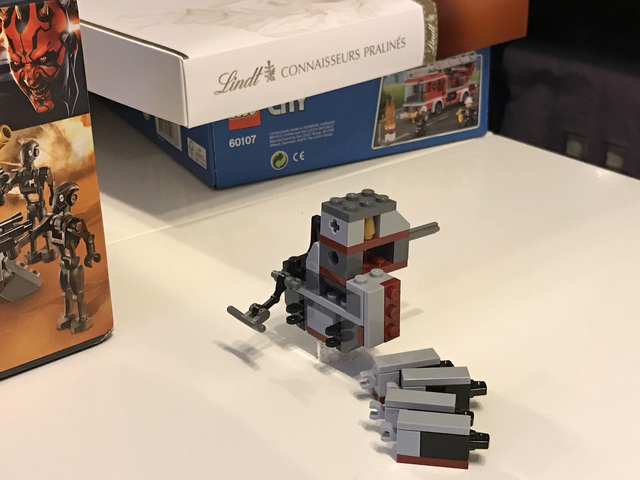](https://www.freelug.org/IMG/jpg/CloneTrooper_CommandoDroid_16.jpg)

Puis ses pieds.

[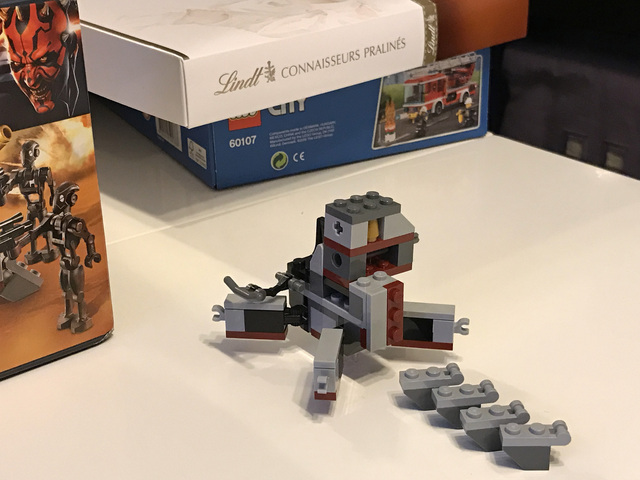](https://www.freelug.org/IMG/jpg/CloneTrooper_CommandoDroid_17.jpg)

Et voilà la canonnière finie.

[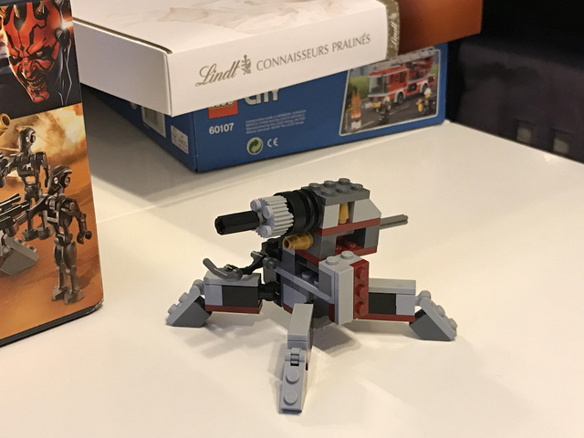](https://www.freelug.org/IMG/jpg/CloneTrooper_CommandoDroid_18.jpg)

Petite mise en situation.

[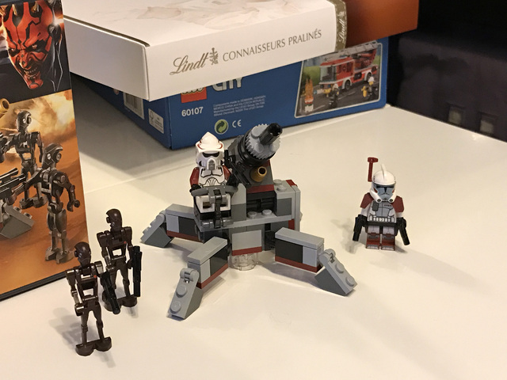](https://www.freelug.org/IMG/jpg/CloneTrooper_CommandoDroid_19.jpg)

[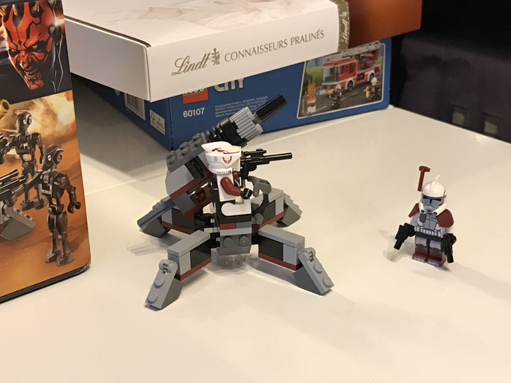](https://www.freelug.org/IMG/jpg/CloneTrooper_CommandoDroid_20.jpg)

* * *

**AVIS :**

Comme tous les _Battle Pack_ celui-ci possède un véhicule peu enthousiasmant, et encore ce n’est pas le pire que _LEGO_ a sorti. Les fans de MOC de la _Guerre des Clones_ étant nombreux, ce petit pack ajoutera tout de même engin et figurines sur un diorama et y apportera un peu plus de réalisme.  
Pour les collectionneurs, ce set vaut le coup juste pour les deux clones vraiment réussis.

**BONUS :**

Voici un GIF animé réalisé avec la totalité des photos prises pour cette review (cliquez sur l’image pour lancer l’animation).

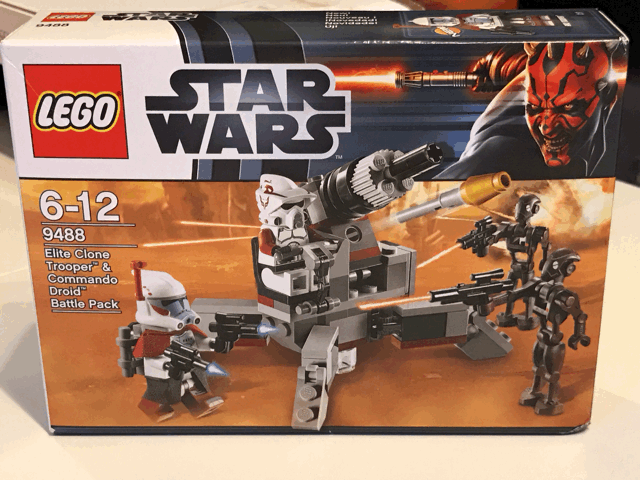
