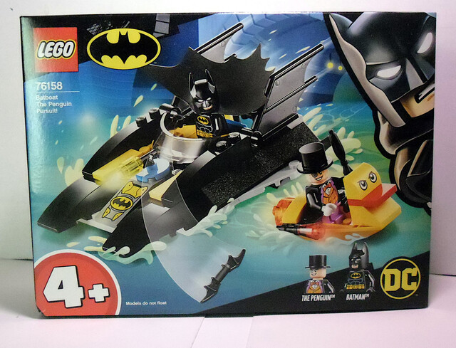
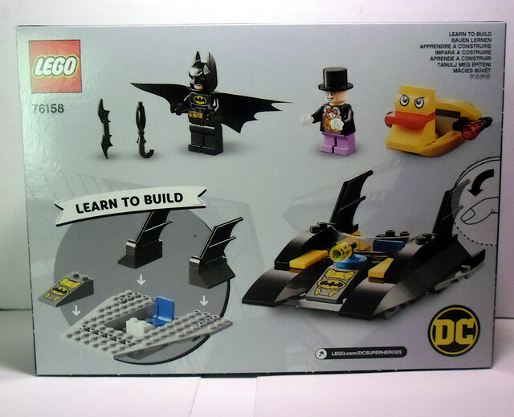
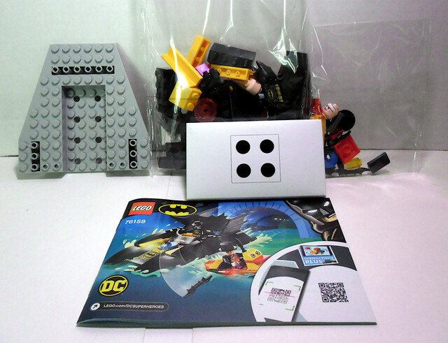
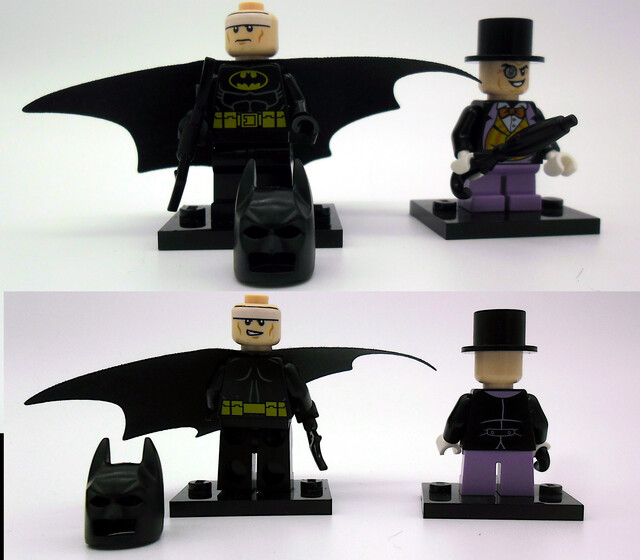
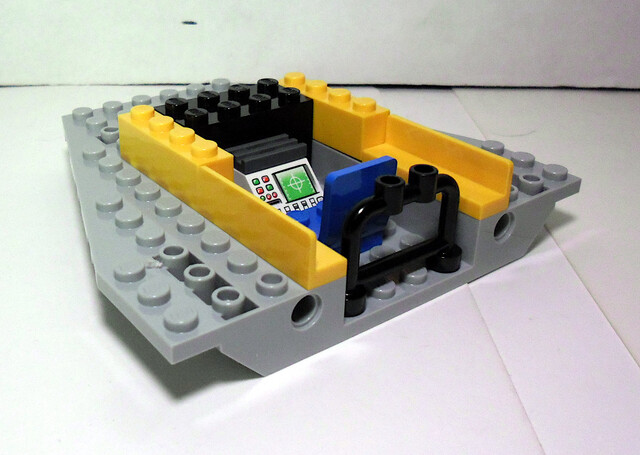
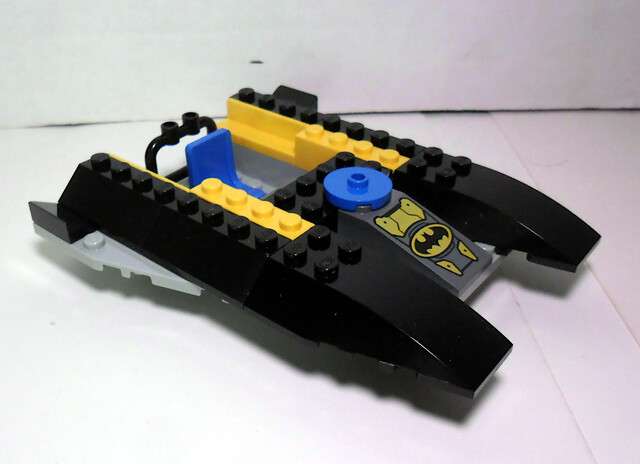
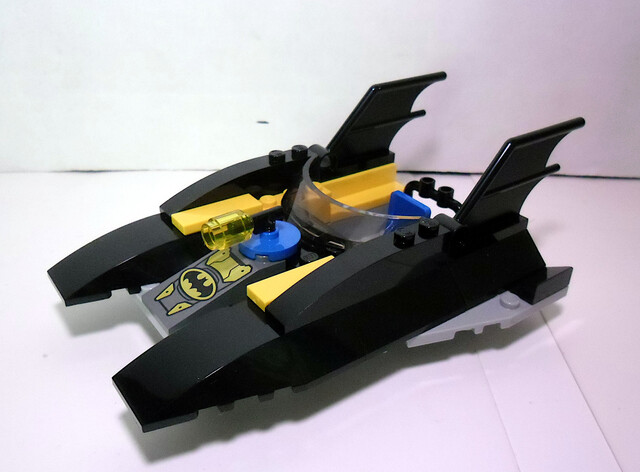
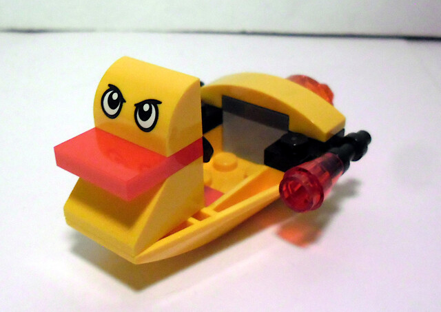
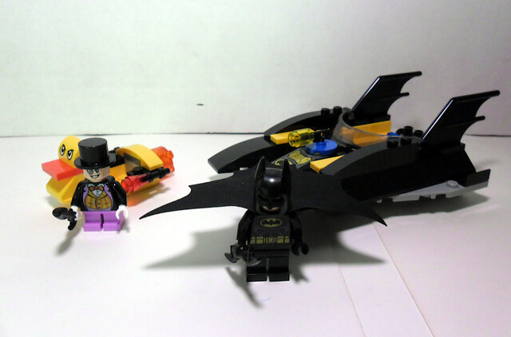
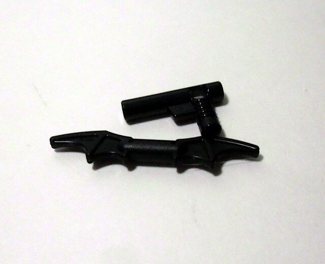

Une boite dans l’ex-gamme junior, ça donne donc quoi ?

Le set comprend 54 pièces avec deux personnages. Pour un prix de 9,99€ soit un rapport prix/pièces de 0,185 euros, c’est cher diront certains. Mais est-ce vraiment une gamme pour les adultes ?  
Une petite vue arrière donne une idée de la jouabilité du set :

Venons au principal : le contenu de la boite :

Deux personnages, Batman et le méchant Pingouin

Avec une grosse metapièce, le BatBateau se monte vite :

Passons au bateau du Pingouin : un gros canard ! Il fait la tête je trouve.

Voilà fini, une petite photo de famille !

Et pour terminer les extra parts :

**Conclusion**  
Que dire : pour adulte, ben entre un Batman et un Pingouin, il y en a beaucoup qui les ont en stock.

Pour un jeune, il est déjà possible de jouer direct avec ces éléments. Et pour ce prix, moi je pense que ça passe.
