On sort un peu du Star Wars pour une review des sets 70232, 70230 et 70229 de la gamme Chima.  
Ces sets sont sortis en 2015 au prix de 9,99 € l’unité.

Pour rappel les Tribe Pack sont, tout comme les Battle Pack Star Wars, des sets à 10 euros contenant un petit véhicule - encore plus anecdotique que dans les Battle Pack - et trois minifigures. Ce sont donc des sets très intéressants pour se constituer une troupe/armée à "bon prix".

De plus la gamme Chima ayant été officiellement arrêtée par LEGO fin 2015, les boites vont devenir de plus en plus rares.

-   **LEGO Chima 70232 : Saber-tooth Tiger Tribe Pack**

Set sorti en 2015 au prix de 9,99 € et composé de 74 pièces, soit un ratio prix/pièce de 14 centimes d’euros.

Le visuel de la boite est constitué d’une bande orange qui occupe un tiers du set avec les logos _LEGO_ et _Chima_.  
Les deux tiers restant mettent en scène le contenu du set dans un décor glacé.

[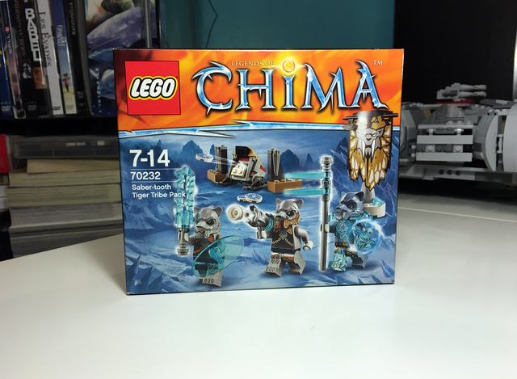](https://www.freelug.org/IMG/jpg/TPSaberToothTiger_01.jpg)

Au verso est présentée une mise en scène de ce _Tribe Pack_ en compagnie d’un gros set de la gamme _Chima_.

[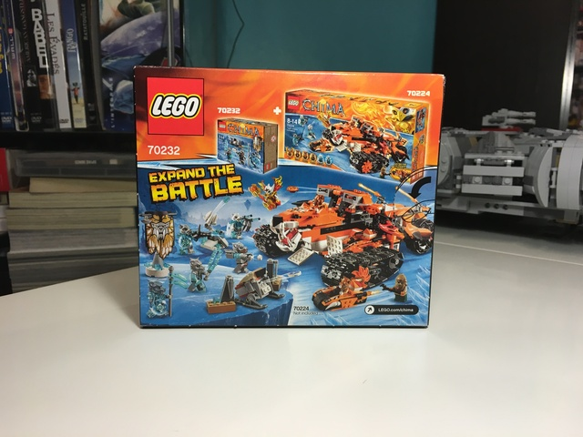](https://www.freelug.org/IMG/jpg/TPSaberToothTiger_02.jpg)

La boite contient deux sachets, un étendard et une notice de construction.

[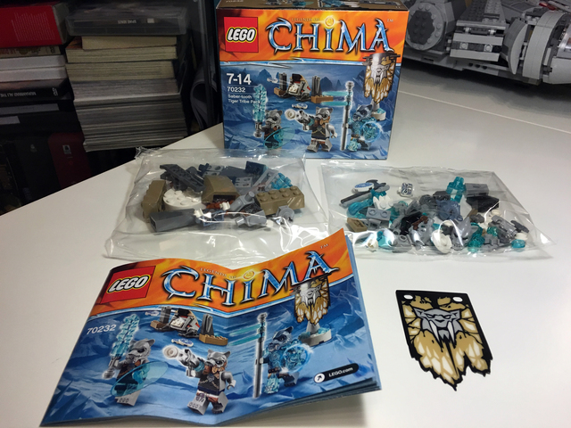](https://www.freelug.org/IMG/jpg/TPSaberToothTiger_03.jpg)

Petit focus sur l’étendard du clan _Saber-tooth Tiger_.

[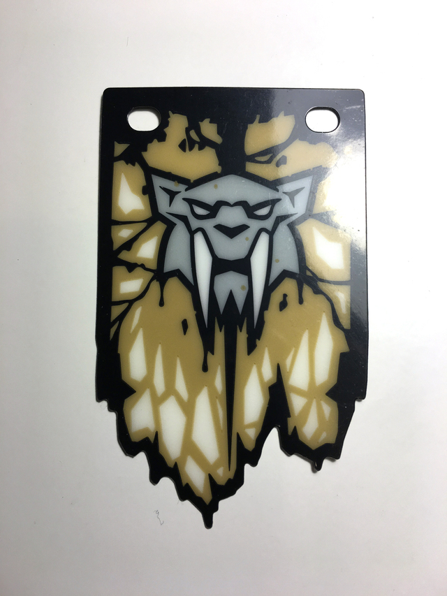](https://www.freelug.org/IMG/jpg/TPSaberToothTiger_04.jpg)

Et sur les trois pièces sérigraphiées du set (round 2x2).

[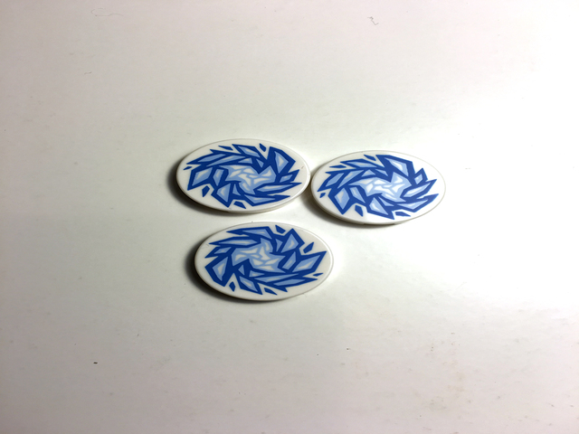](https://www.freelug.org/IMG/jpg/TPSaberToothTiger_05.jpg)

La première minifig est _[Sirox](http://brickset.com/minifigs/loc124/Sirox)_, ici avec son casque de tigre à dents de sabre et son armure.

[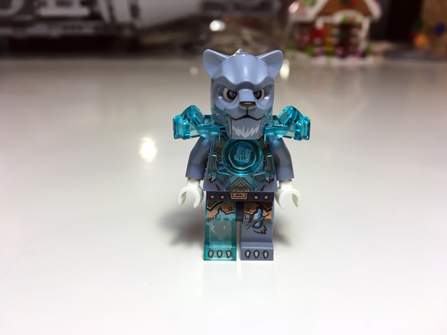](https://www.freelug.org/IMG/jpg/TPSaberToothTiger_06.jpg)

_Sirox_ sans son casque, l’impression au niveau de la tête, du torso et des jambes est vraiment réussie. Les pièces métalliques sont de couleur dorée et l’impression de peau déchirée laissant apparaître les os est saisissante.  
Comme on peut le voir, la jambe droite est bleue transparente, ce qui donne un petit effet "wahou" à cette fig.

[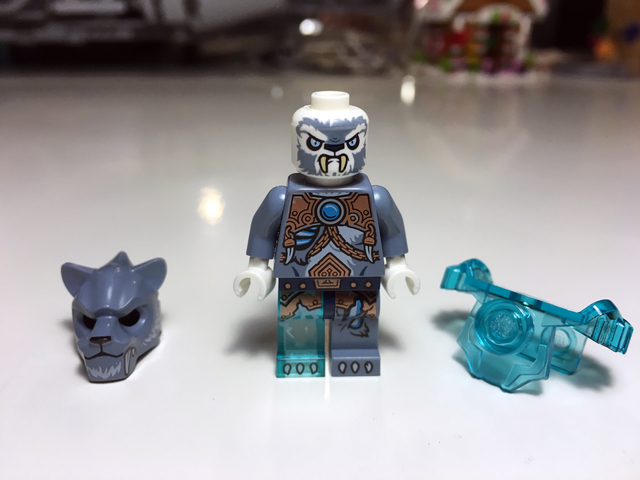](https://www.freelug.org/IMG/jpg/TPSaberToothTiger_07.jpg)

De dos, pas de visage alternatif, mais le verso du torso est magnifique avec l’armure et les petits détails du pelage.

[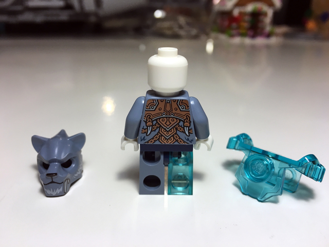](https://www.freelug.org/IMG/jpg/TPSaberToothTiger_08.jpg)

Le _[Guerrier Tigre à dents de sabre n°1](http://brickset.com/minifigs/loc125/Saber-Tooth-Tiger-Warrior-1)_ avec son casque à mâchoire métallique.

[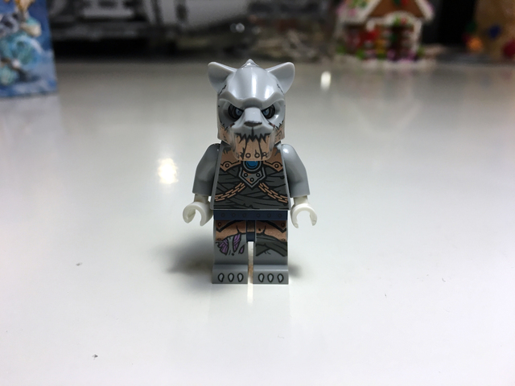](https://www.freelug.org/IMG/jpg/TPSaberToothTiger_12.jpg)

Sans son casque, on aperçoit le visage momifié serti des dents de sabre de son espèce. Là encore la sérigraphie est magnifique et fourmille de détails, notez la peau déchirée et les muscles apparents sur la jambe droite.  
Le tout renforçant le côté mort-vivant de cette espèce dans l’univers Chima.

[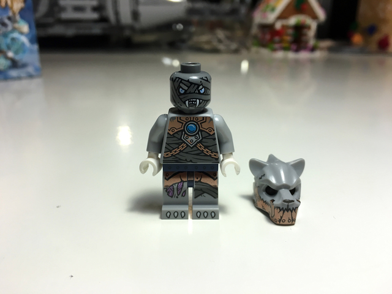](https://www.freelug.org/IMG/jpg/TPSaberToothTiger_13.jpg)

De dos on a le droit à un visage alternatif sans dents. Au niveau du torso on retrouve les détails de l’armure couleur bronze et des bandages.

[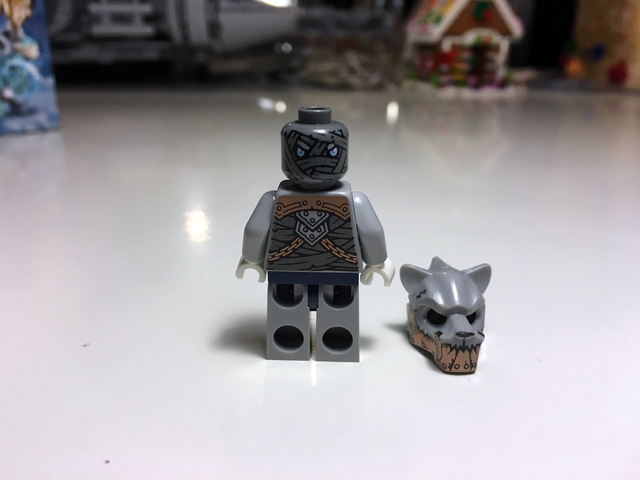](https://www.freelug.org/IMG/jpg/TPSaberToothTiger_15.jpg)

Le _[Guerrier Tigre à dents de sabre n°2](http://brickset.com/minifigs/loc126/Saber-Tooth-Tiger-Warrior-2)_ avec son casque, même torso mais jambes différentes de l’autre guerrier.

[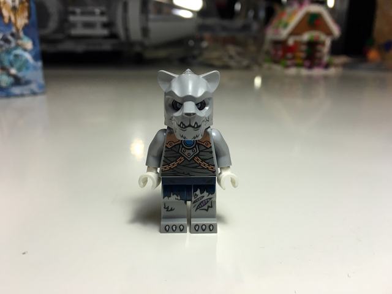](https://www.freelug.org/IMG/jpg/TPSaberToothTiger_09.jpg)

Une fois le casque enlevé, on a le droit au même visage momifié. Ici c’est sur la jambe gauche que le pelage déchiré laisse entrevoir les tissus des muscles.

[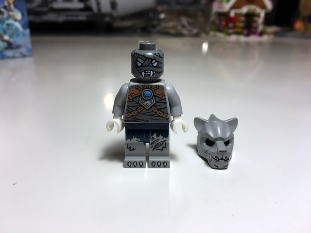](https://www.freelug.org/IMG/jpg/TPSaberToothTiger_10.jpg)

Le verso ressemble à s’y méprendre au _guerrier n°1_.

[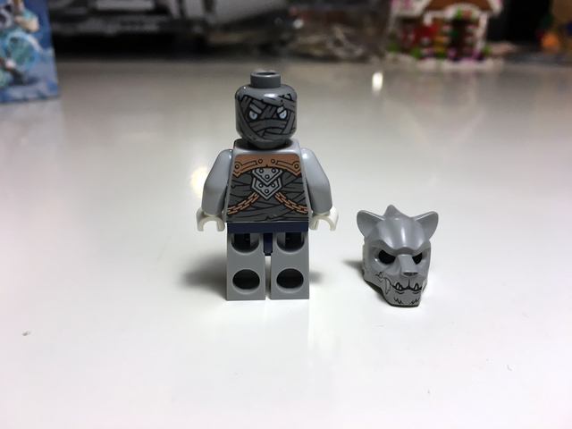](https://www.freelug.org/IMG/jpg/TPSaberToothTiger_11.jpg)

Petite photo de famille de ces trois minifigs vraiment réussies.

[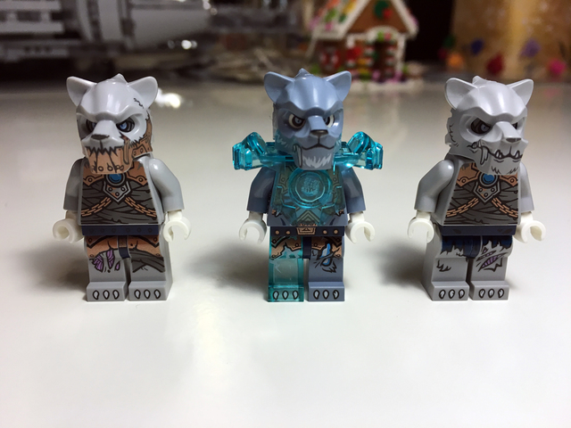](https://www.freelug.org/IMG/jpg/TPSaberToothTiger_16.jpg)

On commence maintenant la construction du mât qui servira à porter l’étendard.

[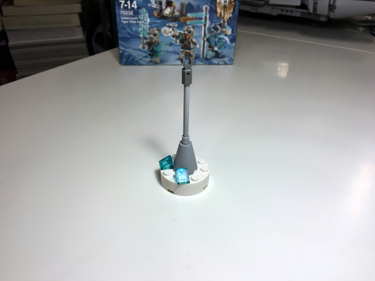](https://www.freelug.org/IMG/jpg/TPSaberToothTiger_17.jpg)

Une fois l’étendard hissé, on s’attaque à la construction de la machine de guerre.

[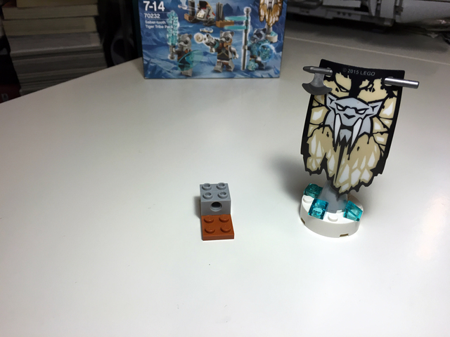](https://www.freelug.org/IMG/jpg/TPSaberToothTiger_18.jpg)

installation de la pièce spéciale permettant de lancer les disques sérigraphiés.

[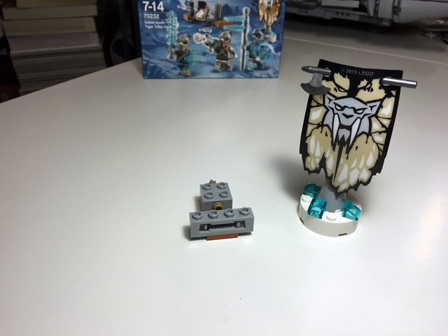](https://www.freelug.org/IMG/jpg/TPSaberToothTiger_19.jpg)

Le montage continue.

[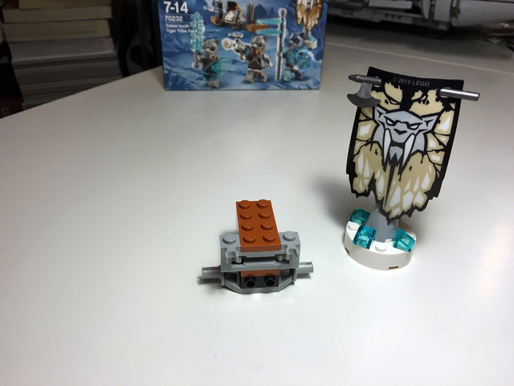](https://www.freelug.org/IMG/jpg/TPSaberToothTiger_20.jpg)

Voilà la machine de guerre terminée.

[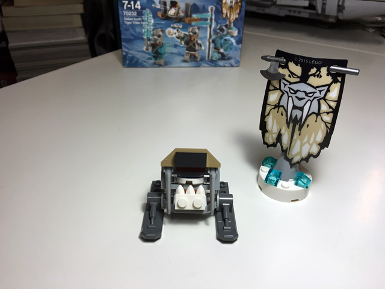](https://www.freelug.org/IMG/jpg/TPSaberToothTiger_21.jpg)

On s’attaque maintenant aux mini remparts de protection.

[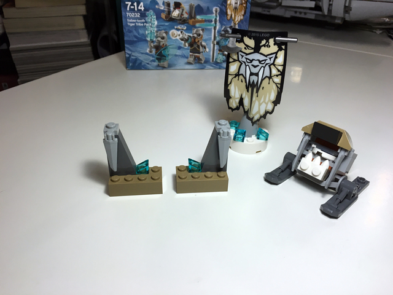](https://www.freelug.org/IMG/jpg/TPSaberToothTiger_22.jpg)

Et voilà la set terminé et mis en situation.

[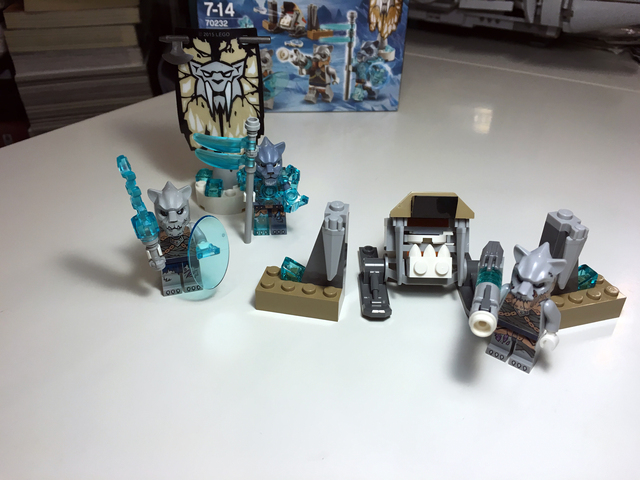](https://www.freelug.org/IMG/jpg/TPSaberToothTiger_23.jpg)

**AVIS :**

Au final que dire de ce _Tribe Pack_, que les _Battle Pack Star Wars_ font achalandés à côté. Non sans rire, on est vraiment en présence d’un pack inintéressant niveau construction et vrac. Heureusement que les figurines rattrapent le coup, car elles sont magnifiques.  
Bref vous l’aurez compris, ce type de set ne vaut que pour ces dernières.

**BONUS :**

Voici un GIF animé réalisé avec la totalité des photos prises pour cette review (cliquez sur la photo pour lancer l’animation).

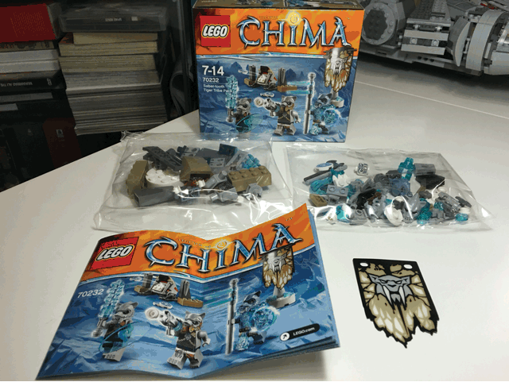

* * *

> **Les machines de guerres des _Tribe Pack_ étant tellement pauvre et anecdotique que je ne m’attarderai pour les deux prochains sets que sur les trois minifigs et le résultat final.**

* * *

-   **LEGO Chima 70230 : Ice Bear Tribe Pack**

Set sorti en 2015 au prix de 9,99 € et composé de 75 pièces, soit un ratio prix/pièce de 13 centimes d’euros.

Comme pour le set 70232 vu plus haut, le visuel de la boite est constitué d’une bande orange qui occupe un tiers du set avec les logos _LEGO_ et _Chima_.  
Les deux tiers restant mettent en scène le contenu du set dans un décor glacé.

[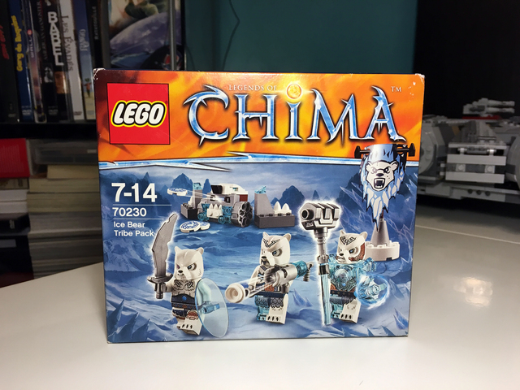](https://www.freelug.org/IMG/jpg/TPIceBear_01.jpg)

Au verso est présentée une mise en scène de ce _Tribe Pack_ en compagnie d’un gros set de la gamme _Chima_.

[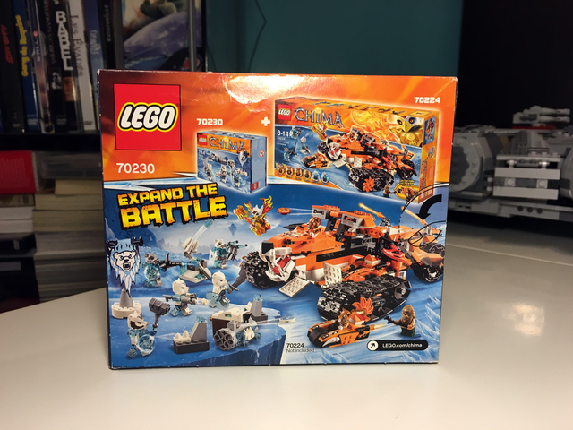](https://www.freelug.org/IMG/jpg/TPIceBear_02.jpg)

Petit focus sur l’étendard du clan _Ice Bear_ et des trois pièces sérigraphiées du set (trois round tile 2x2).

[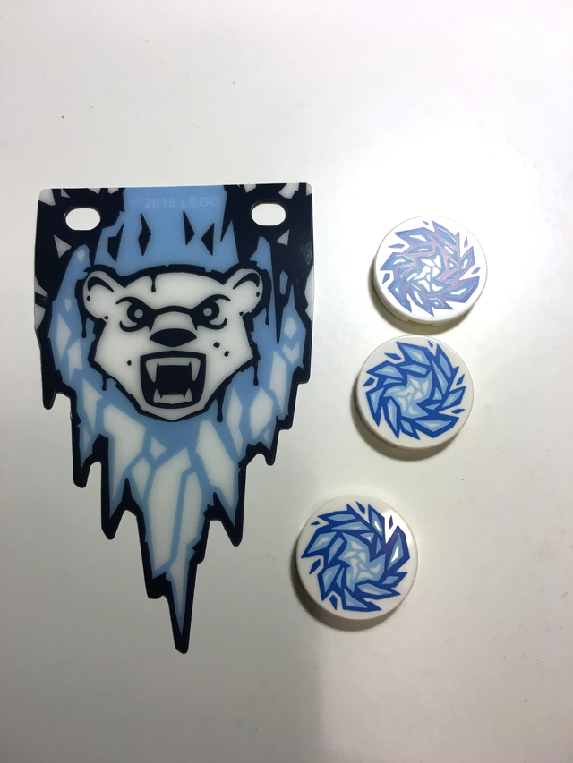](https://www.freelug.org/IMG/jpg/TPIceBear_03-2.jpg)

Première minifig présentée, _[Icerlot](http://brickset.com/minifigs/loc118/Icerlot)_ avec casque d’ours blanc et armure.

[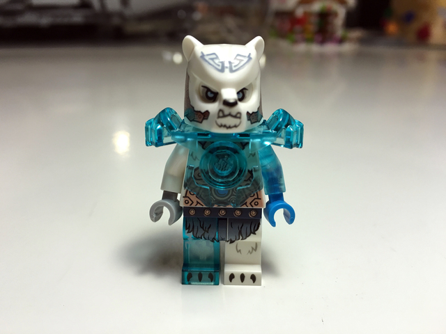](https://www.freelug.org/IMG/jpg/TPIceBear_04.jpg)

_Icerlot_ sans son casque et son armure, l’impression de la tête, du torso et des jambes est encore réussie. Les pièces métalliques sont couleur bronze et l’armure fourmille de détail.  
La jambe droite et le bras gauche _Blue Trans Clear_ apportent un plus indéniable à cette minifig.

[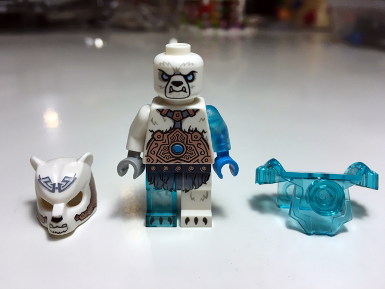](https://www.freelug.org/IMG/jpg/TPIceBear_05.jpg)

De dos, pas de visage alternatif mais un tatouage tribal et le verso du torso avec les sangles et boucle permettant de tenir l’armure.

[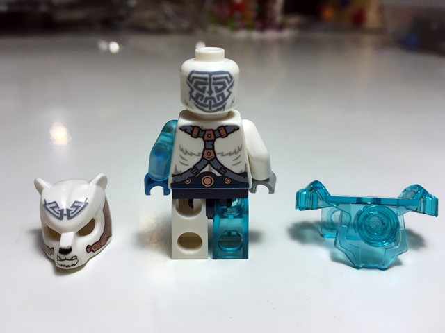](https://www.freelug.org/IMG/jpg/TPIceBear_06.jpg)

Vient ensuite un _[Ice Bear Warrior n°1](http://brickset.com/minifigs/loc119/Ice-Bear-Warrior-1)_ avec son casque.

[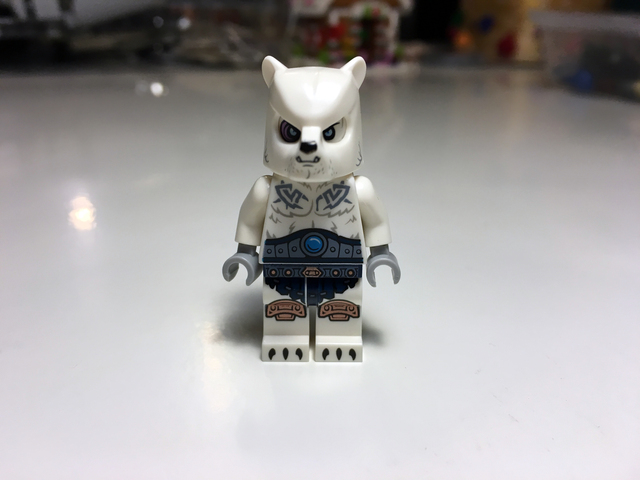](https://www.freelug.org/IMG/jpg/TPIceBear_07.jpg)

Sans son casque, on aperçoit le visage patibulaire et un œil au beurre noir. Cette fig ne possède pas d’armure mais un tatouage tribal sur le torse.

[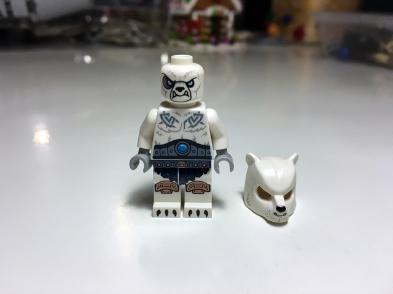](https://www.freelug.org/IMG/jpg/TPIceBear_08.jpg)

De dos cette minifigure possède elle aussi un tatouage derrière le crane.

[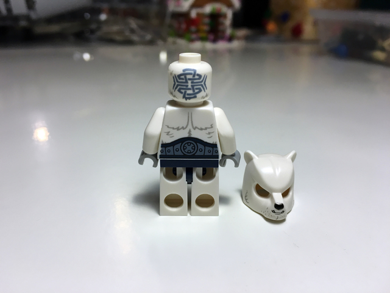](https://www.freelug.org/IMG/jpg/TPIceBear_09.jpg)

Troisième fig de ce set, l’_[Ice Bear Warrior n°2](http://brickset.com/minifigs/loc120/Ice-Bear-Warrior-2)_ avec son casque.

[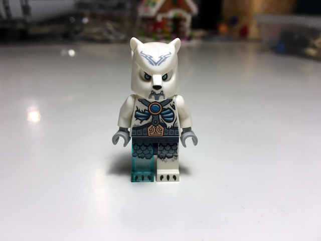](https://www.freelug.org/IMG/jpg/TPIceBear_10.jpg)

Une fois le casque enlevé, on a le droit à un visage patibulaire, un torse avec côtes apparentes et une jambe droite _Blue Trans Clear_.

[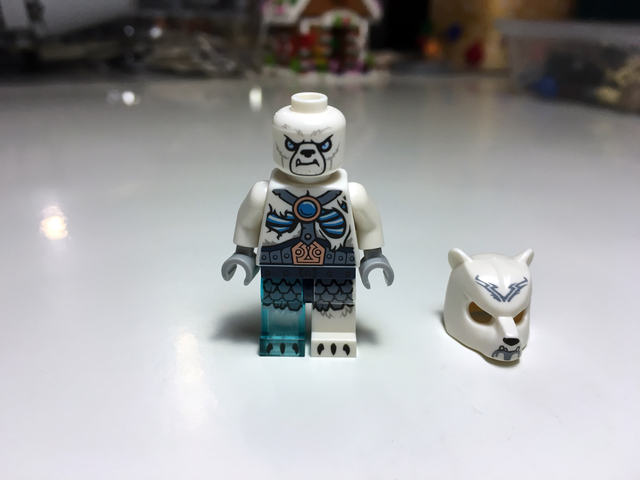](https://www.freelug.org/IMG/jpg/TPIceBear_11.jpg)

Au verso, pas de tatouage mais un pelage.

[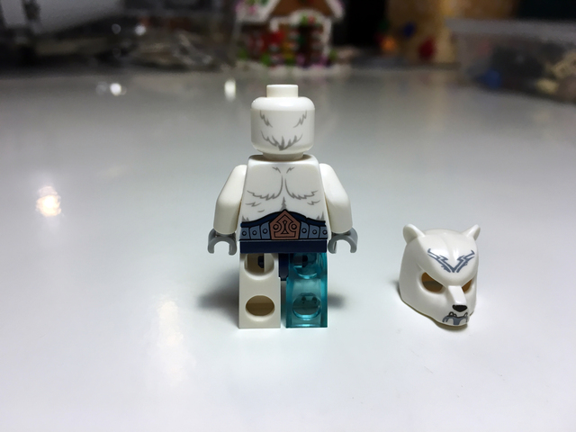](https://www.freelug.org/IMG/jpg/TPIceBear_12.jpg)

Petite photo de famille des trois minifigures.

[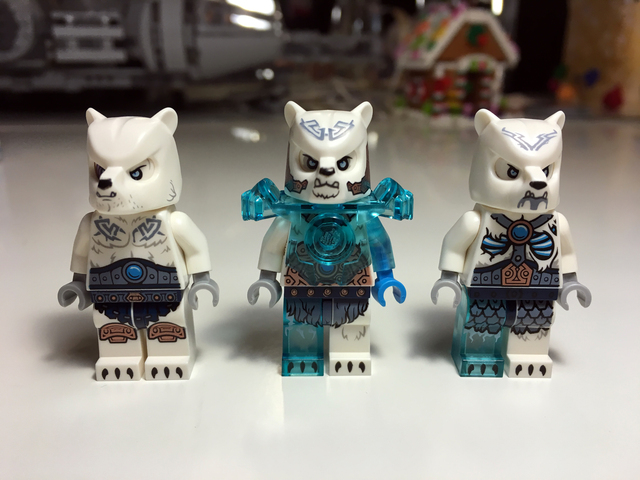](https://www.freelug.org/IMG/jpg/TPIceBear_13.jpg)

Une photo du set complet.

[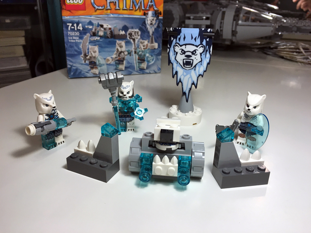](https://www.freelug.org/IMG/jpg/TPIceBear_14.jpg)

**AVIS :**

Que dire de plus que je n’ai déjà dit dans ma première review. Machine de guerre insignifiante et trois figurines magnifiquement réalisées.

* * *

-   **LEGO Chima 70229 : Lion Tribe Pack**

Set sorti en 2015 au prix de 9,99 € et composé de 78 pièces, soit un ratio prix/pièce de 13 centimes d’euros.

Comme pour les deux sets précédents, le visuel de la boite est constitué d’une bande orange qui occupe un tiers du set avec les logos _LEGO_ et _Chima_.  
Les deux tiers restant mettent en scène le contenu du set dans un décor glacé.

[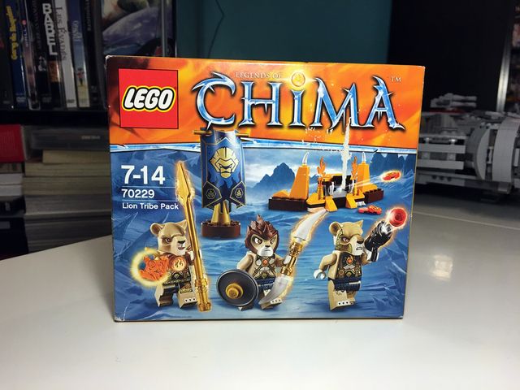](https://www.freelug.org/IMG/jpg/TPLion_01.jpg)

Au verso est présenté une mise en scène de ce _Tribe Pack_ en compagnie d’un gros set de la gamme Chima.

[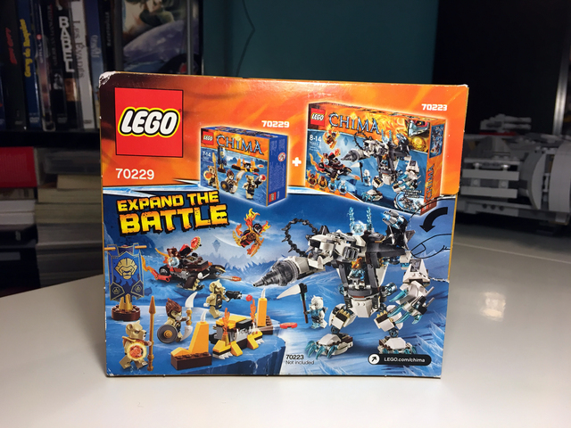](https://www.freelug.org/IMG/jpg/TPLion_02.jpg)

Petit focus sur l’étendard du clan _Lion_ et des cinq pièces sérigraphiées du set (trois _round tile 2x2_ et deux _round tile 1x1_).

[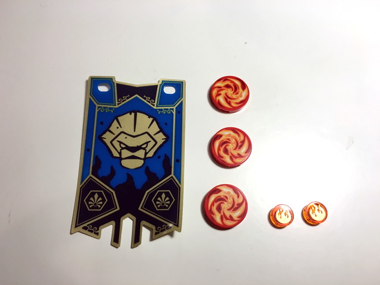](https://www.freelug.org/IMG/jpg/TPLion_03.jpg)

La première minifig est _[Li’Ella](http://brickset.com/minifigs/loc115/Li-Ella-Dark-Blue-Outfit)_, ici avec son casque de lionne et son armure.

[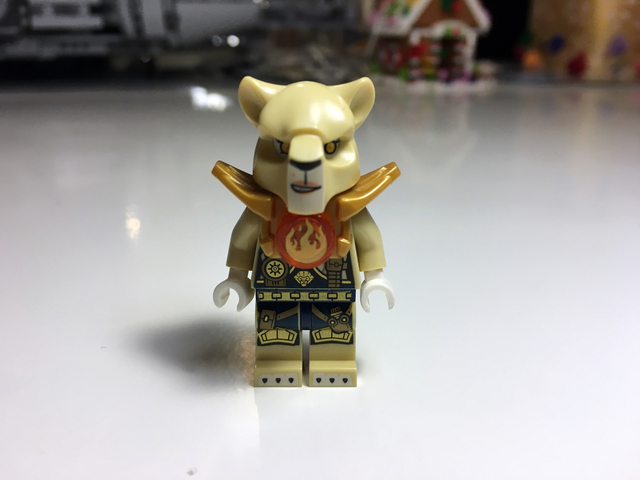](https://www.freelug.org/IMG/jpg/TPLion_04.jpg)

_Li’Ella_ sans son casque et son armure, l’impression de la tête, du torso et des jambes est encore réussie. Les pièces métalliques sont de couleur dorée et l’armure fourmille de détail.

[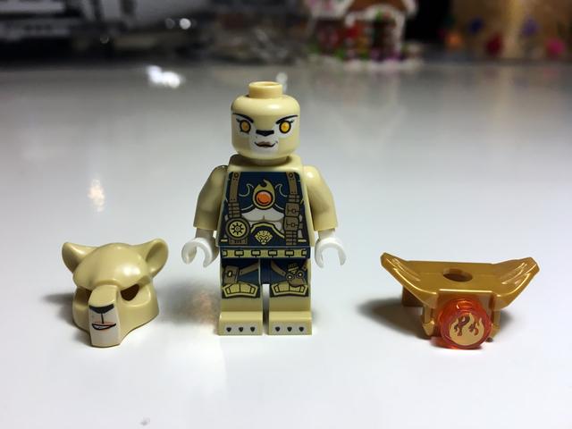](https://www.freelug.org/IMG/jpg/TPLion_05.jpg)

De dos, nous découvrons un visage alternatif narquois et le verso du torso avec les sangles et boucle permettant de tenir l’armure.

[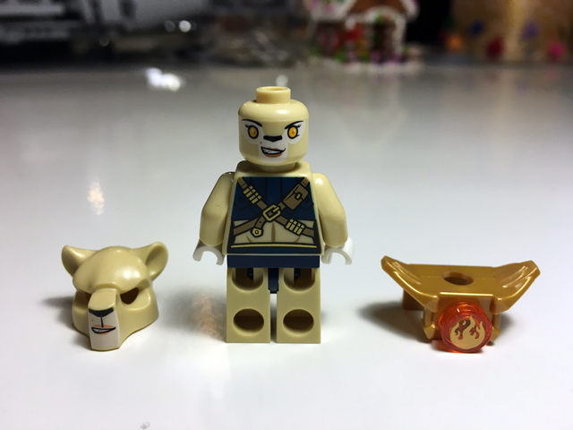](https://www.freelug.org/IMG/jpg/TPLion_06.jpg)

Vient ensuite la _[Guerrière Lionne](http://brickset.com/minifigs/loc116/Lioness-Warrior)_ avec son casque à mâchoire métallique.

[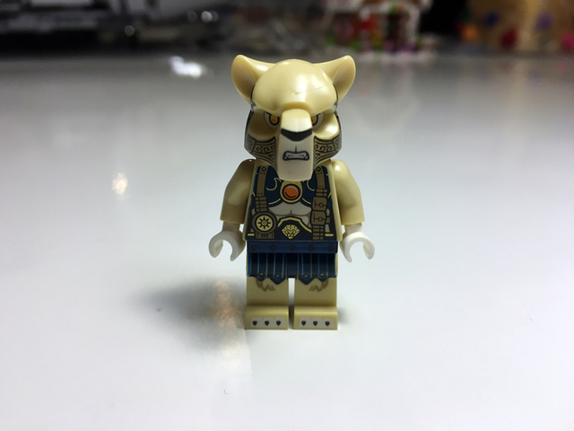](https://www.freelug.org/IMG/jpg/TPLion_07.jpg)

Sans son casque, on aperçoit le visage féminin presque juvénile. Pour le reste on est sur le même corps que _Li’Ella_.

[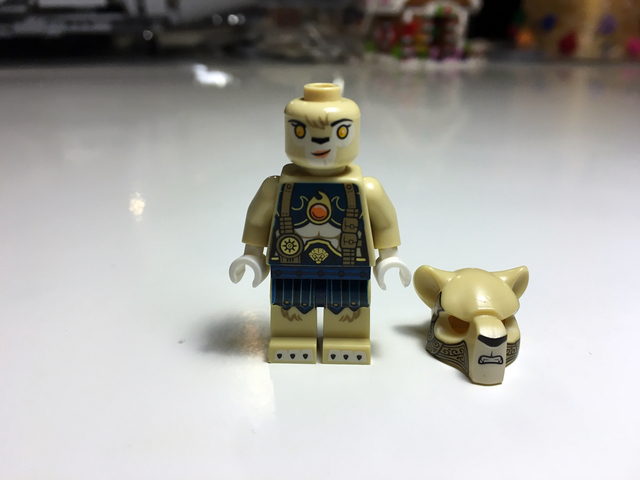](https://www.freelug.org/IMG/jpg/TPLion_08.jpg)

De dos on a le droit à un visage alternatif énervé.

[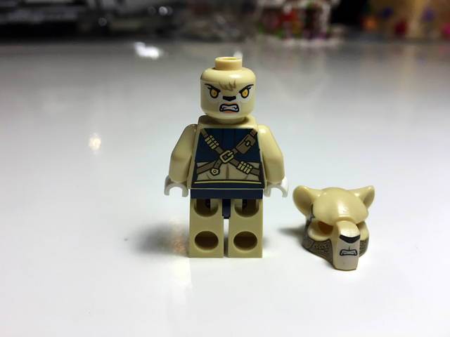](https://www.freelug.org/IMG/jpg/TPLion_09.jpg)

Nous arrivons enfin au _[Guerrier Lion](http://brickset.com/minifigs/loc117/Lion-Warrior)_ avec son casque. Les mêmes jambes que les deux figs précédentes, mais un torso très détaillé qui n’est pas sans rappeler un certain _[Starlion](http://jerem.lego.free.fr/Review/Lego/TPLion/Cosmocats_Starlion.png)_ de _[Cosmocats](http://jerem.lego.free.fr/Review/Lego/TPLion/Cosmocats_Logo.jpg)_.

[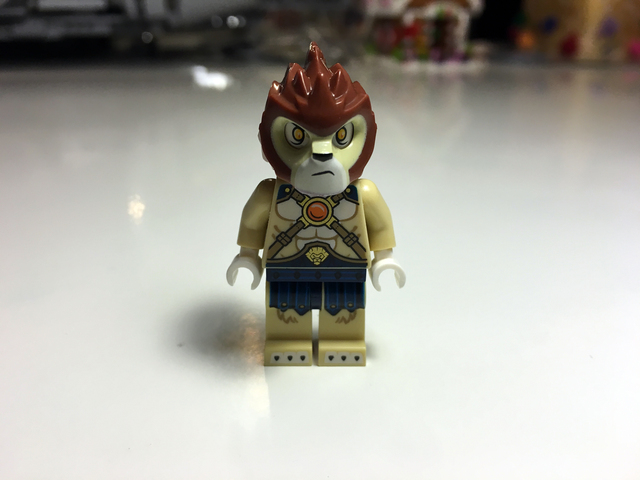](https://www.freelug.org/IMG/jpg/TPLion_10.jpg)

Une fois le magnifique casque enlevé, on a le droit à un visage narquois qui retranscrit parfaitement le surnom donné au lion, le _roi des animaux_.

[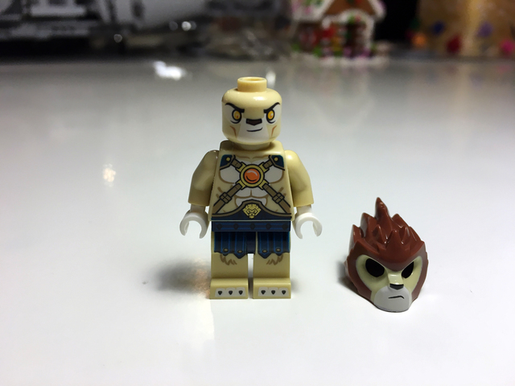](https://www.freelug.org/IMG/jpg/TPLion_11.jpg)

Le verso nous offre un visage alternatif énervé.

[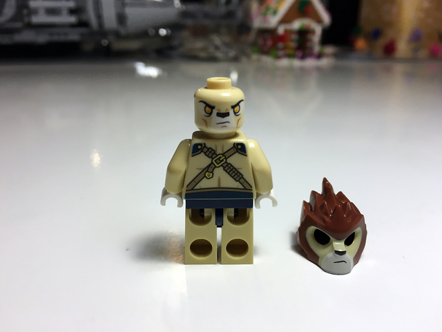](https://www.freelug.org/IMG/jpg/TPLion_12.jpg)

Petite photo de famille de ces trois magnifiques minifigures.

[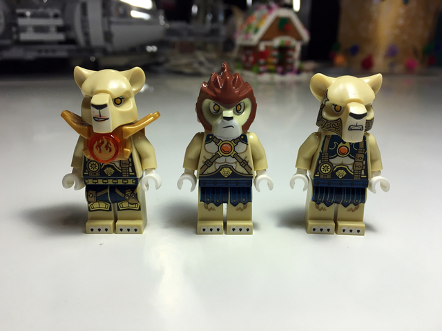](https://www.freelug.org/IMG/jpg/TPLion_13.jpg)

Une photo du set complet.

**AVIS :**

Que dire de plus que je n’ai déjà dit dans mes deux premières reviews. Ici aussi, machine de guerre insignifiante et trois figurines magnifiquement réalisées.

* * *

Au vue de la pauvreté des machines de guerre de ces sets, on en vient à se demander pourquoi _LEGO_ ne fait plus de boite exclusivement composé de plusieurs figurines comme dans les années 80 (par exemple avec les _Spaceman_ comme le set _[6703](http://brickset.com/sets/6703-1/Minifig-Pack)_ ci-dessous).  
Surtout sur des licences maison comme _Chima_ ou _Ninjago_.

