Partons dans les chantiers avec cette boite qui propose une grue mobile !

[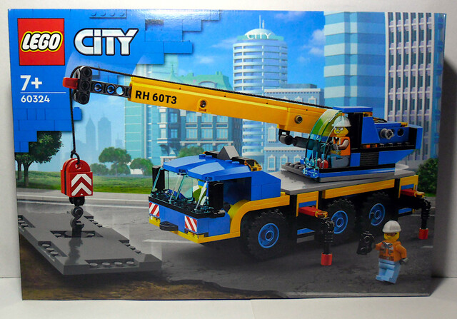](https://www.freelug.org/IMG/jpg/sam_3945.jpg)

Le set comprend 340 pièces avec deux personnages et une grue. Pour un prix de 39,99 € soit un rapport prix/pièces de 0,12 euros, c’est dans la moyenne city, même si la boîte semble chère.  
Une petite vue arrière donne une idée de la jouabilité du set :

[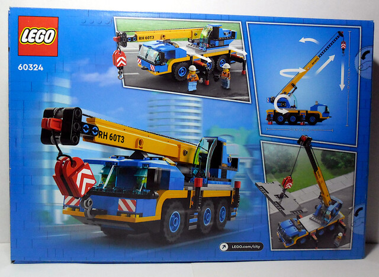](https://www.freelug.org/IMG/jpg/sam_3946.jpg)

Venons au principal : le contenu de la boite :

[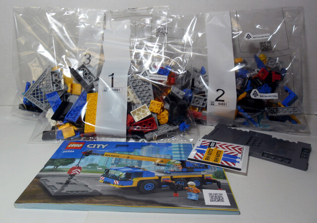](https://www.freelug.org/IMG/jpg/sam_3994.jpg)

Et voilà une petite feuille de sticker !

[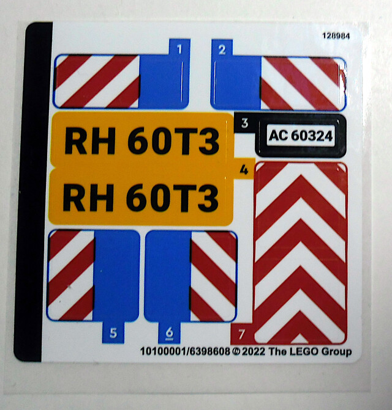](https://www.freelug.org/IMG/jpg/sam_3995.jpg)

Deux personnages, mixtes

[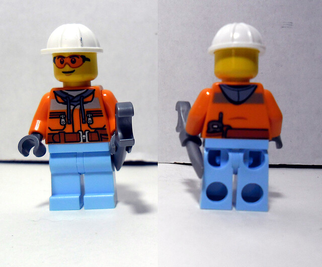](https://www.freelug.org/IMG/jpg/sam_3998.jpg)

[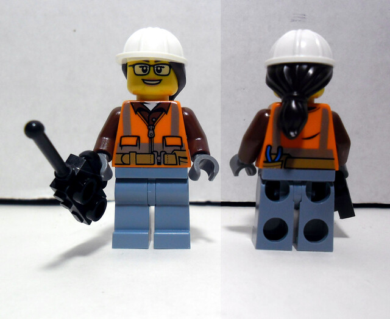](https://www.freelug.org/IMG/jpg/sam_4007.jpg)

Passons à la bête : la fameuse grue :  
On commence avec le châssis :

[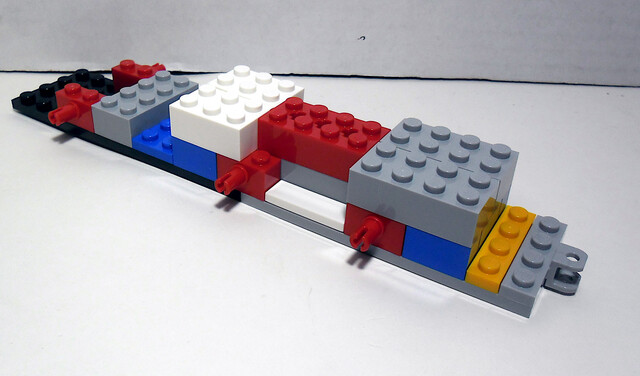](https://www.freelug.org/IMG/jpg/sam_4001.jpg)

le système de stabilisation :

[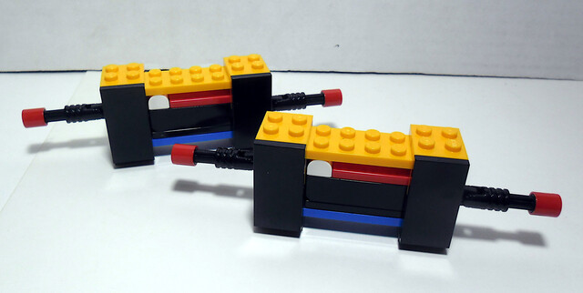](https://www.freelug.org/IMG/jpg/sam_4003.jpg)

[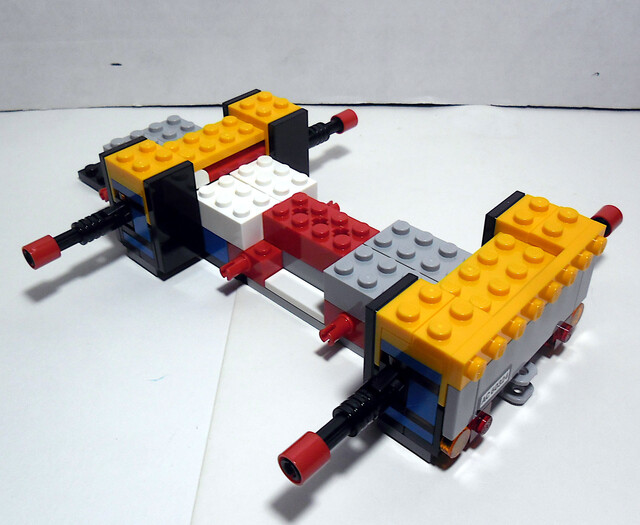](https://www.freelug.org/IMG/jpg/sam_4004.jpg)

[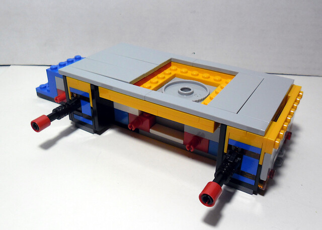](https://www.freelug.org/IMG/jpg/sam_4009.jpg)

On continue avec la cabine conducteur :

[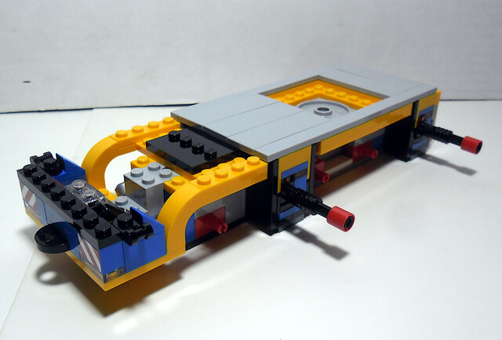](https://www.freelug.org/IMG/jpg/sam_4010.jpg)

[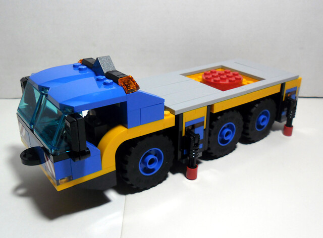](https://www.freelug.org/IMG/jpg/sam_4012.jpg)

Et finissons avec la partie grue :

[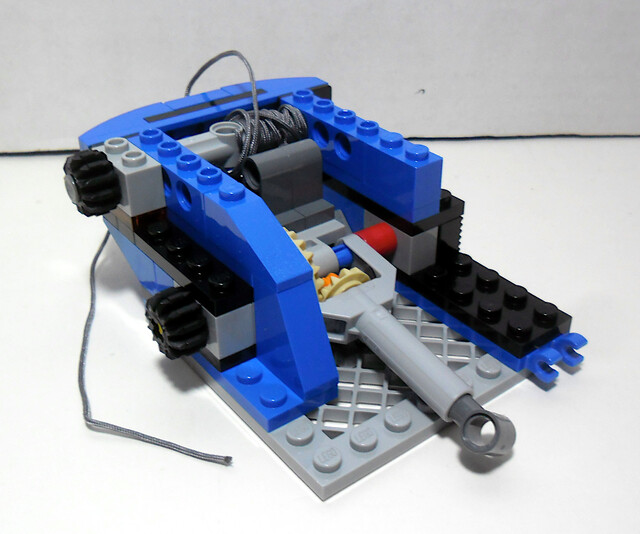](https://www.freelug.org/IMG/jpg/sam_4015.jpg)

[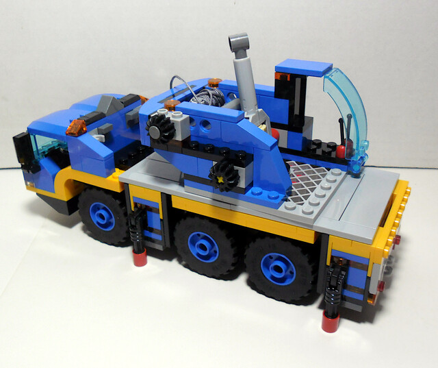](https://www.freelug.org/IMG/jpg/sam_4016.jpg)

[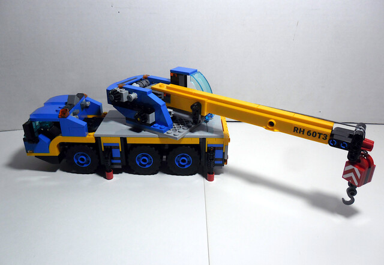](https://www.freelug.org/IMG/jpg/sam_4017.jpg)

Voilà fini, une jolie grue !

[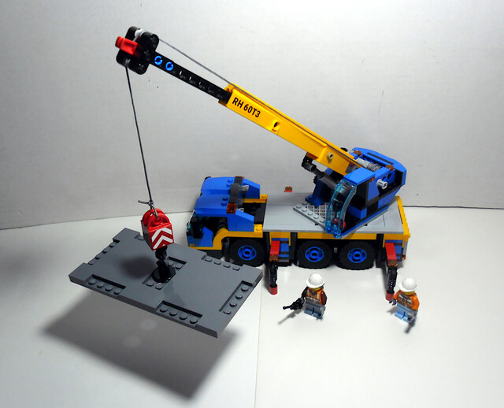](https://www.freelug.org/IMG/jpg/sam_4019.jpg)

[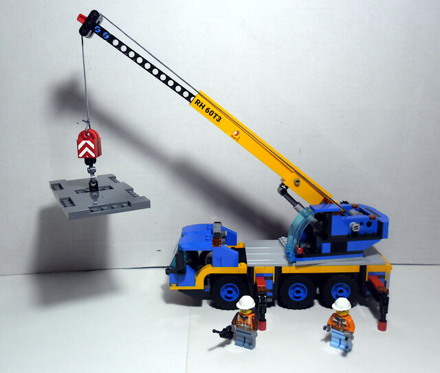](https://www.freelug.org/IMG/jpg/sam_4023.jpg)

Et pour terminer les extra parts :

[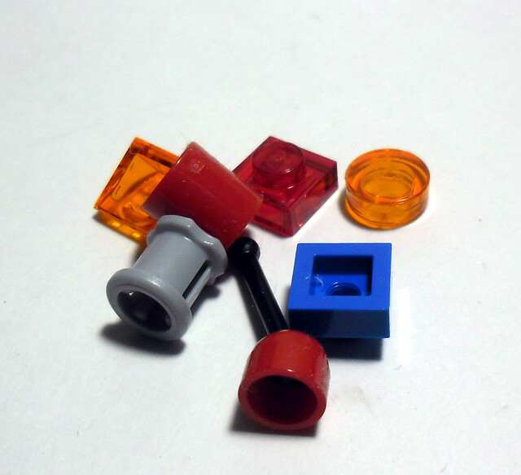](https://www.freelug.org/IMG/jpg/sam_4021.jpg)

**Conclusion**  
Que dire : la boite semble chère, et pour les enfants, c’est pas très jouable… Une fois construite, il n’y a pas grand-chose à faire…  
Pour un complément de chantier, c’est une idée, mais c’est tout.
