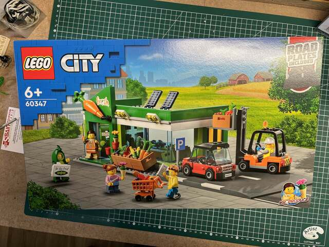
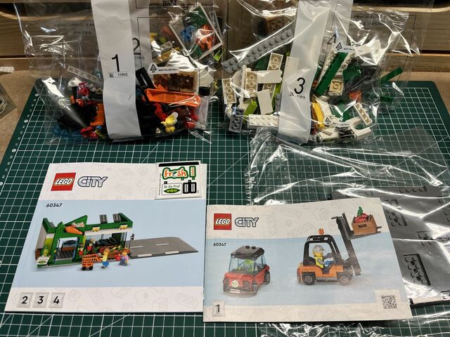
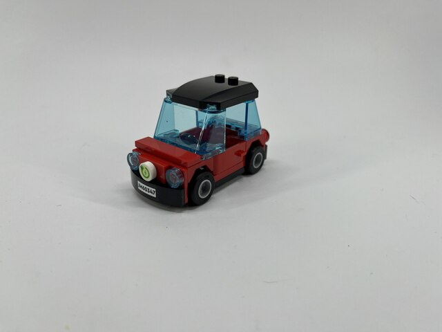
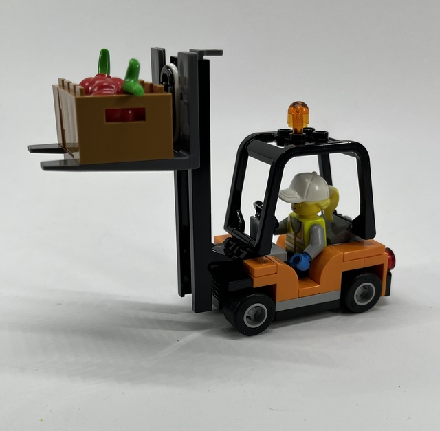
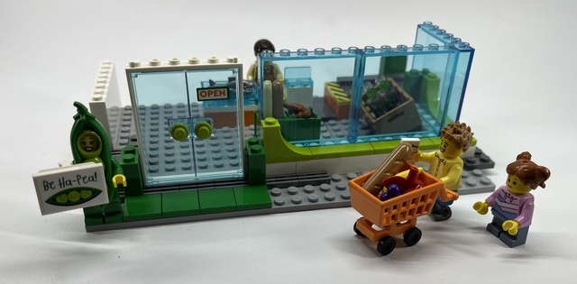
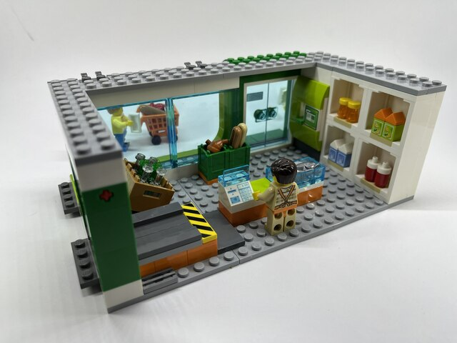
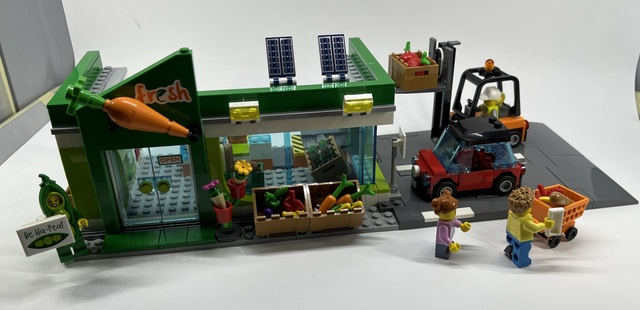

Nouveauté tout juste sortie au 1er juin 2022, ce set référence 60347 de la gamme LEGO City comprend 404 pièces et est vendu au prix de 59,99€ sur le Shop LEGO.

Il s’agit d’un sujet pas trop traité dans la gamme "ville" de LEGO, car hormis le célèbre "[Green Grocer](https://www.bricklink.com/v2/catalog/catalogitem.page?O=10185-1#T=S&O={{ '{%' }}22iconly%22:0})" de la gamme Modular et le supermarché Kwik-E-Mart des Simpsons [71016](https://www.bricklink.com/v2/catalog/catalogitem.page?O=71016-1#T=S&O={{ '{%' }}22iconly%22:0}), je n’ai pas souvenir d’autres sets dans ce même genre de sujet "généraliste".

D’ailleurs en le montant, je me disais qu’un set d’épicerie nécessite pas mal de détails sur les produits mis en rayon et qu’il fallait trouver un bon compromis entre des rayons bien pourvus en marchandises et l’aspect répétitif qu’il pourrait y avoir à présenter dix fois les mêmes accessoires ou fruits et légumes et qu’au final un rayon bien garni avait autant d’intérêt qu’un rayon vide.

Se pose aussi la question de la taille d’un tel bâtiment, évidement très fréquent dans nos villes, mais rarement représentatif d’une architecture exceptionnelle.

En ce qui concerne ce set 60347, je dois avouer que le compromis est assez bien trouvé. Il s’agit d’une épicerie à taille humaine, avec juste ce qu’il faut comme produits alimentaires pour bien évoquer l’activité commerciale, sur une surface attractive avec quelques personnages et véhicules venant ajouter de la jouabilité à l’ensemble. Il n’y a pas de mauvaise surprise sur le prix de ce set, qui permet de bien s’occuper en le montant et de jouer "au marchand" après.

Encore une fois LEGO fait preuve d’inclusion en cassant un peu les genres pour nous mettre en situation une manutentionnaire à la manoeuvre du charriot élévateur et un petit garçon appareillé d’une prothèse. C’est une préoccupation récurrente dans cette nouvelle gamme City 2022, qui nous présente également sur d’autres sets des femmes en situation de responsabilités, qui historiquement étaient plutôt confiés à des personnages masculins, ainsi que des personnages en situation de handicap, afin que tous les enfants puissent s’identifier à ces personnages, sans complexe ou arrière pensée. C’est une préoccupation qui est dans l’air du temps et c’est tant mieux, il était temps.

Passons maintenant aux différentes étapes de montage de ce set, qui s’assemble sans aucune difficulté avec différents sachets numérotés.

Le premier sachet est consacré aux 2 véhicules présents dans ce set. Oui, il y a bien de quoi construire 2 véhicules avec ce sachet. Nous sommes en 2022, nous avons donc une petite voiture électrique, reconnaissable à son cache prise caractéristique et un petit chariot élévateur assez classique.

Ces véhicules pourront officier sur la plaque de route présente également dans ce set.

Les autres étapes concernent l’assemblage de l’épicerie et de ses rayonnages et se terminent par la mise en situation avec la plaque de route et un peu d’habillage fun.

Comme je le soulignais plus haut, il y a de la diversité dans les produits proposés, mais pas de répétitivité, juste ce qu’il faut pour bien représenter les rayons et leur approvisionnement.

L’habillage final est assez sympathique avec une belle devanture, une animation de pois et un petit coin parking.

Nous avons donc un petit set assez fun dont l’enseigne est également rappelée dans la nouvelle gare 60335 qui fera également l’objet d’une prochaine revue de boîte.

N’hésitez pas à commenter cet article et à partager vos impressions et réflexions.
