Aujourd’hui je vous présente le set _31051_, _Le phare_, dans la gamme _Creator_ _3 en 1_.

Sorti en 2016, ce modèle comporte 528 pièces pour 49,99 €, soit un ratio de 0,9 € par pièce. Deux figurines et une brique lumineuse orange sont présentes dans la boîte.

L’avant, classique pour la gamme, présente le modèle principal, avec la brique lumineuse bien en évidence. À gauche les logos LEGO et Creator, sur la droite celui indiquant qu’il y a une brique lumineuse, et sur le côté les modèles alternatifs que l’on peut construire. Pas de doute, on est dans un thème maritime, avec un orque et deux poissons faisant un bond hors de la mer, et deux mouettes. Les modèles alternatifs restent dans la gamme, un bateau et une bouée pour l’un, une maison et un hors-bord pour l’autre.

[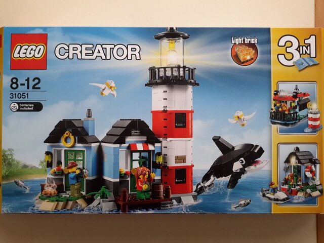](https://www.freelug.org/IMG/jpg/20180218_110325.jpg)

Au dos, comme d’habitude les trois modèles mis en scène simultanément. À gauche le phare est présenté décomposé en ses parties élémentaires.

[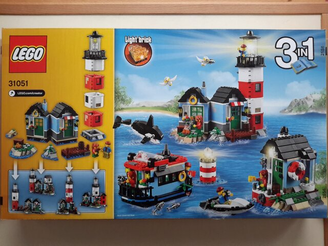](https://www.freelug.org/IMG/jpg/20180218_110344.jpg)

C’est en effet une particularité de ce modèle, que je n’avais pas encore rencontrée — mais qui est utilisée sur d’autres ensembles actuels comme La maison familiale (numéro 31069) avec comme légende « Modular ».

* * *

Dans la boîte une seule notice, grand format A4 et bien épaisse, pour les trois modèles.

[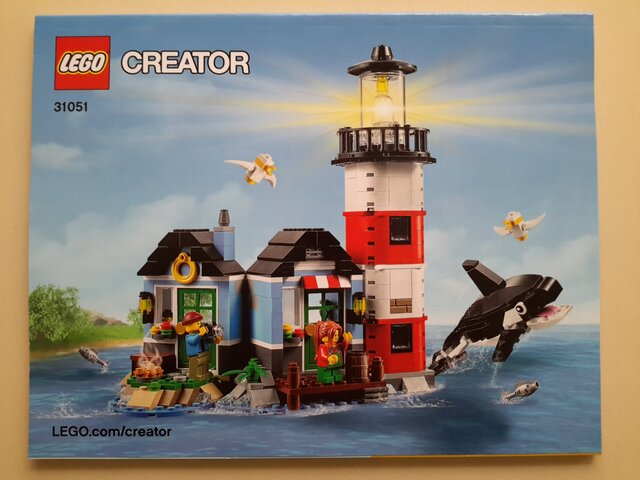](https://www.freelug.org/IMG/jpg/20180218_110413.jpg)

Les sachets ouverts, cela fait un beau tas de pièces. Les deux personnages sont déjà assemblés sur cette photo.

[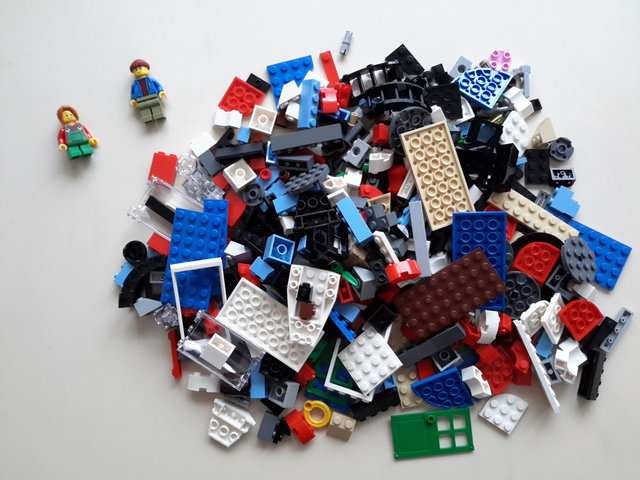](https://www.freelug.org/IMG/jpg/20180225_112926.jpg)

La première minifigurine représente un homme avec un costume de marin. Il porte un polo marron et le bonnet assorti, une veste bleue avec une ancre, comme il se doit. Une poche de chaque côté complète l’ensemble. Les jambes en revanche sont unies, de même que les bras.

[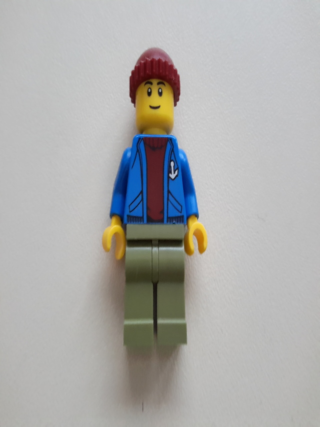](https://www.freelug.org/IMG/jpg/20180225_112637.jpg)

De dos, toujours les jambes unies, et la suite de la veste, avec juste ses rayures.

[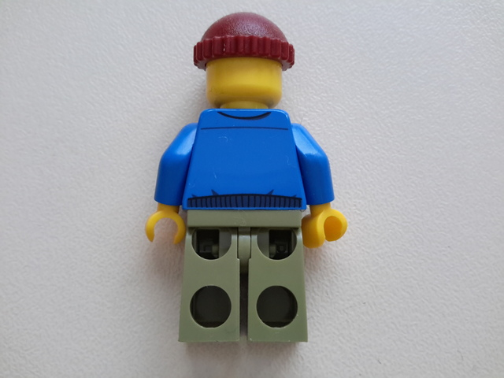](https://www.freelug.org/IMG/jpg/20180225_112714.jpg)

La seconde minifigurine représente une petite fille, portant une salopette verte sur une chemise rouge à rayures bleues. Quelques taches de rousseur, et une belle masse de cheveux dans le dos. En revanche jambes et bras sont unis.

[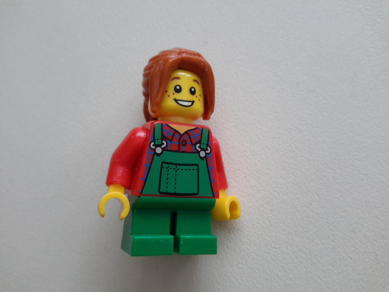](https://www.freelug.org/IMG/jpg/20180225_112803.jpg)

La figurine de dos, avec et sans les cheveux. Le motif de la salopette se prolonge correctement.

[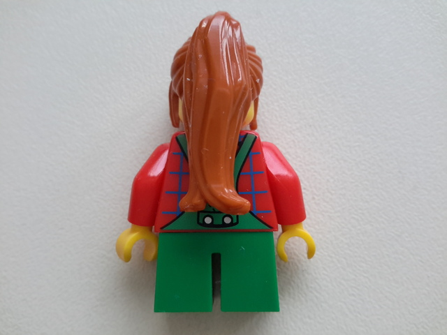](https://www.freelug.org/IMG/jpg/20180225_112736.jpg)

[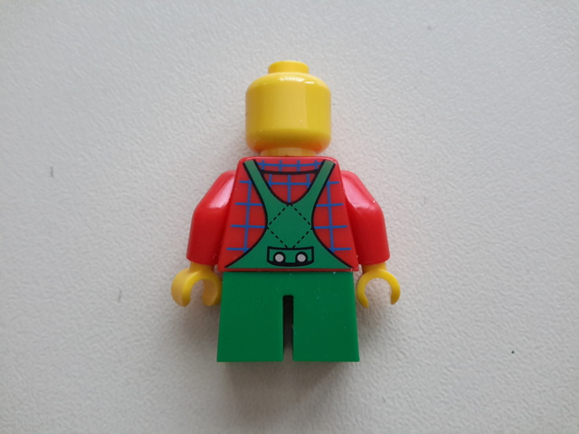](https://www.freelug.org/IMG/jpg/20180225_112826.jpg)

Je ne vais pas présenter les étapes de construction, mais passer directement au phare complet. À son sommet évidemment la brique lumineuse, activable par une barre à l’arrière. Deux mouettes, avec une pièce que je connaissais pas, 1x1 avec deux trous latéraux, décorent le toit. Une petite fille donne un poisson à l’orque, pendant qu’un adulte prend une photo. Une bouée jaune décore la porte de gauche.

[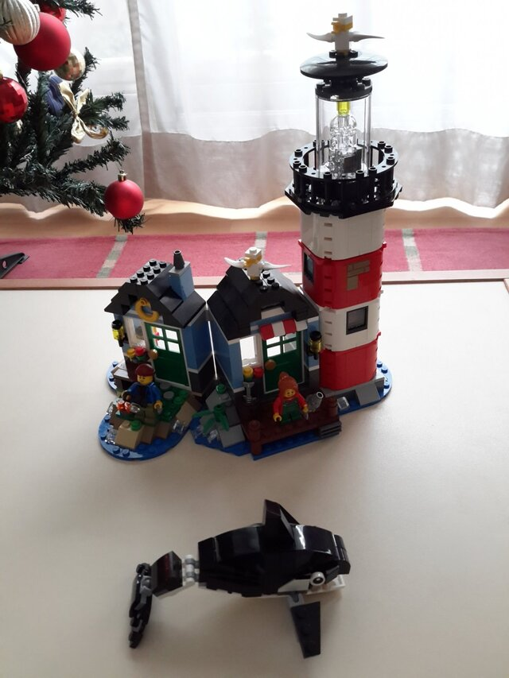](https://www.freelug.org/IMG/jpg/20180218_104305-r90.jpg)

La maison s’ouvre, avec quelques détails comme un sextant accroché au mur, un tableau , une petite table avec tasse à café.

[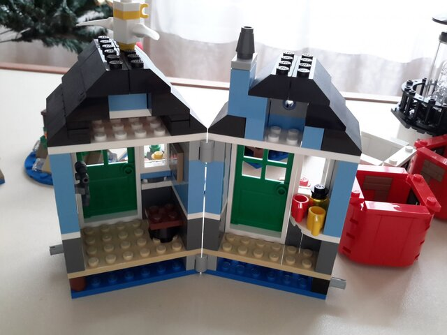](https://www.freelug.org/IMG/jpg/20180218_104605.jpg)

Le modèle avec les pièces bonus.

[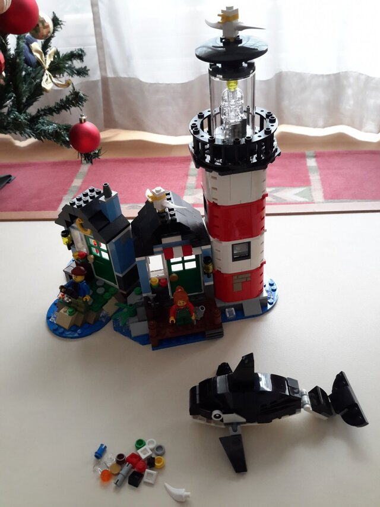](https://www.freelug.org/IMG/jpg/20180218_110104-r90.jpg)

Le dauphin a plusieurs articulations : la queue, les nageoires latérales, et la mâchoire inférieure.

[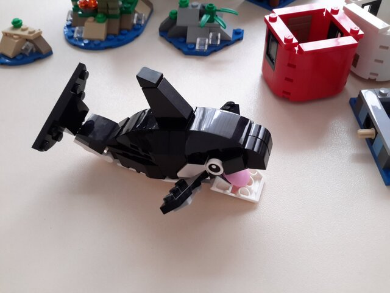](https://www.freelug.org/IMG/jpg/20180218_104457.jpg)

[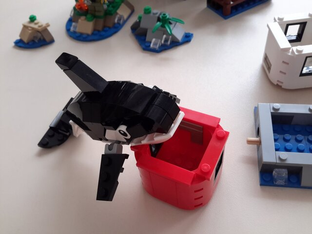](https://www.freelug.org/IMG/jpg/20180218_104523.jpg)

Et comme indiqué sur la boîte, le modèle peut se décomposer en parties élémentaires : le phare comporte quatre étages plus le support, le toit de la maison s’en va, les plantes et le ponton se détachent, etc.

[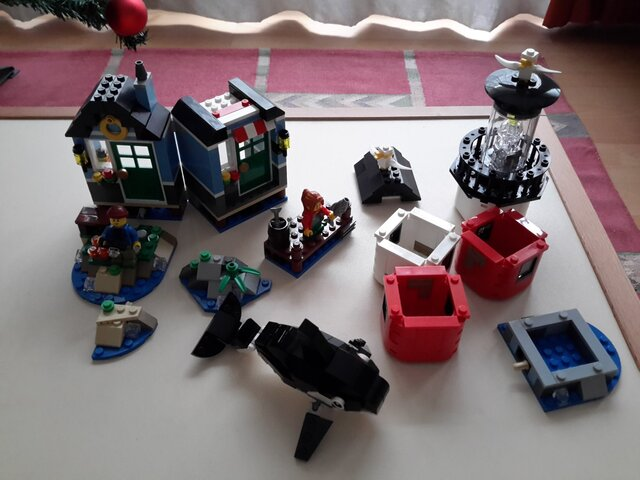](https://www.freelug.org/IMG/jpg/20180218_104658.jpg)

Ceci permet de combiner les différents éléments de pas mal de façon. Voici celles présentées dans la notice.

Le phare sur le toit de la maison de droite, avec le ponton orienté perpendiculairement.

[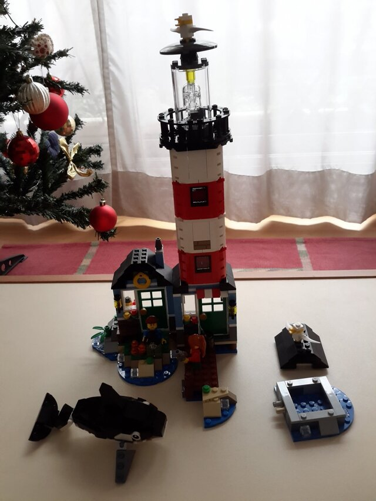](https://www.freelug.org/IMG/jpg/20180218_105043-r90.jpg)

Le phare du côté gauche, avec un étage supplémentaire sur la maison de droite.

[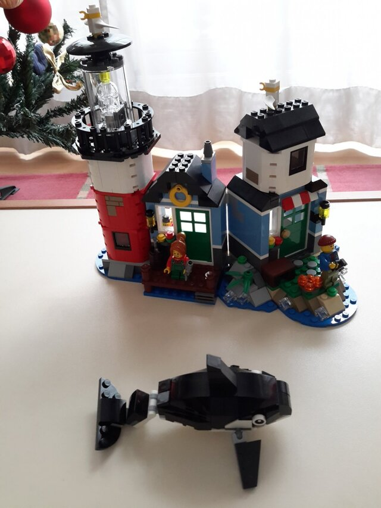](https://www.freelug.org/IMG/jpg/20180218_105317-r90.jpg)

Le ponton reliant le phare à la maison.

[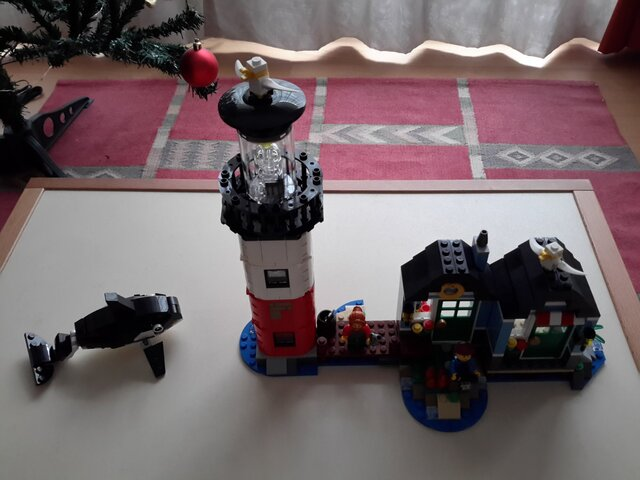](https://www.freelug.org/IMG/jpg/20180218_105550.jpg)

Trois maisons, le phare sur celle du centre.

[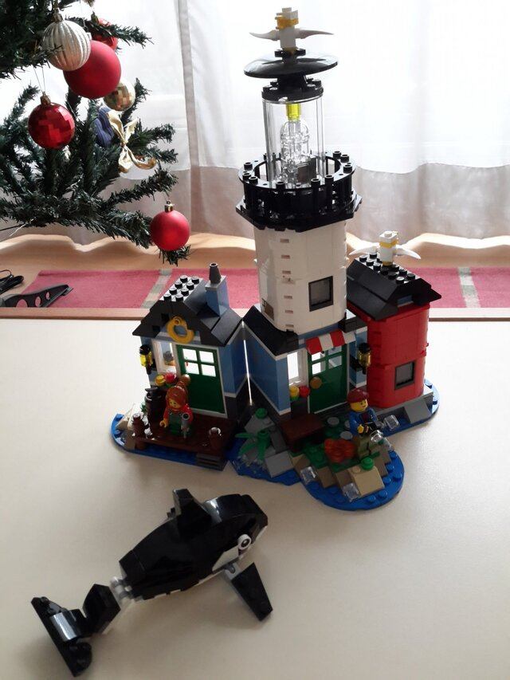](https://www.freelug.org/IMG/jpg/20180218_105827-r90.jpg)

* * *

Voici quelques photos des modèles alternatifs.

Le premier est une petite maison au bord de l’eau accompagnée d’un hors-bord. Elle a un ponton, simple mais sympathique, une fenêtre vertical laissant bien entrer la lumière. La brique lumineuse est située au-dessus de la porte, et s’allume sur l’arrière. À l’intérieur toujours le tableau de bateau, et quelques tasses.

[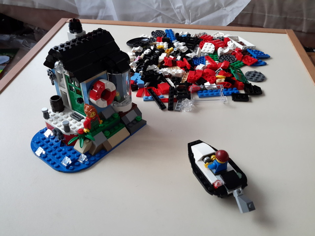](https://www.freelug.org/IMG/jpg/20180225_150937.jpg)

[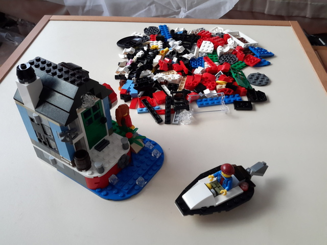](https://www.freelug.org/IMG/jpg/20180225_150954.jpg)

[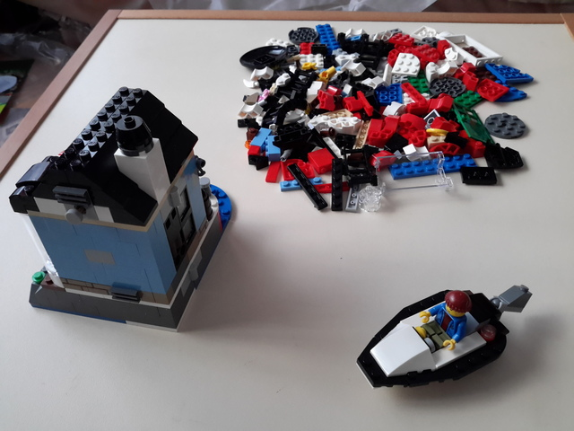](https://www.freelug.org/IMG/jpg/20180225_151005.jpg)

[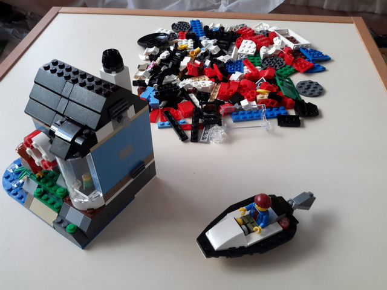](https://www.freelug.org/IMG/jpg/20180225_151016.jpg)

[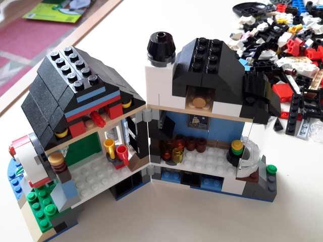](https://www.freelug.org/IMG/jpg/20180225_151039.jpg)

Le second modèle est un petit bateau, avec une bouée de navigation (sur laquelle se pose la brique lumineuse bien sûr). Un côté du bateau s’ouvre, à l’intérieur encore le tableau maritime. Une verrière laisse entrer la lumière.

[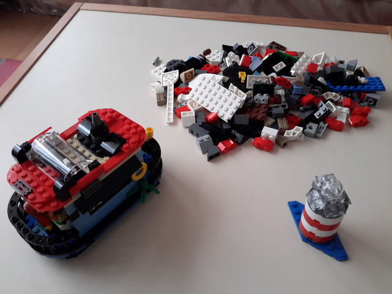](https://www.freelug.org/IMG/jpg/20180304_114804.jpg)

[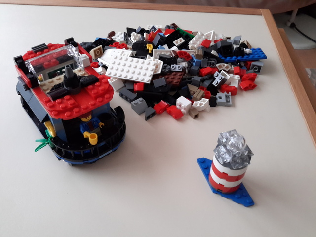](https://www.freelug.org/IMG/jpg/20180304_114818.jpg)

[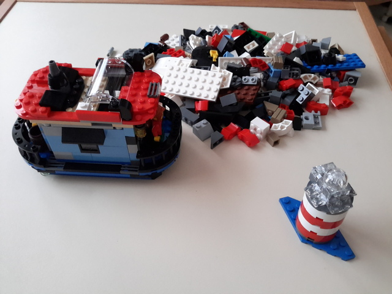](https://www.freelug.org/IMG/jpg/20180304_114832.jpg)

[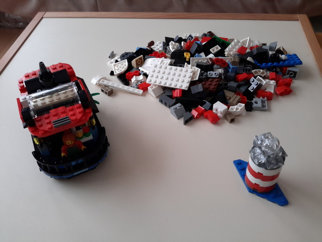](https://www.freelug.org/IMG/jpg/20180304_114847.jpg)

[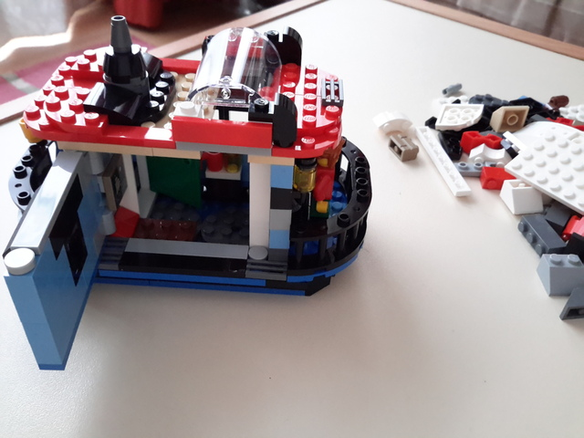](https://www.freelug.org/IMG/jpg/20180304_114943.jpg)

* * *

**Avis :** j’adore ce set, franchement. L’idée de sous-parties modulaires est excellente (du Lego récursif !), et bien implémentée — les éléments sont suffisamment petits pour pouvoir être assemblés de nombreuses façons tout en restant cohérents entre eux. Seul bémol, les pins Technic qui relient les composants, quand on les détache, ont tendance à rester sur la mauvaise brique ! Mais je chipote...

L’orque et les mouettes ont un bon rendu également, et les figurines sont sympathiques.

Bref, tout bon pour moi !
