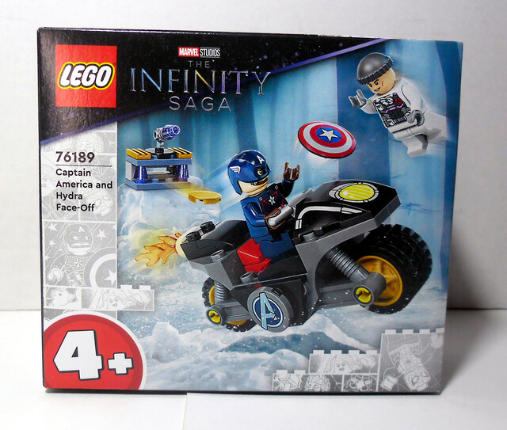
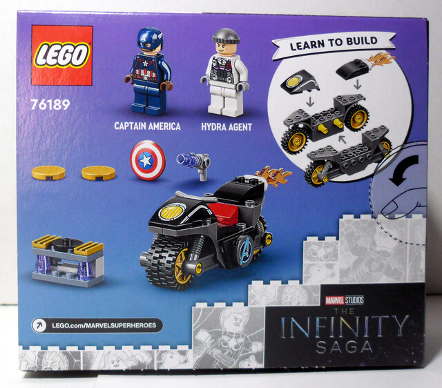
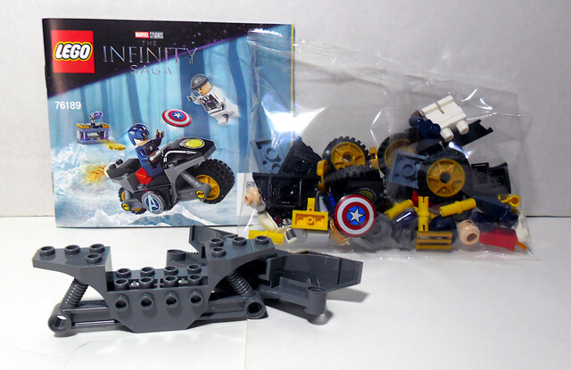
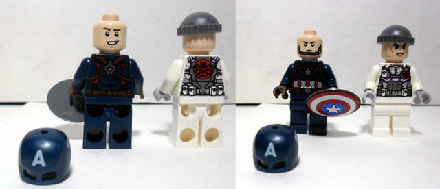
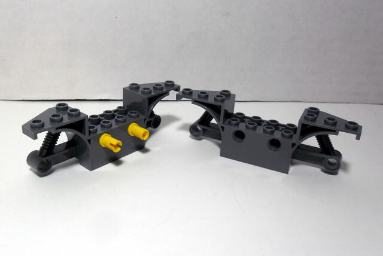
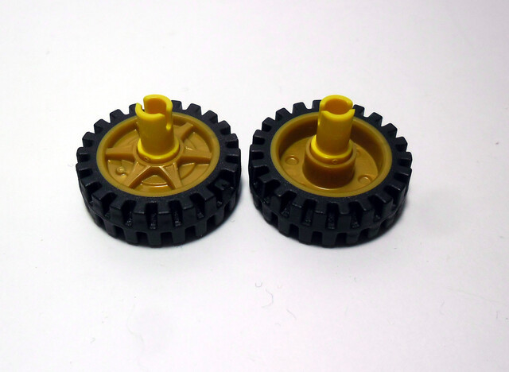
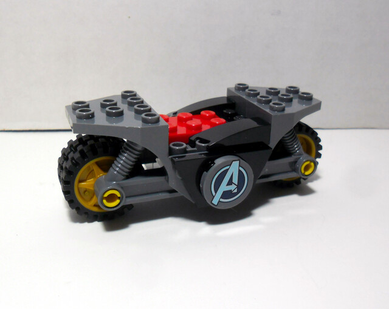
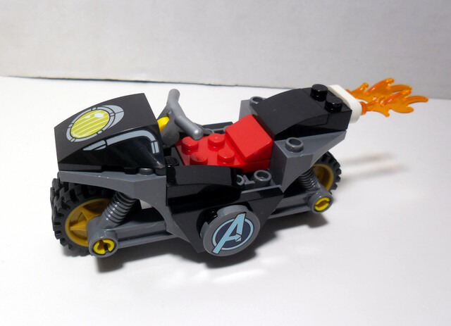
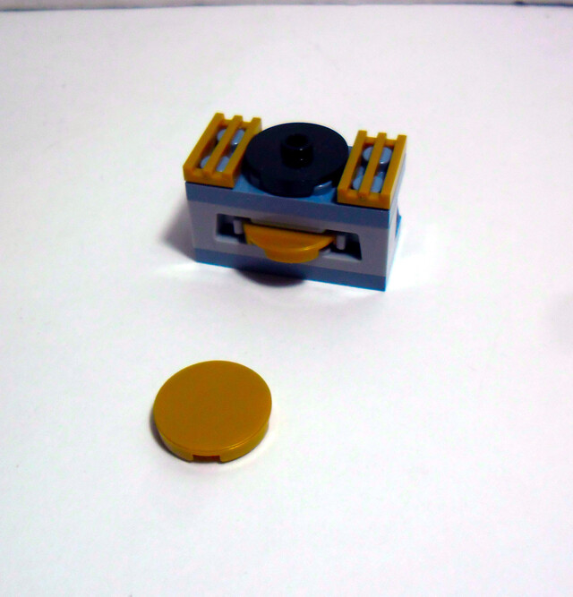
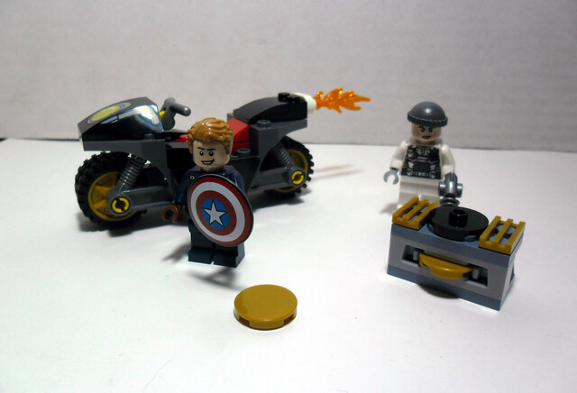

Une boite de SuperHéros dans l’ex gamme junior, ça donne donc quoi ?

Le set comprend 49 pièces avec deux personnages. Pour un prix de 9,99€ soit un rapport prix/pièces de 0,203 euros, c’est très cher diront certains. Mais est-ce vraiment une gamme pour les adultes ?  
Une petite vue arrière donne une idée de la jouabilité du set :

Venons au principal : le contenu de la boite :

Deux personnages, Captain America et un méchant, un soldat d’Hydra

Avec une grosse metapièce, la moto se monte très très vite :

Petite subtilité, les jantes avec pneus :

Passons au lance bidule, vraiment inutile :

Voilà fini, une petite photo de famille !

**Conclusion**  
Que dire : pour adulte, ben entre un Captain et un méchant lambda, c’est peu pour les adultes que nous sommes.  
Pour un jeune, il est déjà possible de jouer direct avec ces éléments (enfin c’est vite dit...). Et pour ce prix, moi je pense que c’est limite.
