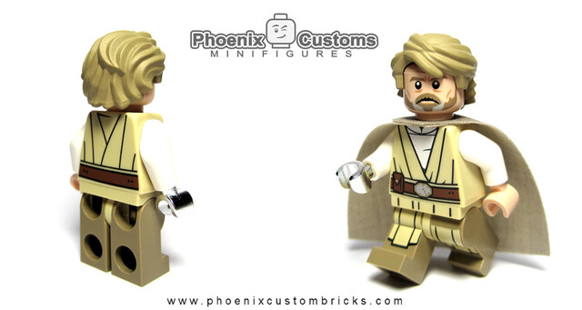
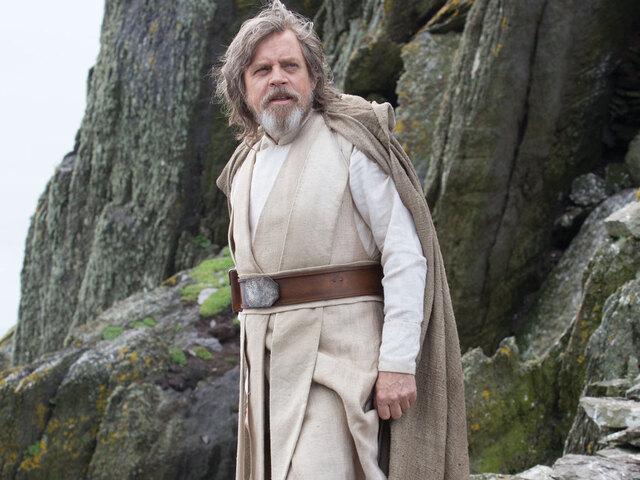
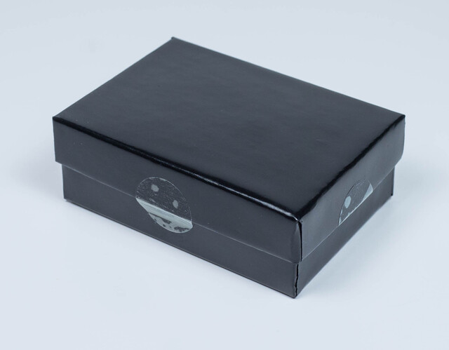
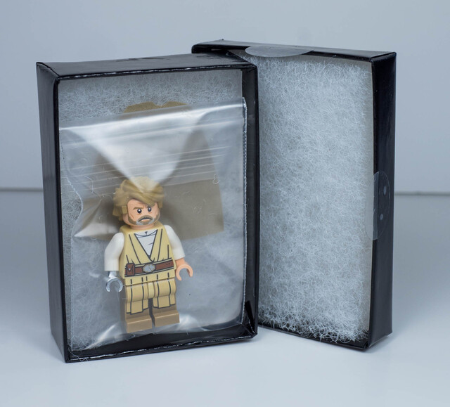
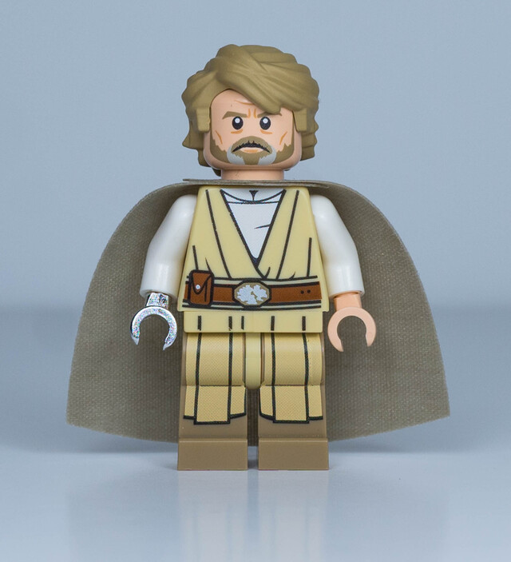
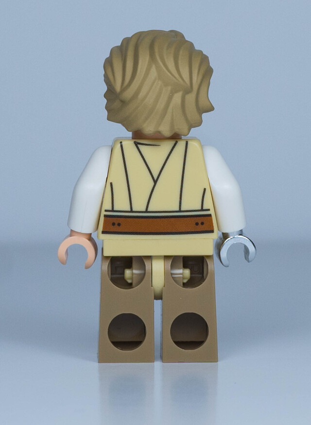
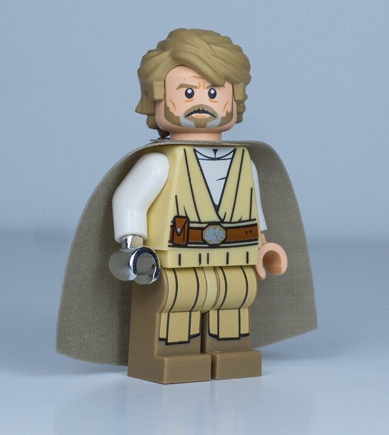
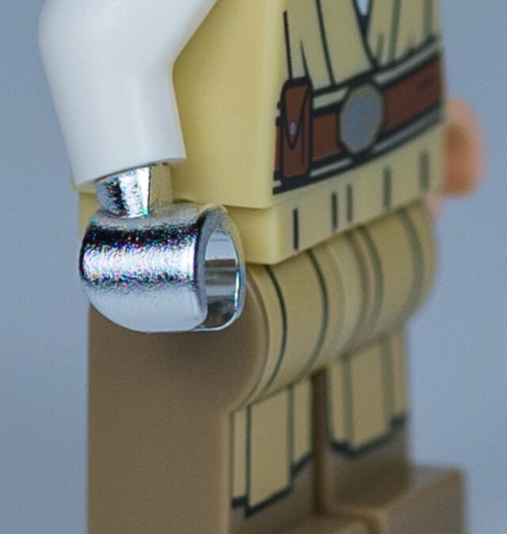

Aujourd’hui je vous propose la review d’une figurine custom : **Galactic Master**, custom de **Luke Skylwalker** version "_The Force Awakens_".

_Phoenix_ est un créateur de custom reconnu par la communauté AFOL. Ses customs sont créés à partir de pièces officielles et sont sérigraphiées avec le même procédé que chez _LEGO_. Vous pouvez retrouver ses créations sur son site _[phoenixcustombricks.com](http://www.phoenixcustombricks.com/)_.

* * *

La fig que je vais vous présenter est donc issue du film _Star Wars : The Force Awakens_ sorti en décembre 2015 sur les écrans de cinéma.

Elle sera en vente sur le site de Phoenix dans quelques jours au prix de 65$, j’ai la chance de l’avoir reçue en avance car je l’avais précommandée il y a quelques mois déjà. Ce qui me permet de vous offrir cette review exclusive avant sa sortie officielle.

* * *

-   **Luke Skywalker**

> **Luke Skywalker** est le personnage principal de la trilogie originale _Star Wars_ (épisodes IV à VI). Il est le fils d’_Anakin Skywalker_ et de _Padmé Amidala_ et le frère jumeau de la princesse _Leia Organa_. Il naît en 19 av. BY dans _La Revanche des Sith_. Il devient un chevalier Jedi et sera le héros de l’Alliance rebelle pendant la Guerre Civile Galactique dans _Un nouvel espoir_, _L’Empire contre-attaque_ et _Le Retour du Jedi_. Trois décennies plus tard, il est le dernier Jedi en vie et s’est exilé sur une planète reculée.
> 
> Il est interprété au cinéma par l’acteur _Mark Hamill_.
> 
> Source : _[Wikipedia](https://fr.wikipedia.org/wiki/Luke_Skywalker)_.

Luke Skywalker (Mark Hamill) dans Star Wars : The Force Awakens

* * *

Figurine exclusive oblige, _Phoenix_ fournit sa création dans une boite en carton noire. Cela change du traditionnel sachet plastique et donne un côté qualitatif indéniable.

A l’intérieur, la figurine est protégée dans un sachet plastique et est entourée de bourre en fibre. La cape est placée derrière la figurine.

Sans être la plus originale des sérigraphies que j’ai vues (la faute au costume/tunique originale qui n’autorise pas des milliers de fioritures), elle reste néanmoins très précise et très fidèle au film (voir photo plus haut). **La réalisation quant à elle est de haute volée**.

C’est une quasi perfection pour la teinte de la tunique sur le pantalon, et les sérigraphies sont parfaitement alignées.

Le visage a le droit aux taches blanches dans la barbe et l’âge de _Luke_ est bien retranscrit. Quelques mèches blanches dans les cheveux et ça aurait été le Nirvana.

Au dos on retrouve la sobriété de la face. Pas de visage alternatif de présent.

Sur les côtés, aucune sérigraphie ne vient agrémenter ce custom. La main chromée est quant à elle superbement réalisée, le chromage est parfait.

Gros plan sur la main chromée.

* * *

**CONCLUSION :**

Une nouvelle réussite de la part de _Phoenix_, ses réalisations sont vraiment de plus en plus belles et techniques et n’ont rien à envier aux productions officielle _LEGO_, loin de là.

Ses customs restent cher, même très cher pour certains, mais il est indéniable que l’on en a pour son argent tant la qualité de fabrication est au rendez-vous.

Pour aller plus loin, vous pouvez lire l’interview d’_Adam_ (aka _Phoenix_) qui explique son [processus de création sur le site _HelloBricks_](http://www.hellobricks.com/2017/03/dossier-lego-plongee-monde-minifigs-custom-avec-phoenix-customs/).
