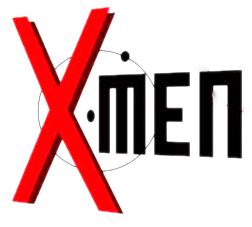
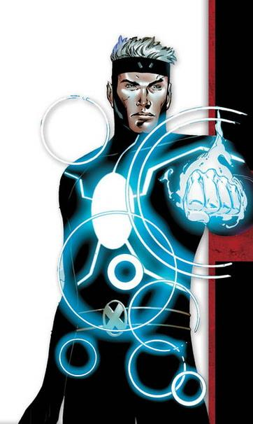
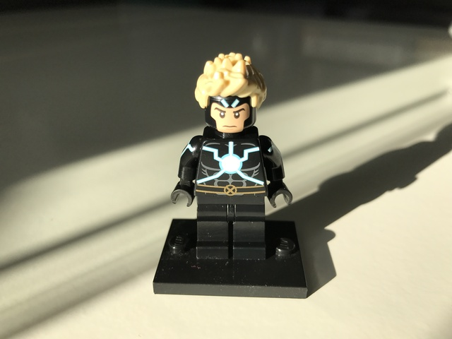
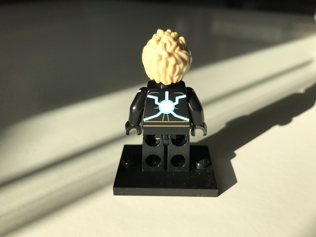
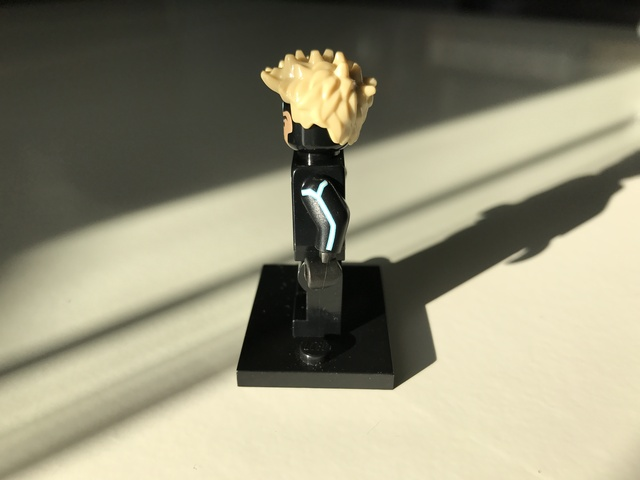
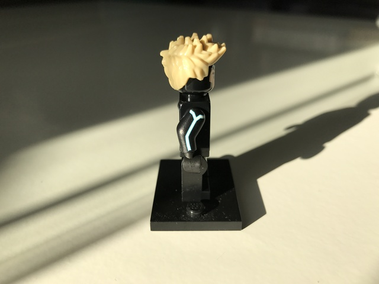

Aujourd’hui je vous propose la review d’une figurine custom du personnage de **Havok**.

> _Phoenix_ est un créateur de custom reconnu par la communauté AFOL. Ses customs sont créés à partir de pièces officielles et sont sérigraphiées avec le même procédé que chez LEGO.

Vous pouvez retrouver ses créations sur son site _[phoenixcustombricks.com](http://www.phoenixcustombricks.com/)_.

* * *

La fig que je vais vous présenter est issue du comics _[X-Men](https://fr.wikipedia.org/wiki/X-Men)_ édité par _[Marvel](https://fr.wikipedia.org/wiki/Marvel_Comics)_.

* * *

-   **Havok**

Son vrai nom est Alexander Summers. Il est le frère du mutant nommé _Cyclope_ (Scott Summers), leader de l’équipe des _X-Men_. Après la mort de leurs parents, les deux frères sont séparés. Alex ne montre aucun signe de mutation avant de se faire capturer par Ahmet Abdol, le _Monolithe Vivant_ (source _[Wikipedia](https://fr.wikipedia.org/wiki/Havok_\(comics\))_).

* * *

De face la sérigraphie respecte complètement le costume du super-héros, les sérigraphies du torse, bien que simples sont sublimes. Le visage est très bien réalisé, le ton "chair" ne parait pas passé sur la tête noire.

De dos on retrouve quasiment le même dessin que sur le recto. La réalisation est toujours impeccable.

Côtés gauche et droit, nous avons droit à une sérigraphie sur chaque bras. C’est un plus qui ajoute au réalise du costume.

* * *

**CONCLUSION :**

Encore une réussite de la part de _Phoenix_ qui fournit vraiment des customs de haute volée.  
Même si les prix sont environ de 30-35$, la qualité est au rendez-vous et au final c’est tout ce qu’on demande.
