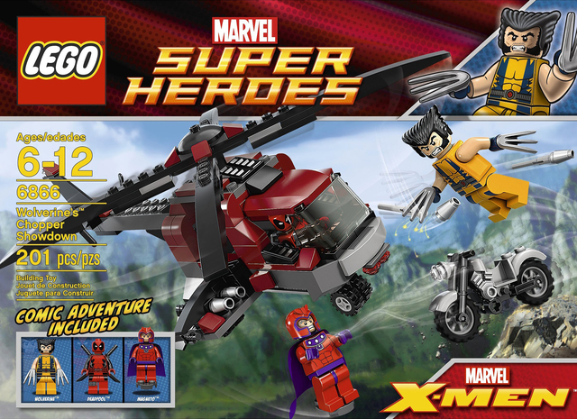
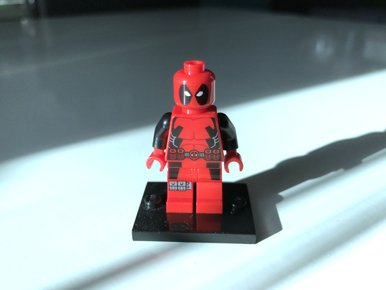
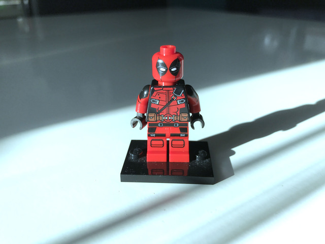
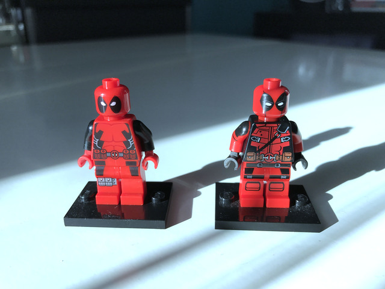
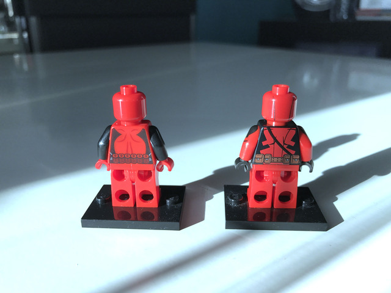
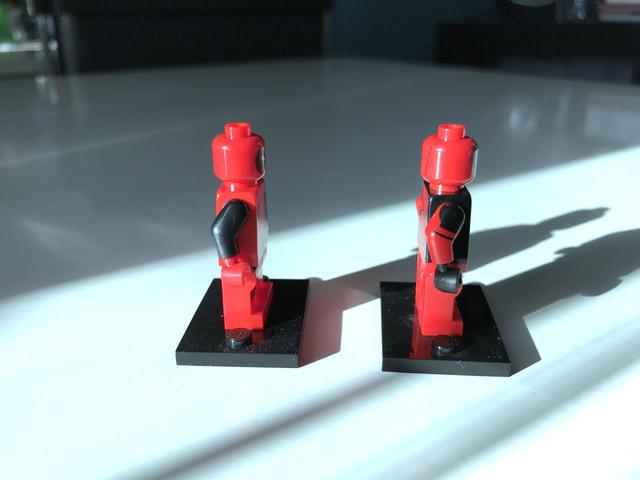
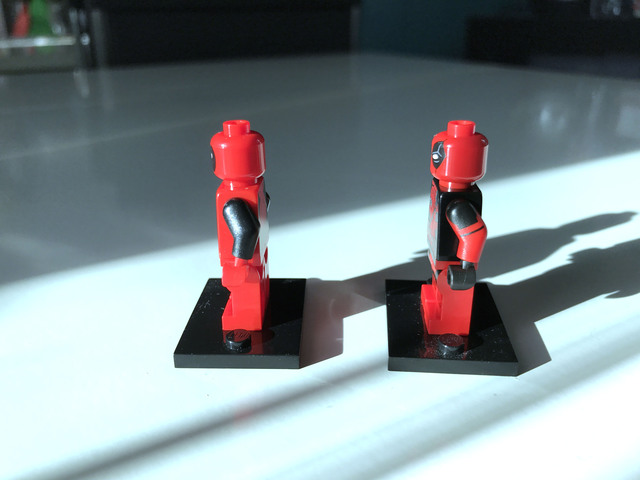

Review un peu spéciale aujourd’hui avec un comparatif de la minifigure _Deadpool_ officielle _LEGO_ et le [custom de _Phoenix_](http://www.phoenixcustombricks.com/sarcastic-mercenary/).

_Phoenix_ est un créateur de custom reconnu par la communauté AFOL. Ses customs sont créés à partir de pièces officielles et sont sérigraphiées avec le même procédé que chez _LEGO_.  
Vous pouvez retrouver ses créations sur son site _[phoenixcustombricks.com](https://www.phoenixcustombricks.com/)_.

* * *

Les figs que je vais vous présenter aujourd’hui sont issues du comics _[Deadpool](https://fr.wikipedia.org/wiki/Deadpool)_ édité par _[Marvel](https://fr.wikipedia.org/wiki/Marvel_Comics)_.

La figurine officielle _LEGO_ a été éditée dans un seul set datant de 2012, le _[6866](http://brickset.com/sets/6866-1/Wolverine-s-Chopper-Showdown)_.

* * *

**Les Minifigs :**

_Deadpool (officielle LEGO) :_  
Belle réussite pour cette figurine officielle, la sérigraphie est sobre tout en étant détaillée.

_Deadpool (Phoenix Customs) :_  
Un custom superbe, bien plus détaillé que la figurine officielle. Cette fig est très proche du costume que porte le personnage dans le film éponyme.

* * *

**Le comparatif :**

Quand on met les deux figs côte à côte on voit tout de suite que le custom est bien plus détaillé. Pour autant la fig officielle ne parait pas ridicule car elle prend le parti de la version Comics du personnage, alors que le custom s’inspire clairement du film.  
Chose étonnante les couleurs du torso sont complètement inversées sur les deux figs.

De dos on a le même sentiment au niveau réalisation, impeccable pour les deux et un traitement radicalement différent (Comics/Film).  
Il est à noter que le custom a le droit aux coutures sérigraphiées à l’arrière du masque.

Sur les côtés droit et gauche, encore une fois seul le custom a le droit à des sérigraphies.

* * *

**CONCLUSION :**

Une réussite, d’un côté comme de l’autre grâce à un traitement du personnage complètement différent. _LEGO_ opte pour la version Comics de _Deadpool_, alors que _Phoenix_ nous gratifie d’une version cinématographique, beaucoup plus adulte.  
Au final on fera son achat suivant la version qu’on aime le plus. **Personnellement j’adore les deux versions** et il m’est impossible de choisir celle que je préfère.
