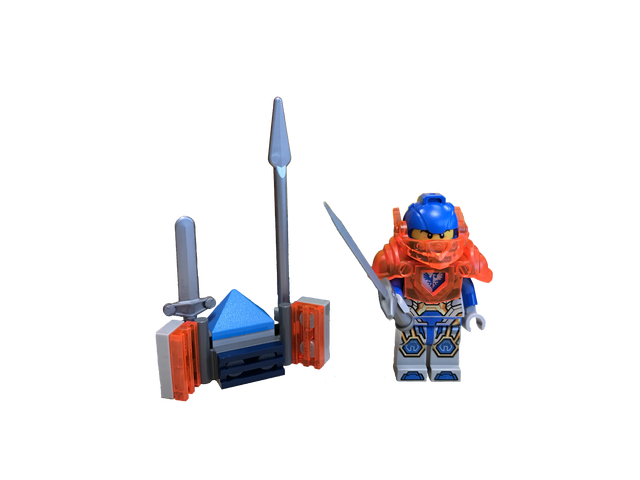
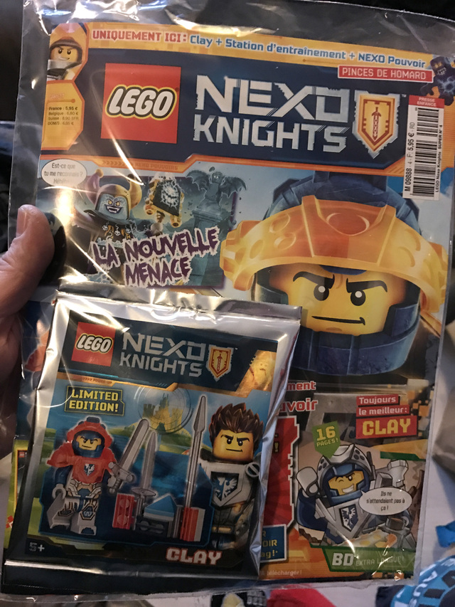
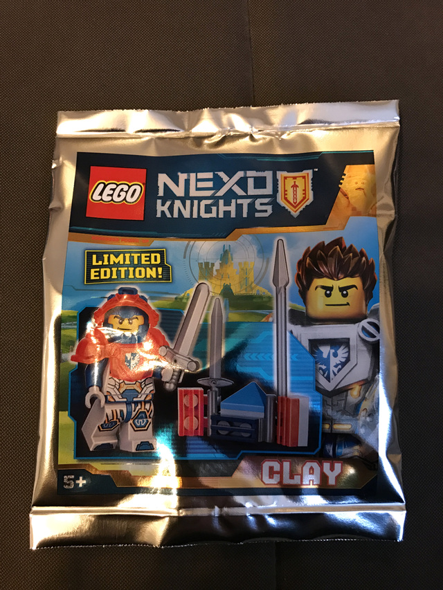
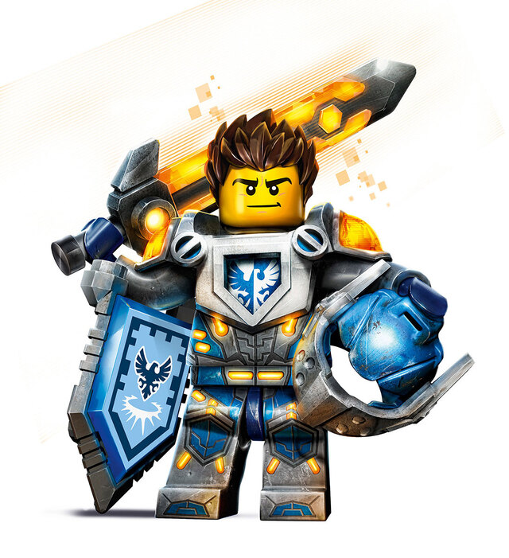
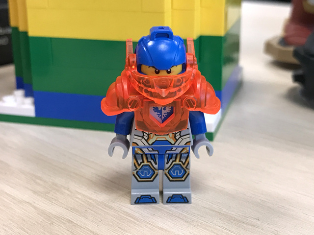
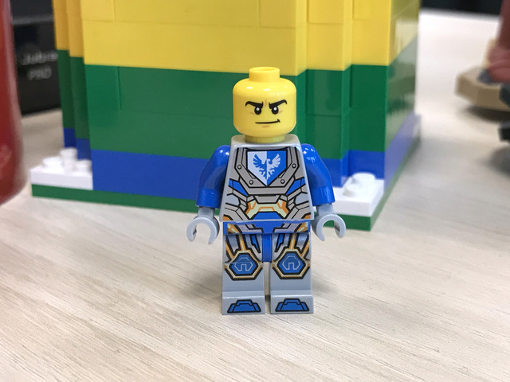
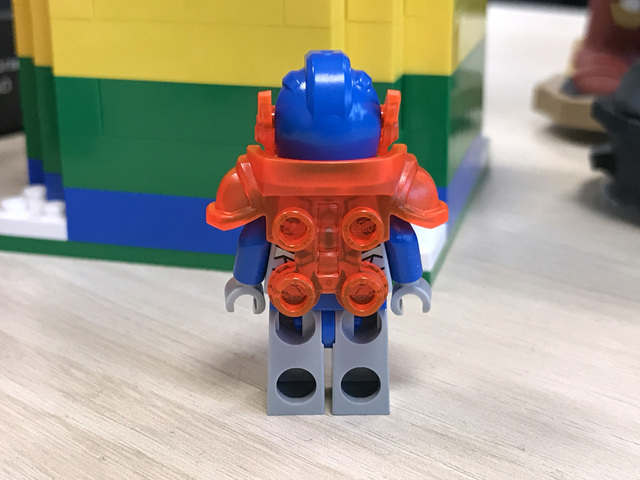
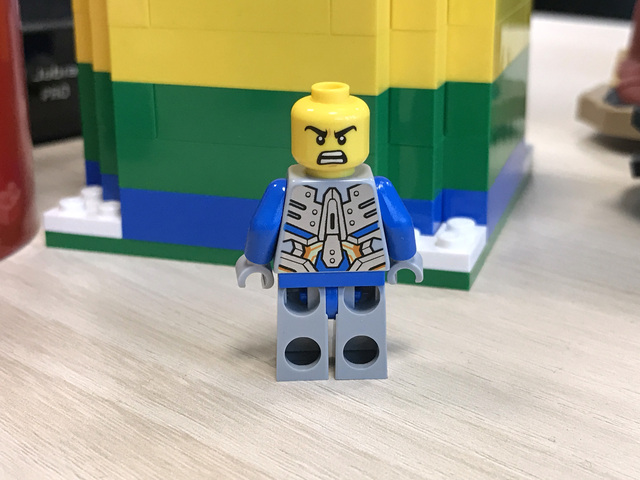
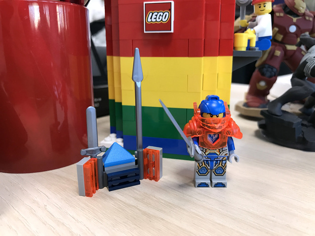

Aujourd’hui je vous propose la review de la figurine **Clay** dans la gamme _Nexo Knight_.

Cette figurine est offerte avec le magazine _LEGO Nexo Knight_ actuellement vendu en kiosque.

* * *

Voici le magazine (février 2017) où est offert cette figurine _Limited Edition_ de **Clay**.

La pochette (polybag ?) contenant la minifig.

* * *

-   **Clay**

> Description : _Héros le plus brave de tous les temps_  
> Arme : _Épée Claymore à une main_  
> Véhicules : _Lame vrombissante_  
> Talents : _Le sauvetage, l’entraînement, le commandement_  
> N’aime pas : _Ne pas s’entraîner, improviser des farces avant le combat_  
> Aime : _Le code des chevaliers, les vidéos d’entraînement_
> 
> **Clay** a toutes les qualités d’un chevalier. Cet orphelin a passé toutes ses journées à s’exercer pour en devenir un. Maintenant que son rêve s’est réalisé, il passe ses journées à s’entraîner aux attaques, à apprendre de nouvelles compétences ou à lutter contre le mal. La nuit, il rêve des actes héroïques qu’il accomplira le lendemain.

Source _[LEGO.com](https://www.lego.com/fr-fr/nexoknights/characters/clay-8f7547831eee4e69a18a99dc85b547cc)_.

* * *

Très belle réalisation pour cette version de **Clay**, son armure _Trans-Neon Orange_ et le mélange des couleurs (gris/bleu) utilisées amènent un peu de fantaisie par rapport à la version toute bleue _Ultimate Clay_ (lire la review _[ICI](http://www.freelug.org/spip.php?article2219&var_mode=calcul)_).  
Nous avons le droit à un double visage, j’aime beaucoup le rendu sur la face avant, facilement réutilisable pour des MOC ou des versions custom. Les sérigraphies sont impeccables avec pas moins de six couleurs utilisées.

Au verso, encore une fois de superbes sérigraphies. Le visage alternatif énervé est lui aussi très sympa et facilement réutilisable.

Voici **Clay** mis en situation avec son râtelier d’arme.

* * *

**CONCLUSION :**

Très belle réussite pour cette version de **Clay**. Les accessoires fournis dans le sachet sont bienvenus.  
Bref, une belle figurine exclusive pour pas cher, les collectionneurs vont être contents.
