La Jeep Wrangler est mythique pour tous les fans de Jurassic Park, mais ici c’est une version plus civil.

[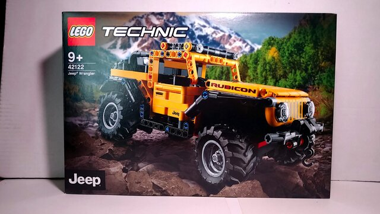](https://www.freelug.org/IMG/jpg/dsc_2034.jpg)

Le set comprend 665 pièces . Pour un prix de 49,99€ soit un rapport prix/pièces de 0,75Euros, c’est pas trop mal pour un set à licence.  
Une petite vue arrière donne une idée de la jouabilité du set :

[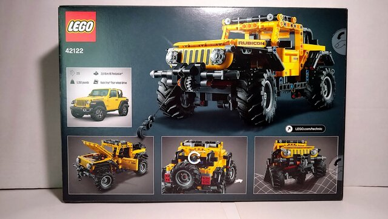](https://www.freelug.org/IMG/jpg/dsc_2036.jpg)

Venons au principal : le contenu de la boite : 4 sachet, des pneus et un petit sticker

[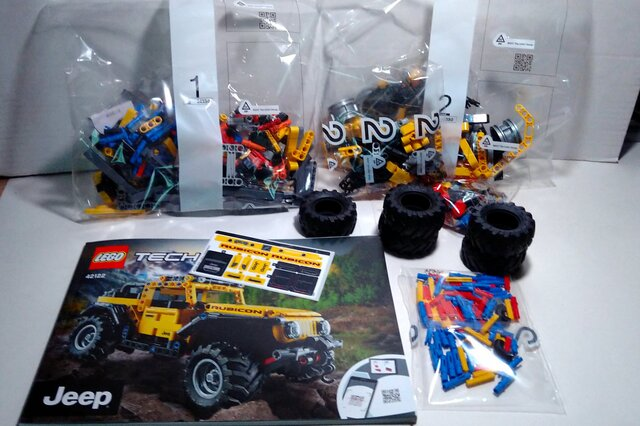](https://www.freelug.org/IMG/jpg/dsc_2038.jpg)

Et voilà une petite feuille de stickers !

[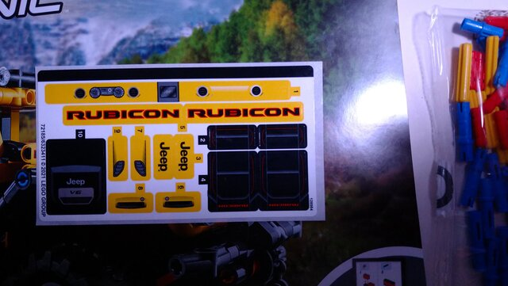](https://www.freelug.org/IMG/jpg/dsc_2039.jpg)

Commençons par le début : le système de direction :

[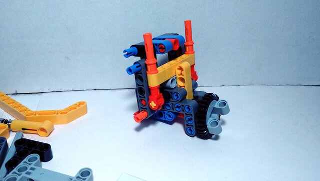](https://www.freelug.org/IMG/jpg/dsc_2041.jpg)

Puis la structure interne :

[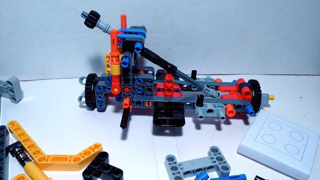](https://www.freelug.org/IMG/jpg/dsc_2042.jpg)

[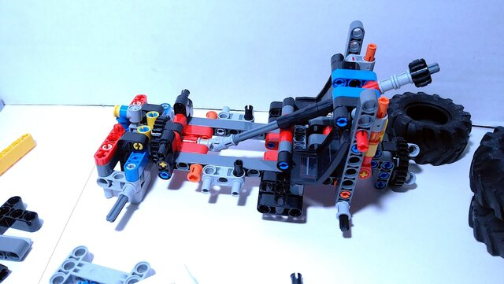](https://www.freelug.org/IMG/jpg/dsc_2043.jpg)

[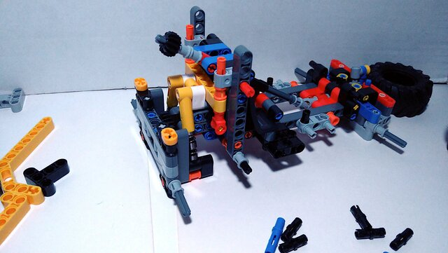](https://www.freelug.org/IMG/jpg/dsc_2044.jpg)

Une vue rapprochée du capot avec les pièces sérigraphiées :

[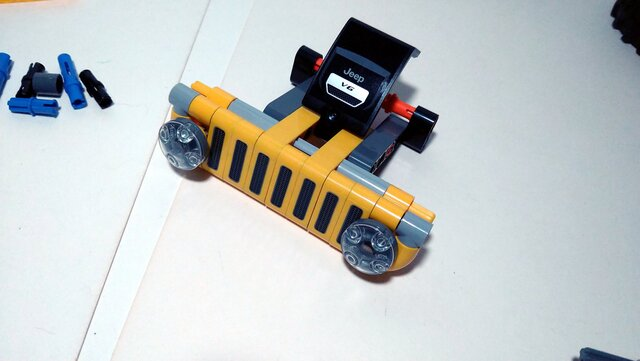](https://www.freelug.org/IMG/jpg/dsc_2045.jpg)

On continue sur la carcasse avec les portes puis le capot.

[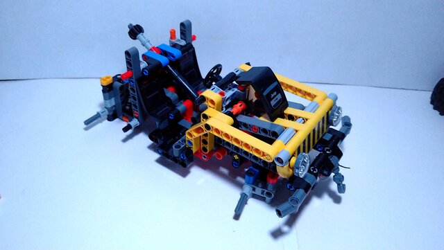](https://www.freelug.org/IMG/jpg/dsc_2046.jpg)

[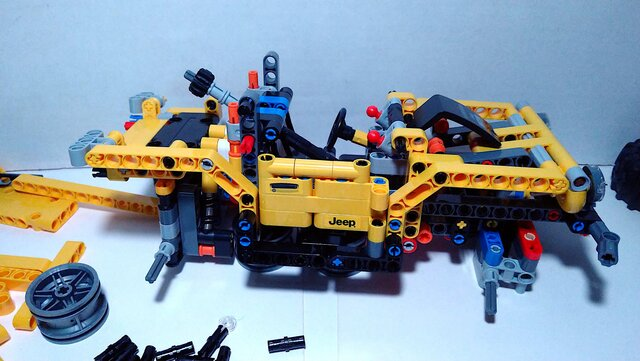](https://www.freelug.org/IMG/jpg/dsc_2047.jpg)

[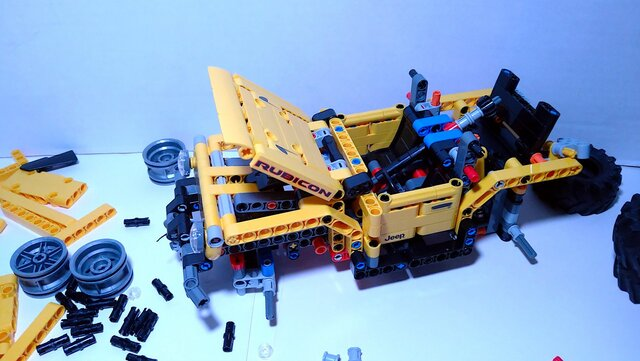](https://www.freelug.org/IMG/jpg/dsc_2048.jpg)

Voilà deux vues du set complètement assemblé :

[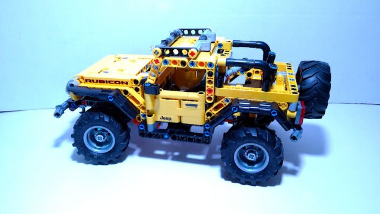](https://www.freelug.org/IMG/jpg/dsc_2050.jpg)

[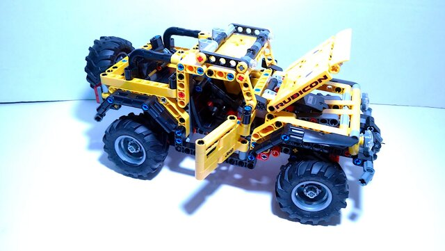](https://www.freelug.org/IMG/jpg/dsc_2052.jpg)

**Conclusion**  
Que dire : ben , le set assemblé n’est pas si ressemblant par rapport au véhicule réel. En plus, la fin de la notice avec les éléments publicitaires et la photo de la vraie Jeep fait mal.  
Mais pour, je reste sur un avis tranché : une belle Jeep, bien agréable à construire.

Allez, en bonus : voici une mise en valeur de l’ensemble !

[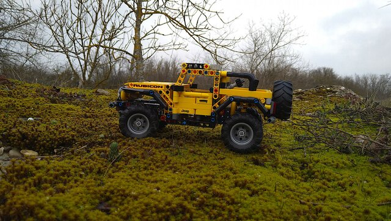](https://www.freelug.org/IMG/jpg/dsc_2057.jpg)
