La plus petite boite de la gamme Toy Story 4, à 10€, ça donne donc quoi ?

[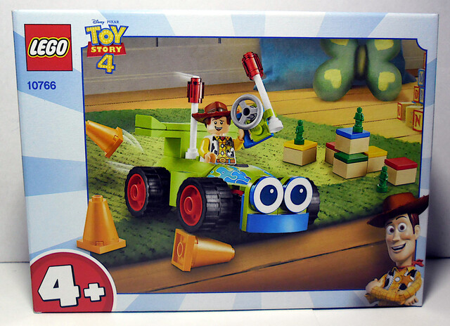](https://www.freelug.org/IMG/jpg/sam_3832.jpg)

Le set comprend 69 pièces avec un personnage. Pour un prix de 10€ soit un rapport prix/pièces de 0,145 euros, c’est pas très cher dans cette gamme .

Une petite vue arrière donne une idée de la jouabilité du set :

[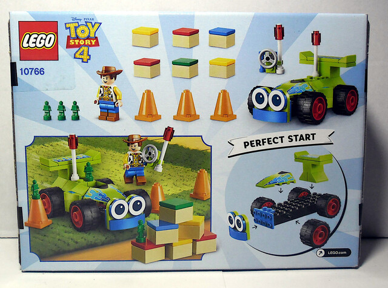](https://www.freelug.org/IMG/jpg/sam_3833.jpg)

Venons au principal : le contenu de la boite :

[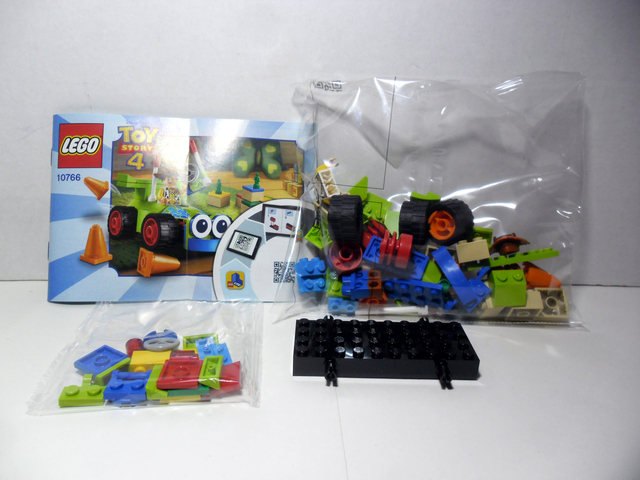](https://www.freelug.org/IMG/jpg/sam_3834.jpg)

Oh les jolies pièces tampographiées :

[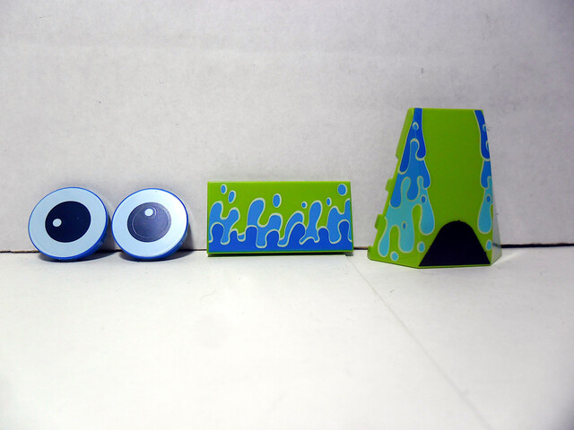](https://www.freelug.org/IMG/jpg/sam_3838.jpg)

Et voilà pour commencer Woody (et les soldats verts) :

[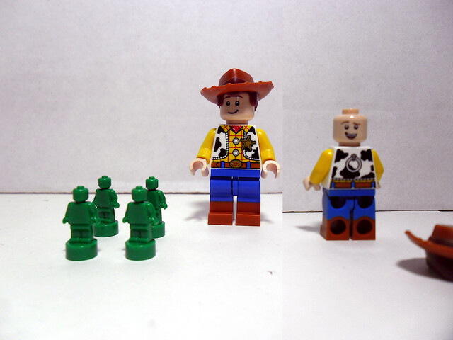](https://www.freelug.org/IMG/jpg/sam_3835.jpg)

La construction avance assez vite : La télécommande

[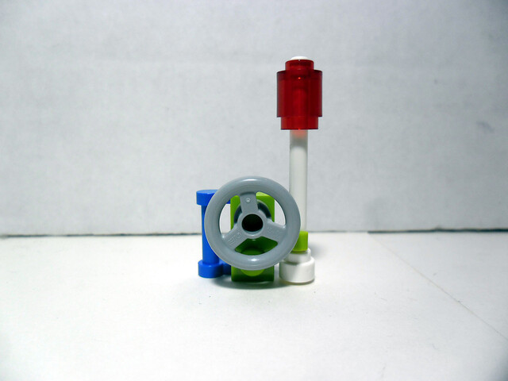](https://www.freelug.org/IMG/jpg/sam_3839.jpg)

Puis les cônes oranges :

[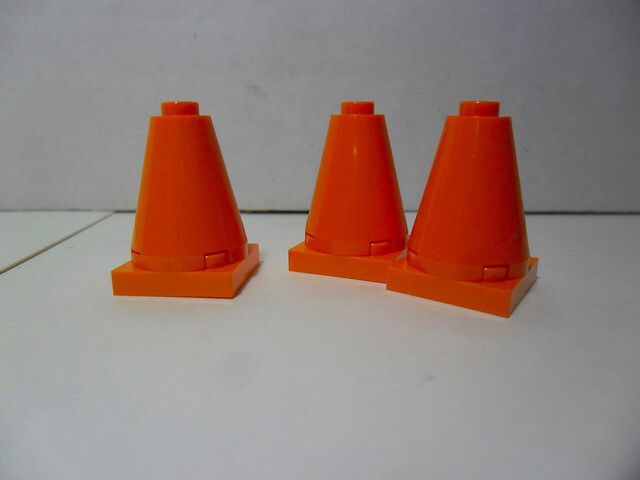](https://www.freelug.org/IMG/jpg/sam_3840.jpg)

Des caisses :

[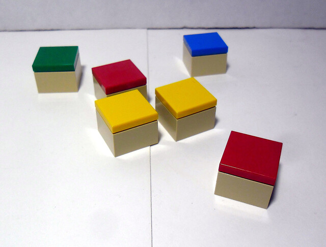](https://www.freelug.org/IMG/jpg/sam_3841.jpg)

Et pour finir le RC :

[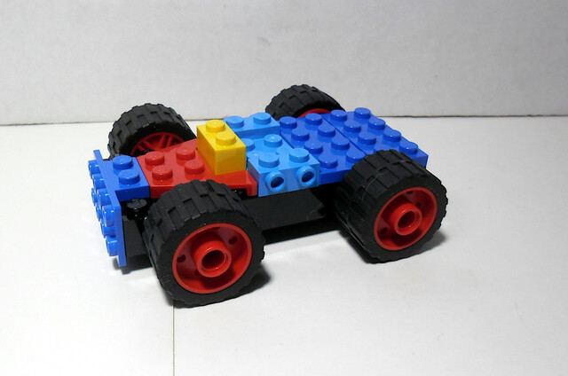](https://www.freelug.org/IMG/jpg/sam_3842.jpg)

[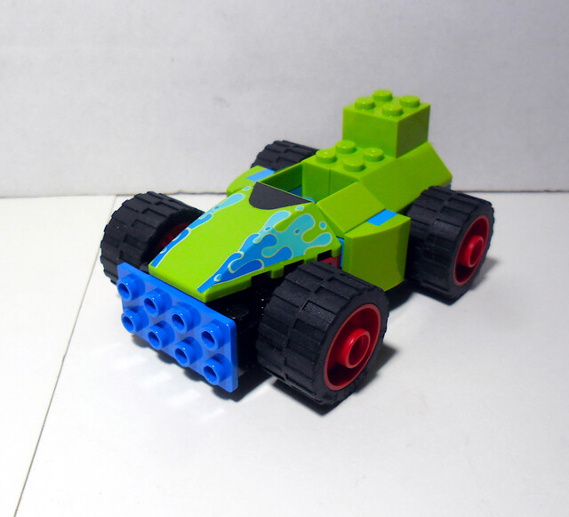](https://www.freelug.org/IMG/jpg/sam_3843.jpg)

[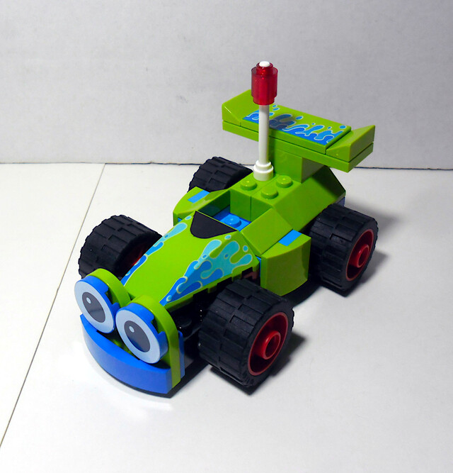](https://www.freelug.org/IMG/jpg/sam_3844.jpg)

Voilà fini, une petite photo de famille !

[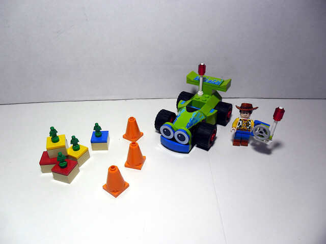](https://www.freelug.org/IMG/jpg/sam_3846.jpg)

**Conclusion**  
Que dire : pour adulte, c’est encore un set qui se construit très vite. Après, il est jouable, mais bon...

Post-Scriptum :

Donc un petit set pour les jeunes, même s’il y a sûrement mieux.
