Une nouvelle boite dans la gamme Toy Story à 35 €, ça donne donc quoi ?

[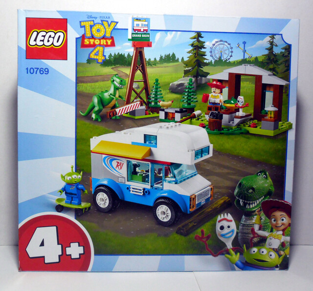](https://www.freelug.org/IMG/jpg/sam_3643.jpg)

Le set comprend 178 pièces avec deux personnages, un dinosaure. Pour un prix de 35 € soit un rapport prix/pièces de 0,197 euros, c’est cher diront certains. Mais c’est finalement dans la moyenne de la gamme.

Une petite vue arrière donne une idée de la jouabilité du set :

[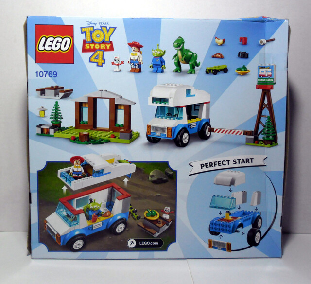](https://www.freelug.org/IMG/jpg/sam_3644.jpg)

Venons au principal, le contenu de la boite :

[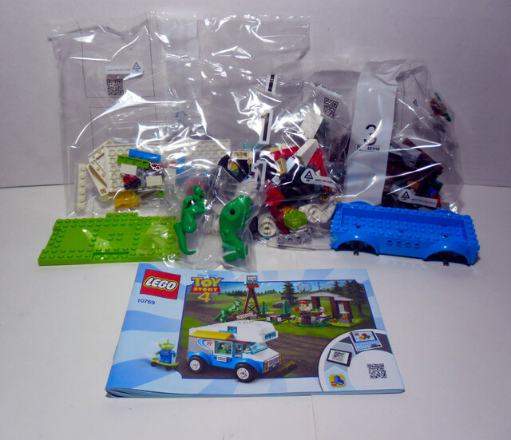](https://www.freelug.org/IMG/jpg/sam_3645.jpg)

Oh la jolie métapièce, bien énorme : le châssis du camping-car

[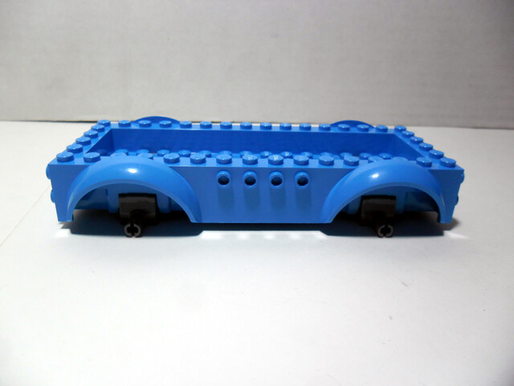](https://www.freelug.org/IMG/jpg/sam_3646.jpg)

Et voilà pour commencer Jessie :

[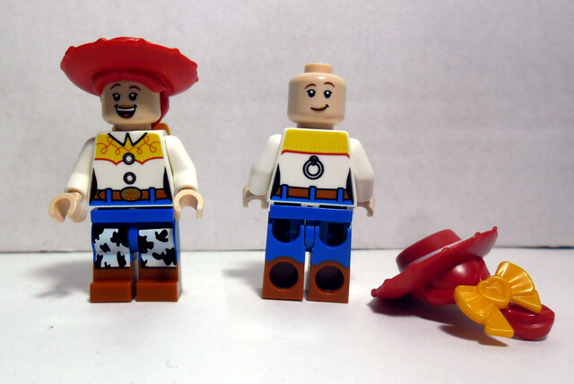](https://www.freelug.org/IMG/jpg/sam_3648.jpg)

Puis Rex :

[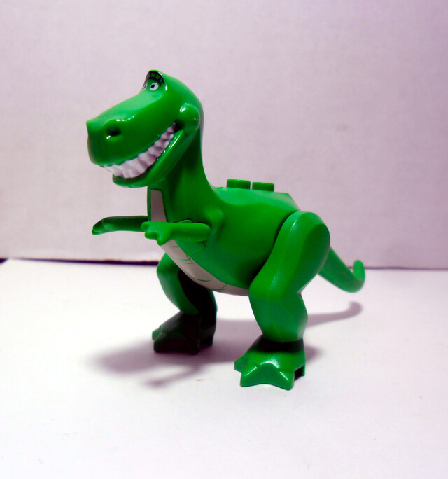](https://www.freelug.org/IMG/jpg/sam_3652.jpg)

Et, pour finir, Alien avec Forky :

[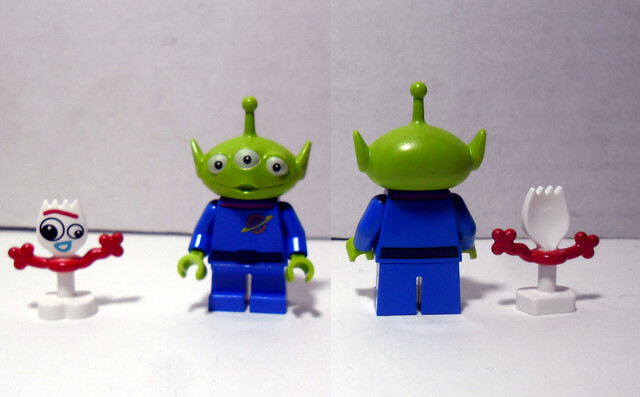](https://www.freelug.org/IMG/jpg/sam_3657.jpg)

La construction avance assez vite : Le camping-car

[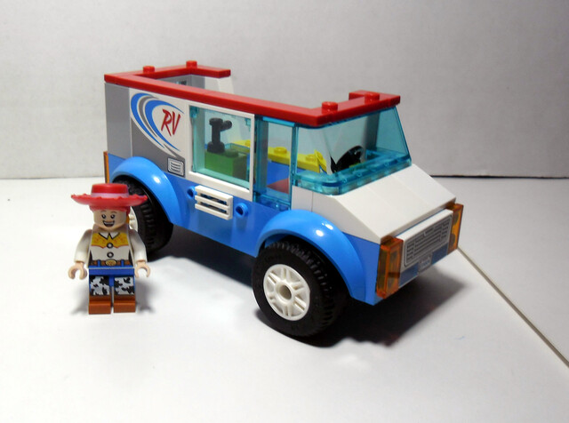](https://www.freelug.org/IMG/jpg/sam_3650.jpg)

[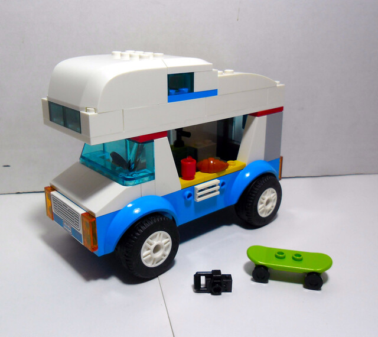](https://www.freelug.org/IMG/jpg/sam_3654.jpg)

Puis une petite barrière :

[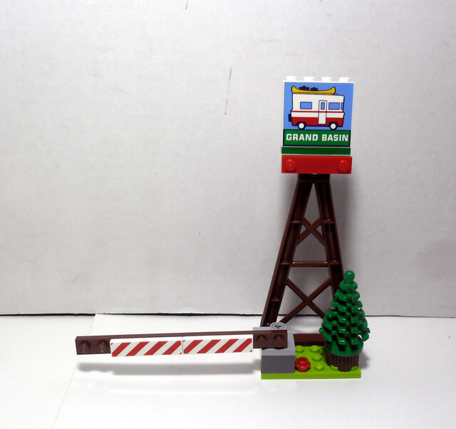](https://www.freelug.org/IMG/jpg/sam_3655.jpg)

Et pour finir le mini-chalet :

[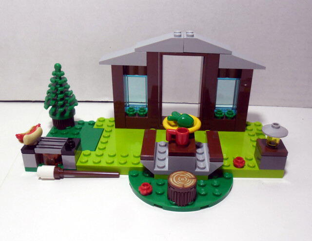](https://www.freelug.org/IMG/jpg/sam_3659.jpg)

Voilà fini, une petite photo de famille !

[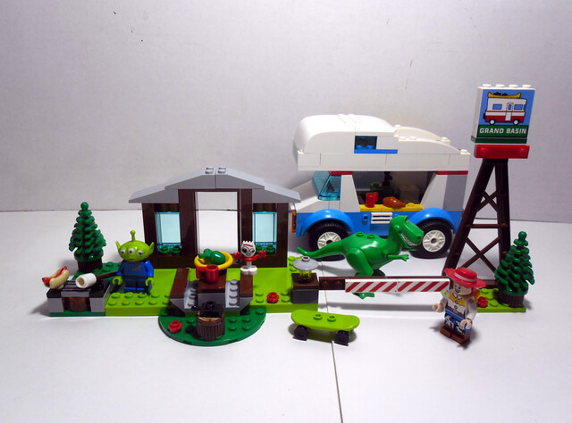](https://www.freelug.org/IMG/jpg/sam_3660.jpg)

Et pour terminer les extra parts :

[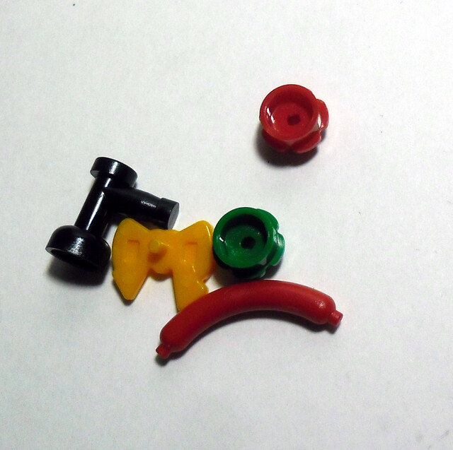](https://www.freelug.org/IMG/jpg/sam_3663.jpg)

**Conclusion**  
Que dire : pour adulte, c’est encore un set qui se construit très vite. Après, il est jouable, mais bon...  
L’ayant acheté à -50%, le Rex manquait à ma collection, et le reste c’est du bonus...

Nota : "Grand Basin" sur le panneau est-elle une photo ? N’ayant pas vue le film, mystère...
