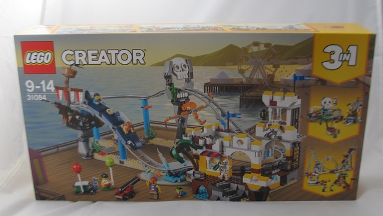
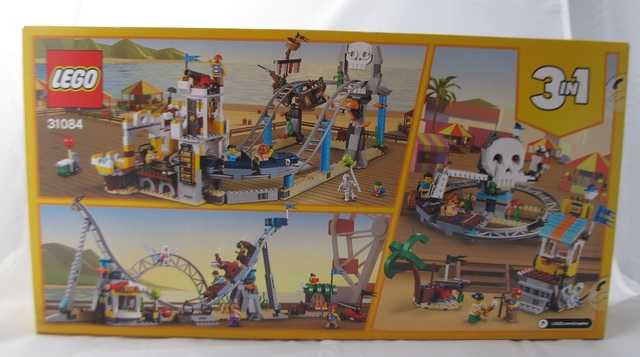
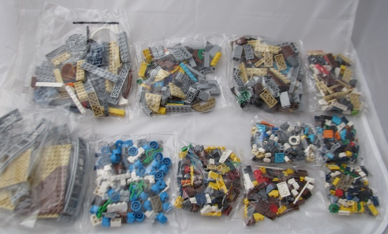
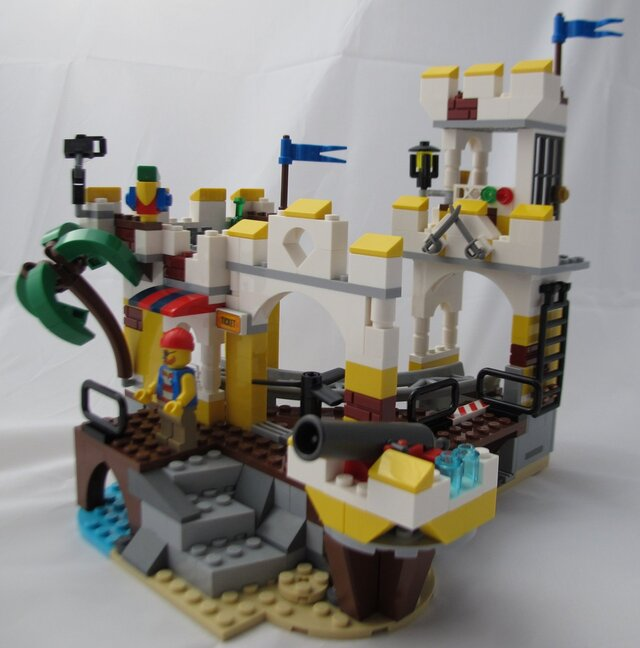
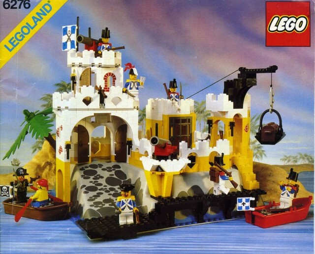
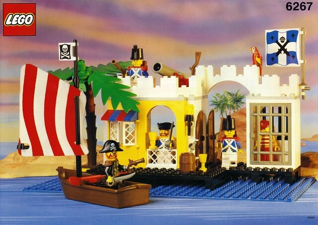
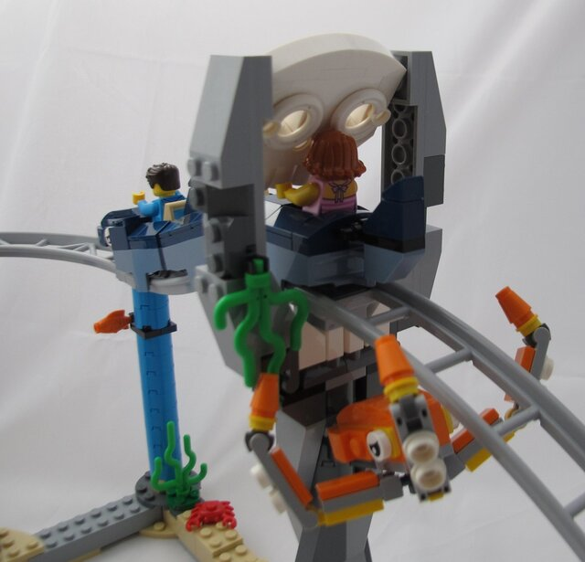
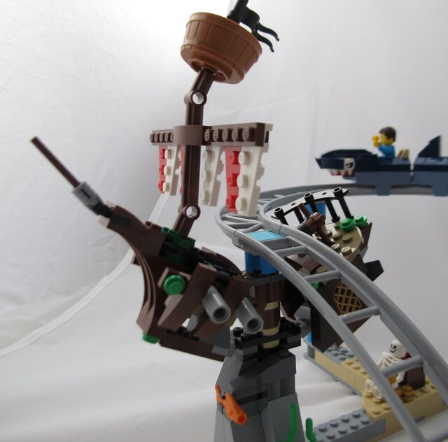
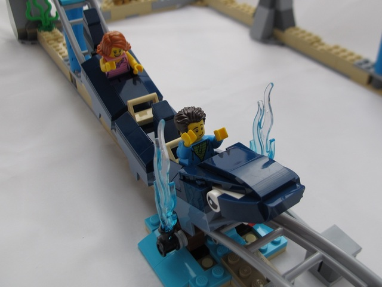
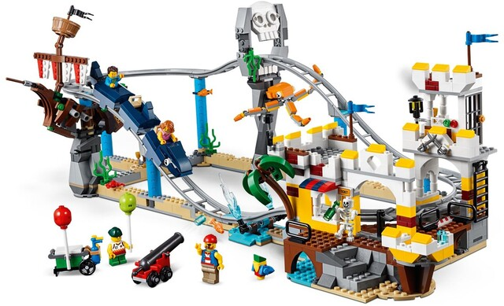

L’actualité de ces deux dernières semaines sur les blogs LEGO faisait la part belle au [Roller Coaster 10261](https://brickset.com/sets/10261-1/Roller-Coaster), qui leur était remis gracieusement par LEGO afin d’en faire la promotion... Et du coup, son petit frère le _Pirate Roller Coaster_ est passé sous silence. Plus humblement donc, j’en propose ici donc une revue.

**–** Référence : 31084  
**–** Nom : Pirate Roller Coaster  
**–** Année : 2018  
**–** Nombre de pièces : 923  
**–** Prix : 84,99 €

Classiquement pour la gamme Creator 3-1, la boite propose trois montages différents, dont le principal un Roller Coaster, et deux autres manèges en alternatif, tous sur le thème des Pirates.

Les 12 sachets sont non numérotés, et le montage se fait d’un seul tenant, prévoyez la place avant de construire !

Contrairement au grand Roller Coaster, celui-ci est thématique et les voyageurs vont pouvoir évoluer au milieu d’un décor Pirates. Et c’est bien sur cet aspect que je vais porter mon attention.

La base principale, ici un fort, rappellera sans conteste la gamme Pirates de 1989-1991. Tout d’abord, la sélection des couleurs, le blanc et jaune, avec quelques touches de briques apparentes en Dark Red, telles les sérigraphies de l’époque.

De [l’Eldorado Fortress](https://brickset.com/sets/6276-1/Eldorado-Fortress), on retrouve le pas de tir du canon qui reprend un montage très similaire. On a également les slopes 1x2 surmontées d’une arche 1x4.

Enfin, le store du guichet est un écho à peine caché du [Lagoon Lock-Up 6267](https://brickset.com/sets/6267-1/Lagoon-Lock-Up)

Le montage s’est donc accompagné d’une petite nostalgie (cette gamme Pirates fait partie de mon enfance), et j’y ai pris à vrai dire du plaisir. Plaisir non atténué par un usage de briques relativement classiques (le propre de la gamme Creator) plutôt que des pièces ultra spécifiques.  
Même si on aurait préféré un vrai palmier, ce petit modèle "brickbuilt" ne manque pas de charme, tout comme le perroquet en 6 pièces.  
Le canon (à eau !) peut prendre position en 3 lieux différents sur le fort.

Le reste du circuit est agrémenté d’autres éléments.

Tout d’abord une pieuvre (ou calamar) géante dont les tentacules viennent embrasser les rails.  
Elle est surmontée d’un crane qui doit donner... un mal de crane aux passagers qui se le prennent en pleine tête !

Que seraient des pirates sans bateau ?

Et enfin, pour la petite photo souvenir, des jets d’eau sont actionnés au passage du train (petit conseil, ne pas trop serrer les pièces Technic pour le bon fonctionnement).

Le train, lui, prend l’apparence d’un requin.

Le set s’accompagne de 4 figurines (2 adultes, 1 enfant et un pirate), ainsi que d’un squelette.

Le montage global se fait sans difficulté, et est visiblement bien loin du montage répétitif de son grand frère.

Il ne faut surtout pas se fier à l’effet wahou du poids de la boite, ce sont juste les 320 pages de la notice (un seul livret pour les 3 modèles).

Et en terme de jouabilité ? Ici, pas de mécanisme ou de chaine pour véhiculer le train. Tout se fait à la main, et malheureusement, il faut un peu trop pousser pour faire faire le tour complet. On se lassera très vite.

Et si, pour le prix du grand Roller Coaster (350€), on prend 4 Roller Coaster Pirate (4x85 = 340€) pour essayer de faire quelque chose de grand ? L’idée pourrait être bonne, mais il manque crucialement de rails droits et sections inclinées droites pour varier le circuit. Avec juste des courbes et des changements d’inclinaison, les combinaisons sont vite limitées.

Ca n’en reste pas moins un petit coup de coeur, et je tenais à redonner un peu de visibilité à celui-ci face au grand Roller-Coaster.
